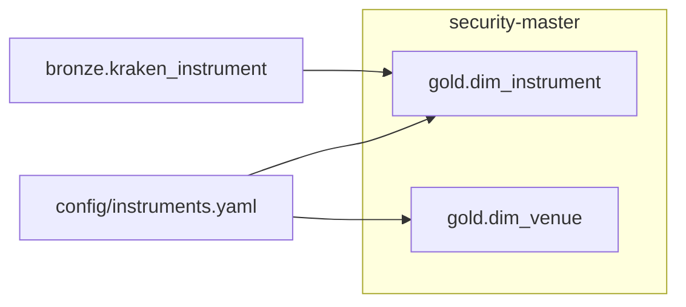

<!-- Generated by `k2gen generate` from contracts/. Do not edit: change the contract, then `make generate`. -->
# security-master

The instrument and venue dimensions, Kimball type-2, so an attribute can be read as it stood at a trade's timestamp. Not rebuildable from silver: nothing else holds the history (ADR-030).

| | |
|---|---|
| Domain | [reference-data](../README.md#reference-data) |
| Owner | `reference-data-team` |
| Kind | source-aligned |
| Lifecycle | draft |
| Status | running |
| Descriptor | [`contracts/reference-data/security-master/product.yaml`](../../../contracts/reference-data/security-master/product.yaml) |

## Inputs and outputs

| Input | What it is |
|---|---|
| `config/instruments.yaml` | external source, classified public. The instrument registry: instruments, symbols and book depth per venue. |
| `bronze.kraken_instrument` | an output of [market-capture/venue-frames](../market-capture/venue-frames.md) |

Known readers outside the contracts:

- notebooks/k2lake.py

## gold.dim_instrument

Security master, type-2: one row per validity interval per instrument, joined as of a timestamp on (exchange, canonical_symbol).

| | |
|---|---|
| Status | running |
| Classification | internal |
| Entitlement | none |
| Retention | snapshots expire after 7 days; no row is deleted ([ADR-032](../../../docs/adr/ADR-032-odcs-contracts-and-k2gen.md)) |
| Partitioning | `exchange` |
| Sort | `canonical_symbol`, `valid_from` |
| Schedule | `1-59/5 * * * *` |
| Reads | `config/instruments.yaml`, `bronze.kraken_instrument` |
| Contract | [`gold.dim_instrument.odcs.yaml`](../../../contracts/reference-data/security-master/gold.dim_instrument.odcs.yaml), version 1.0.0 |
| DDL | [`docker/lake/ddl/lake.sql`](../../../docker/lake/ddl/lake.sql) |

| Column | Type | Description |
|---|---|---|
| `instrument_id` | `STRING NOT NULL` | Deterministic surrogate: first 32 hex of sha256(exchange \| 0x1F \| canonical_symbol). Stable across a rebuild and across a native-symbol rename |
| `exchange` | `STRING NOT NULL` | With canonical_symbol, the natural key |
| `canonical_symbol` | `STRING NOT NULL` | BASE/QUOTE. Unique per exchange: tests/test_contracts.py asserts it, which is what makes this a key |
| `symbol` | `STRING NOT NULL` | native, byte for byte as the venue spells it. Tracked: a rename opens a new version, not a new instrument |
| `base` | `STRING NOT NULL` |  |
| `quote` | `STRING NOT NULL` |  |
| `book_depth` | `INT NOT NULL` | The L2 subscription depth in force: the per-instrument override or the venue default |
| `subscribed` | `BOOLEAN NOT NULL` | Present in config/instruments.yaml as of this version. An instrument that leaves the registry gets a subscribed = false version, never a delete: deleting would make historical facts unjoinable |
| `tick_size` | `DECIMAL(28,10)` | Venue-published. Kraken only, from bronze.kraken_instrument data.pairs[]. NULL on Binance and Coinbase, which publish it over REST that K2 does not capture: `source` disambiguates |
| `qty_increment` | `DECIMAL(28,10)` | Venue-published, Kraken only |
| `price_precision` | `INT` | Venue-published, Kraken only. The precision silver.book_kraken verifies checksums at |
| `qty_precision` | `INT` | Venue-published, Kraken only |
| `venue_status` | `STRING` | Venue-published trading status (Kraken: online, cancel_only, post_only, limit_only, reduce_only). NULL where not captured |
| `source` | `STRING NOT NULL` | Which authority supplied the venue attributes on this version: registry (they are NULL) or venue:kraken |
| `attr_hash` | `STRING NOT NULL` | sha256 over the tracked attributes, canonically serialised: fixed field order, 0x1F separator, NULL as 0x00. Adding a tracked attribute rewrites every hash and opens a version for every instrument, once |
| `valid_from` | `TIMESTAMP NOT NULL` | Effective from, inclusive |
| `valid_to` | `TIMESTAMP NOT NULL` | Effective to, exclusive. Open rows carry the sentinel 9999-12-31 23:59:59, never NULL |
| `is_current` | `BOOLEAN NOT NULL` | valid_to = the sentinel. Derivable, kept because it is the predicate every consumer writes and it pushes down |
| `recorded_at` | `TIMESTAMP NOT NULL` | When K2 learned it. Equal to valid_from for a registry change; valid_from < recorded_at is a backfill, and is the only as-known-at axis this table has |

## gold.dim_venue

Venue dimension, type-2: one row per validity interval per venue.

| | |
|---|---|
| Status | running |
| Classification | internal |
| Entitlement | none |
| Retention | snapshots expire after 7 days; no row is deleted ([ADR-032](../../../docs/adr/ADR-032-odcs-contracts-and-k2gen.md)) |
| Partitioning | `exchange` |
| Sort | none |
| Schedule | `1-59/5 * * * *` |
| Reads | `config/instruments.yaml` |
| Contract | [`gold.dim_venue.odcs.yaml`](../../../contracts/reference-data/security-master/gold.dim_venue.odcs.yaml), version 1.0.0 |
| DDL | [`docker/lake/ddl/lake.sql`](../../../docker/lake/ddl/lake.sql) |

| Column | Type | Description |
|---|---|---|
| `venue_id` | `STRING NOT NULL` | Deterministic surrogate: first 32 hex of sha256(exchange) |
| `exchange` | `STRING NOT NULL` | The natural key |
| `book_depth` | `INT NOT NULL` | Default L2 depth. 0 = the venue sends the whole book (Coinbase) |
| `instruments` | `INT NOT NULL` | How many instruments are subscribed. Tracked, so adding an instrument opens a venue version too |
| `subscribed` | `BOOLEAN NOT NULL` | Present in config/instruments.yaml as of this version. A venue that leaves gets a subscribed = false version, never a delete |
| `source` | `STRING NOT NULL` | registry. No venue publishes its own row |
| `attr_hash` | `STRING NOT NULL` | sha256 over the tracked attributes, as dim_instrument |
| `valid_from` | `TIMESTAMP NOT NULL` | Effective from, inclusive |
| `valid_to` | `TIMESTAMP NOT NULL` | Effective to, exclusive. Open rows carry the sentinel 9999-12-31 23:59:59, never NULL |
| `is_current` | `BOOLEAN NOT NULL` |  |
| `recorded_at` | `TIMESTAMP NOT NULL` | When K2 learned it |
