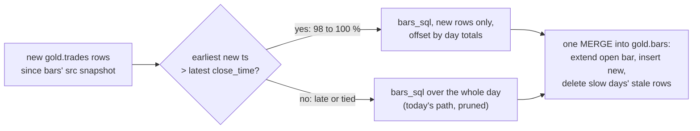

# Incremental bars recompute: where the gold step's time and memory go, and what to change

**Date:** 2026-11-26 (measurements from the 2026-11-25 UTC ingest runs)
**Question:** the step of each five-minute ingest run that builds candles and event bars takes
most of the run, grows through the UTC day, and crashed out of memory on 2026-11-25. Where do
its seconds and its memory go, and which redesign makes the cost follow what a run adds?
**Status:** proposed as two ADRs.
[ADR-048](../adr/ADR-048-gold-step-reads-touched-data-writes-bars-once.md) is "stage 1" in this
note; [ADR-049](../adr/ADR-049-event-bars-extended-not-recomputed.md) is "stage 2". The owner's
two decisions of 2026-11-26 are folded in (section 5).
A design review the same day changed several conclusions of sections 4 to 6; section 8 records
each change and its evidence, and where the two disagree, section 8 and the ADRs hold.

## In short

- Most of the step's time and memory is waste: it computes the bars twice, reads the whole
  trade table ten times where a few files would do, and moves and sorts every trade more than
  the result needs.
- Removing that waste changes no stored row and no table (stage 1, ADR-048). It also writes the
  bars in one commit, so a crash can no longer leave a day without bars.
- What remains is recomputing each touched day of bars from all of that day's trades, which
  grows from midnight to midnight UTC.
- Almost every batch of new trades arrives after everything already stored, so the stored bars
  can be extended instead (stage 2, ADR-049). That needs one new exact column on `gold.bars`, in
  the lake and in ClickHouse.
- Every "after" number here is an estimate; every measured number has its command in the
  appendix.

## Glossary

| Term | Meaning here |
|---|---|
| ingest run | one execution of `docker/lake/ingest.py`, started by Airflow every five minutes |
| stage 2d, the gold step | the ingest step that builds the gold tables (`gold.trades`, the dimensions, candles `gold.ohlcv_*`, event bars `gold.bars`); code in `docker/lake/gold.py`. The other steps are 1 (Kafka to `raw.messages`), 2b (bronze), 2c (silver trades), 2e (books); ADR-048 has the table |
| event bars | bars closed by a trade count, a traded quantity or a traded dollar value instead of by the clock; `docker/lake/bars.py`, thresholds in `config/bars.yaml` |
| symbol-day | one instrument, on one venue, for one UTC day; bars restart at 00:00 UTC, so it is the unit a run recomputes |
| units before | for one trade, the count, quantity or dollar value of the day's earlier trades; the trade's bar is `floor(units before / threshold)` |
| in-order batch | a run's new trades for one symbol-day whose earliest `exchange_ts` is strictly later than the latest already stored |
| fold | extend the stored bars with an in-order batch: add its trades to the open bar and append the bars that follow, without rereading the day |
| evaluation, cache | a Spark DataFrame is a recipe; each action (count, write) evaluates it from the source tables again, unless Spark substitutes a cached result |
| shuffle | Spark moving rows between tasks so that rows with one key meet in one task, through local disk |
| spill | a task writing sorted runs to disk when it has more rows than memory, merged later |
| heap | the Java memory of the single Spark process (driver and only executor in local mode): 1,536 MiB, of which 741 MiB is lent to running tasks |
| commit, snapshot | an Iceberg commit replaces the table's metadata in one atomic step and creates a snapshot, an immutable numbered version of the table; readers read one whole snapshot |
| pruning | Iceberg skipping partitions and data files whose stored `exchange_ts` range cannot match a filter; only works for a filter comparing the column itself to constants |

Every number below is seconds, bytes, file counts, stage counts or a ratio, read from the
Spark History Server inside `k2-spark-iceberg` or from Trino over the lake, read-only. No
venue price, trade count or row count of live market data appears; where a size matters it is
given in bytes. The commands are in the [appendix](#appendix-commands).

---

## 1. Findings

1. **The bars are computed twice per run. Confirmed.** `fresh.cache(); fresh.count()` builds
   and fills a cache, the DELETE commits, and `fresh.writeTo(...).append()` then plans a
   second evaluation from `gold.trades`: its physical plan has no `InMemoryTableScan` and a
   `BatchScan lake.gold.trades`, in every one of the 11 runs sampled from 07:56 to 21:31 UTC.
   The second evaluation is **43.3 s of the 139 s** of stage 2d's candle and bar steps at
   21:26 (31 %), and 18 % of the whole 242 s run. Why Spark's cache manager did not
   substitute the cached plan is not established here; the fix below does not depend on it.
2. **Every read of `gold.trades` in stage 2d is the whole table, not the day.** Ten scans per
   run (two per candle `MERGE`, four timeframes, plus the two bar evaluations), each reading
   1,133 of 1,133 data files at 21:26 and 632 of 632 at 07:56, zero skipped. The joins compare
   an expression of `exchange_ts` (a bucket start, or `CAST(... AS DATE)`) to the touched
   keys, so no predicate reaches the Iceberg scan, and dynamic partition pruning only fires on
   a join key that is the partition source column itself. The table is partitioned by
   `days(exchange_ts)` and carries full `exchange_ts` metrics: the pruning is available and
   unused.
3. **So the candle cost is linear in the table, not in the day.** The 1m `MERGE` grew from
   7.3 s at 07:56 to 11.7 s at 21:26 while what it recomputes (five minutes of buckets) stayed
   the same size. The four candle `MERGE`s are 47 s of the 139 s. Prediction, not measured:
   this part does not reset at 00:00 UTC; it keeps growing with every day of history.
4. **The heap peak is in the bars, and has two causes.** One bar evaluation is three stages:
   a whole-table scan; a window (running sums) over the day's touched trades, partitioned by
   symbol-day; then a sort-merge join with the threshold table followed by a sort-based
   aggregate. The third stage is the largest: 601 MiB of shuffle, 75 s of task time, its
   largest task 28.9 s with 489 MiB spilled to disk, and the run's highest execution-memory
   peak (560 MiB of a 741 MiB unified pool). It exists for two avoidable reasons: the
   threshold table is built from Python rows with no size statistics, so Spark will not
   broadcast its ~100 rows, and `min_by` / `max_by` over a `struct` ordering key cannot use
   hash aggregation. The window stage, the part that really is the day's recompute, peaks at
   343 MiB of execution memory (431 MiB in the second evaluation) and spills 375 MiB to disk;
   the JVM heap reached 1,276 MiB of 1,536 MiB during the bar stages and 480 to 518 MiB
   during the candle stages.
5. **The incident's failures happened after the DELETE.** The two failed runs sampled (17:46
   and 18:39 UTC, 768m heap) failed in the second evaluation's `append` stage, so each left its
   touched symbol-days with no bars until a later run touched them again. The double
   computation is what put the failure on the wrong side of the DELETE.
6. **Batches arrive in order almost always.** Of every (exchange, symbol) batch on 2026-11-25,
   none started at or before the latest `exchange_ts` already stored for its symbol-day. On
   the other days in the table: 2026-11-24, 2.0 % of Binance symbol-batches tied the stored
   maximum to the timestamp (0 s late, none earlier); 2026-08-28, 0.24 % of Coinbase
   symbol-batches were up to 317 s late; 2026-09-03, none.
7. **A failed bars step is healed by the next run's touched set, not by the bars' own
   state.** The touched days come from the run's silver batch. A retry after a failure past
   `stage_trades` finds `gold.trades` level with silver for the committed range and only
   recomputes days the new data touches, so a symbol-day the DELETE emptied and nothing
   touches again (yesterday's day after a run that straddled 00:00 UTC, an illiquid symbol)
   stays empty until the nightly `bars_parity` flags it. Read from the code; never observed:
   every `bars_parity` and `ohlcv_parity` row in `lake.audit.checks` has passed.
8. **ClickHouse holds bars, by pull only.** `gold.bars` is a `ReplacingMergeTree(computed_at)`
   in `docker/clickhouse/ddl/10-gold-tables.sql`, loaded from the lake by the `iceberg()`
   `INSERT` in `docs/runbooks/clickhouse-rebuild-from-lake.md`, with its columns named. Bars
   never travel on the wire: no Avro schema, no queue table in `20-gold-kafka.sql`, and no
   scheduled pull anywhere in the repo. On the live stack the table is empty (`system.tables`
   `total_bytes` 0, 2026-11-25, about 22:00 UTC).

---

## 2. How stage 2d runs today

`gold.stage()` ([`docker/lake/gold.py`](../../legacy/v3-lake-ingest/lake/gold.py)) appends the new
silver rows to `gold.trades` per venue and returns `minutes`, a lazy DataFrame of distinct
`(exchange, canonical_symbol, minute)` over those batches. Then:

- `stage_ohlcv`: per timeframe, `candles()` joins all of `gold.trades` to the touched
  `window_start` keys, aggregates, and copy-on-write `MERGE`s into `gold.ohlcv_<tf>`.
- `stage_bars`: `__days` = distinct touched `(exchange, canonical_symbol, day)`;
  `_bars()` joins all of `gold.trades` to it on `CAST(exchange_ts AS DATE) = day`, runs
  `bars.bars_sql` (window sums, the threshold join, the bucket aggregate), caches and counts
  it, DELETEs the touched days from `gold.bars`, appends.

`rebuild_bars` and `rebuild` call the same `_bars` and `candles` with every key.

---

## 3. Measured cost per step

`stage2d_cost.py` (appendix) on three runs. Wall seconds are the SQL execution's duration;
input is Spark's bytes read after column pruning; the files column is per `gold.trades` scan.

**21:26 UTC run** (`local-1795641961945`, 1536m heap, 242 s, nothing else running):

| Step | Wall s | Input MiB | Shuffle read MiB | Spill to disk MiB | `gold.trades` files read per scan |
|---|---:|---:|---:|---:|---|
| candle `MERGE` 1m | 11.7 | 517 | 10 | 0 | 1133 of 1133, twice |
| candle `MERGE` 5m | 10.4 | 515 | 3 | 0 | 1133 of 1133, twice |
| candle `MERGE` 1h | 10.8 | 514 | 1 | 0 | 1133 of 1133, twice |
| candle `MERGE` 1d | 14.3 | 514 | 2 | 27 | 1133 of 1133, twice |
| bars, first evaluation (`count`) | 47.6 | 258 | 911 | 1,458 | 1133 of 1133 |
| bars DELETE | 0.4 | 0 | 0 | 0 | none |
| bars, second evaluation (`append`) | 43.3 | 257 | 912 | 1,733 | 1133 of 1133 |
| **candles and bars** | **139** | | | | |

**07:56 UTC run** (`local-1795593362079`, 768m heap, 166 s): candle `MERGE`s 7.3 / 6.8 /
7.3 / 7.8 s over 632 of 632 files; bars 19.6 s + 0.5 s + 17.3 s; 67 s in all, 258 MiB of
shuffle per bar evaluation. Everything outside these steps is flat through the day: 99 s at
07:56, 103 s at 21:26 (run minus steps).

**21:31 UTC run** (`local-1795642262168`, 265 s): the same shape, but its append took 61.6 s
while two other Spark applications ran in the same container (`k2-p4-spike-c`, 21:34:25 to
21:34:56; `k2-p4-spike-e` from 21:38). Not used as a baseline.

**Inside one bar evaluation** (21:26, stages 476 / 478 / 482 of the first evaluation; the
second repeats them as 534 / 536 / 540):

| Stage | Tasks | Task time s | Largest task s | Shuffle | Disk spill | Peak execution memory |
|---|---:|---:|---:|---|---|---|
| scan, join to `__days`, shuffle by symbol-day | 286 | 18.7 | 1.1 | 310 MiB written | 0 | 8 MiB per task |
| window sums | 7 | 20.9 | 8.2 | 310 MiB read, 601 MiB written | 375 MiB (177 largest task) | 343 MiB stage |
| threshold sort-merge join, sort aggregate | 200 | 75.0 | 28.9 | 601 MiB read | 1,083 MiB (489 largest task) | 560 MiB stage |

The window stage has 7 tasks because each holds one symbol-day hash bucket: its largest task
is the busiest symbol's day, which is what grows from 00:00 to 24:00 UTC. The third stage
shuffles every windowed row again only to meet a threshold table of about a hundred rows.

**Candles** evaluate their `MERGE` source twice, both whole-table scans: once in a job
submitted from a broadcast future (where the copy-on-write `MERGE`'s runtime filter picks
which target files to rewrite) and once for the write. The 1d `MERGE` costs barely more than the 1m one (14.3 against
11.7 s): the scan dominates, not the size of the bucket.

**The DELETE** costs 0.4 to 0.6 s: the files it removes hold only the touched days' bars
(the previous run's output), so its rewrite plan is empty. `gold.bars` is 18 files, 845 KB,
with no duplicate key.

**What today's table holds.** `gold.trades` is 1,142 data files and 422 MB at 21:40 UTC;
today's partitions are 569 files, 185 MB (44 % of the bytes). Today's files each cover one
run's 5 minutes of `exchange_ts` (median span 299 s; the widest spans 6.1 h), so a 5-minute
range overlaps two or three files per venue and an hour about twelve (from the spans, not
from a scan).

---

## 4. Options

Each option against: correctness, cost, risk, ADR-029's parity contract, crash safety
(today two commits, DELETE then append, with no transaction across them), and rebuild.

### (a) Evaluate the bars once

Materialise `fresh` before the DELETE with an eager `localCheckpoint()` (an RDD checkpoint in
the driver's block manager, which Spark's cache manager cannot drop or fail to substitute),
then DELETE, then append the checkpointed frame, and take the row count from the commit
summary (`added_records`, the pattern `rebuild_bars` and the README's "nothing is cached"
section already use). The frame is the bars, about 1.2 MiB at 21:26, not a payload.

- *Correctness:* identical rows; the plan changes, the SQL does not.
- *Cost:* removes the second evaluation, 43.3 s at 21:26 (measured). The append then writes
  about a megabyte (estimate: under 2 s).
- *Crash safety:* better than today. The evaluation, which is where the incident's OOM struck,
  now happens before the DELETE, so a failure leaves the old bars in place; the window between
  the two commits shrinks from a full evaluation (17 to 62 s measured) to one small append.
  The owner chose to close it in stage 1 as well: next subsection.
- *Parity, rebuild:* unchanged.
- *Risk:* none found. "Write then count from the summary" alone would also compute once, but
  keeps the evaluation after the DELETE.

### (a2) One commit per run (owner decision: in stage 1)

Replace DELETE-then-append with one statement that replaces the touched symbol-days, so a
reader, a crash or a kill sees either the old day or the new one. Three forms, in order of
preference; none is verified on this stack, and the one used is the first that passes a
rehearsal on a scratch table in `lake.scratch_p4` (section 6):

1. **`MERGE` with `WHEN NOT MATCHED BY SOURCE`.** `MERGE INTO gold.bars t USING <checkpointed
   bars> s ON <the five key columns> WHEN MATCHED THEN UPDATE SET * WHEN NOT MATCHED THEN
   INSERT * WHEN NOT MATCHED BY SOURCE AND (t.exchange, t.canonical_symbol, t.day) IN
   (<touched days, as literals>) THEN DELETE`. One copy-on-write commit that rewrites only the
   files holding touched days; the `BY SOURCE` clause makes Spark join against the whole
   target, which is 845 KB today. Spark 3.5's grammar has the clause; whether Iceberg 1.8.1's
   row-level rewrite accepts it is the open point. It is also the statement stage 2 extends,
   and DuckDB 1.4.4 runs the same clause (appendix), so CI can hold its semantics.
2. **`writeTo(gold.bars).overwritePartitions()`** with the touched days' fresh bars plus the
   untouched rows of the same `(exchange, months(open_time))` partitions, read from the table
   and checkpointed into the same frame. Dynamic partition overwrite is one commit and long
   supported, and it keeps the `snapshot-property` write options; the cost is rewriting a
   month of bars per touched venue on every run (estimate: a few MB at month end).
3. **Fallback: a branch, then a fast-forward.** Reset a branch of `gold.bars` from `main`,
   run today's DELETE and append on the branch, then `CALL lake.system.fast_forward('gold.bars',
   'main', '<branch>')`. Readers of `main` see one atomic move; a crash before it leaves `main`
   as it was and the next run resets the branch. Reported proven on this stack on 2026-11-25
   by the P4 spike (History Server applications `k2-p4-spike-a` to `-e`, 21:30 to 21:40 UTC);
   not re-verified for this note, and plan 2026-11-24's README still lists the spike as P4's
   first task.

A SQL `MERGE` carries no write options, so form 1 loses the `k2.job` snapshot property today's
append stamps on `gold.bars`; nothing reads it for this table (`git grep` over `docker/lake`),
and stage 2 takes its source snapshot from the rows, not the commit (below).

### (b) Fold each in-order batch into the day's bars

Keep the cumulative-bucket definition and carry its state in `gold.bars` itself. A trade's bar
is `floor(units before it in the day / T)`, so the whole state needed to continue a day is the
day's unit total so far per kind and the open (last) bar's partial aggregates:

| Kind | Units | Day total from stored bars | Order-dependent |
|---|---|---|---|
| tick | 1 per trade | `sum(trade_count)`, exact | yes |
| volume | `qty_e8` | `sum(volume_e8)`, exact | yes |
| dollar | `price_e8 * qty_e8`, 1e-16 | **not stored**: `quote_volume_e8` is floored per bar | yes |

All three kinds are order-dependent. A trade inserted at position p in `(exchange_ts,
recv_ts_ns, trade_seq)` order adds its units to the "units before" of every later trade of the
day, so every later bar boundary can move (for tick bars, every later boundary moves by exactly
one trade); bars wholly before p are unchanged. That is the docstring's claim, and it is why a
late trade cannot be folded. Continuing the open bar also needs its exact notional, because
`floor((a + b) / 1e8)` is not `floor(a / 1e8) + floor(b / 1e8)`. So the fold needs **one new
column, `quote_volume_e16 DECIMAL(38,0)`**, the bar's exact notional (then `quote_volume_e8 =
quote_volume_e16 DIV 1e8`, and the dollar day total is its sum).

The algorithm, per touched `(exchange, canonical_symbol, day)`:



- *Correctness:* for an in-order batch, `bars_sql` over the new rows with each row's "units
  before" offset by the stored day total assigns exactly the bar the full recompute would
  (the total before the first new trade is that day total), and the open bar combines by
  `open` kept, `high`/`low` by greatest/least, `close` and `close_time` from the new side,
  sums for `volume_e8`, `quote_volume_e16`, `trade_count`. The fast-path test is strict on
  `exchange_ts`, the leading order key, so a tie goes to the full-day path. Proved by tests,
  not argued: section 6.
- *State integrity:* the new rows must be exactly the trades not yet folded. Read them as an
  incremental Iceberg scan of `gold.trades` from the snapshot the last bars write was computed
  from: the `src_snapshot_id` on the rows with the newest `computed_at`, committed with them,
  so it needs no commit property and survives any of (a2)'s three write forms. That is the
  ADR-022 idea (the position travels with the data), and reading from the bars' own state
  rather than the run's silver batch also closes finding 7. It is only sound if every bars
  commit is whole: a half-applied full-day path (DELETE committed, append not) would leave a
  day absent but computed, and the fold would restart it at zero. Stage 1's single commit
  (a2) is what makes it sound; stage 2 only adds the folded rows to the same statement.
- *Cost:* the fast path reads today's bars for touched symbols (under a megabyte) and the new
  trades (one run's files). No window over the day, no day scan. Estimate: bars step under 5 s
  and flat through the day. Slow path: today's cost for that symbol-day only, at the measured
  0 to 2 % of symbol-batches.
- *Crash safety:* one commit per run on both paths, so there is no window at all.
- *Parity (ADR-029 clause 3):* stands as written and gets stronger. Today the stored table and
  the nightly `bars_parity` recompute are the same SQL over the same day, so the audit only
  catches partial application; after the change the stored table comes from the fold and the
  audit, `make parity-bars`' DuckDB side and the Python reference all recompute whole days.
  `quote_volume_e16` joins the compared columns (an integer, tolerance zero). The pin in
  `tests/parity/pinned.json` moves once, after the rebuild that adds the column.
- *Rebuild:* `rebuild_bars` writes whole days with the new column, each row carrying its
  source snapshot; the next run folds from there. A recorded snapshot that no longer exists in
  `gold.trades` history (expired after a stop longer than the 7-day retention, or a manual
  `gold.trades` rebuild without bars) fails the run loudly with `make lake-rebuild LAYER=bars`
  as the fix.
- *Risk:* a schema change across the lake and ClickHouse (the owner's decision; section 6
  lists every file), and a second code path whose only arbiter is the parity set.

### (c) Recompute from the earliest affected bar onward

Keep only the bars wholly before the earliest new trade and recompute the rest of the day.
With batches measured in order, the earliest affected bar is always the open bar, so (c) buys
what (b) buys. Without the new column it must recompute the dollar prefix total from
`gold.trades` (a scan of the day, without the sort), and the bars store only `exchange_ts` for
their first and last trades, so an `exchange_ts` tie at the cut forces the cut back a bar at a
time. A third code path with tie handling, for no saving over (b) whose fallback is the
existing full-day path. Rejected.

### (d) Move the full-day recompute off the 5-minute path

Recompute bars hourly or in the nightly maintenance run and serve today's bars on read
(`notebooks/k2lake.py` `bars()`, or a Trino or ClickHouse view).

- Cuts the 5-minute cost to zero but leaves each recompute linear in the day, so the heap
  peak of an end-of-day run is unchanged: it moves the OOM, it does not remove it.
- Breaks the product: `contracts/market-analytics/event-bars` declares `schedule:
  "1-59/5 * * * *"`, and ClickHouse `gold.bars` would lag by the cadence.
- An on-read view in Trino or ClickHouse is a new engine spelling `bars_sql`, which ADR-029
  makes a new parity side. Rejected.

### (e) Make the day scan cheaper

As a partition or sort change: rejected. A finer `gold.trades` partition (`hours`, or a symbol
bucket) is a contract change and a rewrite of every file to fix a scan that today prunes
nothing at all. The existing `days(exchange_ts)` partition and the `exchange_ts` file metrics
are enough once a predicate reaches the scan.

As a predicate: adopted. Collect the touched range on the driver (one row: the minimum and
maximum touched bucket, or day) and add `g.exchange_ts >= lo AND g.exchange_ts < hi` to the
`gold.trades` side of `candles()` and `_bars()`. Every row the existing join keeps satisfies
it, so the result is unchanged; it only lets Iceberg skip files. Expected reads per scan, from
the file spans in section 3 (estimate): 1m and 5m, two or three files per venue; 1h, about
twelve; 1d and bars, today's files. A straggler outside the run's minutes widens the one range
and costs reads, never rows.

Two plan fixes go with it, each with no change to the result: give the threshold view a
broadcast hint (`_thresholds_view`, which `audit_bars_parity` also uses), and order a bar's
open and close by `n_before`, the trade's ordinal in the day that the window already computes,
instead of a `struct` of the order key. Within one symbol-day the ordinal is the order, and a
bar never spans one, so `min_by(price_e8, n_before)` is `min_by(price_e8, struct(ORDER))`; a
`BIGINT` ordering key lets Spark use hash aggregation, one small map entry per bar, instead
of sorting every windowed row twice. Both dialects change together, which is what the
DuckDB-against-reference test in section 6 holds.

### The options side by side

| Option | ADR-029, `bars_parity`, `make parity-bars` | Crash safety (today: DELETE, then append) | Rebuild | Schema change |
|---|---|---|---|---|
| (a) one evaluation | unchanged | the evaluation moves before the DELETE; the gap becomes one small append | unchanged | none |
| (a2) one commit per run | unchanged | no gap: one statement replaces the touched days | unchanged | none |
| (b) in-order fold | clause 3 as written; the stored table now comes from a different algorithm than the three recomputes; `quote_volume_e16` compared; pin moves once | one statement per run, as (a2) | writes the column, rows carry their source snapshot; a lost snapshot fails loudly | `quote_volume_e16` on lake and ClickHouse `gold.bars` |
| (c) from the earliest affected bar | as (b), without the new column | as (b) only if its slow path is also one `MERGE` | unchanged | none, at the price of a day scan |
| (d) off the 5-minute path | today's bars become a fourth, on-read side | unchanged, at a lower frequency | unchanged | the product's `schedule` |
| (e) predicate (adopted) | unchanged | unchanged | unchanged | none |
| (e) partition change | unchanged | unchanged | every `gold.trades` file rewritten | `gold.trades` partitioning |

---

## 5. Recommendation

**A staged pair: (a), (a2) and (e) as a predicate with the two plan fixes now, then (b).**

**Owner decisions, 2026-11-26.** (1) Stage 1 includes the single commit per run (a2).
(2) Stage 2's `quote_volume_e16` goes into the lake and into ClickHouse `gold.bars`, not the
lake only. Both are folded into this section and section 6; the option analysis above is as
first written, apart from (a2) and the lines that pointed at these decisions.

Stage 1 changes no table, contract or bar definition and removes the work that is not the
recompute: the second evaluation, ten whole-table scans, a shuffle of every windowed row and
the sort the incident failed in; and it makes the bars write one commit, so no run leaves a
day half-applied. Estimate for the 21:26 run, labelled as such:

| Step | Measured | Estimate after stage 1 | Estimate after stage 2 |
|---|---:|---:|---:|
| candle `MERGE`s (4) | 47 s | 8 to 15 s | unchanged |
| bars | 91 s | 12 to 20 s | under 5 s, flat through the day |
| run | 242 s | 125 to 140 s | 110 to 125 s |
| heap peak | 1,276 MiB, in the bar stages | little lower: the window sort holds it | the candle stages' level, about 0.5 GiB at 21:26 |

Stage 1 is a time fix. The window over the day's touched trades still grows from 00:00 to
24:00 UTC and still sets the heap's high-water mark, so a busier day can still OOM in it.
Stage 2 removes that sort from the 5-minute path, which is what the spark_conf comment above
`DRIVER_MEMORY` said the fix would have to be. It goes second because it is a schema change
with a new code path, and stage 1's measured numbers are the baseline its win is stated
against.

What stays linear in the day after both: the 1d candle (today's trades, sorted once) and the
1h candle within its hour. The same fold applies to candles (combine by first, last, max, min
and sums under the same strict test); it is left out until the 1d `MERGE` passes 10 s.

---

## 6. Implementation plan

### Stage 1: one PR, no schema change

Before the PR: rehearse (a2)'s three forms, in order, on a copy of one day of `gold.bars` in
`lake.scratch_p4`, in a Spark session started by hand outside the ingest schedule and holding
the lake lock. For each: one new snapshot, the touched day's rows equal to the fresh frame,
the stale tail gone, an untouched day byte-identical, and a driver killed before the commit
leaves the table at its previous snapshot. Use the first that passes; if none does, ADR-048
returns to the owner before the write changes.

Functions:

- `gold.candles(spark, seconds, keys, src, run_ts, lo, hi)`: the `exchange_ts` range on the
  `gold.trades` side of the CTE. `stage_ohlcv` computes `lo`/`hi` once from `minutes` (one
  aggregate row) and `localCheckpoint()`s each timeframe's candles before its `MERGE`, so the
  source is evaluated once; `rebuild` passes the table's whole range.
- `gold._bars(spark, days_view, src, run_ts)`: the same range from the touched days, `[min
  day, max day + 1 day)`.
- `gold.stage_bars`: `fresh = _bars(...).localCheckpoint()`; one write statement in the
  form the rehearsal chose, in place of the DELETE and the append; `n` from the commit
  summary. The `cache()`, `count()` and `unpersist()` go, and the two-commit comment becomes
  the one-commit argument.
- `bars.merge_sql(target, source, dialect, replace_days)` for form 1: the replacing `MERGE`
  with the `NOT MATCHED BY SOURCE` delete limited to the touched days, rendered per dialect
  so DuckDB executes the same statement in CI. (Form 2 or 3 needs no SQL helper.)
- `gold._thresholds_view`: `.hint("broadcast")` on the DataFrame before the temp view.
- `bars.DIALECT` `first`/`last`: order by `n_before`; `bars.py` docstring says why.
- A pure range helper in `gold.py` (keys and seconds in, `lo`/`hi` out), so the boundary rule
  has one home.

Tests (`make test-python`):

- `tests/test_bars.py`, **DuckDB `bars_sql` equals the reference on seeded random trades**: two
  venues, three symbols, a day boundary, ties on `exchange_ts` and on `recv_ts_ns`, all three
  kinds, every column including open and close. Nothing in CI executes `bars_sql` today; this
  is the test that fails if the ordinal change, or any later edit, picks the wrong trade.
- **Range helper boundaries**: a trade at exactly `lo` is in, at `hi` is out, `hi` is the last
  touched bucket's end, a day key spans `[d, d+1)`; and, on random buckets and trades, the
  range-then-join row set equals the join alone.
- **One evaluation, one write**: `stage_bars` against a stub Spark in the style of
  `tests/test_lake_instruments.py` that records calls. Assert the frame written is the one an
  eager `localCheckpoint()` returned, that no other action runs on an unmaterialised bars
  frame, and that the run issues exactly one write statement and no DELETE. Today's code fails
  all three (it counts, DELETEs, then appends a frame whose cache, as measured, does not
  survive). The stub can only hold the order; the end-to-end proof is the live check below.
- **`merge_sql` replaces whole days, in DuckDB** (form 1): a stored day with a longer tail than
  the fresh one loses the tail, a day not in `replace_days` is untouched even when the source
  has no rows for it, a new day is inserted, and applying the same fresh frame twice leaves the
  same rows.

Rollout: merge, then pull `main` in the live checkout between two runs; the next run's driver
imports the new modules (directory mount, no restart). Check the next three runs with
`stage2d_cost.py` (its step matching will need the new statement's description): the bars
write shows no `gold.trades` scan, the candle rows read a few files of the table, the
post-window stage spills nothing, and `gold.bars` gains one snapshot per run, not two
(`SELECT committed_at, operation FROM lake.gold."bars$snapshots" ORDER BY 1 DESC LIMIT 6`
in Trino). Then `make parity-bars` at the
current pin (the stored side predates the change, so a pass proves the SQL change kept the
semantics), and the next nightly `bars_parity` and `ohlcv_parity`. Rollback: `git revert`, pull
between runs. No table moved, so nothing else.

### Stage 2: one PR through `/schema-change`

Starts after stage 1 has run one whole UTC day, measured at the last run before 00:00 UTC.

Functions and files:

- `docker/lake/ddl/lake.sql` `gold.bars`: `quote_volume_e16 DECIMAL(38,0) NOT NULL` (the bar's
  exact notional) and the table comment; `contracts/market-analytics/event-bars/gold.bars.odcs.yaml`
  description ("a day a new trade touches is replaced whole" becomes "the open bar is extended,
  an out-of-order day is replaced"). Partitioning and sort do not move, so `make test-k2gen`
  and `make generate` are unaffected.
- ClickHouse, the owner's decision: `docker/clickhouse/ddl/10-gold-tables.sql` `gold.bars`
  gains `quote_volume_e16 Decimal(38, 0)` in the `CREATE TABLE` and an idempotent `ALTER
  TABLE gold.bars ADD COLUMN IF NOT EXISTS quote_volume_e16 Decimal(38, 0) AFTER
  quote_volume_e8` for running servers; the comment above it says the column is the exact
  notional `quote_volume_e8` is floored from. `docs/runbooks/clickhouse-rebuild-from-lake.md`:
  the pull's column list gains it. `tests/clickhouse/bars.jsonl` gains it and
  `tests/clickhouse/assertions.sql` asserts `quote_volume_e8 = intDiv(quote_volume_e16,
  100000000)` on the fixture (`make test-clickhouse`).
- Not touched, and the PR says why: `docker/clickhouse/ddl/20-gold-kafka.sql` and
  `schemas/avro/*.avsc` (bars never travel on the wire); `tests/test_wire_format.py` (it holds
  Avro against the queue tables, where bars do not appear; the ClickHouse side of this change
  is `make test-clickhouse`); `docs/architecture/14-partitioning-strategy.md` (no partition or
  sort change).
- `bars.bars_sql(trades, thresholds, dialect, offsets=None)`: emits `quote_volume_e16`; an
  optional relation `(exchange, canonical_symbol, day, bar_kind, units_before)` added to the
  window's `n_before` / `vol_before` / `usd_before` before the bucket division.
- `bars.merge_sql(target, source, dialect, slow_days=None)`: the combining `MERGE`, with the
  `NOT MATCHED BY SOURCE` delete limited to the slow days. DuckDB 1.4.4 runs `MERGE INTO`, so
  CI executes the same statement the lake does.
- `bars.reference(trades, kind, threshold, offset=0)`.
- `bars.merge_sql`: the combining form for folded rows (`open` kept, `high`/`low` by
  greatest/least, `close` and `close_time` from the source, sums), beside stage 1's replacing
  form for slow days, in the one statement.
- `gold.stage_bars`: new rows by incremental read from the source snapshot on the newest
  bars rows; route per symbol-day; offsets from stored bars; one write (source checkpointed
  once).
- `bars.COMPARE_COLUMNS`, `scripts/parity_bars.py` `COLS`: add `quote_volume_e16`.
- `maintenance.AUDITS`: `duplicate_identifiers` on `gold.bars`'s key. `bars_mismatches` keys
  rows by a dict, so a duplicated stored bar collapses silently today; a `MERGE`-maintained
  table should be checked for it.
- Docs in the same PR: `docker/lake/README.md` (the `gold.bars` bullet and crash safety),
  `docs/architecture/13-schema-design.md` (the gold and ClickHouse gold rows and the event-bars
  paragraph), `docs/architecture/10-clickhouse-gold.md` if it lists the bars columns,
  `docs/operations/data-catalog.md`, `docs/products/market-analytics/event-bars.md`.

Tests:

- **Fold equals full recompute on randomised inputs**: for seeds, random trades and a random
  split where the suffix starts strictly after the prefix, `merge(full(prefix), partial(suffix,
  offsets))` equals `full(all)`, in the Python reference and in DuckDB (`bars_sql` plus
  `merge_sql`), all kinds, every column. Include notionals near 1e30 so `DECIMAL(38,0)` /
  `HUGEINT` overflow would show.
- **Late trade**: a suffix with a trade earlier than the prefix's last routes the symbol-day to
  the full-day path, the result equals the reference over all trades, and at least one later
  trade's `bar_seq` differs from the in-order placement: the docstring's claim, executable.
- **Tie at the boundary**: earliest new `exchange_ts` equal to the stored latest goes to the
  full-day path and equals the reference.
- **Day boundary**: a batch spanning `23:59:59.999999` and `00:00:00` folds the old day and
  starts the new one at `bar_seq` 0 with zero offsets; equals the reference.
- **One commit per run**: stub Spark; a run with fast and slow days issues one statement,
  combining the folded rows and replacing the slow days.
- `bars_mismatches` flags a differing `quote_volume_e16`.

Rollout: pause `lake_ingest` between runs; pull `main`; `make lake-rebuild LAYER=bars` (drops
and recreates the table from the new DDL, so no `ALTER` and no schema evolution for
ClickHouse's `iceberg()` to read; it takes the ingest lock, so a run that fires meanwhile exits
75 and is skipped); `scripts/parity-bars.sh --pin-current`; unpause. ClickHouse: apply
`10-gold-tables.sql` to the running server (the skill's `clickhouse-client --multiquery`
command), then `TRUNCATE TABLE gold.bars` and the runbook's whole-table pull, so no row
carries the column's default; the pull path carries the new lake table uuid. Verify on the
next three runs and on the next nightly audits as in stage 1, plus the fast-path share per run
from the run log, and `DESCRIBE gold.bars` in ClickHouse. Rollback: pause, `git revert`,
`make lake-rebuild LAYER=bars` (recreates the lake table without the column from the reverted
DDL), `ALTER TABLE gold.bars DROP COLUMN quote_volume_e16` in ClickHouse and a re-pull,
re-pin, unpause.

### Measuring the win

The baseline is section 3: `stage2d_cost.py` on the 07:56 and 21:26 runs, and run durations
from the application list. After each stage, the same script on runs at the same UTC minutes
the next day, and the duration of every run that day by hour (minimum, median, maximum),
against 166 s at 07:56 and 242 s at 21:26. Heap: `peakMemoryMetrics.JVMHeapMemory` from the
`executors` endpoint, against 1,276 MiB; RSS: the `ps -o rss=` sampling the spark_conf comment
describes. The measured numbers go into ADR-048's and ADR-049's Outcome sections with their
commands, and into a
`docs/benchmarks/` file through `/benchmark-report` if the README quotes them.

---

## 7. Not verified here

- Why the cached bars were not used by the append. Observed in every sampled run; the
  mechanism is not identified, and stage 1 does not depend on it.
- That Spark picks hash aggregation once the ordering key is a `BIGINT` (expected from the
  buffer types; check with `EXPLAIN` before merging stage 1).
- Any of (a2)'s three single-commit forms on Iceberg 1.8.1 and Spark 3.5.5: `WHEN NOT MATCHED
  BY SOURCE` in a copy-on-write `MERGE`, dynamic `overwritePartitions()` over
  `months(open_time)`, and a branch write with `fast_forward` (reported proven by the P4
  spike on 2026-11-25, not re-checked here). Section 6 rehearses them on `lake.scratch_p4`.
- Every "after" number: estimates from the measured stage breakdown, not runs.
- That the candle cost keeps growing across 00:00 UTC: inferred from whole-table scans; the
  History Server keeps runs from 07:55 UTC only, so no midnight run was available.
- The retry gap (finding 7): read from the code, never observed.

---

## 8. Design review, 2026-11-26: what changed and why

An independent review of ADR-048 and ADR-049 found one blocker in each and several gaps. Each
claim was checked read-only where it could be; the result is below. The ADRs carry the revised
design; this section is the evidence.

**The single-statement `MERGE` is rejected as the one-commit form (sections 4 (a2), 6).**
Iceberg 1.8.1's Spark 3.5 runtime ships no `MERGE` rewrite of its own, so Spark's applies, and
Spark 3.5.5's `RewriteMergeIntoTable.buildReplaceDataPlan` takes the branch
`if (notMatchedBySourceActions.isEmpty) (cond, Some(groupFilter)) else (TrueLiteral, None)`: with
a `WHEN NOT MATCHED BY SOURCE` clause there is no pushed filter and no runtime file filter, so a
copy-on-write `MERGE` rewrites every file of the target. On `gold.bars` that is the whole table
(853 KB at 22:54 UTC, growing with history) every run instead of today's 308 KB, and 7 days of
retention at 288 runs a day keep 2,016 such copies. The branch form becomes the first choice:
`DELETE` and `append` on a branch, then `fast_forward` `main`, which also carries write options
(a SQL `MERGE` takes none) and therefore the gold step's position. The fallback `MERGE` carries
the stale keys in its source and deletes them with `WHEN MATCHED AND s.stale THEN DELETE`, which
keeps the file filter. The fast-forward's property behaviour was shown on
`lake.scratch_p4.wap_bronze` on 2026-11-25 (`offsets.main_lineage`'s docstring).

**Touched keys come from a recorded position, not the silver batch (ADR-048, new).** The
22:31 UTC run on 2026-11-25 (`local-1795645862133`) never completed: its candle `MERGE`s had
committed and its last SQL execution, the bars `count()`, started at 22:33:08 and was still
`RUNNING`; every container restarted at 22:39:25 (`docker inspect`), reported as a host
out-of-memory kill of the Docker VM, which is not visible from here. That run did no lasting
damage (its candles were written, its bars `DELETE` had not run), but a run stopped between its
`gold.trades` append and its candle `MERGE` would leave those minutes' 1m and 5m candles stale
for good, because the retry's touched keys come only from new silver trades.

**Timestamps are collected as microseconds (ADR-048).** PySpark's `TimestampType.fromInternal`
returns `datetime.fromtimestamp(...)`, a naive local datetime; a SQL literal built from it is
re-read in the session time zone (UTC). The container is `Etc/UTC` today, so this is a latent
fault, closed by collecting `unix_micros()` and filtering with `timestamp_micros()`.

**Candle cost still grows, more slowly (ADR-048).** The 1m candle `MERGE` rewrites the newest file
of each venue-month and that file grows: 1,091,422 bytes added per commit at 08:57 UTC, 2,209,973
at 22:52 (`gold.ohlcv_1m$snapshots`, `added-files-size`). `gold.ohlcv_*` is not in the nightly
compaction. The 1d candles keep their sort aggregate.

**Incremental reads skip non-append commits (ADR-049, and ADR-048's position).**
`BaseIncrementalAppendScan.appendsBetween` in the Iceberg 1.8.1 jar selects snapshots by comparing
the operation with the string `append`, so a `delete` or `overwrite` repair of `gold.trades` is
invisible to an incremental read. ADR-048 stops the run on one; ADR-049 sends the affected
symbol-days to the full-day path. A mid-day threshold change likewise routes to the full path.

**Position by commit summary, not by the newest `computed_at` (ADR-049).** Section 4 (b) took the
position from the bar rows with the newest `computed_at`, which trusts the clock. The position is
now `k2.src-snapshot-id.trades` on the `gold.bars` commit, read with `offsets.latest_summary` along
`main`'s lineage.

**ADR-049 gains a gate, drift detection and a way back.** It proceeds only if, at the last run
before 00:00 UTC on a full day after ADR-048, the window stage's peak execution memory passes
370 MiB or the heap passes 1,152 MiB; audits every changed day, not only yesterday; checks
conservation of trade count, quantity and dollar value each run; has a switch that forces the
full path; and runs one shadow day before cutover. Folded runs leave small files, so `gold.bars`
joins the nightly compaction. Its open questions (a scheduled ClickHouse pull; candles) became
future decisions, and the candle one now names the 1m roll-up as an alternative.

**Second round, same day.** A second review of commit `84aea58` added, each checked against the
code: `gold.stage()` runs candles and bars only `if minutes is not None`, so a retry that finds
silver already copied skips them and the position alone would not close the crash gap; the step
must run whenever `gold.trades` has moved past the position. A SQL `MERGE` takes no write options
(`SparkWriteConf` reads `snapshot-property.` from write options only), so the stale-key `MERGE`
cannot carry the position and is a fallback for the one-commit publish only. `latest_summary`
keeps only summaries whose `k2.job` matches, so the publish must carry `k2.job=decode`, and
`rebuild_bars()` must record the position. A missing or expired position stops only the candle
and bar work (the affected range is unknown); an `overwrite` or `delete` on `gold.trades` instead
recomputes its days (the range is known from `all_entries`), so ADR-049's routing can run.
`latest_summary` orders by `committed_at`, so the position does rest on a clock. ADR-049's gate
moves from used heap, which counts uncollected garbage, to the window stage's execution memory and
spill, with thresholds marked as proposals.

Commands for this section:

```bash
# no MERGE rewrite in the Iceberg runtime; Spark's is used
docker exec k2-spark-iceberg sh -c 'cd /opt/spark/jars; unzip -l iceberg-spark-runtime-3.5_2.12-1.8.1.jar | grep -iE "RewriteMerge|RowLevel"'
# the NOT MATCHED BY SOURCE branch: TrueLiteral and None at offsets 126 to 139
docker exec k2-spark-iceberg sh -c 'cd /opt/spark/jars; javap -c -p -classpath spark-catalyst_2.12-3.5.5.jar "org.apache.spark.sql.catalyst.analysis.RewriteMergeIntoTable\$"' \
  | awk '/buildReplaceDataPlan\(/{f=1} f' | sed -n 18,75p
# incremental reads select operation "append"
docker exec k2-spark-iceberg sh -c 'cd /opt/spark/jars; javap -c -p -classpath iceberg-spark-runtime-3.5_2.12-1.8.1.jar org.apache.iceberg.BaseIncrementalAppendScan' | grep -n 'String append'
# PySpark timestamp conversion and container time zone
docker exec k2-spark-iceberg python3 -c "import inspect, pyspark.sql.types as t; print(inspect.getsource(t.TimestampType.fromInternal))"
docker exec k2-spark-iceberg cat /etc/timezone
# the stopped 22:31 run and the restart
docker exec k2-spark-iceberg curl -s 'localhost:18080/api/v1/applications/local-1795645862133/sql?details=false&length=1000'
docker ps --format '{{.Names}}' | xargs -I{} docker inspect -f '{{.Name}} {{.State.StartedAt}}' {}
```

```sql
-- bytes each gold.bars and gold.ohlcv_1m commit adds and removes
SELECT committed_at, operation, element_at(summary, 'added-files-size'), element_at(summary, 'removed-files-size'),
       element_at(summary, 'total-files-size')
FROM lake.gold."bars$snapshots" ORDER BY committed_at DESC LIMIT 4;
SELECT committed_at, operation, element_at(summary, 'added-files-size'), element_at(summary, 'total-files-size')
FROM lake.gold."ohlcv_1m$snapshots" ORDER BY committed_at DESC LIMIT 6;
```

---

## Appendix: commands

All run on the host; nothing writes. App ids are 2026-11-25 ingest runs.

```bash
# run list, durations, completion
docker exec k2-spark-iceberg curl -s 'localhost:18080/api/v1/applications?limit=400'
# driver heap of a run
docker exec k2-spark-iceberg curl -s localhost:18080/api/v1/applications/local-1795641961945/environment
# per-step table (section 3): the script below
python3 -I stage2d_cost.py local-1795641961945
# stage internals: tasks, largest task, spill, peak execution memory
docker exec k2-spark-iceberg curl -s 'localhost:18080/api/v1/applications/local-1795641961945/stages/482/0/taskList?length=400'
docker exec k2-spark-iceberg curl -s 'localhost:18080/api/v1/applications/local-1795641961945/stages?details=false'   # peakExecutorMetrics
docker exec k2-spark-iceberg curl -s localhost:18080/api/v1/applications/local-1795641961945/executors                 # peakMemoryMetrics
# the incident's failed stages
docker exec k2-spark-iceberg curl -s 'localhost:18080/api/v1/applications/local-1795628806767/stages?status=failed'
docker exec k2-spark-iceberg curl -s 'localhost:18080/api/v1/applications/local-1795631996335/stages?status=failed'
# Iceberg runtime
docker exec k2-spark-iceberg sh -c 'ls /opt/spark/jars | grep -i iceberg'
# ClickHouse gold.bars on the live stack (prints: bars 0)
docker exec k2-clickhouse clickhouse-client --password "$CLICKHOUSE_PASSWORD" \
  --query "SELECT name, total_bytes FROM system.tables WHERE database = 'gold' AND name = 'bars'"
# DuckDB 1.4.4 runs WHEN NOT MATCHED BY SOURCE (prints [(1, 0, 100), (1, 1, 101), (2, 0, 20)]:
# day 1's stale tail deleted, day 2 untouched)
uv run --no-project --with duckdb==1.4.4 python -I -c "import duckdb; c = duckdb.connect()
c.execute('CREATE TABLE t (d INT, k INT, v BIGINT)'); c.execute('INSERT INTO t VALUES (1, 0, 10), (1, 1, 11), (1, 2, 12), (2, 0, 20)')
c.execute('CREATE TABLE s (d INT, k INT, v BIGINT)'); c.execute('INSERT INTO s VALUES (1, 0, 100), (1, 1, 101)')
c.execute('MERGE INTO t USING s ON t.d = s.d AND t.k = s.k WHEN MATCHED THEN UPDATE SET v = s.v WHEN NOT MATCHED THEN INSERT VALUES (s.d, s.k, s.v) WHEN NOT MATCHED BY SOURCE AND t.d IN (1) THEN DELETE')
print(c.execute('SELECT * FROM t ORDER BY d, k').fetchall())"
# DuckDB 1.4.4 executes MERGE INTO (prints [(1, 10, 5), (2, 21, 8), (3, 30, 9)])
uv run --no-project --with duckdb==1.4.4 python -I -c "import duckdb; c = duckdb.connect()
c.execute('CREATE TABLE t (k INT, v BIGINT, e HUGEINT)'); c.execute('INSERT INTO t VALUES (1, 10, 5), (2, 20, 7)')
c.execute('CREATE TABLE s (k INT, v BIGINT, e HUGEINT)'); c.execute('INSERT INTO s VALUES (2, 1, 1), (3, 30, 9)')
c.execute('MERGE INTO t USING s ON t.k = s.k WHEN MATCHED THEN UPDATE SET v = t.v + s.v, e = t.e + s.e WHEN NOT MATCHED THEN INSERT VALUES (s.k, s.v, s.e)')
print(c.execute('SELECT * FROM t ORDER BY k').fetchall())"
```

```sql
-- docker exec k2-trino trino --user reviewer --execute "<query>"
-- gold.trades files and bytes per partition
SELECT partition.exchange, partition.exchange_ts_day, count(*), sum(file_size_in_bytes)
FROM lake.gold."trades$files" GROUP BY 1, 2 ORDER BY 2 DESC, 1;
-- exchange_ts span of today's files
WITH f AS (SELECT partition.exchange ex,
  from_iso8601_timestamp(json_extract_scalar(readable_metrics, '$.exchange_ts.lower_bound')) lo,
  from_iso8601_timestamp(json_extract_scalar(readable_metrics, '$.exchange_ts.upper_bound')) hi
  FROM lake.gold."trades$files" WHERE partition.exchange_ts_day = DATE '2026-11-25')
SELECT ex, count(*), approx_percentile(date_diff('second', lo, hi), 0.5), max(date_diff('second', lo, hi))
FROM f GROUP BY 1;
-- out-of-order batches: a batch whose earliest exchange_ts is at or before the latest of every
-- earlier batch of its symbol-day (ingest_ts is the run)
WITH b AS (SELECT exchange, canonical_symbol, CAST(exchange_ts AS DATE) d, ingest_ts,
                  min(exchange_ts) mn, max(exchange_ts) mx FROM lake.gold.trades GROUP BY 1, 2, 3, 4),
w AS (SELECT *, max(mx) OVER (PARTITION BY exchange, canonical_symbol, d ORDER BY ingest_ts
                              ROWS BETWEEN UNBOUNDED PRECEDING AND 1 PRECEDING) prev_mx FROM b)
SELECT d, exchange, round(1e0 * count_if(mn <= prev_mx) / count(*), 4), count_if(mn = prev_mx),
       max(date_diff('second', mn, prev_mx)) FILTER (WHERE mn <= prev_mx)
FROM w GROUP BY 1, 2 ORDER BY 1, 2;
-- gold.bars size and duplicate keys
SELECT count(*), sum(file_size_in_bytes) FROM lake.gold."bars$files";
SELECT count(*) FROM (SELECT 1 FROM lake.gold.bars GROUP BY exchange, canonical_symbol, bar_kind, day, bar_seq HAVING count(*) > 1);
-- parity audit history
SELECT check_name, run_ts, passed FROM lake.audit.checks
WHERE check_name IN ('bars_parity', 'ohlcv_parity') AND NOT passed;
```

`stage2d_cost.py`, run from a scratch directory (it is a measurement, not part of the repo):

```python
"""Stage 2d cost per step for one ingest run, read-only from the Spark History Server."""
import json, subprocess, sys

APP = sys.argv[1]
def get(path):
    out = subprocess.run(["docker", "exec", "k2-spark-iceberg", "curl", "-s",
                          f"localhost:18080/api/v1/applications/{APP}/{path}"], capture_output=True, text=True).stdout
    return json.loads(out)

sql = sorted(get("sql?details=false&length=1000"), key=lambda e: e["id"])
jobs = {j["jobId"]: j for j in get("jobs")}
stages = {s["stageId"]: s for s in get("stages?details=false") if s["status"] in ("COMPLETE", "FAILED")}
# Stage 2d after load_dims (gold.py:245): 4 x (MERGE, keys.count), then bars: days count, fresh.count, DELETE, append.
rest = sql[max(i for i, e in enumerate(sql) if "gold.py:245" in e["description"]) + 1:]
steps, tf = [], iter(["1m", "5m", "1h", "1d"])
for e in rest:
    d, done = e["description"], len(steps)
    if d.startswith("sql at") and done < 4:
        steps.append((f"candle MERGE {next(tf)}", e))
    elif done == 4 and d.startswith("count") and e["duration"] > 1000:
        steps.append(("bars fresh.count()", e))
    elif done == 5 and d.startswith("sql at"):
        steps.append(("bars DELETE", e))
    elif done == 6 and d.startswith("append"):
        steps.append(("bars append", e))
        break

def agg(e, key):
    return sum(stages[s][key] for j in e["successJobIds"] + e["failedJobIds"] for s in jobs[j]["stageIds"] if s in stages)

def scans(e):
    nodes = get(f"sql/{e['id']}?details=true")["nodes"]
    m = [{x["name"]: x["value"] for x in n["metrics"]} for n in nodes if n["nodeName"] == "BatchScan lake.gold.trades"]
    return "/".join(f"{x.get('number of result data files')} of {int(x.get('number of result data files', '0').replace(',', '')) + int(x.get('number of skipped data files', '0').replace(',', ''))}" for x in m)

mib = lambda b: f"{b / 2**20:7.0f}"
run = get("")["attempts"][0]
print(f"{APP}: started {run['startTime'][:19]}Z, run {run['duration'] / 1000:.0f} s")
print(f"{'step':20s} {'wall s':>6s} {'input MiB':>9s} {'shuffle rd MiB':>14s} {'spill disk MiB':>14s}  gold.trades files read per scan  status  cached")
for name, e in steps:
    print(f"{name:20s} {e['duration'] / 1000:6.1f} {mib(agg(e, 'inputBytes')):>9s} {mib(agg(e, 'shuffleReadBytes')):>14s} {mib(agg(e, 'diskBytesSpilled')):>14s}  "
          f"{scans(e) or '-':31s}  {e['status']:9s} {'InMemoryTableScan' in e['planDescription']}")
print(f"candles + bars: {sum(e['duration'] for _, e in steps) / 1000:.0f} s")
```

The `cached` column is `True` on the first evaluation (it fills the cache) and `False` on the
append in every run sampled: `local-1795593362079`, `-596962359`, `-600561886`, `-604162521`,
`-607761445`, `-622161768`, `-628806767`, `-631996335`, `-641661641`, `-641961945`,
`-642262168` (the `local-1795` prefix shortened).
