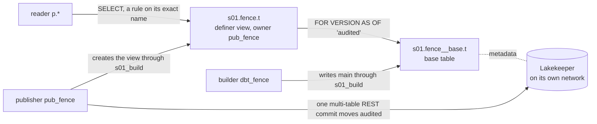

# Tested data through a view over a tag: the gate of decision O8

**Date:** 2026-11-26 (UTC)
**Question:** does design (a) for decision O8 of
[DECISIONS-FINAL](./2026-11-26-unified-platform-architecture/DECISIONS-FINAL.md) ("readers see only tested data,
always"), as amended by its five conditions, hold when it is attacked and when it is run? This is the gate
`spine-h-tested-data-view` that step S01 of [phase 001](../plans/2026-11-26-unified-product-platform/001-release-and-rules-spine.md)
must pass before the interfaces step merges. It follows spike (g) of
[the release spine spikes](./2026-11-26-release-spine-spikes.md) and the independent review of the phase's
interfaces proposal, which found the forgeries of h3 and the statistics leak of h1.
**Status:** findings, not decisions. ADR-061 (step S02) commits to them; the interfaces they change are named in
"What the interfaces must say".

## In short

**Verdict: yes, design (a) passes its gate.** The last run printed 61 rows, 54 PASS, 0 FAIL, 7 INFO, and exited 0.
It needs two changes the proposal does not state, and it leaves two limits on the record:

- **Change: a publisher needs catalog access `all` on the reader catalog.** Trino 484's file rules check a definer
  view's owner with `checkCanCreateViewWithSelectFromColumns`, which demands catalog access `ALL` on the catalog that
  holds the base (read from the 484 bytecode), then `GRANT_SELECT`. With `read-only` there, every read of every view
  failed (run 1). With `all`, the read-only connector (`iceberg.security=read_only`) still refused the publisher all
  9 writes tried through that catalog, including `rollback_to_snapshot`, `optimize`, `CALL` and `DROP`.
- **Change: `svc.platform` should hold no privilege in reader namespaces.** With `OWNERSHIP` there it replaced a
  reader view. This fails closed, because readers then get an error and not rows, and the drift check would flag
  the owner. It is still a way to break a view, and the platform principal does not need it.
- **Limit (Q2, as expected): a reader can count the rows its policy hides.** A count over the view returned 2 rows
  to the delayed reader and 3 to the full reader. The client protocol reported `processedRows` 4 for both, and
  `EXPLAIN ANALYZE` printed `Input: 4 rows`. The untested row is never counted. With table statistics off, no
  bound, row count or hidden value appears anywhere else.
- **Limit: one query is not a cross-table snapshot.** The multi-table commit is all or nothing (a stale requirement
  gave 409 and moved neither tag), but Trino loads each table separately. In 2 of 122 polls a single query saw one
  output at the new tag and the other at the previous one. Both polls overlapped a commit, and no poll showed it
  outside one.

Everything else held as designed:

- Every base path was refused to every reader (228 of 228).
- Readers got exactly the tagged rows with their policies, and builders could not touch a view.
- A second publisher could not serve another product's rows.
- `SET AUTHORIZATION` and the statistics session property were refused, in the statement and in the header.
- Over 23 publishes, a failing build, an added column, a dropped column and a killed publisher, no poll erred or
  returned an untested, empty or partly loaded result.
- The catalog API was unreachable from k2-net. From inside its network both forgeries were accepted and served,
  and the drift check exited 1, naming each planted object.

## The design under test



- **Catalogs.** `s01` is a reader catalog: `iceberg.security=read_only` and `iceberg.table-statistics-enabled=false`.
  `s01_build` is the writer. Both are over one warehouse, as `<domain>` and `<domain>_build` will be.
- **Namespaces.** Base tables live in `<fence>__base`. Views live in `<fence>` and are owned by `pub_<fence>`.
- **View SQL.** It is exactly `SELECT <contract columns> FROM s01.<fence>__base.<t> FOR VERSION AS OF 'audited'`.
- **Policies.** Each reader role is one rule on the view's exact name. The delayed role carries the scope filter, a
  20-minute delay filter and a mask of `secret` to a typed null. The full role carries the scope filter only.
- **Principals.** Product A has `dbt_a`/`pub_a`. Product B has `dbt_b`/`pub_b`, with A's base as B's input.
  Product C has `dbt_c`/`pub_c` and two outputs, for h2. `pub_x` is a test-only publisher that holds `SELECT` but
  not `GRANT_SELECT` on A's base. The readers are `p.reader-full` (full role), `p.reader-delayed` (delayed role)
  and `p.unrelated` (no grant).
- **Groups.** They come from the file group provider, as `<fence>__<role>`.

## What was run

```bash
bash scripts/spikes/2026-11-26/spine-h-tested-data-view/run.sh   # about 90 s; exit 0 only when every row holds
```

[`run.sh`](../../scripts/spikes/2026-11-26/spine-h-tested-data-view/run.sh) runs
[`spike.py`](../../scripts/spikes/2026-11-26/spine-h-tested-data-view/spike.py), which generates the rules per
product. The REST client, drift check and forgeries are
[`catalog.py`](../../scripts/spikes/2026-11-26/spine-h-tested-data-view/catalog.py), the same file on the host and
inside the catalog network. The output of the run quoted here is
[`results-2026-11-26/run.txt`](../../scripts/spikes/2026-11-26/spine-h-tested-data-view/results-2026-11-26/run.txt).

- **Trino.** One throwaway Trino 484 (`trinodb/trino:484`, the compose pin) with file rules and the file group
  provider. It sits on k2-net, for the live Lakekeeper, and on `spike-s01-catalog`, for the throwaway one, as
  Trino will sit on both networks.
- **h1 and h2.** They ran in scratch warehouse `spike_s01` of the live Lakekeeper, on scratch bucket `spike-s01` of
  the live MinIO, with namespaces `spike_s01_*`.
- **h3.** It ran in a throwaway Lakekeeper (`quay.io/lakekeeper/catalog:v0.13.9`) with its own Postgres (the
  compose digest) and MinIO (the compose tag), on network `spike-s01-catalog` only, with no published port.
  `catalog.py` ran inside that network from a container of the Spark base image of `docker/spark/Dockerfile`,
  standing in for the `tools` one-shot, and from a fresh container of the same image on k2-net.
- **Credentials.** The live MinIO key came from the main checkout's `.env` into the process and reached containers
  by variable name only; mc got it through `MC_HOST_root`. The throwaway stack's keys were random per run, and the
  output was checked against every `.env` value (no hit).
- **Cleanup.** The warehouse, bucket, network and every `spike-s01-*` container were removed, and the run checks
  this.
- **Runs.** Three full runs. Run 1 failed on the publisher's catalog access (the first change above), and its poll
  checks passed over polls that had all erred, a flaw in the checker. Those checks now count only answered polls and
  fail when there are none. Run 2 failed one row: a `FOR TIMESTAMP AS OF current_timestamp` probe was sometimes
  rejected as "not in the past" before the access check, so it proved nothing, and it now reads one second back.
  Run 3 is quoted.
- **Data.** Synthetic rows only. Hidden values carry markers (`zz-sec-3`, `444444` and so on), so a leak can be
  searched for in any output.

## h1, the fence matrix

| Row | Assertion | Result |
|---|---|---|
| h1.01 | The publisher creates its view through `s01_build`, in namespace `<fence>`, its SQL naming the base through `s01`; a reader reads it through `s01` | PASS; stored owner `trino.run-as-owner = pub_a`, one `trino` representation, no default catalog |
| h1.02 | With catalog access `all` on `s01`, the publisher is still refused every write there by the connector | PASS; 9 of 9 refused (create or replace view, insert, delete, `rollback_to_snapshot`, `optimize`, `CALL`, drop table, drop view); main and the view list unchanged |
| h1.03 | A reader sees no other principal's query text | PASS; `system.runtime.queries` denied (no table rule on `system`), `/v1/query` listed 0 foreign queries; `svc.platform` saw the builder's INSERT carrying the untested values |
| h1.04 | Full reader: exactly the tagged rows, scope applied | PASS; ids 1, 2, 5 |
| h1.05 | Delayed reader: scope, delay and mask | PASS; ids 1, 2 with `secret` null; a predicate on the masked column matched 0 |
| h1.06 | The untested row (id 4) is never returned, though `main` holds it | PASS |
| h1.07 | Unrelated user: view denied, nothing listed | PASS |
| h1.08 | Every base path refused to every reader, both catalogs, both products: the table, time travel by id, by `'audited'` and by timestamp, `$snapshots $files $history $partitions $refs $manifests $all_manifests $properties $metadata_log_entries $entries $all_entries`, `table_changes`, DESCRIBE, SHOW STATS, SHOW CREATE; each statement also run by the builder through `s01_build`, so a refusal is the fence and not a typo | PASS; 228 of 228 refused, 0 invalid controls |
| h1.09 | Time travel on the view by snapshot id and by timestamp | PASS; `Views do not support versioning` |
| h1.10 | A string version on the view (`'main'`, `'zzz'`) | PASS; silently ignored, the tag's rows returned |
| h1.11 | The view has no metadata tables; readers cannot reach it through `s01_build` | PASS |
| h1.12 | The builder, another product's builder and another publisher cannot create, replace, drop, rename or comment a reader view, or put a table in the reader namespace | PASS; 9 of 9 refused, view unchanged |
| h1.13 | Publisher B, with no privilege on A's base, cannot serve A's rows | PASS; refused at creation |
| h1.14 | A publisher with `SELECT` but not `GRANT_SELECT` on A's base | PASS; view created, every read refused: `View owner 'pub_x' cannot create view that selects from branch audited` |
| h1.15 | An invoker view over the base | PASS; readers refused (they hold no base privilege) |
| h1.16 | Materialized views | PASS; `not supported for Iceberg REST catalog` |
| h1.17 | B4: a builder with `SELECT` on an input base copies its untested `main` into its own base | INFO; ids 1 to 5 copied, held by `k2_input` and the lint, not by Trino |
| h1.18 | No reader can read that copy | PASS |
| h1.19 | `SET AUTHORIZATION` on a view, schema or table, by publishers, the builder and `svc.platform` | PASS; 6 of 6 refused, owners unchanged |
| h1.20 | SHOW STATS on the view and on a query over it | PASS; no bound, no row count, no hidden value; what is left: for the delayed reader `secret` distinct 0, nulls 1.0 (the mask) |
| h1.21 | EXPLAIN ANALYZE VERBOSE, both readers | PASS; no hidden value, estimates `?`; it does show `Input: 4 rows`, the base's name and the tagged snapshot id |
| h1.22 | The processed-rows counter never counts the untested row | PASS; `processedRows` 4, the tagged count, for both readers |
| h1.22q | Q2: rows hidden by policy are countable | INFO; full reader 1 of 4, delayed reader 2 of 4 |
| h1.23 | A reader's `SET SESSION s01.statistics_enabled = true` | PASS; refused by the rule, all 3 readers |
| h1.24 | The same in the session header (`X-Trino-Session`, the CLI's `--session`) | PASS; refused |
| h1.25 | Control: `pub_a` may set it, and the bounds come back through the view | PASS; id 1 to 5, amount 10 to 555555, 4 rows: the rule is what holds |
| h1.26 | No other boolean catalog session property a reader may set brings a bound back | PASS; 17 flipped one at a time, none |
| h1.27 | A reader's retention session property | PASS; refused |
| h1.28 | SHOW CREATE VIEW | PASS; refused |
| h1.29 | B5: `information_schema.views` | INFO; each reader sees the SQL of the views it is granted (base names and `FOR VERSION AS OF 'audited'`), the unrelated user none |
| h1.30 | No base table listed to a reader | PASS |
| h1.31 | A view planted in A's reader namespace under a name no rule grants | PASS; denied (exact-name rules) |
| h1.32 | The view as the catalog stores it | INFO; input for the drift check |
| h1.33 | `svc.platform` replaces a reader view without the tag | PASS (fails closed): the replace succeeded, owner became `svc.platform`, readers got `View owner 'svc.platform' cannot create view that selects from` |
| h1.34 | The builder drops and recreates its base, the tag going with the old table | PASS (fails closed): `Cannot find snapshot with reference name: audited` |

## h2, the polled cycle

Product C has outputs `t1` and `t2`. A build is an INSERT. A column change is dbt's contracted path, an empty
create-or-replace and then the insert (spike (f)), so `main` was empty for a moment each time. A test counts rows
flagged bad. The publish is the proposal's A7 step 6 under condition 4: views to C ∩ old ∩ new, one multi-table
tag commit, views to C ∩ new. The reader `p.reader-full` ran one query reading both views about every 50 ms, on its
own connections, from the first publish to the end. A self-check first fed the poll checker 9 planted polls (an
untested row, a failed build's row, an empty table, a torn table, a mixed state with no commit in flight, a stale
read, an error); it classified each correctly (h2.00).

| Row | Assertion | Result |
|---|---|---|
| h2.01 | (ii) A failing build: its test fails, neither tag moves, `CREATE OR REPLACE TABLE t AS SELECT * FROM t FOR VERSION AS OF <id>` restores `main` to the tagged rows | PASS |
| h2.02 | (iii) An added column: the view gains it after the tag moves | PASS |
| h2.03 | (iv) A dropped column under the rule: the view drops it before the tag moves | PASS |
| h2.04 | (v) The publisher, a separate process, SIGKILLed between the tag commit and the view update: reads go on with the old columns; the reconcile completes the view; a second reconcile changes nothing | PASS; exit -9, 14 polls in the cycle |
| h2.05 | One stale requirement in the multi-table commit | PASS; 409 `CatalogCommitConflicts`, neither tag moved |
| h2.06 | Multi-table tag commit, 2 tables, host to Lakekeeper, n=23 | median 13.2 ms, p95 18.0 ms, max 30.1 ms |
| h2.07 | No poll erred | PASS; 122 polls over 25 s, all answered; poll latency median 145 ms; 7, 6, 6 and 14 polls during cycles (ii) to (v) |
| h2.08 | No untested row (a failed build's, or a batch before its commit was sent) | PASS; 0 of 122 |
| h2.09 | No empty result | PASS; 0 of 122 |
| h2.10 | No partly loaded table (rows equal the tested count of the batch seen) | PASS; 0 of 122 |
| h2.11 | The two tables disagree only while a commit is in flight during that very poll | PASS; 2 of 122 disagreed, both during a commit, 0 outside one |
| h2.12 | A poll after a commit returned showing an older batch | INFO; 0 of 122 |
| h2.13 | View replace (`CREATE OR REPLACE VIEW` as the publisher), n=5 | INFO; median 48.7 ms, max 63.4 ms |
| h2.14 | Control, reader stopped: the wrong order (tag first) on a dropped column | PASS; reads failed (`Column 'total' cannot be resolved`), the reconcile repaired them |

The commit, the poll and the view replace times are from one run on this host, through Docker Desktop's port
forwarding. They are single-run figures, not benchmarks.

## h3, the catalog fence

| Row | Assertion | Result |
|---|---|---|
| h3.01 | The throwaway Lakekeeper is on `spike-s01-catalog` only, no host port | PASS |
| h3.02 | From a container on k2-net the catalog API is unreachable | PASS; by name: `Name or service not known`; by address: timed out after 4 s (dropped, no answer) |
| h3.03 | From k2-net both forgeries fail to connect, and the catalog is unchanged | PASS; both exit 2 (unreachable); drift check exit 0 |
| h3.04 | Inside the network, B's view deleted and re-created by REST with SQL over A's base `main` and `trino.run-as-owner` set to `pub_a` | Forgery accepted (204, 200); B's reader got A's rows 1 to 5, the untested row and A's unmasked secrets included |
| h3.05 | The drift check then exits non-zero and names the view | PASS; exit 1, `DRIFT view spike_s01_b.t: owner 'pub_a', release says 'pub_b'` and its SQL |
| h3.06 | The publisher re-creates B's view from the release | PASS; drift check exit 0 |
| h3.07 | Inside, `add-snapshot` plus `set-snapshot-ref` graft A's untested snapshot into B's base as its `audited` tag | Forgery accepted (200); B's own, legitimate view served A's rows, the untested one included |
| h3.08 | The drift check then exits non-zero and names the tag | PASS; exit 1, `DRIFT tag spike_s01_b__base.t audited: <grafted id>, release records <id>` |
| h3.09 | The host and the throwaway catalog's container address | INFO; timed out (Docker Desktop's VM) |

The drift check compares the catalog with a release generated from the contracts. Reader namespaces must hold
exactly the generated views. Each view must have the generated SQL (compared token by token, since Trino stores
it reformatted), exactly one `trino` representation and the publisher as `trino.run-as-owner`. Base namespaces may
hold no view. Every `audited` tag must equal the snapshot id the publish step recorded. On the untouched catalog it
exits 0, so a non-zero exit is the forgery and not the check.

## Surprises

- **The definer-view owner check wants catalog `ALL`.** This is the first change of "In short". The denial names
  the tag as a branch: `Cannot select from branch audited in table ...`. Trino 484 passes a string version to
  access control as a branch, and the file rules have no branch rules of their own.
- **A query reading two outputs can straddle a publish.** This is the second limit of "In short": 2 of 122 polls,
  each a single query. With 23 commits at a poll period of about 195 ms, that suggests a window in the order of 15
  ms per commit. That is an estimate, not a measurement.
- **`system.runtime.queries` is closed to readers by default here.** The rules have no catch-all table rule, so no
  `system` table is readable without one. `svc.platform` needed an explicit rule for the control, and the live
  rules' catch-all `SELECT` would open it.
- **Trino rejects `FOR TIMESTAMP AS OF current_timestamp` as "not in the past"** before it checks access, in some
  runs and not others.
- **`svc.platform` with `OWNERSHIP` in a reader namespace can plant and replace views.** This is the second change
  of "In short". A planted view under an ungranted name is invisible to readers (h1.31); a replaced one fails
  closed (h1.33).
- **The stored view has no default catalog,** so its SQL must name every relation in full, as the generated SQL does.

## What the interfaces must say

- **Publisher route (A8, S12).** `pub_<fence>` creates and replaces views through the writer catalog
  `<domain>_build`, in namespace `<fence>`, with SQL naming the base through the reader catalog
  `<domain>.<fence>__base.<t>`. No third "publish" catalog is needed. The reader catalog stays
  `iceberg.security=read_only` and `iceberg.table-statistics-enabled=false`. In the rules, `pub_.*` has
  `allow: all` on reader catalogs; this grants no write, because the connector refuses them (h1.02).
- **Rule shapes that worked (S12).** This is product A's part of the rules file that ran, global sections included.
  Two things are reduced: the catalog regexes to the live warehouse's two names (the run also matched `fence` and
  `fence_build`), and the reader rules' view pattern from `t|inv` to `t` (`inv` is h1.15's test view). It is the
  gate's rule set, not a release.

```json
{
 "catalogs": [
  {"user": "svc\\.platform|dbt_.*|pub_.*", "catalog": "s01_build", "allow": "all"},
  {"user": "pub_.*", "catalog": "s01", "allow": "all"},
  {"catalog": "s01", "allow": "read-only"},
  {"catalog": "system", "allow": "read-only"}],
 "schemas": [
  {"user": "svc\\.platform", "catalog": "s01_build", "owner": true},
  {"user": "dbt_a", "catalog": "s01_build", "schema": "spike_s01_a__base", "owner": true},
  {"user": "pub_a", "catalog": "s01_build", "schema": "spike_s01_a", "owner": true},
  {"owner": false}],
 "tables": [
  {"user": "svc\\.platform", "catalog": "s01_build", "privileges": ["SELECT", "INSERT", "DELETE", "UPDATE", "OWNERSHIP"]},
  {"user": "svc\\.platform", "catalog": "system", "privileges": ["SELECT"]},
  {"user": "pub_a", "catalog": "s01_build", "schema": "spike_s01_a", "privileges": ["SELECT", "OWNERSHIP"]},
  {"user": "pub_a", "catalog": "s01", "schema": "spike_s01_a__base", "privileges": ["SELECT", "GRANT_SELECT"]},
  {"user": "pub_a", "catalog": "s01", "schema": "spike_s01_a", "privileges": ["SELECT"]},
  {"user": "dbt_a", "catalog": "s01_build", "schema": "spike_s01_a__base", "privileges": ["SELECT", "INSERT", "DELETE", "UPDATE", "OWNERSHIP"]},
  {"user": "dbt_b", "catalog": "s01", "schema": "spike_s01_a__base", "table": "t", "privileges": ["SELECT"]},
  {"group": "spike_s01_a__full_reader", "catalog": "s01", "schema": "spike_s01_a", "table": "t",
   "privileges": ["SELECT"], "filter": "region <> 'restricted'"},
  {"group": "spike_s01_a__delayed_reader", "catalog": "s01", "schema": "spike_s01_a", "table": "t",
   "privileges": ["SELECT"], "filter": "region <> 'restricted' AND ts < current_timestamp - INTERVAL '20' MINUTE",
   "columns": [{"name": "secret", "mask": "CAST(NULL AS varchar)"}]}],
 "catalog_session_properties": [
  {"user": "svc\\.platform", "allow": true},
  {"user": "dbt_.*|pub_.*|svc\\.(runs|catalog)", "property": "statistics_enabled", "allow": true},
  {"property": "statistics_enabled|expire_snapshots_min_retention|remove_orphan_files_min_retention", "allow": false},
  {"allow": true}],
 "queries": [{"user": "svc\\.platform", "allow": ["execute", "kill", "view"]}, {"allow": ["execute"]}]
}
```

- **The deny rule.** It is the `catalog_session_properties` list above. Pipeline principals come first,
  `statistics_enabled` is denied to everyone else, and the rule holds for `SET SESSION` and for the session header
  alike. There are no `authorization`, `procedures` or `functions` rules. `SET AUTHORIZATION`, `CALL` and
  `table_changes` were refused to everyone.
- **`svc.platform`.** Give it no table privilege in reader namespaces. Dropping a product's views is a catalog
  call, which the drop script makes from inside the catalog network. This goes beyond the proposal's A8 and comes
  from h1.33.
- **The tag commit (A7 step 6).** It is one `POST /catalog/v1/{prefix}/transactions/commit`, prefix from
  `GET /catalog/v1/config?warehouse=<w>`. No secret is involved, because the catalog has no authentication. It
  answers 204 on success and 409 `CatalogCommitConflicts` when any requirement is stale, and then it moves nothing:

```json
{"table-changes": [
  {"identifier": {"namespace": ["<fence>__base"], "name": "<table>"},
   "requirements": [{"type": "assert-ref-snapshot-id", "ref": "main", "snapshot-id": <tested id>},
                    {"type": "assert-ref-snapshot-id", "ref": "audited", "snapshot-id": <previous id or null>}],
   "updates": [{"action": "set-snapshot-ref", "ref-name": "audited", "type": "tag", "snapshot-id": <tested id>}]},
  {"identifier": "...one entry per output of the product..."}]}
```

- **Condition 4 and reconcile (A7 steps 1 and 6).** Confirmed as written. A killed publisher leaves readers on the
  old columns, and the reconcile completes the view. The wrong order breaks reads until the reconcile runs (h2.14).
- **Cross-table consistency (ADR-061, A7 step 2, A12).** Say that a publish is all or nothing, but a query reading
  two outputs may see adjacent publishes for the duration of one commit.
  - The wrapper's input resolution reads several `$refs` and can straddle a publish the same way. It should read
    them twice and compare, as A12 already does for `/v1/data`.
  - Not tested here.
- **A9 rows.** Add rows for the publisher's write floor through the reader catalog (h1.02), the session header form
  of the statistics property (h1.24) and `svc.platform` having no view rights in reader namespaces.
- **Q2.** Readers can count the rows their policy hides, `processedRows` and `EXPLAIN ANALYZE` alike, as the proposal
  expected. ADR-061 states it; the owner's answer to Q2 decides whether that is acceptable for `delayed_reader`.

## Verdict

**Design (a) passes its gate: yes.** No assertion failed in the run quoted. Every leak path tried against the
design was closed, or failed closed with an error. The two forgeries work exactly when the catalog API is
reachable, and the network fence plus the drift check stop and detect them. Nothing failed, so no design
consequence follows from a failure.

The two changes above are needed for the design to work at all (the publisher's catalog access), or to remove a
needless privilege (`svc.platform` in reader namespaces). The two limits are stated rather than fixed: the
countable policy-hidden rows (Q2) and the cross-table straddle.

**Not tested:**

- Trino with password authentication and HTTPS (S13).
- The drift check against run records, which come in `002`.
- Spark as a reader of the views.
- A large table's restore time.
- Resource groups.
- The Docker socket holder as an attacker: the proposal argues that one, not this gate.
- Policies that need more than one rule per view.
