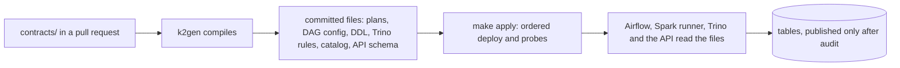
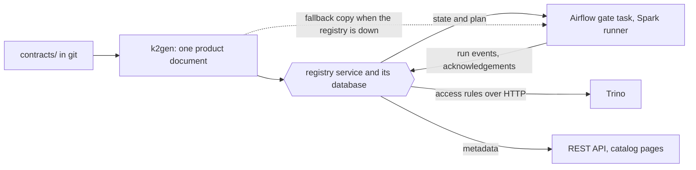
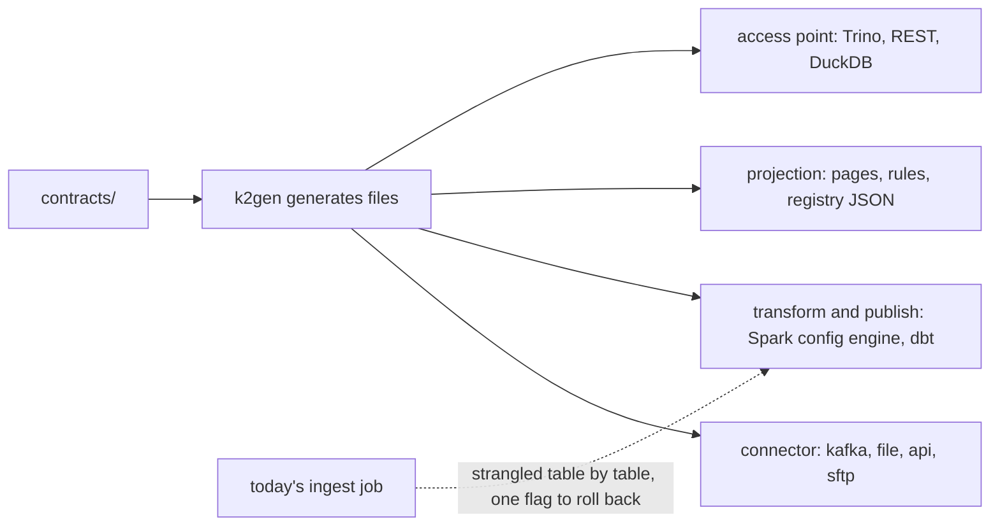
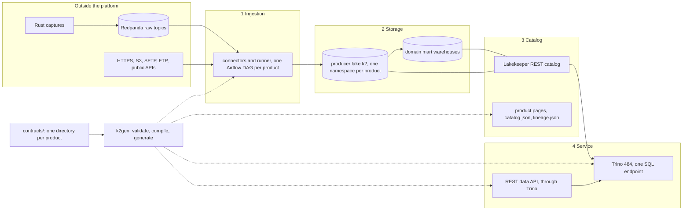
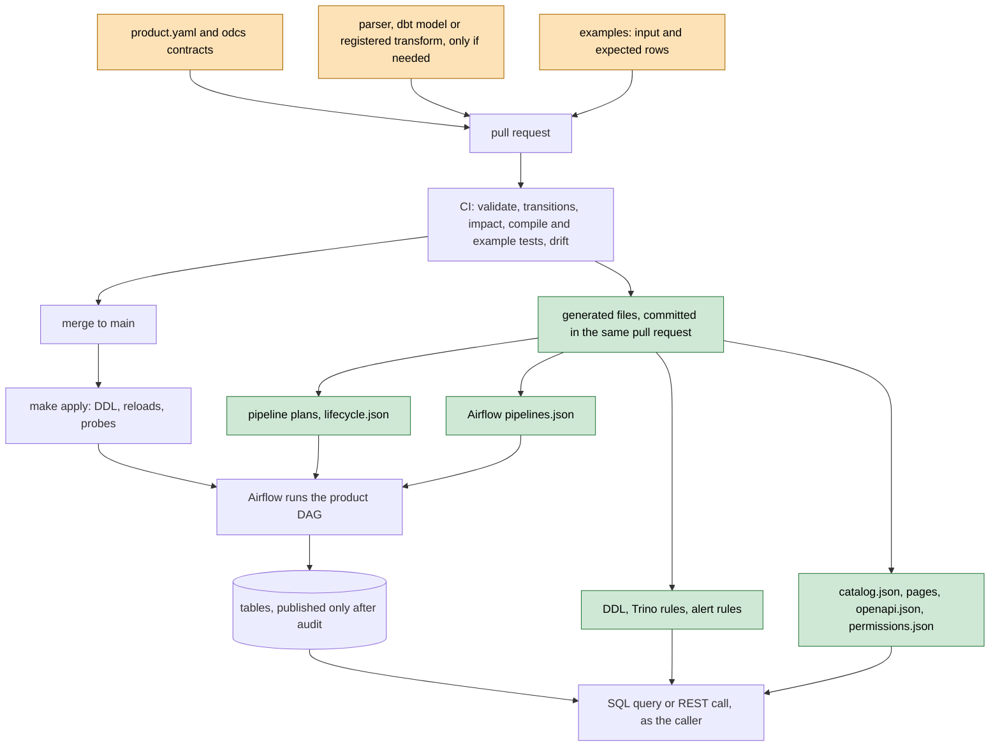
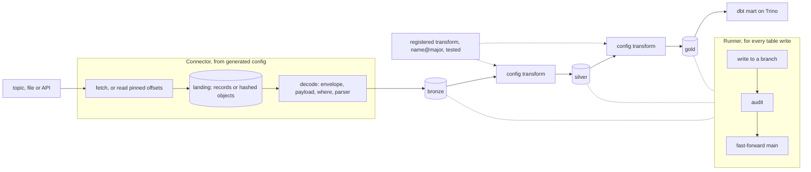
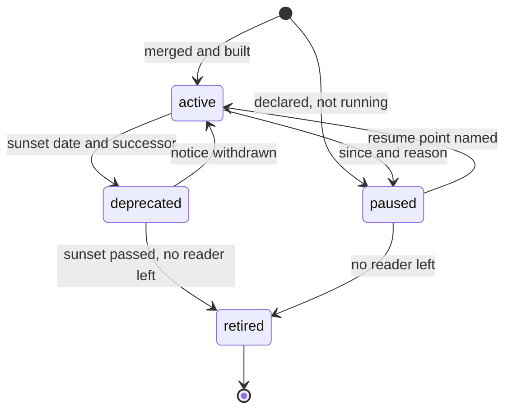
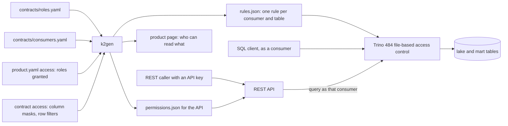
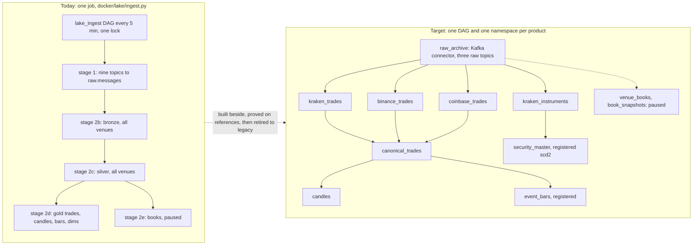
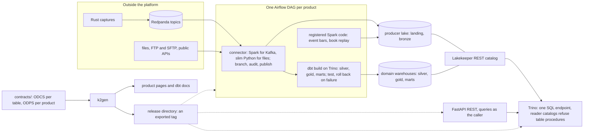

# The unified platform architecture tournament: verdict and review

**Date:** 2026-11-26. **Status:** research before a decision; nothing here is accepted, and no ADR
or plan has been written from it. **Question:** what architecture makes K2 a product- and
service-oriented data platform with unified ingestion, storage, catalog and query layers, and in
what order should it be built? **Inputs:** [the retained material](2026-11-26-unified-platform-architecture/README.md);
repository read at `main` `bb6e77f` (entries, judge) and `43cd971` (reviewer). Day counts are judgements.

| Term | Meaning |
|---|---|
| Data product | An owned, named unit of data (one or more tables) with a contract, one lifecycle state, a pipeline and permissions |
| Contract, descriptor | A contract is a YAML file in the Open Data Contract Standard (ODCS) v3.2.0 describing one table; the descriptor `product.yaml` describes the whole product |
| `k2gen` | The repository's generator (`platform/k2gen/`): it validates contracts and writes files (DDL, access rules, pages) that CI checks for drift |
| Medallion | The lake's layers: landing or raw (as received), bronze (parsed, source shape), silver (typed, flagged), gold (one row per entity, across sources), marts (SQL shaped for a consumer) |
| Connector, landing | A connector reads one source (a topic, a file, an API, an FTP server); the landing is its verbatim record of what arrived |
| Iceberg, WAP | The open table format. Each write is a snapshot; a branch is a hidden line of snapshots; a fast-forward moves the visible `main` to a branch. Write-audit-publish (WAP) writes to a branch, audits it, and fast-forwards only on a pass |
| Lakekeeper, MinIO, Redpanda | The Iceberg catalog (REST protocol); the S3-compatible object store; the Kafka-compatible message bus the captures publish to |
| Airflow DAG, asset, pool | A scheduled pipeline; a dataset whose update can trigger a DAG; a cap on how many tasks run at once |
| Spark, Trino, dbt | Spark writes the lake today; Trino is the SQL engine and the one SQL endpoint; dbt builds tables from SQL files (section 6) |
| Registered transform | Named, versioned, tested code (`name@major`) that a contract calls where config cannot express the logic, such as order-book replay |

## 1. In one page

**The question.** The owner wants K2 to stop being coupled pipelines and become a platform: a user
defines a data product once, in a contract, and the platform ingests, stores, catalogues,
permissions and serves it, whatever the source.

**How it was answered.** Three independent agents each wrote a competing architecture and plan from
one brief, unseen by each other (entries A, B, C). A judge scored them against the owner's five
criteria and wrote a synthesis ([`VERDICT.md`](2026-11-26-unified-platform-architecture/VERDICT.md)); a reviewer attacked it, re-checking 23 facts and
testing claims in throwaway containers ([`REVIEW.md`](2026-11-26-unified-platform-architecture/REVIEW.md)). The last requirement change came after the entries.

**The outcome.** The judge chose a synthesis with entry A as its spine: a product is a directory of
YAML in a pull request, `k2gen` compiles it into committed files, and every runtime reads those
files, so no new service decides anything at run time. It grafted six parts of C and three of B,
and replaced all three migrations with a clean rebuild of the crypto pipeline. The work runs as
vertical slices: pause ClickHouse, then ECB FX, then Kraken trades, then all crypto with the old job
retired, about 50 working days to `v3.0.0`. The reviewer upheld that spine but found one critical
problem (a contract's SQL can read the storage root password and any table) and nine high ones,
and recommends dbt on Trino for silver, gold and marts instead of the judge's transform language.

**Agreed by both, not yet by the owner.** Contracts in git as the only definition; one generator;
one Airflow pipeline per product; Iceberg on Lakekeeper; Trino as the one SQL endpoint; a small
read-only REST API querying Trino as the caller; vertical slices; ClickHouse paused first; crypto
rebuilt clean and proved against independent references.

**The story continues.** This page and sections 1 to 10 record the tournament as it ended on the
morning of 26 November. Later that day the owner rejected the verdict's diagrams, an architect
revised the architecture, three spikes measured the risky claims, a plan was reviewed, and the owner
decided every open item. The last section, "What happened next", tells that part; where it differs
from the sections above, the last section wins.

**Awaiting the owner: everything.** The reviewer asked the judge to rewrite five verdict sections and
phases N0 to N3 before the owner signs; not yet done. Eleven decisions are in section 8.

## 2. What was asked for

**The vision.** K2 should be product- and service-oriented, an aggregator with one ingestion layer,
one storage layer, one catalog and one service (query) layer, where users can easily define, create
and serve data sets from many sources, in place of today's tightly coupled pipelines.

**Fixed decisions** from the brief: (1) a product is defined once, in a YAML contract in a pull
request, and a later catalog UI is read-only; (2) one lifecycle state per product (active, paused,
deprecated, retired) that every layer obeys; (3) source kinds kept open, from files to streams and
derived SQL; (4) the stream pipeline declared now, regenerated later (later overridden); (5) SQL
through one endpoint plus a REST data API, built after the catalog; (6) a reference architecture
for many teams on one host; (7) ClickHouse paused behind an opt-in profile, data kept, checks
visibly stood down; (8) order-book capture stays paused (ADR-050); (9) a new plan supersedes phases
P4 to P7 of the governed self-serve plan, `3.0.0` tagged at its gate; (10) one review round per
pull request, phase audits fix critical and high only, then a hardening sprint. Constraints: one
host at 25 CPU / 48 GiB ([ADR-045](../adr/ADR-045-ceiling-25-cpu-48-gib.md)), pins, no secrets.

**The refinements**, from five addenda. The Rust captures stay standalone producers: the boundary
is a topic and its schema, and a paused product means the platform stops consuming. Kafka or
Redpanda is one connector kind beside public APIs, FTP and SFTP, and files; the first phases
deliver these four. Ingestion is Airflow-backed and config-driven, as scheduled micro-batches (read
what arrived, commit, stop), an always-on mode designed but not built. The ETL design is the
centre: a medallion with config-driven transforms. Each venue is its own product, unified trades
and candles are derived products, and each product has one pipeline; the acceptance cases are
Kraken trades and ECB FX. Permissions go per product by role, with column rules (mask a column)
and row rules (delayed rows only). The platform is a lab until release: data is disposable after a
confirmed backup, production rules apply from the `3.0.0` gate, effort goes to the platform rather
than its data, and the product path may be built greenfield. Vertical slices were the orchestrating
agent's recommendation, for the judge to weigh.

**The judging rule**, in order: (1) robust: fails loudly, recovers without hand repair, never
publishes unaudited data; (2) easy to manage: few moving parts, one way to do each thing; (3) easy
for stakeholders: onboarding is a contract and a pull request, no tribal knowledge; (4) current best
practice: a standard wherever one exists; (5) modern yet tried and tested: about two years of
stable releases or major backing, recent releases, a permissive licence, a pin and a fallback.

| Stage | What changed | Effect on the designs |
|---|---|---|
| Brief | Vision, ten fixed decisions; captures obey product state; stream pipeline regenerated later | The baseline |
| Addendum 1 | Captures standalone; Kafka a connector kind; Airflow-backed and config-driven; four connector kinds first | The existing job must split into a connector and product logic |
| Addendum 2 | Micro-batch now; ETL design the centre; crypto migrates in this plan, old and new side by side | Each entry designed a shadow-and-cutover migration |
| Addendum 3 | Each venue a product; derived unified trades and candles; pipeline per product; row and column rules; two acceptance cases | Product grain and permissions fixed |
| Addendum 4 | Five to eight ethos principles; six Mermaid diagrams | Shapes every document since |
| Addendum 5, after the entries | Lab until release; clean rebuild; backup before drop; platform over contents; greenfield; slices | The judge simplified all three migrations (section 9) |

## 3. The three designs

### Entry A: the contract is the program, and `k2gen` is its compiler

A product is a directory of YAML in a pull request, compiled by `k2gen` into static, committed
files that every runtime reads. A change of state is a reviewed diff plus a deploy, never a message.

| Entry A | |
|---|---|
| Contract to query | CI validates, checks the lifecycle transition, runs compile and example tests in the Spark image; after merge, `make apply` applies DDL, reloads, waits for Airflow to parse, refreshes Trino's rules and verifies; Airflow runs the DAG; a generic Spark runner writes every table through WAP |
| A user writes | `product.yaml`; one contract per table with a `connector` or a `transform` (steps from a fixed vocabulary of eleven operations whose arguments are Spark SQL expressions) and column and row rules; example input and expected rows |
| It adds | One service, a FastAPI REST API (0.5 CPU / 512 MiB); a compiler and runner, an estimated 1,000 to 1,500 lines |
| Strongest | WAP on every write; a change's whole runtime effect is one diff; any tag rebuilds the exact state |
| Weakest | A state change needs a pull request, a merge and a deploy; many generated files; a new lock scheme; Spark in CI against ADR-050 |
| Found wrong | Judge: its claim about Trino's group provider documentation is wrong, its Airbyte release unverifiable, and it deferred ClickHouse doc updates `CLAUDE.md` requires. Reviewer: F1, F3, F4 and F10 (section 6) hit parts taken from A |

### Entry B: one live metadata plane over a config-driven medallion

`k2gen` compiles every contract into one product document, and a small always-on registry service
hands it, with live state and lineage, to every runtime, which acknowledges the revision it used.

| Entry B | |
|---|---|
| Contract to query | After merge the host pulls; within 30 s the registry records a revision; each DAG's gate task asks it for state; Trino loads its rules from it over HTTP; components post run events back |
| A user writes | `product.yaml`; contracts with `connector`, `transform` (fifteen steps, including decode and parse) and column and row rules; fixture files; a role file. Members sit in a principals file outside git |
| It adds | Two services (registry, API) and a database in Postgres; dlt for API fetches; sqlglot (a SQL parser) for checks; psycopg; the Mermaid CLI; a Python 3.15 base |
| Strongest | The richest live catalog; "applied everywhere" made visible; careful rules for a registry outage |
| Weakest | An always-on service on the path of Trino's rules; desired state held twice; a branch switch on the host changes production in 30 s; a paused venue gaps the raw archive |
| Found wrong | ADR numbers 051 to 055 are taken by drafts in flight; its API port is Airflow's; the SFTP client it would add is already present. Its reliance on Trino surviving a failed rules refresh was unverified; the reviewer showed a broken rules file stops all SQL (F2) |

### Entry C: four small interfaces, adapters behind them, grown by strangling

Each layer gets one small interface (connector, transform and publish, projection, access point),
with every engine an adapter behind one; crypto moves table by table, old beside new.

| Entry C | |
|---|---|
| Contract to query | CI resolves every expression with sqlglot and runs examples on DuckDB; after merge, `make apply` recreates changed services; one DAG per product; the Spark engine interprets the transforms; Trino applies role rules |
| A user writes | `product.yaml` with lifecycle, a separate maturity (`draft`, `published`), trigger and access; one contract per table (fourteen operations); a role file with members; example rows |
| It adds | One service, the REST API with the catalog UI inside; sqlglot; a paramiko (SFTP library) spike; an interpreter, an estimated 600 to 900 lines |
| Strongest | The most realistic migration under the old side-by-side rule, and several ideas the judge grafted |
| Weakest | Interfaces with one implementation each; "mixed mode is a supported state", two ways to do each thing; DuckDB tests can pass where Spark differs; a thin API |
| Found wrong | The Spark image already has an SFTP client, so the paramiko spike rested on a wrong fact; its FastAPI pin was a release only eight days old; it moved old FX goals past `3.0.0` unannounced. Reviewer: F15 hits its grafted state history |

## 4. Side by side

| | Entry A | Entry B | Entry C |
|---|---|---|---|
| How runtimes learn state | generated files, ordered `make apply` | registry over HTTP, file fallback | generated files, `make apply` |
| New always-on services | REST API | registry and database, REST API | REST API with catalog UI |
| Other technology added | FastAPI, uvicorn | FastAPI, uvicorn, psycopg, dlt, sqlglot, Mermaid CLI | FastAPI, uvicorn, sqlglot, paramiko |
| Transforms | 11 operations compiled to Spark SQL | 15 steps interpreted, sqlglot checks | 14 operations interpreted, sqlglot checks |
| Transform tests | compile and example tests in the Spark image in CI | fixtures in `make gates`; no Spark in CI | examples on DuckDB in CI, then on Spark |
| Permissions | one Trino rule per consumer and table | one rule per role group, from the registry | role groups through Trino's group file |
| Migration (old rule) | string-equality test, 48 h byte-level shadow | per-table switch inside the old job, shadow diff | one-flag cutover, seven-day rollback window |
| Effort, its own judgement | about 49 days | about 37 days | 49 days |
| Bootstrap peak at 3.0, CPU / GiB | 17.80 / 30.312 | 18.05 / 30.562 | 17.80 / 30.312 |
| Judge: robust, manage, stakeholders | **4.5**, 4, 4 | 3, 2, 4 | 4, 4, 3 |
| Judge: best practice, modern yet tried | 4, **5** | 4, 3 | 4, 4 |
| Judge: completeness, migration realism, honesty, fit | 4, 4, 4.5, 4 | 3, 3, 4, 3.5 | 3.5, 4.5, 4.5, 4 |

Scores 1 to 5 ([`VERDICT.md`](2026-11-26-unified-platform-architecture/VERDICT.md) 7.1); peaks from `docker-compose.yml` limits (today 21.30 / 37.812).

## 5. The verdict

**What won, in the owner's order.** *Robust:* A and C beat B; A edges C by publishing every table
through WAP, which C left open for streams. *Easy to manage:* A and C tie; B adds an always-on
registry and database on the path of Trino's rules. *Stakeholders:* A, which keeps the old plan's
whole FX scope and compiles permissions per consumer, so a user in two roles gets a predictable
answer. *Best practice:* level. *Modern yet tried:* A adds one framework, FastAPI.

**What the judge built on it.** One Iceberg namespace per product (`lake.kraken_trades.silver_trade`);
a `raw-archive` product owning the Kafka connector, each venue reading its slice, so a paused venue
never gaps the archive; Spark for the producer lake, dbt for marts; a one-slot pool for Spark
writers; a REST API (FastAPI, loopback, `GET` only) querying Trino as the caller. Crypto is rebuilt
beside the old job and proved by known-answer fixtures, compiled SQL equal to today's specs, a new
`make parity-silver` (DuckDB recomputing silver from raw JSON), the existing parities and `make
lake-verify`. Bootstrap peak: 17.90 CPU / 30.375 GiB, ClickHouse paused, API and Alertmanager added.

| Graft | From | Why |
|---|---|---|
| Lifecycle (`active`, `paused`, `deprecated`, `retired`) kept apart from maturity (`draft`, `published`) | C | Matches the owner's example states; evidence of readiness is a separate question |
| Resume from the table's own highest Kafka offset; a `paused/` directory for a paused serving product | C | Survives snapshot expiry in a long pause; makes the ClickHouse pause checkable |
| Storage keys only for roles with no rules; a one-slot pool; state history through a dbt snapshot | C | Closes the bypass of Trino's rules; the simpler start |
| A hash of each table's compiled plan in every commit | B | A changed transform cannot silently compute one table two ways |
| Venue order Kraken, Coinbase, Binance; paused ClickHouse rules still tested | B | Kraken exercises `explode`, Binance is busiest; the rules stay honest |

Rejected: B's registry, dlt, sqlglot and Python 3.15; C's interfaces, DuckDB tests and paramiko; A's
`draft` state and Spark Connect (a long-running Spark server). Top risks: the per-product chain
overrunning the five-minute slot; Trino masks behaving unlike their documentation (fallback: a
restricted dbt mart); the vocabulary growing into a private language.

**The eight ethos principles.**
- **E1. A product is defined once**, in `contracts/`; every runtime file is generated from it.
- **E2. The generator is the only control plane**: runtimes read committed files, never a service.
- **E3. The platform starts at the topic or the file**: producers, the captures too, are outside.
- **E4. Land verbatim, publish only what passed its audit**: branch, audit, fast-forward.
- **E5. Config for the common shape, registered code for the rest**, never code per product.
- **E6. One product, one pipeline, one state, one namespace**: each runs and fails on its own.
- **E7. One enforcement point per rule**: Trino for reads, the runner for writes, CI for contracts.
- **E8. Nothing moves on a red proof**: each step is shown by a command against independent references.

**Diagram 1: the four layers, and a product crossing them**

*Reading guide.* Solid arrows are data; dotted arrows are generated, committed configuration. The
left box is not the platform's. A product, one directory in `contracts/`, passes through `k2gen`
once, and each layer reads the result as a pipeline, a namespace, a page, rules and a route. No
arrow returns to `k2gen`: nothing at run time changes a definition (E2).

**Diagram 2: one product from contract to served query**

*Reading guide.* Orange is all a person writes; green is generated and committed in the same pull
request, so a reviewer sees an edit's runtime effect as a diff. CI is the gate, `make apply` the
only deploy. Three generated inputs shape the query: the pipeline, the rules, the catalog.

**Diagram 3: the medallion flow, config transforms and the code escape hatch**

*Reading guide.* Only the connector touches a source, and it ends at bronze; from there to gold
every product uses the same operations. A registered transform plugs into a step, never replacing
the runner, whose box is what happens on every write: branch, audit, fast-forward. Marts are dbt's.

**Diagram 4: lifecycle states and transitions**

*Reading guide.* Each arrow is a pull request editing `lifecycle` in one `product.yaml`; `k2gen
validate --base origin/main` refuses any arrow not drawn or whose guard fails. No arrow goes from
`active` to `retired`, so readers always get notice. `retired` is final and deletes no row.

**Diagram 5: from a contract's permission to the SQL endpoint and the REST API**

*Reading guide.* Four hand-written inputs, one compiler, three outputs. SQL and REST meet at Trino,
which applies one compiled rule to both; the API adds only authentication. The page projects the
same rules, so catalog and Trino cannot disagree without the drift check failing.

**Diagram 6: today versus target for crypto**

*Reading guide.* Left: one driver writes every layer for every venue, so one fault stops all.
Right: one DAG and namespace per product, run when its input publishes; arrows are lineage (venue,
unified trades, candles). The dotted arrow is the method: build beside, prove, retire to `legacy/`.

**The two acceptance cases** as the verdict writes them (under the review, silver and gold are dbt):

| | Kraken trades from Redpanda | ECB end-of-day FX reference rates |
|---|---|---|
| A user writes | `product.yaml` (owner, state, "run after the archive publishes", roles); a bronze contract naming the Kraken topic's slice of the shared landing; a silver contract with steps (explode, select, look up the canonical symbol, a precision flag, `trade_flags@1`) and rules (two columns masked, rows older than 20 minutes only, for `delayed_reader`); synthetic examples; one consumer entry | `product.yaml` (owner, a cron on TARGET working days, roles); a bronze contract with inline columns and an `https-file` connector; silver and gold steps (cast to `DECIMAL(20,10)`, check the currency against ISO 4217, key, a large-move flag, when the rate became available); a parser for the nested XML; examples; an attributed sample file |
| The platform generates | Pipeline plan; DAG triggered by the archive; namespace DDL; retention and schema-audit entries; Trino rules with the row filter and typed-null masks; page; catalog entry; REST route | DDL; DAG (fetch, load to a branch, audit, publish, transforms); Trino rules; page; catalog entry; REST route; a dbt source once a mart reads it |
| A reader runs | `SELECT * FROM lake.kraken_trades.silver_trade`, or `GET /v1/data/market-capture/kraken-trades/silver_trade` | `SELECT * FROM lake.ecb_fx_rates.gold_eur_rates`, or the matching `/v1/data/...` route |
| Beyond the case | Binance and Coinbase differ only in contracts; unified trades and candles declare the venues as inputs | `fx-crosses` is a dbt mart dividing two euro legs; the rate is a reference fixing, not a market close |

## 6. What the adversarial review changed

The reviewer's verdict: "accept with the listed changes". 1 critical, 9 high, 10 medium, 7 low.

| Id | Finding, in plain words | How it was shown | The fix proposed |
|---|---|---|---|
| F1 critical | A contract's SQL runs in a Spark process holding the storage root password: Spark's `reflect` reads environment variables, and a subquery reads any table, past declared inputs and every mask | `reflect` returned a harmless test variable in a throwaway copy of the Spark image; the live container lists both credential names (values not read) | Parse every expression with Spark's parser; refuse subqueries, `reflect` and functions off an allow-list; run contract SQL without the root key. Moot under dbt |
| F2 | The working tree is the deploy: runtimes read generated files straight from the checkout, so a `git checkout` changes live state, and a broken rules file stops all SQL | A throwaway Trino 484 with a 5 s refresh failed every query for every user on a truncated rules file | Deploy an immutable `git archive` of a tag behind a `current` link; restart Trino instead of live refresh |
| F3 | "Downstream rules at least as strict" cannot be computed for free-form filters, and a definer view (one that reads as its owner) drops base-table masks and filters | In a throwaway Trino a user saw every row unmasked through the view; a rule on the view itself worked | Named policies that compare (`delay`, `mask`, `rowScope`); masks follow column lineage; CI refuses weaker |
| F4 | The access proofs are circular: Trino is compared with a file the same compiler wrote | Reading the verdict | A hand-written expectation file per role and table, checked against a throwaway Trino in CI |
| F5 | Any reader of a writable domain catalog can roll back or expire its tables; Trino's file rules do not cover table procedures | Recorded as open in ADR-044 | Read-only reader catalogs for consumers, or the OPA policy engine |
| F6 | Backup copies four tables of the old layout; after they are dropped it protects nothing new, and no restore is drilled before the gate | `scripts/backup-lake.sh`; its runbook says "not yet drilled" | Backup set generated from contracts, landing buckets included; a first restore drill at the end of slice 3 |
| F7 | Airflow asset triggers wait for all inputs, so unified trades and candles stop when one venue pauses | Airflow's asset-scheduling documentation | Derived products run on the archive's trigger or a cron, with a freshness flag per input |
| F8 | The biggest risk is measured late: today's one job already has a two-day p90 of 248.5 s against ADR-034's 240 s line, and the design splits it into about nine Spark sessions per tick | Prometheus (6 h mean 140 s); Airflow's database (329 runs, p50 185 s); a bare Spark session in 3.5 s | Measure one full chain in N0 with the old job paused; retire the old job at the start of slice 2; keep Spark Connect as an escape |
| F9 | New internet-facing connectors would run on an image past end of life: Python 3.10 (ended 2026-10-01), OpenSSL 1.1.1w (ended 2023-09-11), a base last published 2025-03-11 | A throwaway run; endoflife.date; Docker Hub | Rebase on the official `spark:3.5.9-scala2.12-java17-python3-ubuntu` image, or fetch from a slim Python image |
| F10 | The vocabulary reinvents SQL: six operations are clauses of one `SELECT`, and there would be four ways to write a transform | `docker/lake/silver.py`: today's venue specs are SQL strings | Replace it with SQL models, preferably dbt on Trino |

The **medium** findings: the descriptor should be an Open Data Product Standard (ODPS) v1.1.0
document; public API and FTP connectors come later than addendum 1 asked; the judge alone decided a
paused venue stays archived; people have no identity path to SQL; dbt-snapshot history cannot be
rebuilt from empty; marts publish before their tests; the gate phase is thin; N0 drops objects no
backup covers; dbt DAGs could time out at parse; the estimate omits audits and 231 files naming old
tables. The **low** ones are small simplifications. All are in [`REVIEW.md`](2026-11-26-unified-platform-architecture/REVIEW.md)
section 2. Note: B's sqlglot check refused subqueries, part of F1; the verdict dropped sqlglot.

### dbt, and the reviewer's case for it

**What dbt is.** dbt (dbt-core, Apache 2.0) turns a folder of SQL files into tables: each file is
one `SELECT` plus a small config (replace, append or merge). dbt builds them in dependency order
through the database, here Trino, runs unit tests on fixed rows before a build and data tests on
the result, and writes a manifest from which documentation and lineage follow. **Today** dbt-core
1.12.7 with dbt-trino 1.12.0 builds the marts in each domain's warehouse (candles, delayed candles,
a venue quality scorecard, governance quality results), one Airflow task per model, tested in CI.

**The recommendation.** Connectors land raw and bronze (Spark for Kafka, Python for files and APIs,
each with branch WAP); silver, gold and marts become dbt models on Trino, one folder per product
scaffolded by `k2gen`, in the domain warehouses dbt already writes ([ADR-044](../adr/ADR-044-producer-lake-and-domain-mart-warehouses.md));
event bars and book replay stay registered Spark code. It needs an ADR superseding the row of
[ADR-035](../adr/ADR-035-trino-and-dbt-for-marts.md) that gives those layers to Spark, F5 closed
first, and a Trino resource group so builds cannot starve interactive SQL. **Gained:** no private
language, but the standard tool the owner wants to learn; one way to write a SQL transform; tests,
contracts, documentation and lineage in standard forms; F1 closed for SQL, as Trino has no
reflection; Spark in CI shrinks to the registered transforms; three to five days fewer (judgement).

**The honest cost.** Trino 484 reads Iceberg branches but cannot write them, so silver and gold lose
strict publish-only-after-audit. The model contract is still checked before publish and unit tests
run in CI, but data tests run after the build, and a failure rolls the table back to its previous
snapshot automatically. Downstream products do not run; a direct SQL reader can see bad rows for
seconds, the audit-after-publish pattern [ADR-047](../adr/ADR-047-ingest-batch-audit-after-publish.md)
already accepts for the landing. Smaller costs: an offset watermark replaces snapshot-id progress,
lineage crosses engines, and today's Spark SQL must be translated. Second best, if strict WAP comes
first: the judge's runner executing plain Spark SQL files, with no vocabulary.

**The simpler alternative**, drawn below, is the verdict's spine with dbt from silver up, reader
catalogs and an exported-tag deploy. The verdict buys strict WAP and one engine from raw to gold,
and pays with a private language, a compiler, Spark in CI and F1; the reviewer judges the simpler
design better for this owner. It is the end state the review proposes, not an accepted one:

*Reading guide.* The contract still compiles once, but runtimes read an exported release, never the
working tree. Only connectors (and registered Spark code) write the producer lake; from silver up,
everything is dbt SQL on Trino in the domain warehouses. Readers reach data only through Trino,
whose reader catalogs cannot roll a table back.

## 7. The plan as it stands

Each phase ends with an audit and a tag `v3.0.0-alpha.N`. **Days are judgements, not measurements.**

| Phase | What it delivers | How it is proven | Days |
|---|---|---|---|
| N0 ClickHouse paused | Opt-in profile, volume kept; alerts, health step, parity leg, chaos, screenshots and docs stood down visibly | Default services omit it; `make health` passes with a SKIP line; `make gates` passes; budget 17.30 / 29.812 | 1.5 |
| N1 Slice 1: ECB FX | The in-flight file source (PR #239) with its HIGH fix, generalised; runner, WAP, CI tests; DAG factory; per-product namespaces; ECB to gold; grants; catalog page; a minimal REST route | A bad file leaves `main` unmoved; a reload adds nothing; an ungranted consumer is denied; REST rows equal Trino's | 7 |
| N2 Slice 2: Kraken | Kafka connector, `raw-archive`; Kraken, unified trades, candles; masks and filters; `make parity-silver`; spike S2, the fixed cost per run | A killed run resumes exactly once; both parities on Kraken; the delayed consumer sees nothing under 20 minutes old | 7 |
| N3 Slice 3: all crypto | Coinbase, Binance, all candles, event bars, security master; books declared paused; old job stopped, tables dropped after backup, code to `legacy/` | Parity per venue; `make lake-verify`; empty determinism difference; `lake_ingest` gone | 7 |
| N4 More connectors | Public API, FTP, SFTP, S3 files; two short examples to gold | Tests with no network; a bad host key and an `http://` redirect fail | 3 |
| N5 FX derived products | Crosses, returns, volatility, reporting-currency bars, stablecoin basis | `make parity-fx`; the old plan's dbt unit tests | 3 |
| N6 Permissions, catalog, lineage | Every grant; definer-view rule; read-only consumer key; lineage; impact in CI; static catalog UI | `make access-verify` | 4 |
| N7 REST API complete | Cursor, `as_of`, state headers, 410 for retired products, live panel | `make api-verify` | 3 |
| N8 Controls, release engineering | Controls with evidence, scorecard, SLO alerts, Alertmanager, compatibility check | A test alert is delivered; a column drop without a major version fails CI | 4 |
| N9 Host infrastructure as code | Buckets, keys, warehouses, topics, roles, catalogs declared and converged | `make plan` empty when converged, showing a hand edit | 2 |
| N10 Hardening sprint | Deferred findings; recoverable deletes; off-host backup; Trino authentication | Each finding resolved or given a dated trigger | 6 |
| N11 Release gate | Rebuild from empty; restore drill; production mode; branch protection; tag `v3.0.0` | `/release-check` and the drill's `make lake-verify` pass | 3 |

**The reviewer's changes to it.**
- **Measure the run cost first:** spike S2 moves into N0, one full chain timed in a scratch namespace
  with the old job paused; and the old job retires at the start of N2, not the end of N3 (F8).
- **Connectors earlier:** N4 needs only N1, so it can precede N3, as addendum 1 asked (F12).
- **Restore drill earlier:** `make drop` with its backup in N0 (F18); a contract-generated backup
  set in N1; a first drill at the end of N3 (F6); gate exits showing an alert received off the
  host, the off-host copy and branch protection; the drill stops the live stack (F17).
- **Rewrite N1 to N3** for dbt and the exported-tag deploy (dbt scaffolding, reader catalogs, a
  rollback macro and a resource group instead of a compiler), and rebase the Spark image (F9).
- **Estimate caveats:** the 50 days omit phase audits, review rounds, the ISO 4217 product and the
  231 files naming old tables; re-estimate after slice 1 from measured pace (F20).

## 8. Decisions awaiting the owner

These decisions were made later the same day and are recorded in the final section, "What happened next".

The judge's seven decisions (D1 to D7) merged with those the review raises. The owner decides.

| # | Decision | Options, and what each costs or risks | Judge | Reviewer |
|---|---|---|---|---|
| 1 | Accept the revised architecture, and how far dbt reaches | (a) the verdict: own vocabulary on Spark for silver and gold, dbt for marts; strict WAP everywhere; a private language, a compiler, F1's exposure. (b) dbt on Trino for silver, gold and marts: standard and smaller; publish then test with rollback; a new ADR; F5 first. (c) plain Spark SQL files in the judge's runner. With any: deploy from an exported tag (F2), ODPS descriptor (F11) | (a) | (b), then (c); the judge rewrites first |
| 2 | A minimal REST route in slice 1 (D1) | (a) yes, bending fixed decision 5's order: SQL and REST with permissions shown in about two weeks; (b) the API waits for N7, about five weeks later; (c) build layer by layer, risking scope growth | (a) | not contested |
| 3 | Connector order | (a) public API and FTP/SFTP after the crypto rebuild, about day 22; (b) before slice 3, as addendum 1 asked, so slice 3 starts N4's three days later | (a) | (b), or owner's call |
| 4 | What "paused" means for a venue's raw data | (a) the archive keeps landing every venue topic, and a paused venue product stops reading its slice: no gap, but the platform still consumes; (b) the platform stops consuming the topic: frames older than Redpanda's retention (48 h or 2 GiB per partition) are lost | (a) | owner's call; one task per topic either way |
| 5 | Identity strength before 3.0 (D3) | (a) a trusted header: rules stop mistakes, not a liar, said on every page; (b) Trino password authentication over TLS with API impersonation, about 3 days, every client changes. Also identities for people, not only services (F14) | (b) | no objection; adds person identities (F14) |
| 6 | Alert and off-host backup destinations (D2) | A chat webhook or email; a second disk or object store. Without them "fails loudly" and "backup proven" are not true at the tag | both, before N8 and N10 | both, as gate exits |
| 7 | Infrastructure-as-code scope (D4) | (a) the host only, AWS a separate plan: 2 days, provable; (b) also OpenTofu AWS modules, never applied: about 3 more days that only `validate` proves | (a) | (a) |
| 8 | Spark in CI (D5) | (a) lift ADR-050's "No Spark in CI" for compile and example tests: errors caught in the pull request; (b) run them on the stack in `make gates` | (a) | mostly moot under dbt |
| 9 | Scope cuts for 3.0 (D6) | Judge: database pull designed only; cut order stablecoin basis, blue/green dbt, live panel, telemetry, S3 files. Reviewer adds: the vocabulary, union-of-roles rules (one role per principal), the catalog UI (pages and dbt docs suffice), FX content beyond the capability, `maturity`, `hide` rules, mandatory gold. Each cut saves 1 to 2 days and a demonstration | as listed | as listed |
| 10 | Raw archive retention in the lab (D7) | (a) never expired, ADR-021's recorded requirement: grows on one disk; (b) a rolling window reviewed at the gate: smaller, needs an ADR | (b), 30 days | (b), 7 to 14 days |
| 11 | Spark image rebase | (a) keep it: Python and OpenSSL past end of life under every new connector; (b) the official Spark 3.5.9 image with pinned Iceberg jars; (c) fetch connectors in a slim Python image holding only the landing key | not raised | (b) or (c), in N0 or N1 |

## 9. What nobody could verify, and what the change of direction dropped

**Not verified by anyone:** the fixed cost of one product run on the live Lakekeeper and MinIO (the
plan's biggest risk); Trino masks and filters on Iceberg tables (tested on an in-memory catalog
only); whether reader catalogs keep definer views working; dbt-trino merge and snapshots through
Lakekeeper; Airflow 3.3.2 with several asset events between runs; Trino under five-minute dbt
builds beside interactive SQL; ODPS v1.1.0's full field list; whether N0's scratch objects still
exist; the design's reach in a third domain; every day count.

**Dropped when addendum 5 arrived**, after the entries: shadow runs and old-against-new comparisons
(A's 48-hour byte-level shadow, B's per-table switch, C's one-flag cutover and mixed mode);
identical table names so either writer could resume the other; the "migration realism" score,
which favoured C. Let go after a confirmed backup: lake history older than Redpanda's retention,
the raw archive included; the parity reference day (re-pinned); all order-book data; type-2
dimension history; audit rows; the old job's run history. ClickHouse's kept volume is disposable.

## 10. Where the full material is

Everything is in [`2026-11-26-unified-platform-architecture/`](2026-11-26-unified-platform-architecture/README.md),
whose README says who wrote each file and in what order to read it: the brief, five addenda and
the criteria (a later addendum overrides an earlier one); the three entries; [`VERDICT.md`](2026-11-26-unified-platform-architecture/VERDICT.md)
(section 6 the plan, 7 the scorecard and fact checks, 8 the decisions); [`REVIEW.md`](2026-11-26-unified-platform-architecture/REVIEW.md)
(2 the findings, 3 the fact re-check, 6 the dbt case); and two inputs to the judge.

## 11. What happened next (26 November, after the review)

### 11.1 The owner rejected the diagrams

The owner read the six diagrams in the verdict, was not comfortable with them, and named every
candidate problem offered. Four were named:

1. **One raw archive fed every venue.** It coupled the venues and had no clear owner. Decision: no
   shared raw archive; each product owns its connector and its own verbatim landing.
2. **Generator arrows to everything.** Configuration, deployment and running could not be told
   apart. Diagrams must show three moments apart: defining, deploying, running.
3. **The catalog was off to the side.** It is where users start, so it moves to the centre:
   ingestion, storage and query register into it.
4. **The REST and permissions path was unclear.** A reader must see what a person or service talks
   to, that permission is enforced in one place, and that SQL and REST agree for the same caller.

Every diagram was redrawn from scratch. The ten critical and high findings of the review were
accepted as design inputs, and dbt-core on Trino replaced the judge's own transform language.

### 11.2 The requirements that followed

- **Definitions are documents, and where they are stored is a seam.** For 3.0 git is the store.
  The compile step must not care where documents come from, and the CI checks must be able to run
  inside an API later. After 3.0 a registry (database, then API, then UI) becomes the source of
  truth, with approvals and history; what changes is the store and the approval step, not the
  document format, the compiler or the runtime.
- **The security master.** Each venue has a trades and an instruments product. The master has two
  levels, asset and instrument, with venue symbols mapped by rule plus a reviewed exceptions list;
  a symbol that matches nothing fails an audit and is never guessed.
- **Domain-agnostic, with joins across domains.** Market data is the first tenant. Value comes
  from governed joins: conformed reference products, keys that declare what they refer to, and
  enriched products with declared inputs, permissions never weaker than their inputs', and explicit
  time alignment.
- **Metadata, open standards, readiness for AI.** Metadata is a first-class output of every step;
  open standards are used wherever a mature one exists; nothing in 3.0 may block a later AI
  interface that acts as the calling identity through the one enforcement point.

### 11.3 The revision

One architect rewrote the architecture ([`ARCHITECTURE-V2.md`](2026-11-26-unified-platform-architecture/ARCHITECTURE-V2.md), 13 Mermaid diagrams). Three diagram
checkers and two adversaries raised 96 findings: 3 critical, 24 high, 45 medium, 24 low. All were
acted on, some fixed another way for a stated reason; none was rejected. [`V2-CHANGELOG.md`](2026-11-26-unified-platform-architecture/V2-CHANGELOG.md) gives
each one. The most important changes:

| Finding | Change |
|---|---|
| Derived products read their inputs' current, untested snapshots (critical) | Each output has an audited snapshot recorded per run; derived products read inputs at that snapshot; a build killed midway is reconciled and rolled back |
| Notebooks, Lakekeeper and MinIO bypassed the SQL endpoint (critical) | Those ports are unpublished, notebooks move to the SQL endpoint, the storage root key is rotated, and negative probes check it |
| Undeclared reads were invisible to dependency declarations (critical) | Writers can select only their declared inputs; a lint rejects hidden three-part names and environment reads |
| dbt `env_var` could publish scheduler secrets (high) | A one-shot runner with an allow-listed environment and no Docker socket |
| Rollback lost when the engine or the build dies (high) | A durable pre-run record, reconciliation on restart, and a chaos exit that stops Trino mid-build |

### 11.4 The three spikes

Run on the live stack, synthetic data, scratch schemas dropped afterwards.

| Spike | Measured |
|---|---|
| dbt-core 1.12.7 on Trino 484 through Lakekeeper ([`SPIKE-DBT.md`](2026-11-26-unified-platform-architecture/SPIKE-DBT.md)) | Incremental merge, new columns and type-2 snapshots work. An enforced contract fails before the table changes, but a contracted table is rebuilt in two commits and was empty for about 0.1 s. A failing test followed by a rollback to the previous snapshot restores the rows; bad rows were visible for 2.6 s. One build with two tests took 3.0 to 3.9 s |
| Masks and row filters on Iceberg ([`SPIKE-ACCESS.md`](2026-11-26-unified-platform-architecture/SPIKE-ACCESS.md)) | Masks, filters and a delay rule hold under joins and `SELECT *`. Definer views skip the reader's rules. Iceberg metadata tables leak bounds of hidden and masked columns. A plain reader could run table procedures, including a rollback, on a writable catalog; a read-only catalog refuses them. A changed rules file needs a refresh period to take effect |
| Fixed cost of one product run ([`SPIKE-RUNCOST.md`](2026-11-26-unified-platform-architecture/SPIKE-RUNCOST.md)) | A run on a small table took 6.5 s; with 200 snapshots and 200k rows, 10.5 s, of which the uniqueness audit grew from 0.5 s to 4.4 s. Session start plus the first append is about 65 percent of a small run. Arithmetic, not measured: about 46 small runs fit in five minutes on one Spark slot |

The risks they found (definer views, metadata tables, table procedures) became checks in the plan.

### 11.5 The plan that was written and withdrawn

A trimmed plan to a demo was drafted: simple versions now, proper versions later. The owner
withdrew it. A simple-now, proper-later pair builds the same thing twice, and the second build has
to undo the first. The decision was the full plan, nothing cut, each thing built once and properly.

### 11.6 The review of the full plan

An independent reviewer read the full plan against the repository, the spikes and the live stack
and returned "go, with changes": 2 critical, 8 high, 12 medium, 3 low. The two critical ones:

- **The old pipeline stayed live through the first phase, which rewrites everything it depends
  on.** The phase would have had to carry 13 old-format products and the old writers through the
  new compiler, or run two deploy models. Fix: retire it at the end of the first phase. The cost
  is no live crypto data in the lake and stale dashboards until the Kraken phase, which is cheap
  in a lab.
- **Parallel workers started with no frozen interfaces, five hot-spot files, and a host that
  takes one heavy Docker job at a time.** Fix: merge one interfaces pull request before any
  parallel building, and queue heavy jobs.

The high findings included splitting the first phase in three, recreating only what a deploy
changes, pinning image digests early, and a proving command for everything a phase builds.

### 11.7 The final decisions

[`DECISIONS-FINAL.md`](2026-11-26-unified-platform-architecture/DECISIONS-FINAL.md) records them. In short:

| Subject | Decision |
|---|---|
| Architecture, scope | [`ARCHITECTURE-V2.md`](2026-11-26-unified-platform-architecture/ARCHITECTURE-V2.md), amended by these decisions, accepted; the full plan, nothing cut; if late, the date moves, not quality or order; every critical and high finding of the plan review accepted |
| Order | Clear the ground; release and rules spine; run spine through ECB FX; serving and teaching; Kraken trades and security master; enriched product; catalog, metadata, lineage; REST API and demo readiness; the demo tag `v3.0.0-beta.1`; then remaining connector kinds, wider crypto, controls and release engineering, infrastructure as code, hardening, release gate and `v3.0.0`; after that the definition registry, then the AI interface |
| Roles, catalog | At most one role per principal per product; a generated, read-only static catalog site at the demo and at 3.0, no off-the-shelf tool |
| Identity | Passwords over TLS for SQL, keys for REST; built in the first spine phase; no single sign-on in 3.0 |
| Test window | Readers see only tested data, through a marker that moves after a build's tests pass |
| Alerts, backup, infrastructure as code | Alerts to a Slack incoming webhook kept as a local secret; backup stays on this host until the release gate; infrastructure as code for this host only, cloud a separate plan after 3.0 |
| REST in the first slice | Yes, a minimal data route |
| Old pipeline | Retired at the end of the first phase, with its readers |
| Still open | FX content (needed by the enriched-product phase); landing retention (needed by the Kraken phase) |

### 11.8 Where the decision and the plan now live

- Decision: [`ADR-056-unified-data-product-platform.md`](../adr/ADR-056-unified-data-product-platform.md)
- Architecture chapter, labelled as the target: [`20-target-data-product-platform.md`](../architecture/20-target-data-product-platform.md)
- Plan to the demo tag: [`README.md`](../plans/2026-11-26-unified-product-platform/README.md)
- Plan from the demo tag to `v3.0.0`: [`README.md`](../plans/2026-11-26-unified-product-platform-to-release/README.md)
