# K2 target architecture, version 2

Architect's revision, 2026-11-26, corrected after three diagram checks and two adversarial reviews (`V2-CHANGELOG.md`).
It applies `REQUIREMENTS-V2.md` to the judge's design (`VERDICT.md`) and designs in every finding of `REVIEW.md`.
Repository facts are from `main` at `9c86ada` and `origin/feat/file-source-pattern` at `aa7a73a`, each with the path I
read; web facts were checked on 2026-11-26. "REVIEW F*n*", "VERDICT *n*" and "addendum *n X*" name the tournament
documents beside this file, each cited with its reason.

| Term | Meaning here |
|---|---|
| Product | An owned, versioned unit of data with one lifecycle state, one pipeline and one namespace |
| ODPS, ODCS | Open Data Product Standard v1.1.0, one file per product; Open Data Contract Standard v3.2.0, one contract per table (`contracts/schema/odcs-json-schema-v3.2.0-20261117.json`); both from the Bitol project, Linux Foundation |
| Connector | The code that reads one kind of source: Kafka, public API, FTP or SFTP, files |
| Landing | The verbatim copy of what one product's connector received, committed before any audit, owned by that product |
| Medallion | Layers: landing, bronze (source shape, typed), silver (cleaned, keyed), gold (business grain), mart (consumer SQL) |
| Snapshot, branch, WAP | An Iceberg commit is a snapshot; a branch is a named snapshot pointer readers do not see; WAP (write, audit, publish) writes to a hidden **audit branch**, audits it, then fast-forwards `main`, the branch readers see |
| Audited snapshot | A table's newest snapshot whose run passed its audit or tests, kept in the run record; what other products and REST read |
| Watermark | The highest offset or time a model has processed; an incremental run reads only past it |
| dbt-core | The open-source SQL build tool (`dbt-core==1.12.7`, `dbt/pyproject.toml`); a model is one `SELECT` in a file; a seed is a small CSV a person writes, loaded as a table; a selector names a set of models |
| Trino, Lakekeeper, DAG | The SQL engine (`trinodb/trino:484`, `docker-compose.yml:1072`); the Iceberg REST catalog (v0.13.9, `:879`); an Airflow 3.3.2 pipeline (`:559`) |
| Three catalogs | **Product catalog**: k2-api's pages and routes about products. **Table catalog**: Lakekeeper. **Trino catalog**: a named connection to one warehouse, read-only for readers (`market_capture`) or a writer's (`market_capture_build`) |
| Table procedure | An Iceberg maintenance or rollback command run as SQL, such as `ALTER TABLE ... EXECUTE rollback_to_snapshot` |
| Release | An immutable, content-hashed directory compiled from an approved document set, with the platform code it runs |
| Principal, role, grant, policy | Who calls, a person or a service; an access level a table offers; one role on one product for one principal, approved by that product's owner; what a role sees |
| Reference product | A product other domains join to: security master, currency master, calendars |
| Point in time, as-of join, type-2 | Joining a fact to the reference row that applied (valid time) or was known (knowledge time) when it happened; an as-of join picks that row per fact; a type-2 table keeps one row per version with `valid_from`, `valid_to` |
| TARGET, CODEOWNERS | The euro payment system, whose working days are the ECB's publication days; a GitHub file naming who must review each path |
| LocalExecutor, cosmos | Airflow running tasks as processes inside the scheduler container; astronomer-cosmos, which renders dbt as Airflow tasks (used today, dropped in v2) |
| Resource group, file group provider, Spark Connect | Trino: a cap on concurrent queries and memory for a class of users; a file mapping users to groups. Spark's client and server mode, one long-lived server shared by short clients |
| Egress, SSRF, keyset cursor, burn rate, amtool | Outbound traffic; server-side request forgery, tricking a fetcher into calling an internal address; a page token holding the last key returned; how fast an objective's error budget is spent; Alertmanager's command-line client |

## 1. What the platform is and is for

K2 is a **domain-agnostic data product platform** on one host. A team defines a data product once, as standard
documents; the platform ingests, stores in layers, catalogues, enforces who may read, and serves through SQL and REST.
**Market data is the first tenant, not the definition**: crypto trades and ECB reference rates come first; economic,
financial reference and static data follow on the same mechanics. A security master is a reference-data product.

**The value is in joining products**: a trade valued in euros, tagged with its asset's class or aligned to a business
calendar. So joins are governed: a contract declares which columns are keys of which reference product; the catalog
shows what joins to what; a check fails when a reference does not resolve; an enriched product is never less
restricted than its inputs; every join to history states its point in time. A stakeholder should be able to find a
product, trust it, get access and combine it with another within a day.

## 2. Design ethos

Eight principles. Each later choice follows from one, and each stays true when definitions move to a registry.

- **E1. A product is a set of standard documents, defined once:** one ODPS file, one ODCS contract per table, its
  SQL models, tests and grants, in one directory. Where the documents are stored is a seam, not the design.
- **E2. Runtime reads only an immutable release** compiled from an approved document set, never a working tree or a
  registry: "the generator is the only control plane" restated, since a registry changes who approves, not what runs.
- **E3. The platform starts at the topic, the file or the API.** Each product owns its connector and verbatim landing.
- **E4. Keep what arrived, publish what passed, read what was audited.** The landing commits first and never blocks;
  bronze is published by WAP; dbt tests and rolls back; others read only audited snapshots; each step is proved.
- **E5. SQL first, registered code second, no private language.** A query is a dbt-core model on Trino; other logic
  is a named, tested, registered transform.
- **E6. Products are independent and degrade visibly.** Each runs, fails, pauses and is permissioned on its own; a
  derived product runs on what its inputs have published and says what it is missing.
- **E7. One enforcement point per rule.** Trino enforces reads for SQL and REST alike; the checks library and the
  validation runner enforce definitions, in CI now and in the registry later; product code runs in a one-shot container.
- **E8. The core is domain-agnostic; value comes from governed joins.** The core provides connectors, layers,
  contracts, keys and references, lifecycle, permissions, catalog, metadata and serving; domains provide the rest.

## 3. Legend

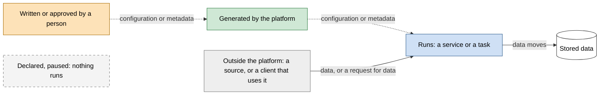

*Reading guide.* Orange: written, reviewed or approved by a person; green: generated; blue: runs; grey: outside; dashed
border: declared, paused; cylinders: stored data (green if generated). In a flowchart a **solid arrow** carries data or
a request for it (a query); a **dashed arrow** carries configuration or metadata, in diagram 9 the deploy's steps. In
sequence diagrams (2, 4) a solid arrow is a request, write or hand-over, a dashed one its reply; coloured boxes group
participants. Design, deploy and run time sit in labelled boxes whenever a diagram holds more than one.

## 4. The architecture
Diagram *n* below is in section 4.*n*, and its reading guide names every node and arrow it draws.

### 4.1 The platform on one page, with the catalog at the centre

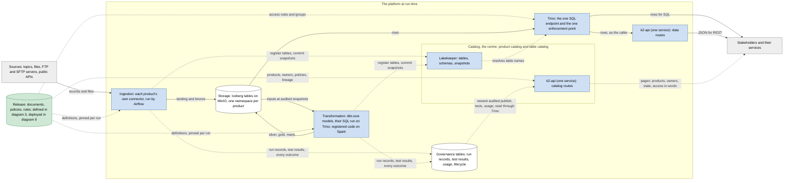

*Reading guide.* Run time only (the **release** is made in diagram 3, deployed in diagram 9; who asks whom is diagram
2). **Sources** feed **Ingestion**, which writes landing and bronze to **Storage**; **Transformation** reads audited
inputs and writes silver, gold and marts. Both register tables in **Lakekeeper** and record every outcome in the
**governance tables**. The release pins each run and feeds the **k2-api catalog routes** and **Trino's** rules; the
catalog routes read governance through Trino, never Lakekeeper or storage. Trino resolves names in Lakekeeper and
serves SQL; the **k2-api data routes** get the same rows as the caller. **Stakeholders** start at the pages.

**The layers.** *Ingestion*: one connector per product (4.4) in its own DAG. *Storage*: warehouse `k2` holds landings
and bronze, written only by connectors; a warehouse per domain holds silver, gold, marts and registered-code outputs,
each table written by one product (its Trino writer, or its transform through a Spark catalog), superseding
`docs/adr/ADR-044-producer-lake-and-domain-mart-warehouses.md`, where `k2` held code outputs no consumer could read.
One namespace per product in both (`lake.kraken_trades.bronze_trade`, `market_capture.kraken_trades.silver_trade`);
governance tables in warehouse `governance` (`docker/trino/etc/catalog/governance.properties`).

**The catalog is the centre.** Lakekeeper is the technical half: every table, schema and snapshot, registered by the
engine that commits it. The product half is `k2-api`, the one new service, serving the release (documents, policies,
lineage from ports and relationships) and the governance tables (run records, dbt results as
`dbt/macros/record_test_results.sql` writes them, usage), read through Trino as `svc.catalog`. Metadata is open to every
principal, so discovery needs no grant; rows are governed. Trino takes names from Lakekeeper and policies from the
release, so nothing the catalog does not know is readable through it (4.6 closes the paths around it). A page shows
owner, purpose, state, schema, keys, joins, lineage, access in words, newest audited publish, tests, freshness, terms,
examples and dbt docs; never a credential. Trino listens on `127.0.0.1:${K2_TRINO_PORT:-8088}`
(`docker-compose.yml:1080`), `k2-api` on `127.0.0.1:8095` (FastAPI 0.162.5, uvicorn 0.54.0, `trino` 0.340.0, REVIEW).

### 4.2 A stakeholder's journey: discover, get access, query by SQL and by REST

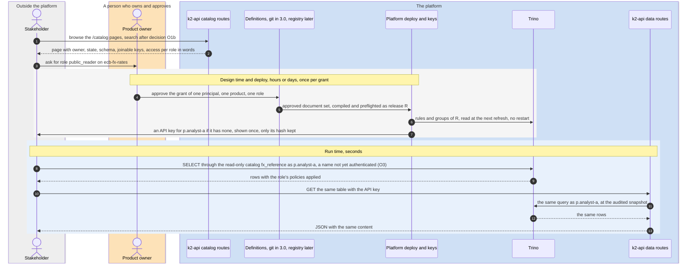

*Reading guide.* Steps 1 and 2: the stakeholder reads the **catalog routes** (roles, and what each sees). Step 3:
they ask the **product owner**, a person. Steps 4 to 7, design time and deploy: the owner approves a grant in the
**definitions** (in 3.0 a pull request to the product's `grants.yaml`), the **platform deploy** releases it, **Trino**
re-reads its rules without a restart, and the principal gets an API key once. Steps 8 and 9: SQL returns rows under
the role's policies. Steps 10 to 13: a REST call to the **data routes** becomes the same query as the same principal.

**SQL.** Consumers query only reader catalogs, one per domain (`market_capture`), with `iceberg.security=read_only`,
which denies every statement and table procedure (`docs/adr/ADR-044-...md:30`); writer catalogs (`<domain>_build`) and
read-only `lake` serve writers and the platform. This closes REVIEW F5 (any user can roll back a mart today, `:116-120`)
**for honest callers**: while Trino trusts the user name a client sends, a local client can claim a writer's (O3).

**REST**, `GET` under `/v1`: `/products`, `/products/{domain}/{product}` (document, state, inputs' states, lineage,
terms, the caller's access), `.../contracts/{table}.odcs.yaml` (the contract references target, 4.11),
`/data/{domain}/{product}/{table}` (declared-column filters, `fields`, `limit` up to 10,000, keyset cursor, `as_of`),
`/lineage/{product}`, `/openapi.json`, `/catalog`, `/dbt-docs`. Data is read at the newest audited snapshot; `as_of`
resolves only to audited ones. A `Bearer` key's sha256 maps to a principal (`make api-key` prints a key once and stores
its hash). The API **must not** write, accept SQL, evaluate a rule, read storage or Lakekeeper, cache rows or own
metadata: it queries Trino as the principal and maps a denial to 403 (REVIEW F23). "The caller's access" is asked of
Trino (`LIMIT 0`); masks and delays are worded from the release and checked by `make access-verify`. **Same answer**
holds by construction (one engine, principal, rule set, snapshot) and by proof: expectations run through both endpoints.

### 4.3 Defining a product: documents, checks, release

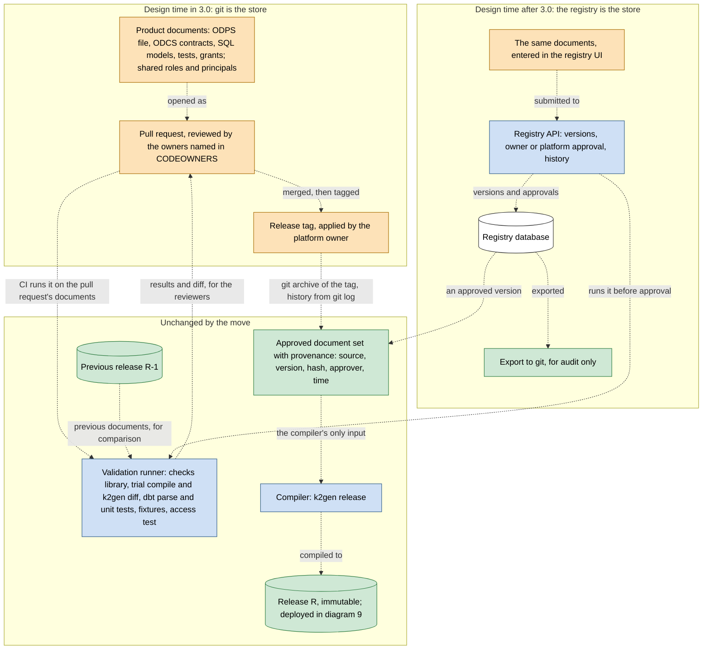

*Reading guide.* All design time; each arrow moves documents or results, or starts a check. In **"in 3.0"** a person
writes the **documents** and opens a **pull request**; CI runs the **validation runner** against the **previous
release** and posts a `k2gen diff`; merge and the **release tag** become an **approved document set** by `git archive`.
In **"after 3.0"** the **registry UI** and **API** run the same runner before approval, keep versions in the **registry
database**, hand an approved version to the same set and **export to git**. In **"Unchanged"** the set is the
**compiler's** only input; it writes **release R** (diagram 9).

**What a person writes, one directory per product** (`contracts/<domain>/<product>/`): `product.odps.yaml`,
`<table>.odcs.yaml` per table, `models/*.sql` and `unit_tests.yml`, `grants.yaml`, optional `seeds/` and `fixtures/`.
Shared: `contracts/domains.yaml` (exists), `contracts/access/roles.yaml` (`full_reader`, `delayed_reader`,
`public_reader`), `principals.yaml`. Domain code (parsers, transforms, macros such as the trade flags) lives under
`<area>/<domain>/` with its owner in `CODEOWNERS`, through git in both states. The compiler assembles models at
`models/<catalog>/<product>/` (`dbt/macros/naming.sql`); `make dbt-dev` builds that tree as symlinks for editing.

**The product file is ODPS v1.1.0**, since ODCS deprecated `dataProduct` for it (REVIEW F11); its schema
(`odps-json-schema-v1.1.0.json`, the standard's GitHub, read 2026-11-26) requires `apiVersion`, `kind`, `id`. v1.0.0
shipped 2025-09-24 (its releases page): under criterion 5's two years, kept for Linux Foundation backing and ODCS's
pointer to it; fallback, a K2 descriptor. **The table contract is ODCS v3.2.0**, columns inline: the DDL of record
(`contracts/schema/README.md`, "Where each K2 field lives").

| Field | Standard or K2 | Meaning |
|---|---|---|
| Product: `apiVersion: v1.1.0`, `kind: DataProduct`, `id`, `name`, `version` | ODPS | identity; `id` is `<domain>.<product>`, stable across stores; `version` is Semantic Versioning |
| Product: `status` | ODPS field, K2 values | `active`, `paused`, `deprecated`, `retired` (4.5); `paused` is a declared deviation, since one field must carry one state |
| Product: `domain`, `type`; `description.purpose`, `.limitations`, `.usage`; `team.name`; `support[]`; `tags` | ODPS | domain from `contracts/domains.yaml`; `sourceAligned`, `aggregate` or `consumerAligned`; page text; owner; where to ask |
| Product: `authoritativeDefinitions[]`: `{type: licence, url}` | ODPS | the source's licence or terms page |
| Product: `inputPorts[]`, `outputPorts[]`: `name`, `version`, `contractId`, `inputContracts[]` | ODPS | every table it reads (its writer may read nothing else, 4.6); every table it publishes, and which inputs feed each |
| Product: `customProperties`: `lifecycleChange`, `schedule`, `connector`, `terms`, `examples` | K2 | `{since, reason, decision, successor, sunset, resume}`, required unless active; `{cron, timeoutMinutes}`; the connector (4.4); `{redistribution, attribution}`; example queries. ODPS 1.1.0 has none of these |
| Product: port `customProperties`: `serves` (output); `required`, `maxLagMinutes` (input) | K2 | `{engine, profile, status}` of a serving copy, such as the paused ClickHouse tier; how a late or paused input changes this product's state |
| Table: `apiVersion`, `kind`, `id`, `name`, `version`, `domain`, `description.purpose`, `team.name`; `schema[0]`: `id`, `name`, `physicalName` | ODCS | identity, semantic version, owner; the table as `<product>.<table>` |
| Table: `properties[]`: `id`, `name`, `businessName`, `logicalType`, `physicalType`, `required`, `primaryKey`, `primaryKeyPosition`, `unique`, `classification`, `description`, `examples` | ODCS | columns; keys and nullability become dbt tests and the model contract; every column needs a description |
| Table: `properties[].relationships[]`: `type: foreignKey`, `to`; its `customProperties`: `asOf` | ODCS; K2 | a key of another product's table, in ODCS's fully qualified form (4.11); `valid` or `known` when the target keeps history |
| Table: `properties[].customProperties`: `unit`, `time` | K2 | a unit or currency; `event`, `publication`, `valid` or `known`; ODCS 3.2.0 has no unit or time-meaning field |
| Table: `quality[]` (`type: custom`, `engine: dbt` or `k2-connector`); `slaProperties[]`; `roles[]` | ODCS | checks beyond the generated ones; freshness targets, which become alerts; the roles the table offers and who approves |
| Table: `customProperties`: `layer`, `format`, `partitioning`, `sort`, `retention` (exist); `build`, `policies`, `backup` (new) | K2 | as today (`contracts/schema/README.md`); `connector`, `dbt` or `code: <name>@<major>`; per role `delay`, `mask`, `rowScope` (4.6); `restore` or `rebuild` (4.9) |
| Table: `entitlement`, `upstreams`, `schedule` | K2, **removed** | replaced by `policies` and grants, ODPS ports, and the product's `schedule` |

**The checks library** (`k2gen check`: pure functions of a document set and the previous release's, never git, so they
run unchanged in an API) enforces both schemas; one producer per table; references resolve to a same-typed column of
a non-retired product, with `asOf` on history; no output policy weaker than an input's; allowed transitions; a drop,
retype, rename or re-key is a major version; no retirement while declared as an input; every column described; every
policy and denied layer covered by an expectation; and no `env_var`, `run_query`, `statement`, `call`, `adapter.` or
relation outside `source()`, `ref()`, `k2_input()` in product SQL. That lint warns; Trino enforces, since a writer
selects only its input ports and CI builds each changed product under the release's rules. The **validation runner**
adds a trial compile, dbt parse and unit tests, fixtures and the access test.

**The seam: what changes after 3.0, and what does not.**

| | Release 3.0 | After 3.0 |
|---|---|---|
| Store and authoring | git, `contracts/`, editor and pull request | registry database as the source of truth, UI on the registry API |
| Approval | review by CODEOWNERS with CI green | owner or platform approval in the registry, approver recorded |
| Document-set adapter | `git archive` of a tag, plus a `git log` exporter for provenance | the registry's approved version by id |
| History | `git log` of `contracts/`; deployed release manifests (4.5) | registry versions, exported to git for audit; deployed manifests |
| **Unchanged** | document formats, document set and provenance record, checks library, validation runner, compiler, release format, deploy steps, read-only metadata routes, runtime | |

**Generated files leave git.** Today `make generate` writes rules, catalogs, dbt sources and `docs/products/` into the
tree, drift-checked by CI (`.github/workflows/ci.yml:84-89`); in v2 they exist only in a release, diffed by CI.

### 4.4 What runs for one product

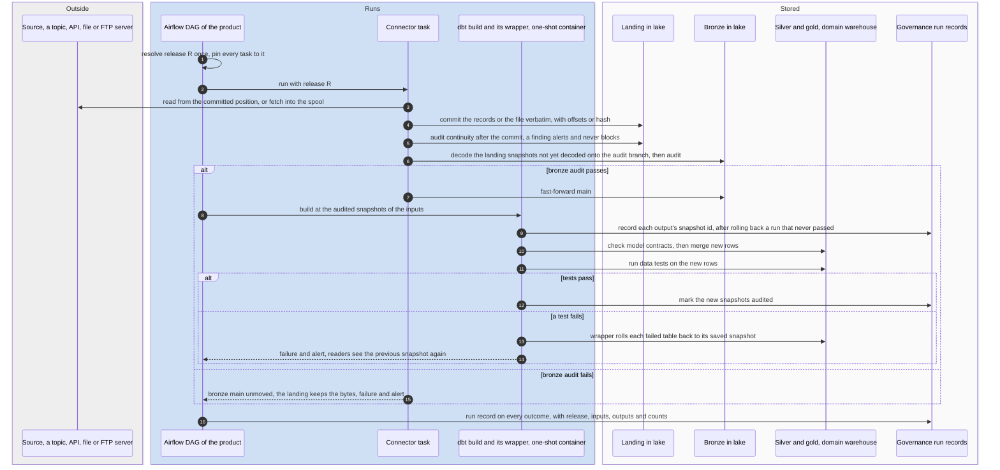

*Reading guide.* Step 1: the **DAG** pins every task to one release. Steps 2 to 5: the **connector task** reads the
**source** (Kafka offsets, or a fetch container), commits it verbatim to the **landing**, audits without blocking.
Steps 6 and 7: **bronze** is decoded on an audit branch, fast-forwarded on a pass. Steps 8 to 12: **dbt and its
wrapper** read inputs at audited snapshots, save output snapshot ids in the **run records**, merge into **silver and
gold**, test the new rows, mark them audited. Steps 13 and 14: a failed table rolls back; a direct SQL reader could see
its rows for the test window (seconds, B.1's choice; O8), other products and REST never. Step 15: bronze stays unmoved,
bytes kept. Step 16: every outcome writes a run record. A derived product starts at step 8.

**Connectors.** A source-aligned product has one connector, in its ODPS file; secrets are named by environment variable.

| `kind` | Required fields | Landing | Runs in |
|---|---|---|---|
| `kafka` (Kafka or Redpanda) | `brokers`, `registry`, `topic`, `envelope: {format, contract}`, `filter: {field, in}?`, `payload`, `startFrom`, `maxOffsetsPerPartition` | table `lake.<product>.landing`: the records the filter keeps, byte for byte, end offsets in the same commit (ADR-022) | Spark, reusing `docker/lake/offsets.py` and the framing half of `wire.py` |
| `public-api` | `url`, `allowHosts`, `params`, `pagination` (`none`, `next-link`, `page`), `maxPages`, `minIntervalS`, `records`, `volatileFields?`, `authHeaderEnv?` | one object per changed response, named by its sha256; every fetch logged | fetch container |
| `https-file`; `s3-file` | `url` (templated by run date), `allowHosts`, `format`, `parser`, `calendar` (a calendars table id); `endpoint`, `bucket`, `key`, `credentialsEnv`, `format`, `parser` | `k2-landing/<domain>/<product>/<day>/<sha256>.<ext>`, never overwritten (`docker/lake/file_source.py` on the branch) | fetch container |
| `sftp`; `ftp` | `host`, `path`, `user`, `keyFileEnv`, `hostKey`; `host`, `path`, `tls: required` (plain only for anonymous public data), `credentialsEnv?` | same | fetch container: OpenSSH `sftp -b`; `ftplib.FTP_TLS` |
| `database`; `lake-table` (reserved) | `dsn` or a product id, `query` or `table`, `cursorColumn` | a landing table, as for `kafka` | built when the first such product is proposed |

**Each product owns its landing; nothing is shared** (A.1). A Kafka product reads its own topic at its own position;
the crypto envelope contract is the capture's `RawMessage` (`schemas/avro/raw-message.avsc`), declared by
`market-capture`, filtered `{field: stream, in: [trade]}`; the rest is counted, so "landed plus skipped equals the
offset span" (giving up ADR-021's "every frame", Proposed). A continuous consumer: a long-running task, same landing.

**The landing commits first and never blocks** (Accepted `docs/adr/ADR-047-ingest-batch-audit-after-publish.md:45`): a
blocked archive stops reading Redpanda, whose topics keep 48 hours or 2 GiB per partition
(`docker/redpanda/init.sh:139-146`); its audit runs after the commit and alerts. **Paused**: nothing lands; **resume**
starts at the log start with an `offset_gap` record on the page. **Loss is never silent**: an active product whose
offset is below the log start fails loudly, as `docker/lake/offsets.py:215-230` does; moving on takes an operator's
per-product accept-data-loss run (an Airflow trigger with `conf`), recorded on the page.

**Fetching is isolated.** Other kinds run in a one-shot `fetch` container (compose profile `fetch`, so
`scripts/check-budget.py` counts and pin-checks it), started with arguments as a list as the branch's
`docker/airflow/dags/factory.py` does: `python:3.12-slim` and OpenSSH, by digest, no key, one spool directory per run.
It connects only to addresses resolved from `allowHosts`, refusing private, loopback, link-local and unique-local IPv4
and IPv6 ranges; redirects only to `https://` on an allowed host; a 64 MiB cap, timeouts, TLS verification. That is the
real guard, as any container here reaches host ports via `host.docker.internal` (REVIEW's probe); a forward proxy waits
for the first source whose hosts cannot be listed. It **parses** with the registered parser
(`<area>/<domain>/parsers/<name>.py`, bytes in, JSON lines out), never in Spark.

**Load, audit, publish.** Spark checks the spooled sha256 against the fetch task's record, moves the object to the
landing bucket, loads rows into bronze on one fixed audit branch per table (REVIEW F26), audits counts, parse errors
and declared checks, and fast-forwards; a response unchanged apart from `volatileFields` lands nothing. **Bronze
publishes in order**: a failed batch blocks later ones per partition (never the landing), so watermarks cannot skip.

**dbt builds silver, gold and marts** (B.1): dbt-core 1.12.7, dbt-trino 1.12.0, never Fusion. A run is one `dbt build
--selector <product>` in a one-shot `dbt-runner` container (compose profile `build`) whose environment is an
allow-list (Trino's address, the writer `dbt_<product>`, the release path): no Docker socket, no Airflow secret. Today
the DAG hands dbt the scheduler's whole environment (`docker/airflow/dags/dbt_marts.py:96,144`), with the database URL
and two signing secrets (`docker-compose.yml:94,99-100`) beside the Docker socket (`:642`), and `env_var()` renders
them into a model. Generated YAML adds `contract: {enforced: true}`, `unique_key`, `incremental_predicates` on the
partition column, and tests scoped by `where` to the new rows; whole-table checks move to maintenance, as one over trades
exceeded Trino's memory (`platform/k2gen/k2gen/generate.py:410-416`). Models merge on the key past a watermark.

**Rollback and reconciliation.** Before building, the wrapper writes a durable run record with each output's snapshot
id; if the previous run never passed (killed by a restart, a timeout or out of memory), it first rolls outputs back to
their last audited snapshot. After the build it reads `run_results.json`, runs `rollback_to_snapshot(<id>)` as
`dbt_<product>` on each failed model, records the ids and fails (`on_kill` too); a follow-up Spark task of that run
expires them by id (`expire_snapshots`), so time travel reaches them for minutes. Outputs are tables, since masks do
not apply through a `definer` view (REVIEW fact 2). **Reading across products** goes only through `k2_input('<product>',
'<table>')`: `source()` plus `FOR VERSION AS OF` the input's newest audited snapshot, resolved once per run and passed as
a dbt variable (unit tests pass none, so dbt mocks the source); own bronze uses `source()`. Transforms and k2-api read
the same ids, so an input's test window never reaches another product (REVIEW section 6 relied on asset events).

**Registered code transforms** carry logic that is not SQL: book replay (`docker/lake/books.py`), event bars
(`docker/lake/bars.py`). A contract names one (`build: code: event_bars@1`); the code lives under its domain with
fixtures and a reference implementation (ADR-029) and runs in a Spark runner that alone reads, locks, writes and
publishes, into its domain warehouse. Contracts hold no code (REVIEW F1). **Least privilege** (ADR-054, in slice 1):
today Spark and Trino hold the MinIO root key (`docker/trino/etc/catalog/lake.properties:16-17`); in v2 Spark writes
`k2` and code outputs, Trino domain warehouses, fetchers nothing; maintenance, init and backup each hold their own key.

**Derived products** (REVIEW F7: asset scheduling waits for every asset) run on their own cron, read audited inputs
from a watermark, and record each input's state, snapshot and lag; the badge is `complete` or `partial: <inputs>` (a
`required` input alerts). Rows missing an input carry a flag such as `rate_missing`, recomputed by the lookback window.

**Maintenance, per product.** Today one nightly job holds the global lock about 34 minutes (REVIEW section 5;
`docker/airflow/dags/lake.py:175-196`, `docker/lake/lock.py:1-8`). In v2 each DAG runs a daily task, staggered, after
its own build: compaction, orphan cleanup (24-hour floor), whole-table checks, and expiry past the rollback reach and
the 7-day `as_of` window (`dbt/macros/expire_mart_snapshots.sql`), under a per-product lock; freshness alerts skip it.

**Fit on one host** (addendum 3 L). About twenty DAGs; one-slot pools for Spark (`lake_spark`) and fetches, two slots
for dbt runners, off the scheduler (four LocalExecutor slots, `docker-compose.yml:91-92`; 1.5 CPU / 3 GiB, `:665`), and
a Trino resource group `pipeline` so builds cannot starve interactive SQL. A Kafka connector starts one 3.5 to 4 s Spark
session (REVIEW fact 8). If N0's chain p90 passes 200 s (ADR-034's line is 240 s), the escapes are one session for
venue connectors, Spark Connect, then derived products every 15 minutes.

### 4.5 Lifecycle states

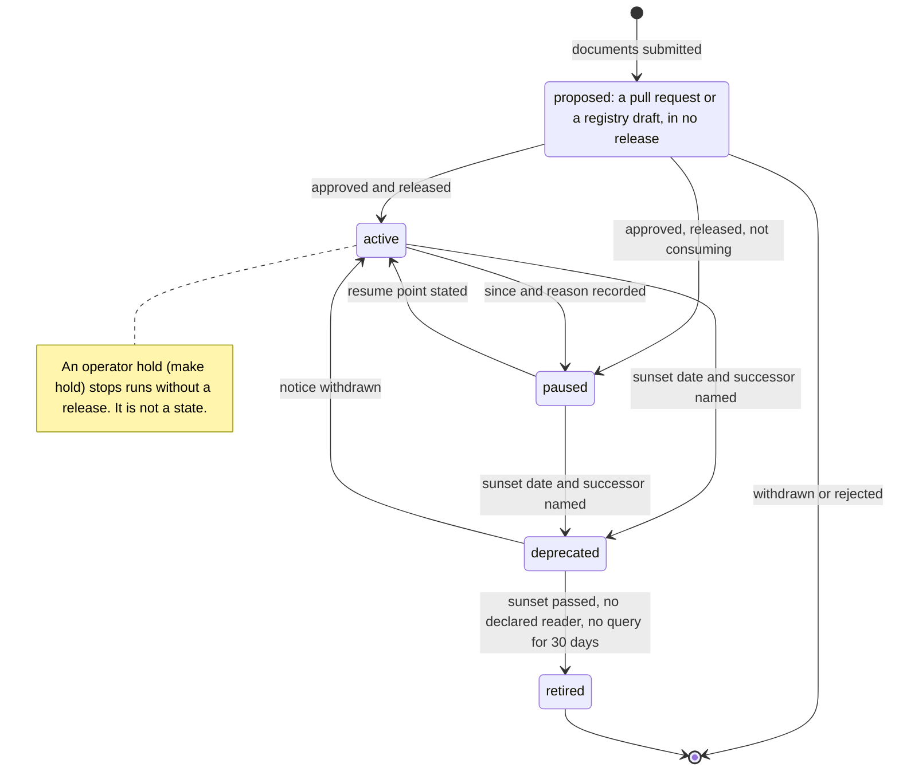

*Reading guide.* **Proposed** is a submission (a pull request or registry draft), not a `status`; its exits are checked
against the submitted documents. Release makes a product **active**, or **paused** if declared but not consuming (the
book products); the two move both ways with since and reason. Either can become **deprecated** (a sunset and a
successor, withdrawable). **Retired**, final, follows only deprecation, after the sunset, with no declared reader and
no query for 30 days (4.12's usage; declared readers until N6), so readers get notice. A **hold** needs no release.

| Part | `active` | `paused` | `deprecated` | `retired` |
|---|---|---|---|---|
| DAG and connector | scheduled, consumes | unscheduled, consumes nothing; resume as in 4.4 | scheduled, consumes | not built |
| Tests and alerts | run; freshness and integrity | stood down with a "paused" row; maintenance and integrity only | run, plus a sunset warning | none |
| Trino | granted roles | readable; page says stale by design | readable; notice in the table comment | owner and platform only; no row deleted (ADR-028 section 12) |
| REST | 200 | 200 with `K2-Product-State: paused` | 200 with `Deprecation` and `Sunset` | 410 Gone |
| Downstream | | shown `partial` | shown `reads deprecated` | checks refuse new readers |

**Operator hold.** `make hold PRODUCT=... REASON=...` pauses the DAG and writes a governance row the page and badges
read; `make unhold` ends it; no deploy overrides it (today a runbook pauses by hand, unrecorded,
`docs/runbooks/lake-ingest-lag.md` section 3). `maturity` gives way to a readiness scorecard. **State history** comes
from deployed release manifests (status, deploy time, merge commit, approver): when a state took effect (REVIEW F15).

### 4.6 Permissions: one enforcement point, both endpoints

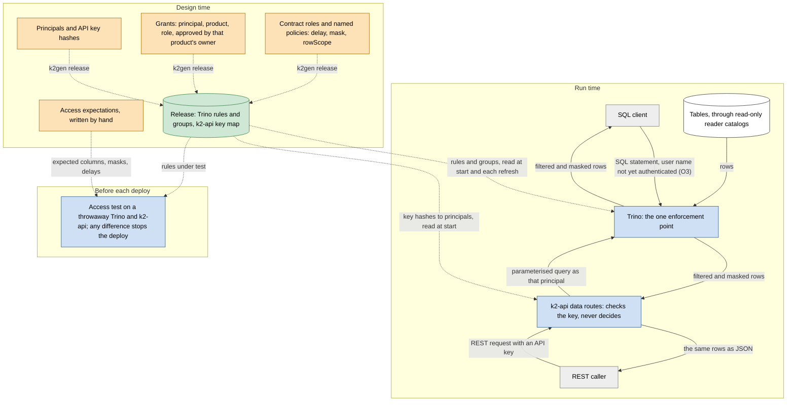

*Reading guide.* **Run time** first: a **SQL client** sends a statement and a user name, trusted on loopback (O3), to
**Trino**; a **REST caller** sends an API key to **k2-api**, which queries Trino as the key's principal. Trino alone
applies rules over the **tables**, returning filtered, masked rows to both. **Design time:** **principals**, **grants**
and **policies** compile into the **release's rules, groups and key map**; a person separately writes the **access
expectations**. **Before each deploy** the **access test** runs both through both endpoints; a difference stops it.

**Model.** `principals.yaml` lists services and, under pseudonymous ids, people (REVIEW F14), each with an owner and a
key hash. A table's ODCS `roles[]` declares the roles it offers; `policies` narrow each with three named, comparable
kinds, never a free-form filter (REVIEW F3); masks only, since hiding breaks `SELECT *` (REVIEW F21). A **grant** in
the product's `grants.yaml` gives one principal one role on one product, so a data business can license one product to
one client; CODEOWNERS makes that product's owner the approver. No match denies (Trino 484).

| Policy | Written as | Trino rule | Stricter when |
|---|---|---|---|
| `delay` | `{column, minutes}` | row filter `column < current_timestamp - INTERVAL 'n' MINUTE` | more minutes, on a column never earlier than the input's |
| `mask` | `[columns]` | column mask to a typed null (`_TRINO_TYPES`, `platform/k2gen/k2gen/generate.py:408`) | more columns |
| `rowScope` | `{column, values}` | row filter `column IN (values)` | fewer values |

**Inheritance.** An output's policy for a role is at least as strict as each input's, or the role is not offered: a
`delay` column is never earlier than the input's (for candles the window end, by a generated test); a masked input
column stays masked or is shown dropped by `transformSourceObjects`; a registered transform is as strict as any input.

**Into Trino.** One group per (product, role) through the file group provider (verified in 484 by the judge) and per
table one rule per offered role naming only that product's groups, after ADR-044's writer and retention-floor rules
(`platform/k2gen/k2gen/generate.py:365-398`); with one role per product, first-match order never decides. Exact table
names deny every `$` metadata table (`t$files`). A writer `dbt_<product>` writes only its namespace in `<domain>_build`
and selects only its inputs and own tables (today everyone selects everything, `generate.py:389-390`). Trino reads
`current/rules.json` with `security.refresh-period`, safe because it changes only by an atomic link swap after
preflight (REVIEW F2's failure was a partly written file).

**A proof that is not circular** (REVIEW F4). `tests/access/expectations.yaml`, hand-written and owner-reviewed, lists
per principal and table the visible and masked columns, the minimum row age, a row that must not appear and negative
probes; `make access-verify` runs it through SQL and REST on a throwaway Trino (`make test-trino`, `Makefile:98`) and
live after deploy. A policy or denied layer without an expectation row is refused.

**Identity and the paths around Trino.** On loopback Trino trusts the user name sent (ADR-044:112-114: "the fences stop
mistakes, not a liar"), so under O3 (a) a local client can claim any name. Paths that read storage without Trino today
are closed in N1, before the first consumer role:

| Path | Today | From N1 |
|---|---|---|
| Notebooks | DuckDB on Lakekeeper and MinIO host ports with the MinIO root key from `.env` (`notebooks/k2lake.py:10-13,33-34,107`) | Trino as a named principal, through the `trino` client |
| Lakekeeper | published on `127.0.0.1:18181`, no authentication (`docker-compose.yml:885`); a drop is a purge (`ADR-044-...md:33`) | not published; on `k2-net` only; authentication per O3 |
| MinIO | published on `127.0.0.1:9000` and `:9001` (`docker-compose.yml:290-291`); root credential the factory default (ledger) | not published; root rotated, held only by init and backup; scoped keys per engine |
| Parity, replay, backup | read storage on host ports (`scripts/parity_ohlcv.py`, `parity_bars.py`, `replay_export.py`, `backup-lake.sh`) | containers on `k2-net` with scoped read keys |
| Fetch containers | reach host-published ports through the host gateway | the address allow-list (4.4); negative probes in `make access-verify` |
| Platform jobs | Spark and Trino on the root key | the remaining trusted paths: init, backup and maintenance, each with its own key |

### 4.7 Crypto as products

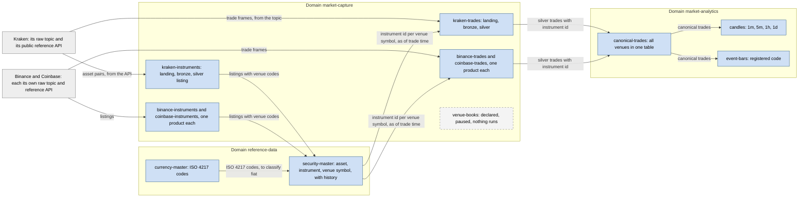

*Reading guide.* Domain boxes make cross-domain arrows visible. Each outside arrow reaches one product: **Kraken's
topic** only **kraken-trades**, its **reference API** only **kraken-instruments**; **Binance and Coinbase** have the
same two products each. Listings and the **currency master's** codes flow into the **security master**, which gives
each trades product the instrument id for its venue symbol as of trade time (4.11). Venue silvers feed
**canonical-trades**, which feeds **candles** and **event-bars**; **venue-books** is paused, so no arrow reaches it.

**The security master** (B.4): two levels plus the venue mapping, built by dbt from the instruments products'
published silver listings through declared input ports, never from their landings.

| Table | Grain and key | Columns |
|---|---|---|
| `asset` | one per asset, `asset_id` (the normalised code, `BTC`); no history: a changed kind or currency is a new asset | `kind` (`crypto`, `fiat`, `stablecoin`); `currency` (ISO 4217 code for fiat, a reference to the currency master; null otherwise); `name` |
| `instrument` | one per traded pair and version, (`instrument_id`, `valid_from`) | `base_asset_id`, `quote_asset_id` (references to `asset`), `valid_from`, `valid_to`, `recorded_at`: BTC/USD, BTC/USDT, BTC/USDC are three instruments of one asset |
| `venue_symbol` | one per venue spelling and version, (`venue`, `venue_symbol`, `valid_from`) | `instrument_id`, `status`, `valid_from`, `valid_to`, `recorded_at` |

**Matching is by rule, never a guess.** Each instruments product publishes per pair and change the venue's codes and
spellings. The master upper-cases codes, applies a reviewed `seeds/code_exceptions.csv` (venue, venue code, code),
matches the pair and gives each `venue_symbol` the normalised `BASE/QUOTE`. Kraken's feed writes `BTC/USD`
(`config/instruments.yaml:122`), its reference API `wsname` `XBT/USD` with codes `XXBT`, `ZUSD` (I called
`https://api.kraken.com/0/public/AssetPairs?pair=XBTUSD`, field names only); `kraken, XBT, BTC` makes them match. Asset
kind: in the currency master, `fiat`; in `seeds/stablecoins.csv`, `stablecoin`; else `crypto`.

**A miss holds rows; it does not stop the venue.** A trade whose symbol resolves to nothing goes to the held table
`silver_trade_unresolved` (owner-only); resolved rows publish. A generated audit, "unresolved rows = 0", fails loudly
(an alert, `degraded` on the page, an on-demand instruments run) and rolls nothing back; held rows move into silver once
they resolve. A spelling claimed twice is held for that venue only. Captures keep their own list (addendum 1 A).

**History.** `instrument` and `venue_symbol` are type-2, built incrementally, valid from the first fetch that saw a
version to the first that saw a change, `recorded_at` as knowledge time. A key's **first version opens at
`1970-01-01`** (or a listing date), so earlier trades match (`docs/adr/ADR-030-scd2-security-master.md:337-339`); the
open row's `valid_to` is `9999-12-31 23:59:59`, never null (`:66-67`); rebuildable, unlike a dbt snapshot.

### 4.8 ECB FX as products: the dbt worked example

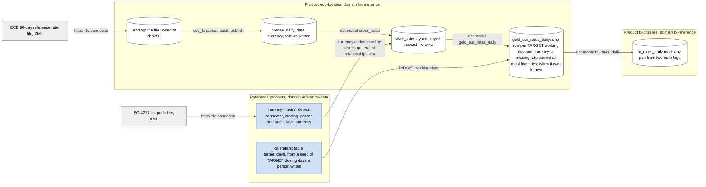

*Reading guide.* Boxes show which tables belong to which product. The **ECB file** lands under its hash; the `ecb_fx`
parser makes **bronze**, published after its audit. Each later arrow is a dbt model: **silver_rates** types and keys,
newest file winning; **gold_eur_rates_daily** builds a row per TARGET working day and currency from the **calendars**
product (a seed a person writes), carrying a missing rate at most five days, with when it was known; **fx-crosses**
builds any pair. The **ISO 4217 publisher** feeds **currency-master**; silver's generated relationships test reads its
codes, and an unresolved quote fails the build and rolls it back. Both reference inputs are declared input ports.

Conventions are old P4's (`docs/plans/2026-11-24-governed-self-serve-platform/004-fx-data-product.md`): quote units per
euro; a reference fixing about 16:00 Frankfurt time, not a market close; `DECIMAL(20,10)`; carry at most five TARGET
days; `rate_available_at`. Each layer earns its place (REVIEW F27). The three models teach a source, a merge, `IGNORE
NULLS` windows, a seed, a cross-product input, unit tests and a rollback, on a file small enough to check by hand.

### 4.9 Deploy and rollback

```mermaid
flowchart TB
  classDef person fill:#fde2b8,stroke:#a86b00,color:#000
  classDef gen fill:#cfe8d5,stroke:#2f7d43,color:#000
  classDef run fill:#cfe0f5,stroke:#2b5a8a,color:#000
  subgraph DEP["Deploy time: make deploy, started by the operator"]
    SET["An approved document set: in 3.0 a release tag, later a registry version"]:::person
    REL[("releases/R: code, rules, compose file, manifest and hashes, immutable")]:::gen
    PRE["Preflight: access test, dbt parse, DAG import, storage plan"]:::run
    STOP["Stop: no pointer moved, R-1 keeps running"]:::run
    DRN["Drain, only when Trino restarts or DAGs change: pause product DAGs, let running tasks finish"]:::run
    DDL["Additive DDL: new tables and new nullable columns only"]:::run
    TRP["Trino pointer to R: rules re-read at the next refresh; restart only for catalog changes"]:::run
    AFP["Airflow, Spark and Prometheus pointers to R; k2-api recreated; DAGs unpaused"]:::run
    VER["make release-verify: every part reports R"]:::run
    DONE["R is live"]:::run
    PREV[("releases/R-1: what the pointers named before, kept")]:::gen
  end
  SET -.->|"git archive or registry export, then k2gen release"| REL
  REL -.-> PRE
  PRE -.->|"any check fails"| STOP
  PRE -.->|"all pass"| DRN
  DRN -.-> DDL -.-> TRP -.-> AFP -.-> VER
  VER -.->|"every part reports R"| DONE
  VER -.->|"a part reports another release"| PREV
  PREV -.->|"make deploy rolls back by itself, same steps, then fails loudly"| DRN
```

*Reading guide.* All deploy time: only configuration moves, so arrows are dashed steps, in order. The **approved
document set** (`git archive` of a tag, never the working tree, or a registry version) is compiled into the **release
directory**. **Preflight** runs the access test, a dbt parse, a DAG import and a **storage plan** (a dry run listing
every table, column and bucket the release would create or change); a failure **stops** with nothing moved. Then it
**drains** if Trino must restart or DAGs change shape, applies **additive DDL**, moves **Trino's pointer**, then
**Airflow's, Spark's and Prometheus's**, recreating k2-api; **release-verify** asks each part its release: all R, **R
is live**. On a mismatch `make deploy` points everything back at **R-1** the same way and exits non-zero. A rollback
moves code and rules, never data.

**Why** (REVIEW F2). Today `./docker/airflow/dags`, `./docker/lake` (read-write) and `./docker/trino/etc` are mounted
from the working tree (`docker-compose.yml:640,692,783,1082`); a checkout emptied the DAG folder for 35 minutes on
2026-11-25 (`CLAUDE.md`). In v2 services mount one releases directory read-only and compose runs from the release,
which holds documents, `docker/lake`, the DAG factory, dbt macros, parsers, transforms, k2-api, the compose file and
image digests (ADR-042), with **a pointer per service**. **Runs are pinned:** Airflow 3.3.2's local bundle has no
versions (`supports_versioning = False`, `airflow/dag_processing/bundles/local.py` in `k2-airflow:3.3.2`) and tasks
re-parse at start, so the first task passes the release id through XCom; a release in use is never deleted.

#### Backup, restore and rebuild

**Backup from contracts** (REVIEW F6: `scripts/backup-lake.sh:30` copies four fixed tables): each release's
`backup-set.json` lists landings, `restore` tables, governance, the Lakekeeper database and the releases; `make
backup-verify` lists each copied snapshot id; `make drop` backs up first (`mc mirror`, N0). Today's commands serve the
old layout (`scripts/lake-verify.sh:7,64-65,83`; `Makefile:161`), so N2 adds `make product-verify` (offsets accounted,
layers level, a second run adds nothing), `make rebuild` (bronze from the landing, silver and gold by `dbt build
--full-refresh`) and a generated `make restore`: a `restore` table registers its copy; a `rebuild` table's entry is
dropped with `purgeRequested=false`, recreated and rebuilt, so none points at uncopied files
(`docs/runbooks/lake-backup-and-restore.md:239-262`). The **first restore drill ends slice 2** (volumes are disposable
before 3.0, addendum 5 P); restore needs `LAKEKEEPER_ENCRYPTION_KEY` (`:49`), kept off the host.

### 4.10 Today beside the target

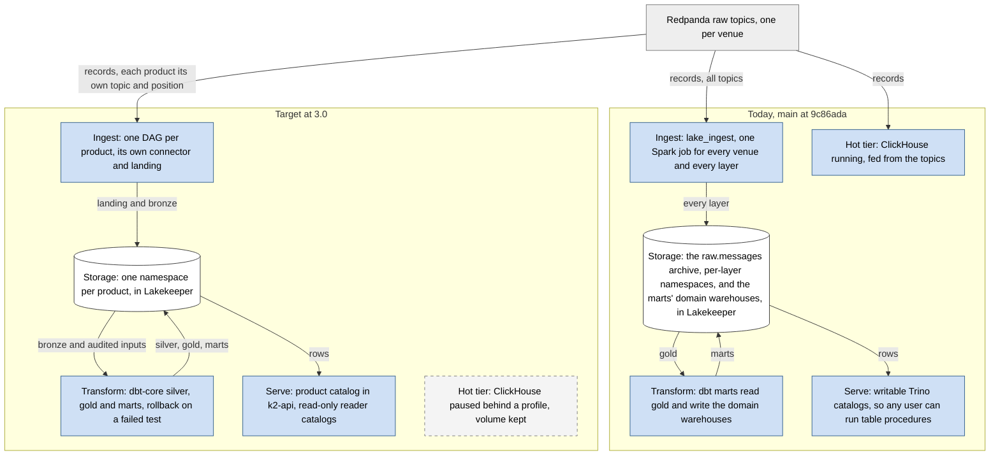

*Reading guide.* Two boxes, the same five rows. **Today** **lake_ingest** (`docker/airflow/dags/lake.py:128-132`)
reads every **topic** and writes every layer, the archive **raw.messages** (`docker/lake/ingest.py:158-166`,
`docker/lake/ddl/lake.sql:47`) then per-layer namespaces, so one fault stops every venue; dbt marts read gold, write
domain warehouses; consumers query writable catalogs, where anyone can run a table procedure; **ClickHouse** runs off
the topics (`docker-compose.yml:223-274`). In the **target** each **DAG** reads its own topic into **its namespace**;
**dbt** builds from bronze and audited inputs; consumers use the **product catalog** and read-only catalogs;
**ClickHouse** is paused, so no arrow reaches it. The method is not an arrow: build fresh, prove, retire to `legacy/`.

**Proof instead of table-to-table parity** (addendum 5 Q): dbt unit tests (as `dbt/models/market_analytics/marts/`),
connector fixtures, `make parity-silver` (DuckDB recomputing silver from the landing), `parity-ohlcv` and `parity-bars`
re-pinned, gapless offsets, exactly-once resume, a double run adding nothing, an empty `EXCEPT ALL` (rows in one result,
not the other) between two builds. **Let go** after a backup: `raw.messages`, `audit.checks`, book data, the old pin.

### 4.11 Joining across domains: an enriched product

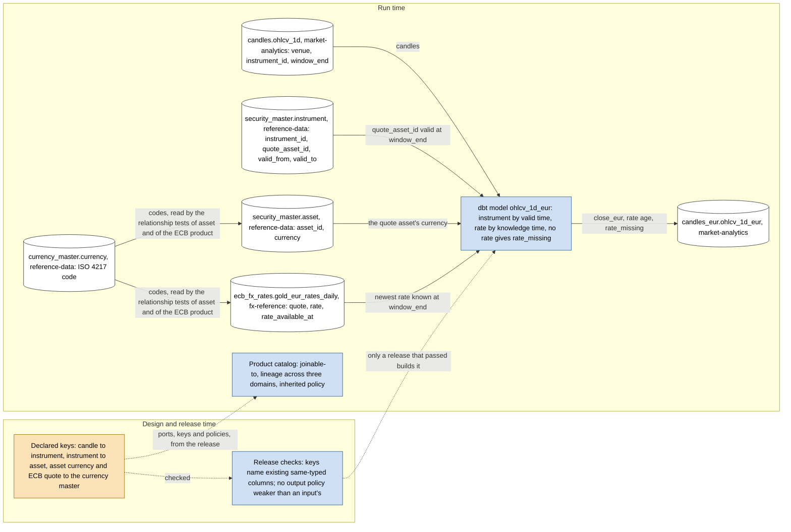

*Reading guide.* The goal is a daily candle valued in euros. The **currency master** is not read by the model: it is
the dictionary both sides point at, read by the relationship tests of **asset** and of the **ECB** product. At **run
time** **candles**, **instruments**, **assets** and **ECB rates**, from three domains, feed one **dbt model**: a candle
finds its instrument as at `window_end` (valid time), the quote asset's ISO 4217 currency and the newest rate published
by `window_end` (knowledge time), writing **candles_eur**. A stablecoin or crypto quote has no currency, hence
`rate_missing`; a paused ECB product makes the badge `partial`. At **design and release time** the **declared keys**
pass the **release checks**, and the **product catalog**, which knows each input already, adds this product's ports.

**Conformed reference products** (security master, currency master, calendars, later entities) are ordinary products.
**A joinable product carries** `instrument_id` or `asset_id`, ISO 4217 codes, calendar-named dates, UTC timestamps, each
an ODCS `relationships` entry in the host-less fully qualified form
`<domain>/<product>/<table>.odcs.yaml#/schema/<table>/properties/<column>`, which the vendored pattern accepts (a URL
with host and port fails it, tested) and k2-api serves the same under git or a registry.

**Point in time.** A reference product with history carries `valid_from`, `valid_to` (when a fact held) and
`recorded_at` or `*_available_at` (when it could be known); a relationship says `asOf: valid` or `known`. ADR-030's
convention (`docs/adr/ADR-030-scd2-security-master.md:66-67,108-110,337-339`): half-open `[valid_from, valid_to)`; the
open row's `valid_to` is `9999-12-31 23:59:59`, never null (`ts < NULL` silently drops the current row); first versions
open at `1970-01-01`. Knowledge time avoids look-ahead: a 10:00 UTC candle gets that day's fixing by valid time, the
previous day's by knowledge time. **`k2_as_of`** writes both: `mode='valid'` is `left join T on <keys> and <at> >=
T.valid_from and <at> < T.valid_to`; `mode='known'` takes the newest row known at `<at>`; unit tests cover boundaries.

### 4.12 Metadata, open standards and readiness for AI

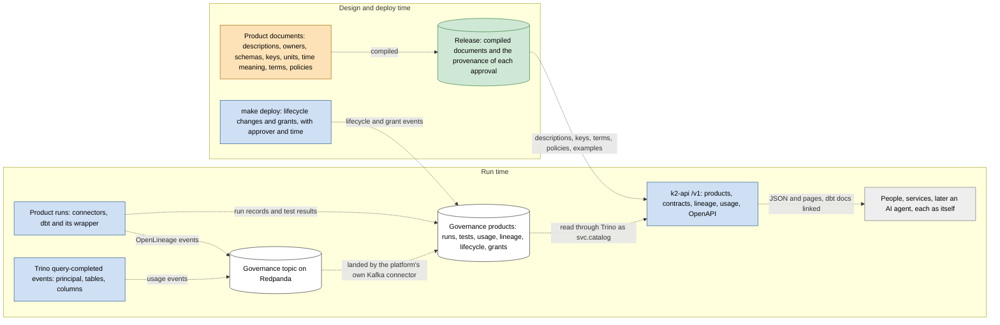

*Reading guide.* All metadata. A person writes the **documents**; the **release** keeps them with each approver; **make
deploy** records lifecycle changes and grants in the **governance products**. **Product runs** write run records and
tests there and emit OpenLineage events, **Trino** a usage event per query, into a **governance topic** the platform's
own Kafka connector lands. **k2-api** serves release and governance (via Trino) to **people, services and agents**.

| Kind | Captured where, in what format | Stored | Read by | Today (path) | v2 |
|---|---|---|---|---|---|
| Descriptive and business | ODPS `description`, `team`, `tags`; ODCS `description`, `businessName`, `classification` | release | k2-api, pages, dbt docs | `contracts/*/*/product.yaml`, `docs/products/` | N1; column descriptions checked; a glossary when a second domain team asks |
| Structural | ODCS columns, keys, `relationships`; K2 `unit`, `time`; as built in Lakekeeper | release; Lakekeeper | k2-api, Trino | ODCS columns (`contracts/schema/README.md`); Avro (`schemas/avro/`) | N1; references N5 |
| Provenance and terms | offsets or sha256 per landing; fetch log; ODPS `authoritativeDefinitions` licence; K2 `terms` | landing tables; release | k2-api, pages | offsets (`docker/lake/offsets.py`); no licence or terms anywhere | N1, terms recorded before any external reader |
| Operational | a run record per run: release, inputs and snapshots, outputs, duration, rows, bytes, outcome | governance | k2-api, alerts | Airflow metadata database; Prometheus | N1 |
| Quality | dbt results (`dbt/macros/record_test_results.sql`), connector audits, objectives from `slaProperties` | governance | k2-api, alerts | `dq.dbt_test_results`, `lake.audit.checks`, `contracts/governance/quality-results/` | N1; objective history N8 |
| Lineage | product level from ports; model level from the dbt manifest; OpenLineage from Airflow and dbt; the reference snapshot each enriched run read | release; governance | k2-api `/lineage`, dbt docs | dbt manifest; `openlineage-python` 1.53.0 unused in the Airflow image, a cosmos dependency | N1 product level; N6 events and columns |
| Access and usage | grants with approver; Trino's Kafka event listener (plugin present in `trinodb/trino:484`) | release; governance | k2-api, retirement check | rules only (`platform/k2gen/k2gen/generate.py`); Lakekeeper's audit trace off (`docker-compose.yml:893`) | N6 |
| Lifecycle | each state change and hold, with who, when, why | governance | k2-api, pages | `lifecycle` in `product.yaml`; `git log` | N1 deploy events; N2 holds |

| Concern | Standard and version | Steward | Where K2 uses it | Without it |
|---|---|---|---|---|
| Product and table definitions | ODPS 1.1.0; ODCS 3.2.0 (JSON Schema 2019-09) | Bitol, Linux Foundation | every product (4.3) | a private descriptor |
| Table format; catalog | Apache Iceberg format v2 (`docker/lake/ddl/lake.sql:61`), jars 1.8.1; Iceberg REST catalog | Apache Software Foundation | storage; Lakekeeper | engine lock-in |
| Files; wire records | Apache Parquet; Apache Avro with Confluent framing | Apache; the framing is a de facto standard | data files; topics (`schemas/avro/`) | private formats |
| Query language | SQL, as Trino implements it | ISO; Trino Software Foundation | SQL endpoint, dbt models | a private language (REVIEW F10) |
| Lineage events | OpenLineage, client 1.53.0 (present) | LF AI and Data Foundation | Airflow provider and `dbt-ol` to Kafka, N6; Trino's listener once a receiver exists | custom lineage tables |
| Metrics; telemetry | OpenMetrics, in use; OpenTelemetry with ADR-051 (trigger: ADR-051 accepted) | CNCF | every service's `/metrics` | private formats |
| REST description | OpenAPI 3.1 as FastAPI generates it (to confirm in N1) | OpenAPI Initiative, Linux Foundation | `/v1/openapi.json` | hand-written API docs |
| Identity | OAuth 2.0 and OpenID Connect, O3 (c) | IETF; OpenID Foundation | Trino, k2-api, Lakekeeper if chosen | shared passwords |
| Versions; codes; time | Semantic Versioning 2.0.0; ISO 4217; ISO 8601 in UTC | semver.org; ISO | `version`; currency master; timestamps | ad hoc conventions |
| Catalog exchange; events; agents | W3C DCAT 3 export, post-3.0 (trigger: an external catalog imports K2); CloudEvents 1.0, rejected: no event leaves the platform (trigger: an external subscriber); Model Context Protocol, post-3.0 (version and steward to confirm then) | W3C; CNCF; an open specification | not in 3.0 | a private export and agent API |

**Readiness for AI**, not built for 3.0 and not blocked by it: every catalog fact is machine readable through `/v1`;
columns are described (a check); products carry example queries and join keys; identifiers are stable; usage is logged.
**After 3.0, beside the registry**, a Model Context Protocol server offers search and governed queries as the caller,
through k2-api and Trino, never around them, its usage logged like any other.

## 5. The acceptance cases, end to end

Every file a person writes is listed; those that carry the design are shown. Generated files are listed, not shown.

### 5.1 Kraken trades from its Redpanda topic

| File a person writes | What it holds |
|---|---|
| `contracts/market-capture/kraken-trades/`: `product.odps.yaml`, `silver_trade.odcs.yaml`, `models/silver_trade.sql`, `grants.yaml` | below |
| `.../bronze_trade.odcs.yaml`; `silver_trade_unresolved.odcs.yaml`; `.../models/unit_tests.yml` | the frame as sent (envelope and lineage columns, `data` as the trade structs `docker/lake/bronze.py:138-143` decodes, `decode_error`), key (`src_partition`, `src_offset`), `build: connector`, no consumer roles; held rows, owner only; a two-trade frame, a re-sent trade (replay), a skipped id (gap), a nine-decimal price, an unknown symbol that must be held |
| `contracts/market-capture/kraken-instruments/`: `product.odps.yaml`, `bronze_asset_pair.odcs.yaml`, `silver_listing.odcs.yaml`, `models/silver_listing.sql`; `contracts/reference-data/security-master/`: `product.odps.yaml`, contracts and models for `asset`, `instrument`, `venue_symbol`, two seeds, `models/unit_tests.yml` | the listing from the public API (below); the master (4.7) |
| `contracts/access/principals.yaml`; `tests/access/expectations.yaml` | `{id: svc.partner-dashboard, kind: service, owner: analytics-team, keySha256: <hash>}`; for it on `silver_trade`: `conn_id`, `conn_msg_seq` null, newest row at least 20 minutes old, bronze and the held table denied |

```yaml
# contracts/market-capture/kraken-trades/product.odps.yaml (apiVersion, kind, version, status: active, as 4.3)
id: market-capture.kraken-trades
name: kraken-trades
domain: market-capture
type: sourceAligned
team: {name: capture-team}
description: {purpose: "Kraken trades as sent, one typed row per trade, every delivery kept and flagged.",
              limitations: "Starts at the oldest record the topic held when the product first ran."}
inputPorts: [{name: venue_symbol, version: 1.0.0, contractId: reference-data.security-master.venue_symbol}]
outputPorts:
  - {name: bronze_trade, version: 1.0.0, contractId: market-capture.kraken-trades.bronze_trade}
  - {name: silver_trade, version: 1.0.0, contractId: market-capture.kraken-trades.silver_trade,
     inputContracts: [{id: reference-data.security-master.venue_symbol, version: 1.0.0}]}
customProperties:
  - {property: lifecycleChange, value: {since: "YYYY-MM-DD", reason: "slice 2", decision: ADR-NNN}}
  - {property: schedule, value: {cron: "1-59/5 * * * *", timeoutMinutes: 4}}   # timeout reset from N0's p99
  - property: connector
    value: {kind: kafka, brokers: "redpanda:9092", registry: "http://redpanda:8081", topic: market.crypto.v3.raw.kraken,
            envelope: {format: avro-confluent, contract: market-capture.envelopes.raw_message},
            filter: {field: stream, in: [trade]}, payload: json, startFrom: earliest-retained, maxOffsetsPerPartition: 600000}
```

```yaml
# contracts/market-capture/kraken-trades/silver_trade.odcs.yaml, the parts that carry the design. The key is
# (src_partition, src_offset, src_index), primaryKey and primaryKeyPosition on each; other columns as in today's silver.
schema:
  - id: silver_trade
    physicalName: kraken_trades.silver_trade
    properties:
      - {id: instrument_id, name: instrument_id, logicalType: string, physicalType: varchar, required: true,
         description: The security master's instrument for this venue symbol at trade time.,
         relationships: [{type: foreignKey,
                          to: "reference-data/security-master/instrument.odcs.yaml#/schema/instrument/properties/instrument_id",
                          customProperties: [{property: asOf, value: valid}]}]}
roles: [{role: full_reader, access: read}, {role: delayed_reader, access: read, firstLevelApprovers: capture-team}]
slaProperties: [{property: latency, value: 15, unit: min, element: silver_trade.exchange_ts}]
customProperties:
  - {property: build, value: dbt}
  - {property: backup, value: rebuild}
  - {property: policies, value: {delayed_reader: {delay: {column: exchange_ts, minutes: 20}, mask: [conn_id, conn_msg_seq]}}}
# grants.yaml beside it: [{principal: svc.partner-dashboard, role: delayed_reader}]
```

```sql
-- contracts/market-capture/kraken-trades/models/silver_trade.sql: key, contract and tests come from the ODCS file;
-- silver_trade_unresolved, built after this model, keeps rows with no match and marks those now in silver.
{{ config(materialized='incremental', incremental_strategy='merge') }}
with frames as (
  select b.*
  from {{ source('kraken_trades', 'bronze_trade') }} b
  
  left join (select src_partition, max(src_offset) as done from {{ this }} group by 1) w
    on w.src_partition = b.src_partition
  where b.src_offset > coalesce(w.done, -1)   -- safe: bronze publishes in offset order per partition (4.4)
     or exists (select 1 from {{ source('kraken_trades', 'silver_trade_unresolved') }} h
                where h.src_partition = b.src_partition and h.src_offset = b.src_offset and h.resolved_at is null)
  
),
trades as (
  select f.src_partition, f.src_offset, cast(t.ord - 1 as integer) as src_index,
         t.symbol, cast(t.trade_id as varchar) as trade_id, t.trade_id as trade_seq,
         t.price, t.qty, t.side, t.side as side_native, t.ord_type, f.type as frame_type,
         cast(from_iso8601_timestamp_nanos(t.ts) as timestamp(6) with time zone) as exchange_ts,
         f.recv_ts_ns, f.conn_id, f.conn_msg_seq,
         t.price <> round(t.price, 8) or t.qty <> round(t.qty, 8) as precision_loss
  from frames f
  cross join unnest(f.data) with ordinality as t(symbol, side, price, qty, ord_type, trade_id, ts, ord)
),
resolved as (   -- left join venue_symbol on venue and symbol, exchange_ts in [valid_from, valid_to)
  {{ k2_as_of('trades', k2_input('security-master', 'venue_symbol'), at='exchange_ts', mode='valid',
              on={'venue': "'kraken'", 'venue_symbol': 'symbol'}, take=['instrument_id']) }}
)
-- venue_replay, seq_gap, missing_before: docker/lake/silver.py:186-221's two windows, in a market-capture macro.
{{ k2_trade_flags('resolved', where='instrument_id is not null', lookback_days=1) }}
```

`UNNEST ... WITH ORDINALITY` replaces Spark's `posexplode` (`docker/lake/silver.py:110-125`). **kraken-instruments**
declares `{kind: public-api, url: "https://api.kraken.com/0/public/AssetPairs", allowHosts: [api.kraken.com],
pagination: none, minIntervalS: 5, records: result, recordKey: pair, parser: json_records}`, hourly and on demand;
`silver_listing.sql` splits `wsname` at `/`, one row per version. **Generated:** landing DDL, the DAG (`connect`,
`build`, daily `maintain`), dbt YAML and tests, group `kraken_trades__delayed_reader`, alerts, backup entries, page,
lineage, REST route. **One run:** `connect` reads up to 600,000 offsets per partition (`docker/lake/ingest.py:155`),
keeps `stream = trade`, commits and audits the landing, publishes bronze by WAP; `build` merges and tests, or rolls
back. **Served:** `SELECT * FROM market_capture.kraken_trades.silver_trade` as `svc.partner-dashboard` gives rows at
least 20 minutes old, two columns null; `GET /v1/data/market-capture/kraken-trades/silver_trade` the same.

**Derived products.** `canonical-trades` unions venue silvers through `k2_input()` where `not venue_replay`, adding
`price_e8`, `qty_e8` as `docker/lake/gold.py` does, keyed (`venue`, `instrument_id`, `trade_id`), `maxLagMinutes: 15`;
`candles` recomputes each touched bucket as `dbt/models/market_analytics/marts/candles/ohlcv_1m.sql` orders it. **Binance
and Coinbase differ only in documents.** Binance: bronze renames case-only twins (`e`/`E`, `t`/`T`, `m`/`M`), the
ledger's unreadable `bronze.binance_trade`; side from `m` (`docker/lake/silver.py:60-64`). Coinbase: `events` then
`trades` unnested twice, the flat index of `docker/lake/silver.py:129-135` as a running sum. Their instruments
endpoints' field names are to confirm.

### 5.2 ECB end-of-day FX reference rates, the dbt worked example

| File a person writes | What it holds |
|---|---|
| `contracts/fx-reference/ecb-fx-rates/`: `product.odps.yaml`, `models/silver_rates.sql`, `gold_eur_rates_daily.sql`, `unit_tests.yml`, `grants.yaml` | below; `silver_rates.sql` keeps the newest landed value per (`rate_date`, `currency`) as `DECIMAL(20,10)`, merged on the key past its `landed_at` watermark; three unit tests (a fixing carried five TARGET days then null, with a made-up code; a later file replacing an earlier one; `rate_available_at` 15:00 UTC in winter, 14:00 in summer) |
| `.../bronze_daily.odcs.yaml` | `rate_date`, `currency` (`^[A-Z]{3}$`), `rate` as written, `source_file_sha256`, `landed_at`; key (`rate_date`, `currency`, `source_file_sha256`); `quality`: `rate_positive`, `no_future_date` (engine `k2-connector`); `backup: rebuild` |
| `.../silver_rates.odcs.yaml`; `.../gold_eur_rates_daily.odcs.yaml` | key (`rate_date`, `quote`), `quote` refers to `reference-data/currency-master/currency.odcs.yaml#/schema/currency/properties/code`, roles `public_reader`, `full_reader`, `delayed_reader` without policies; key (`as_of_date`, `quote`), `rate` nullable, `quality: rate_null_after_five_days` |
| `.../fixtures/eurofxref-hist-90d.xml`, `eurofxref-corrupt.xml`; `fx-reference/parsers/ecb_fx.py` | the attributed sample and a corrupted copy, which the old plan allows (`docs/plans/2026-11-24-governed-self-serve-platform/README.md:94-97`, per VERDICT 4.2); the registered parser, domain-owned and platform-reviewed: a row per `Cube time` and `Cube currency rate`, safe XML parsing as on the branch |
| `contracts/reference-data/currency-master/`, `contracts/reference-data/calendars/` | the reference products it reads: an https-file product for the ISO 4217 list; a seed of TARGET closing days built into `target_days` |

Its `product.odps.yaml` differs from 5.1 in its id, purpose and limitation ("a reference fixing about 16:00 Frankfurt
time, not a market close"); input ports `reference-data.currency-master.currency` and `.calendars.target_days`; a
licence link and `terms: {redistribution: allowed, attribution: "Source: ECB"}`, both checked against the ECB's terms
in N1; `schedule: {cron: "30 15 * * 1-5"}`; `connector: {kind: https-file, url:
"https://www.ecb.europa.eu/stats/eurofxref/eurofxref-hist-90d.xml", allowHosts: [www.ecb.europa.eu], format: xml,
parser: ecb_fx, calendar: reference-data.calendars.target_days}`.

```sql
-- contracts/fx-reference/ecb-fx-rates/models/gold_eur_rates_daily.sql: every TARGET day per quote, the last fixing
-- carried at most five days, with when it was known. In unit tests k2_input renders a plain, mockable source().
{{ config(materialized='table') }}
with grid as (
  select d.day as as_of_date, q.quote, row_number() over (partition by q.quote order by d.day) as day_no
  from {{ k2_input('calendars', 'target_days') }} d
  cross join (select distinct quote from {{ ref('silver_rates') }}) q
  where d.day between (select min(rate_date) from {{ ref('silver_rates') }})
                  and (select max(rate_date) from {{ ref('silver_rates') }})
),
joined as (
  select g.*, r.rate, r.rate_date, case when r.rate is not null then g.day_no end as fixed_day_no
  from grid g left join {{ ref('silver_rates') }} r on r.quote = g.quote and r.rate_date = g.as_of_date
),
carried as (
  select as_of_date, quote, day_no,
         last_value(rate) ignore nulls over (partition by quote order by as_of_date) as rate,
         last_value(rate_date) ignore nulls over (partition by quote order by as_of_date) as rate_date,
         last_value(fixed_day_no) ignore nulls over (partition by quote order by as_of_date) as fixed_day_no
  from joined
)
select as_of_date, 'EUR' as base, quote, rate_date, day_no - fixed_day_no as days_stale,
       case when day_no - fixed_day_no <= 5 then rate end as rate,
       with_timezone(cast(rate_date as timestamp(6)) + interval '16' hour, 'Europe/Berlin') as rate_available_at
from carried
```

**Generated:** as for Kraken; the DAG is `fetch` (and parse), `load`, `build`, `maintain`; the page quotes "a reference
fixing, not a market close" and the attribution. **Proof:** the same bytes again write nothing; the corrupt fixture
lands but fails the bronze audit; a failing test rolls silver back. **Served:** `SELECT * FROM
fx_reference.ecb_fx_rates.gold_eur_rates_daily` or `GET /v1/data/fx-reference/ecb-fx-rates/gold_eur_rates_daily`.
**A short SFTP CSV product** (N3, addendum 3 J): `connector: {kind: sftp, host: sftp.example.test, path:
"/out/prices_{{ds}}.csv", user: k2, keyFileEnv: K2_SFTP_KEY, hostKey: "ssh-ed25519 AAAA...", format: csv, parser:
csv_records}`; bronze lists the columns as `varchar` with a key; one model types them.

### 5.3 One enriched product across the two domains: candles valued in euros

`market-analytics.candles-eur` (namespace `candles_eur`) joins candles to euro rates through reference data (diagram
11). **Files:** `product.odps.yaml` (inputs `candles.ohlcv_1d`, `security-master.instrument` and `.asset`,
`ecb-fx-rates.gold_eur_rates_daily`, all `required: false`, so a paused input makes it `partial`);
`ohlcv_1d_eur.odcs.yaml` (key `venue`, `instrument_id`, `window_start`; `instrument_id` refers to the security master
`asOf: valid`, `rate_date` to the ECB product `asOf: known`; `delayed_reader` 20 minutes on `window_end`); unit tests.

```sql
-- contracts/market-analytics/candles-eur/models/ohlcv_1d_eur.sql
{{ config(materialized='incremental', incremental_strategy='merge') }}
with c as (
  select venue, instrument_id, window_start, window_end, close_e8
  from {{ k2_input('candles', 'ohlcv_1d') }}
   where window_start >= (select max(window_start) from {{ this }}) - interval '7' day 
),
i as ({{ k2_as_of('c', k2_input('security-master', 'instrument'), at='window_end', mode='valid',
                  on=['instrument_id'], take=['quote_asset_id']) }}),           -- valid time
a as (
  select i.*, a.currency as quote_currency                                   -- asset has no history (4.7)
  from i left join {{ k2_input('security-master', 'asset') }} a on a.asset_id = i.quote_asset_id
),
r as ({{ k2_as_of('a', k2_input('ecb-fx-rates', 'gold_eur_rates_daily'), at='window_end', mode='known',
                  known='rate_available_at', on={'quote': 'quote_currency'}, where='days_stale = 0',
                  take=['rate', 'rate_date', 'rate_available_at']) }})            -- knowledge time
select venue, instrument_id, window_start, window_end, quote_asset_id, quote_currency, close_e8,
       cast(close_e8 as decimal(38, 8)) / 100000000 / cast(rate as decimal(24, 12)) as close_eur,
       rate_date, rate_available_at, rate is null as rate_missing
from r
```

The join runs on declared keys only: instrument to asset by `quote_asset_id`, asset to the ECB quote by ISO 4217
`currency`. A stablecoin or crypto quote has no `currency`, so `rate_missing`, a stated limitation, not an assumption
that a stablecoin is a dollar (dbt lab 6); if ECB pauses, the badge says `partial` and the lookback refills on resume.

## 6. The plan, revised

`docs/plans/2026-11-27-unified-product-platform/`, written with `/plan`, supersedes P4 to P7 of
`docs/plans/2026-11-24-governed-self-serve-platform/`. Every phase: one review round per pull request; an audit fixing
critical and high; a tag `v3.0.0-alpha.N`; drops through `make drop`; "What this does and why" in dbt pull requests;
its runbooks; a chapter in `docs/architecture/` from 20. ADRs from 056. **Days are judged working days** (REVIEW F20).

| Phase | Scope | Exit, proved by a command | Learning aids and runbooks | Days |
|---|---|---|---|---|
| **N0 Pause and measure** | ClickHouse paused, with its ADR: a `profiles:` line so `make up` cannot restart it; `make gates` with `parity_ohlcv.py --skip-clickhouse`; its chaos scripts and screenshots 08 and 09 retired; `scripts/health.sh` step 2, six alert rules, the scrape job and two Grafana dashboards removed; the docs that call it running corrected (the inventory of 2026-11-26 lists each path); a paused `hot-gold` product declared with `serves`; ADR-050's Outcome; the owed `maintenance.py --with-paused` audit; `make drop` with its own `mc mirror` backup, then the scratch objects dropped; Spark image rebased on `spark:3.5.9-scala2.12-java17-python3-ubuntu` with pinned Iceberg jars (REVIEW F9: Python 3.10.16 and OpenSSL 1.1.1 past end of life); **per-product run cost** on a scratch namespace seeded with several days of synthetic trades, three venue chains and an hourly load contending, at least 20 ticks including one after a maintenance-length pause; spikes: dbt-trino merge with `incremental_predicates`, `rollback_to_snapshot` through Lakekeeper, Spark `expire_snapshots` by id on a Trino-written table, a read-only reader catalog, `security.refresh-period` through a link swap | `docker compose config --services \| grep -cx clickhouse` prints 0; `python3 scripts/check-budget.py` reports 17.30 CPU / 29.812 GiB; `docker run --rm <new image> python3 -c "import sys, ssl; print(sys.version, ssl.OPENSSL_VERSION)"` prints OpenSSL 3 and Ubuntu's Python 3.10 (patched until 22.04's standard support ends in April 2027, a dated N10 trigger); `docs/benchmarks/<date>.md` with p50 and p90 with n per step and each timeout set from p99; the decision recorded: p90 under 200 s keeps per-product sessions, else the first escape of 4.4 enters N2; the spike scripts exit 0; `make test` | runbooks: pause and resume a serving product; upgrade a pinned component; chapter 20 (ethos, diagrams 1 and 2) | 4 |
| **N1 Slice 1: ECB FX through every layer, and the spine** | release and `make deploy` from a tag with per-service pointers, drain and automatic rollback, runs pinned through XCom, generated files out of git; the document-set adapter and validation runner; ODPS and ODCS model, checks and lint, transitions against the previous release; the paths around Trino closed (4.6); per-engine scoped keys; https-file connector from #239 with the HIGH fix, fetch container with the address allow-list and in-container parsing; landing commit then audit, bronze WAP in order, one audit branch; the dbt runner, `k2_input`, audited snapshots, rollback and reconciliation, run records; reader and writer catalogs, per-product writers; Trino resource groups; principals, grants, roles, named policies, key issue; access expectations with the coverage rule; backup set from contracts; `currency-master`, `calendars`, `ecb-fx-rates` to gold, terms recorded; `/v1/products`, and `/v1/data` if O7 is yes; dbt docs linked from pages; ADR-036 accepted, ADR-055 revised, ADRs for dbt silver and gold (superseding ADR-035's boundary row), for catalogs, writers and warehouse layout (superseding ADR-044's), deploy, policies and grants | `make deploy RELEASE=v3.0.0-alpha.3 && make release-verify`; a forced verify mismatch rolls back to R-1 and exits non-zero; `docker exec k2-airflow-scheduler airflow dags test ecb_fx_rates`; `bash scripts/chaos/fx-bad-file.sh` leaves bronze `main` unmoved; a second load adds no row; `bash scripts/chaos/dbt-failing-test.sh` shows silver at its prior snapshot and the failed one expired; `bash scripts/chaos/trino-stop-mid-build.sh`: the next run rolls back first; a fixture model using `env_var` fails CI, and `docker inspect` of the dbt runner lists only allowed variable names; `make access-verify`, with `t$files` denied, MinIO and Lakekeeper unreachable from a consumer and a fetch container, and a policy with no expectation failing `k2gen check`; `ALTER TABLE fx_reference.ecb_fx_rates.silver_rates EXECUTE optimize` as a consumer is denied; `make backup && make backup-verify` lists the ECB landing | dbt labs 1 to 3 (a source and a model; an incremental merge with a unit test; a failing test that rolls back); the owner's guide to reviewing dbt work; runbooks: onboard a file product, failed audit, connector failure, grant revoke and verify access, deploy and roll back, backup; chapters 21 (product model and deploy, diagrams 3, 5, 8, 9) and 22 (permissions, diagram 6) | 12 |
| **N2 Slice 2: Kraken trades, instruments, security master** | first: back up, stop `lake_ingest`, `make drop` the old namespaces, stand down the gates that read them with visible SKIP lines (REVIEW F8); Kafka connector with envelope contract, filter, counts, loud failure below the log start and per-product accept-data-loss; `wire.py` framing split from the trade constants; public-API connector with `volatileFields`; `kraken-trades` with held rows, `kraken-instruments`, `security-master`; `canonical-trades` and `candles` on Kraken alone, with derived-product semantics; per-product maintenance; operator hold; `make product-verify`, `make rebuild`, `make restore`; `make parity-silver`; **first restore drill** | `bash scripts/chaos/kafka-connector-kill.sh` resumes exactly once; `make parity-silver PRODUCT=kraken-trades`; `make product-verify PRODUCT=kraken-trades`; an unknown-symbol fixture lands in the held table, alerts, starts an instruments run, and other symbols keep publishing; a trade earlier than a symbol's first fetch still resolves; a bronze batch failed then repaired reaches silver; a venue silver test failed while `canonical-trades` runs leaves `canonical-trades` and `candles` unchanged; `make access-verify` shows `delayed_reader` sees nothing newer than 20 minutes and null `conn_id`; pausing `kraken-trades` leaves `canonical-trades` running and `partial`; after 48 hours of five-minute runs each silver table's delete-file count stays under the bound N0 set; `make restore-drill` passes and records its time | dbt labs 4 (`UNNEST WITH ORDINALITY`, window flags) and 5 (type-2 history from listings); runbooks: onboard a Kafka product, onboard a public-API product, pause resume deprecate retire, hold a product, accept data loss, backup restore and rebuild from empty; chapter 23 (what runs, crypto, diagrams 4 and 7) | 10 |
| **N3 All four connector kinds proven** | `sftp`, `ftp` with TLS, `s3-file`; SFTP and FTPS test servers from a Debian base pinned by digest under a `test` profile; the short SFTP CSV product to silver | `airflow dags test` for each; `make test-connectors` with no network; an unknown host key fails; a redirect to `http://`, to a host outside `allowHosts` or to a private or unique-local address fails | runbooks: onboard an FTP or SFTP product; rotate a credential | 3 |
| **N4 Widen crypto** | Coinbase, then Binance (bronze renames), trades and instruments; `canonical-trades` over three venues; candles at four timeframes; `event-bars` as a registered transform writing `market_analytics`; `venue-books` declared paused; `venue-quality` rebuilt on run records; a new parity pin; every reader of the old table names moved or retired (231 files, REVIEW F20); stage code to `legacy/v3-lake-ingest/` with a README | `make parity-silver` and `make product-verify` per venue; `make parity-ohlcv`; `make parity-bars`; `SELECT count(*) FROM market_analytics.event_bars.bars` as a consumer succeeds; the determinism `EXCEPT ALL` empty; the Trino smoke test; `git grep -l -E '\braw\.messages\b' -- ':!legacy' \| wc -l` prints 0 | runbook: add a venue; chapter 24 (today and target, diagram 10) | 6 |
| **N5 The enriched product** | `candles-eur`; `k2_as_of` and `k2_input` with boundary tests; relationship and policy-inheritance checks with failing fixtures; joinable-to on pages; `fx-crosses`; FX content per O1c | `dbt build --selector candles_eur` on fixtures; a weaker-policy fixture fails `k2gen check`; a reference to a retired product fails; a fact exactly on `valid_from` picks the new version; pausing `ecb-fx-rates` gives `rate_missing` rows and `partial` | dbt lab 6 (point-in-time joins); chapter 25 (joins across domains, diagram 11) | 3 |
| **N6 Catalog, metadata, lineage, identity** | every grant; identity per O3; catalog UI per O1b, else pages; Trino's Kafka event listener and a `governance.query-usage` product; OpenLineage from the Airflow provider and `dbt-ol` into the governance topic; lineage across domains from ports, manifest, run records and events; the 30-day no-query retirement rule; retention as code; a privacy note on the usage of pseudonymous people | `make access-verify` over every expectation; `curl -s '127.0.0.1:8095/v1/lineage/candles-eur?direction=up'` crosses three domains; a query by a test principal appears in usage within one tick; `make check-docs` | runbook: verify access end to end; chapter 26 (metadata and standards, diagram 12) | 6 |
| **N7 REST API complete** | cursor, `as_of` resolved to audited snapshots only, state headers, 410 for retired; key rotation | `make api-verify`: every route answers, REST equals SQL per expectation row, `as_of` before a rollback returns no failed row, a retired fixture returns 410 | runbook: issue, rotate and revoke an API key | 3 |
| **N8 Controls, alerts, release engineering** | Alertmanager v0.35.0 to O4's destination; per-product objective and burn-rate alerts; a duration alert for five-minute products; compatibility check; image digests in the release manifest; version in `make health`; the Prometheus image upgraded (two critical vulnerabilities, ledger) | `amtool` sends a test alert that arrives at the destination; a column drop without a major version fails CI; `make health` prints the release id | runbook: an alert fires and where it goes | 4 |
| **N9 Infrastructure as code** | per O5 | `make converge --check` shows nothing on a converged host and one change after a hand edit | runbook: converge the host and read a drift report | 2 |
| **N10 Hardening** | deferred medium and low findings; off-host backup copy and timer (O4); Iceberg 1.12 and Lakekeeper 0.15 upgrades with dated triggers (REVIEW F25); recoverable deletes (ADR-053); ADR-051 telemetry; Lakekeeper off the Postgres superuser; `prefect-db` renamed; the Spark base's April 2027 trigger | every finding `Resolved in <commit>` or given a dated trigger | | 6 |
| **N11 Release gate** | a fresh clone rebuilt from empty; the restore drill again, stopping the live stack; `production` mode; branch protection; governance pack, capability traceability, compliance report, golden path per connector kind, README tour; `/benchmark-report`; ask the owner about the `legacy/` layout; tag `v3.0.0` | `/release-check` passes; the drill's `make product-verify` passes; a test alert received externally; the off-host copy listed; `make drop` refuses in production; `gh api repos/{owner}/{repo}/branches/main/protection` shows required checks | runbook: release and recover | 5 |

**About 64 days plus 6 for twelve audits: about 70**, against the verdict's 50: audits were missing, and v2 adds the
release model, the paths around Trino, per-product writers and grants, audited reads, an early restore, four
connectors before crypto, a public-API security master, metadata and usage. **Cut order:** catalog UI, FX content beyond
`fx-crosses`, `s3-file`, OpenLineage; never proofs, rollback, failure-mode tests, runbooks, drills or provenance.
**Connector order:** files, Kafka and public API, FTP and SFTP, then wider crypto (addendum 1 D; O2). **Budget:** 17.30
CPU / 29.812 GiB after N0, plus k2-api (0.5 / 512 MiB), Alertmanager (0.1 / 64 MiB), a fetch container (0.5 / 512 MiB)
and two dbt runners (0.5 / 768 MiB each), all counted by `scripts/check-budget.py`: 19.40 / 32.375, under 25 / 48
(ADR-045); more Trino memory than 5 GiB (`docker-compose.yml:1097`) gets an ADR-010 Outcome line.

**Every existing product** (`contracts/*/*/`, thirteen) **and every `LEDGER.md` item is assigned.**

| Today, or ledger item | Becomes | Phase |
|---|---|---|
| `market-capture/raw-archive`, `lake-audit` | retired: no shared archive (A.1); run records replace `audit.checks` | N2 |
| `market-capture/venue-frames`, `venue-trades` | split into per-venue `-trades` and `-instruments` products | N2, N4 |
| `market-capture/venue-books`; `market-analytics/book-snapshots` | declared paused (ADR-050); retired with book data, re-proposed if books resume | N4 |
| `reference-data/security-master`; `market-analytics/canonical-trades`, `candles`, `event-bars`, `venue-quality` | rebuilt (4.7); kept as dbt models, a registered transform, a product on run records | N2, N4 |
| `market-analytics/delayed-candles`; `governance/quality-results` | retired for the `delay` policy on `candles`; kept, the first governance product | N4; N1 |
| ClickHouse pause; ADR-050 Outcome; `--with-paused` audit; scratch objects; trades-only day; ADR-034's trigger | as listed | N0 |
| #239, ADR-036; #240, ADR-055 and its questions; ADR-052; ADR-054; MinIO default credential; allow-all catalog; parity CODEOWNERS; quality results rolled back undetected; P4's ECB, currency master, bad-file chaos | as listed | N1 |
| Restore never drilled; `_lake_busy`, stale 2026-08-28 candles; ADR-048; `bronze.binance_trade`; Trino smoke test; ADR-049; parity pin (lapses about 2027-05-25) | as listed | N2, N4 |
| P4's FX marts, `make parity-fx` (O1c b); trace-product (the lineage route); OpenLineage; catalog (k2-api, not OpenMetadata: one service fewer); entitlements, retention, privacy | as listed | N5, N6 |
| ADR-042 (digests, `make health`, deploy log); alerts delivered nowhere; duration alert; Prometheus vulnerabilities; controls; Terraform (O5) | as listed | N8, N9 |
| ADR-051; ADR-053; Lakekeeper superuser; `prefect-db`; off-host copy and timer; #228 gate holes; governance pack, traceability, compliance report, golden paths, README, `legacy/` and lakehouse questions, tag | as listed | N10, N11 |
| The non-K2 listener on `0.0.0.0:5432` | not K2's: reported by N9's drift check | owner |

**The first project after 3.0 is the definition registry**: versions, approvals and history in the existing Postgres
(`docker-compose.yml:487`); an API running the validation runner and recording the approver; a UI; the document-set
adapter reading an approved version; an export to git. Exit: a product entered in the UI compiles byte-identical to the
same documents from git. **Beside it**, 4.12's readiness for AI: a Model Context Protocol server and a DCAT export.

## 7. What changed from the verdict

Why: **owner** (REQUIREMENTS-V2), **review** (REVIEW.md), **v2 review** (`V2-CHANGELOG.md`).

| Item | Verdict said | v2 says | Why |
|---|---|---|---|
| Landing; deploy | one `raw-archive` for every venue; files committed, `make apply` from a checkout | each product's own landing, committed first; releases with per-service pointers and automatic rollback | owner A.1, A.2; review F2, F13; ADR-047 |
| Catalog; transforms | a side projection; a compiler and Spark silver and gold | the centre; dbt-core on Trino in a one-shot container, tests and rollback, audited reads | owner A.3, B.1; review F10, F16, F23 |
| Definitions; access | `product.yaml`; SQL fragments on the root key; free-form filters, global roles, circular proofs | ODPS; no code in contracts; scoped keys; named policies; grants per product; hand-written expectations | review F1, F3 to F5, F11; addendum 3 M |
| Operations; scope | four backup tables; asset triggers; crypto and FX; 50 days | backup set, restore plan, early drill; own cron; domain-agnostic, metadata and usage; about 70 days | owner B.3, B.4, D, E; review F6 to F8, F20 |

## 8. Decisions still open for the owner

Neutral. Where the plan needs a choice to count days, it assumes the option marked "(plan)".

| # | Decision | Options | Consequences |
|---|---|---|---|
| O1a | Roles per principal per product | (a) at most one role per product, any number of products (plan); (b) several roles on one product | (a) one group per (product, role), rules that never overlap, a combined need is a role on the product; (b) a rule per principal and table, because Trino applies the first match: a larger file and a union to reason about |
| O1b | Catalog UI at 3.0 | (a) pages, `/v1/products` and the dbt docs site; a UI after 3.0 (plan); (b) a read-only UI in N6 | (a) about 2 days saved, search waits; (b) a browsable catalog at the tag, one more surface to test |
| O1c | FX at 3.0 | (a) capability: `ecb-fx-rates`, `fx-crosses`, `candles-eur` (plan); (b) old P4's full content | (a) the platform shown without the content; (b) returns, volatility, reporting-currency bars, stablecoin basis and decomposition, about 3 more days and `make parity-fx` |
| O1d | Layers per product | (a) only layers with distinct guarantees (plan); (b) every layer for every product | (a) fewer tables, layer rules stated per product; (b) uniform shape, some layers copy their parent |
| O2 | Connector order | (a) all four kinds before widening crypto (plan); (b) crypto first | (a) addendum 1 D met early, full crypto about 3 days later; (b) three venues sooner, FTP and SFTP after the old readers move |
| O3 | Identity before 3.0 | (a) trusted user name on loopback, stated on every page (plan); (b) Trino password authentication over TLS, k2-api impersonating principals; (c) OpenID Connect for Trino, k2-api and Lakekeeper | (a) rules stop mistakes, not a determined local process, which can claim a writer's name; (b) about 3 days in N6, every client changes, writers and platform services get passwords; (c) about 5 days and an identity provider to run, the standard path for outside stakeholders |
| O4 | Alert and off-host backup destinations | a chat webhook or email; a second disk or an object store | without them "alerts are delivered" and "backup survives the host" are not true at the tag; needed before N8 and N10 |
| O5 | Infrastructure-as-code scope | (a) host only: buckets, keys, warehouses, namespaces, topics, roles, catalogs, with a check mode; (b) also cloud modules, validated, never applied | (a) about 2 days, fully provable; (b) about 3 more days that only `validate` proves |
| O6 | Landing retention | (a) never expired; (b) a rolling window per product in the lab, reviewed at the gate | (a) keeps everything on one disk (`docker/lake/ddl/lake.sql:29` records "never expired" today); (b) a small demonstration set, needing an ADR because it reverses a recorded requirement |
| O7 | A minimal REST data route in slice 1 | (a) yes (plan); (b) metadata routes only until N7 | (a) SQL and REST shown equal under permissions in about two weeks; (b) about a day less in N1, that proof waits for N7 |
| O8 | What interactive SQL readers see while a dbt build is tested | (a) the current snapshot: a build's rows are visible for its test window, seconds, and rolled back on failure, as B.1 decided (plan); (b) an `audited` Iceberg tag the wrapper moves after tests pass, which consumers read by name | (a) no extra moving part; other products and REST already read audited snapshots only; (b) every consumer read audited, at a ref update through Lakekeeper per run, a spike and about a day in N1 |

## 9. What I am least sure of

- **dbt-trino merge, `incremental_predicates` and rollback through Lakekeeper 0.13.9**, Spark expiring a Trino-written
  snapshot by id, and Trino's rules refresh through a link swap: documented, not run here; N0's spikes settle them (the
  fallback is the verdict's runner executing plain SQL on Spark with branch WAP). Pinning through XCom: N1's chaos runs.
- **Reasoned, not measured:** Trino as build engine beside users, and a container plus dbt start per run (N0 measures).
  **Not re-run or checked here:** the reviewer's host-gateway probe (the allow-list does not depend on it); usage volume
  and the Kafka transports of Trino's listener and `dbt-ol` (N6); Binance and Coinbase fields; ECB and ISO terms (N1).
