# Implementation plan: phases N0 and N1 as pull-request-sized steps

Lead engineer's build breakdown, 2026-11-26, of `ARCHITECTURE-V2.md` section 6 rows N0 and N1, as the owner fixed
them in `FULL-PLAN-BRIEF.md`. Repository facts are from `main` at `9c86ada` and `origin/feat/file-source-pattern` at
`9b7d664`, each with the path read. Measured facts are from `SPIKE-DBT.md`, `SPIKE-ACCESS.md`, `SPIKE-RUNCOST.md`;
work they already did is struck from N0. "PROPOSED" marks a gap in v2 that this plan fills with the smallest answer;
everything else cites the v2 section that already decides it. Workers come in two tiers: **S** (stronger, design-heavy
or risky) and **L** (lighter, mechanical).

Three facts change the plan's shape and are worth knowing first:

1. **The HIGH fix of #239 is already on the branch**: `9b7d664` ("the file fetch refuses redirects to plain http or
   to private addresses") adds `require_public_https` and a `Redirects` handler capped at five hops
   (`docker/lake/file_source.py` on the branch). Only the review's medium items remain (`PR239-REVIEW.md`).
2. **The live stack reads the working tree**: `./docker/airflow/dags`, `./dbt`, `./docker/lake` (read-write) and
   `./docker/trino/etc` are bind-mounted (`docker-compose.yml:640-641,692-693,783,980,1082`). Until the stack runs
   from releases, every merge to `main` that a pulled checkout exposes changes production behaviour. So the release
   pointers and the compose switch (N1-20, N1-32) are the critical path, and before N1-32 no step may change a file
   the live stack reads in a way the running pipeline cannot take (new files only; see N1-14).
3. **The old validator would read v2 documents**: `cli.py` globs `contracts/*/*/product.yaml` and
   `contracts/*/*/*.odcs.yaml` (`platform/k2gen/k2gen/cli.py:101,105`), so a v2 directory's `run_record.odcs.yaml`
   fails the old K2 profile. N1-8 makes a directory holding `product.odps.yaml` invisible to the old path.

## A. Interfaces to fix first

Each spec is what two workers on either side build against. A change after its wave starts goes through the
orchestrator and every dependent step is told.

**A1. Release directory and manifest** (v2 4.9; layout PROPOSED). Host root `${K2_RELEASES:-$HOME/k2-releases}`,
outside any checkout for the reason `scripts/backup-lake.sh` keeps its target out of one (git clean, every container
mounting the checkout). Every service mounts the root read-only at `/k2/releases`.

```text
k2-releases/
  <id>/                         id = <tag>-<first 12 hex of manifest sha256>, e.g. v3.0.0-alpha.3-3f2a9c1d0e4b
    manifest.json  provenance.json
    documents/                  the approved document set (A2), unchanged
    platform/                   git archive of: docker/lake, docker/airflow/dags, docker/fetch, docker/dbt-runner,
                                dbt/macros, domains/, services/k2-api, docker/prometheus/rules, platform/runs
    compiled/
      products/<product id>/pipeline.json     (A4)
      dbt/                      project tree (A7)
      trino/etc/                config.properties, jvm.config, node.properties, catalog/*.properties,
                                access-control.properties, group-provider.properties, resource-groups.properties
      trino/rules.json  trino/groups.txt  trino/resource-groups.json
      lake/ddl/<warehouse>.<namespace>.<table>.sql  lake/contract_schemas.json  lake/retention.json
      lake/backup-set.json  lake/storage-plan.json
      airflow/dags.json  oneshots.json  api/principals.json
      catalog/index.json  catalog/products/<product id>.json  catalog/site/  catalog/dbt-docs/
      legacy/                   only under decision E2 option A: today's render() output at today's paths
    compose/docker-compose.yml  compose/images.lock.json     (image -> digest)
  pointers/{trino,airflow,spark,prometheus,k2-api} -> ../<id>   relative symlinks, swapped by `mv -T`
  deploy-log.jsonl              append-only: {at, release, from, step, outcome, operator}
```

Built into `.<id>.tmp`, then `chmod -R a-w`, then renamed: a partial release is never visible. A release named by a
pointer, by `deploy-log.jsonl` as R-1, or by any run record of the last 7 days is never deleted.
`manifest.json`: `{release, tag, commit, builtAt, k2gen, previous, products: [{id, version, status, sha256}],
files: {<path>: <sha256>}, images: {<service>: <ref@digest>}, needs: {trinoRestart, dagShapeChange, ddl: [<table>]}}`;
`needs` is computed against `previous` and decides drain and restart (v2 diagram 9).

**A2. Document set and provenance** (v2 4.3 seam table; record PROPOSED). Adapter `k2gen docset --tag <tag> --out
<dir>`: `git archive <tag> contracts/ domains/`, extracted; byte-identical on a re-run. `provenance.json`: `{source:
"git", tag, commit, tagger, taggedAt, setSha256, documents: [{path, sha256, lastCommit, pr}]}`, `pr` parsed from the
last commit's subject `(#NNN)` (this repo's squash-merge subjects, `git log --oneline`), the release approver being
the tag's tagger. The registry later writes the same record with `source: "registry"`.

**A3. What the compiler emits** (v2 4.3, 4.4, 4.6). `k2gen release --set <dir> --previous <release dir|none> --out
<root>` runs every emitter, each a pure `emit(model, previous) -> dict[path, text]` listed in `release.py`'s
`EMITTERS` (one line each, appended). Per product: `pipeline.json`; its dbt models, YAML, sources, selector and
seeds under `compiled/dbt/`; one DDL file per table; its rules, groups `<fence>__<role>` and writer
`dbt_<fence>`; its catalog JSON and page; its backup-set entries. Platform-wide: catalogs, `rules.json`, resource
groups, `principals.json`, `dags.json`, `oneshots.json`, `storage-plan.json`. `k2gen check --set <dir> --previous
<dir>` runs the checks library only; `k2gen diff <release> <release>` prints the file-level and storage-plan
difference CI posts on a pull request. "Previous" in CI is the newest `v3.*` tag (PROPOSED).

**A4. Connector configuration**, inside `pipeline.json` (fields from v2 4.4's connector table; envelope PROPOSED):

```json
{"product": "fx-reference.ecb-fx-rates", "fence": "ecb_fx_rates", "domain": "fx-reference", "status": "active",
 "dagId": "ecb_fx_rates", "schedule": {"cron": "30 15 * * 1-5", "timeoutMinutes": 10},
 "connector": {"kind": "https-file", "url": "https://www.ecb.europa.eu/stats/eurofxref/eurofxref-hist-90d.xml",
   "allowHosts": ["www.ecb.europa.eu"], "format": "xml", "parser": "fx-reference/ecb_fx",
   "calendar": "reference-data.calendars.target_days", "maxBytes": 67108864},
 "landing": {"bucket": "k2-landing", "prefix": "fx-reference/ecb-fx-rates/", "log": "lake.ecb_fx_rates.landing_files"},
 "bronze": [{"table": "lake.ecb_fx_rates.bronze_daily", "key": ["rate_date", "currency", "source_file_sha256"],
   "values": ["rate"], "decimal": ["rate"], "patterns": {"currency": "^[A-Z]{3}$"},
   "audits": ["rate_positive", "no_future_date"], "lineage": "source_file_sha256", "branch": "audit",
   "checks": "lake.ecb_fx_rates.audit_checks"}],
 "build": {"engine": "dbt", "selector": "ecb_fx_rates", "writer": "dbt_ecb_fx_rates",
   "outputs": ["fx_reference.ecb_fx_rates.silver_rates", "fx_reference.ecb_fx_rates.gold_eur_rates_daily"]},
 "inputs": [{"contractId": "reference-data.currency-master.currency", "relation": "reference_data.currency_master.currency",
   "required": true, "maxLagMinutes": null}],
 "maintain": {"cron": "40 4 * * *", "retainDays": 7}}
```

`key`, `values`, `decimal`, `patterns` keep the meaning of #239's generated `file_sources.json` (`_file_sources` in
the branch's `generate.py`). Parser contract (v2 4.4): `domains/<domain>/parsers/<name>.py` exposing `parse(data:
bytes) -> list[dict]` and one function per declared audit, rows to a list of problems; the fetch container writes
JSON lines. `domains/` is PROPOSED for v2's unnamed `<area>`.

**A5. Landing and bronze conventions** (v2 4.1, 4.4; table names PROPOSED). Warehouse `k2`, namespace = product
fence, so `lake.<fence>.*`. A file landing is `s3://k2-landing/<domain>/<product>/<YYYY-MM-DD>/<sha256>.<ext>`,
never overwritten (conditional PUT, as on the branch); a Kafka landing (N2) is the table `lake.<fence>.landing`.
Per product, not shared (A.1): `lake.<fence>.landing_files` (one row per landed object: today's
`bronze.source_files` columns), `lake.<fence>.audit_checks` (today's `audit.checks` columns, so #239's publish guard
reads it unchanged), and `lake.<fence>.bronze_<name>`. One fixed audit branch per bronze table, named `audit` (REVIEW
F26, replacing `wap_<sha16>`). **In order**: load refuses a new batch while `audit` holds an unpublished one other
than itself, so a failed batch blocks later batches and never the landing. Spool: per run
`/spool/<dagId>/<run id>/` holding `raw.<ext>`, `rows.jsonl`, `fetch.json` (`{url, finalUrl, sha256, bytes,
fetchedAt, status}`), on a volume the fetch container writes and Spark reads; Spark re-hashes before moving the
object into the bucket. Reserved product names add `raw bronze silver gold audit scratch dq runs` (today's `k2`
namespaces, `docker/lake/ddl/lake.sql`) to `RESERVED` and `LAYER_SCHEMAS` (`cli.py:56-72`).

**A6. Run-record table** (v2 4.4, 4.12 Operational row; columns PROPOSED). Product `governance.run-records`, table
`governance.run_records.run_record`, append-only, partitioned `days(recorded_at)`, written only by principal
`svc.runs` through `governance_build`, read by `svc.catalog` and every wrapper:

| Column | Type | Meaning |
|---|---|---|
| `run_id`, `product_id`, `release_id`, `task` | varchar | Airflow `dag_id/run_id`; `<domain>.<product>`; A1 id; `fetch`, `load`, `audit`, `publish`, `build`, `expire`, `record`, `maintain` |
| `event` | varchar | `started`, `passed`, `failed`, `rolled_back`, `audited`, `reconciled`, `expired` |
| `table_name` | varchar | fully qualified; null for a task-level row |
| `snapshot_before`, `snapshot_after` | bigint | id saved before the build; id after the step |
| `inputs` | varchar | JSON `[{contractId, relation, snapshot, state, lagMinutes}]` |
| `rows_written`, `bytes_written` | bigint | counts as the step reports them |
| `started_at`, `recorded_at` | timestamp(6) with time zone | UTC |
| `duration_s` | double | |
| `detail` | varchar | at most 1,000 characters, as `record_test_results.sql` cuts messages |

The newest audited snapshot of a table is `max_by(snapshot_after, recorded_at)` over `event = 'audited'`; for bronze,
`publish` writes the `audited` row. The client is one module, `platform/runs/k2runs.py` (`trino==0.340.0`), used by
the dbt wrapper, the Airflow `record` task and k2-api.

**A7. dbt wrapper contract and `k2_input`** (v2 4.4; invocation split PROPOSED pending N0-4(d)).
`k2-dbt build --release <id> --product <product id> --run-id <run id>` in the `dbt-runner` container, environment
exactly `K2_TRINO_HOST`, `K2_TRINO_PORT`, `K2_TRINO_USER=dbt_<fence>`, `K2_RUNS_USER=svc.runs`, `K2_RELEASE`.
(1) Reconcile: for each output whose newest row is `started` with no later outcome, roll back to its newest `audited`
snapshot (none: `DELETE FROM` the table, a zero-row snapshot), write `reconciled`. (2) Resolve each input's newest
audited snapshot, once. (3) Write `started` with `snapshot_before` per output. (4) `dbt build --selector <fence>
--exclude test_type:unit --vars '{"k2_inputs": {"<product name>/<table>": {"relation": "<cat>.<ns>.<t>",
"snapshot": <id>}}}'`, after a first invocation `dbt test --select "<selector>,test_type:unit"` with no vars. (5) Read
`target/run_results.json`; each failed or errored model's table: `ALTER TABLE <domain>_build.<ns>.<t> EXECUTE
rollback_to_snapshot(<snapshot_before>)` as `dbt_<fence>` (works: SPIKE-DBT 5), `rolled_back`; else `audited` with
the current snapshot. (6) Exit 0 pass, 1 tests failed and rolled back, 2 build error and rolled back, 3 a rollback
itself failed (page). `on_kill` runs (5) for every output. The Airflow `expire` task then runs Spark
`expire_snapshots` by id on the rolled-back ids. `k2_input(product, table)` renders `{{ source(<product fence>,
<table>) }} FOR VERSION AS OF <snapshot>` when `k2_inputs` holds the key, a plain `source()` when the var is absent
(unit tests mock it), and a compiler error when the var is present without the key. Test results: each writer's own
`<domain>_build.<fence>.dq_test_results` (one writer per table; today's per-domain `dq.dbt_test_results` shape,
`dbt/macros/record_test_results.sql`), unioned by a generated governance view.

**A8. Catalog, writer and principal naming** (v2 4.1, 4.2, 4.6). Reader catalog `<domain fence>` with
`iceberg.security=read_only`; writer catalog `<domain fence>_build`, reachable only by users matching
`dbt_.*|svc\.runs|svc\.platform` (catalog rule `allow: none` for everyone else, so readers never reach a writable
catalog: SPIKE-ACCESS's table-procedure finding); `lake` stays read-only over warehouse `k2`
(`docker/trino/etc/catalog/lake.properties`). Writer per product `dbt_<product fence>`; group per (product, role)
`<product fence>__<role>`; platform principals `svc.runs`, `svc.catalog`, `svc.platform` (deploy DDL, Trino-side
maintenance). Product names are unique platform-wide (new check), which `lake.<fence>` and `dbt_<fence>` require.
DAG id `<product fence>`; Airflow pools `lake_spark` 1, `fetch` 1, `dbt` 2 (v2 4.4). Trino resource groups `pipeline`
(users `dbt_.*`, `svc\..*`) and `interactive` (everyone else). Storage keys by environment name (PROPOSED):
`K2_SPARK_S3_ACCESS_KEY`/`_SECRET_KEY`, `K2_TRINO_S3_*`, `K2_MAINT_S3_*`, `K2_BACKUP_S3_*`, `K2_TOOLS_S3_*` (read
only); `MINIO_ROOT_*` for `lake-init` and backup only; the fetch container gets none.

**A9. Access expectations** (v2 4.6; format PROPOSED). `tests/access/expectations.yaml`, hand-written:

```yaml
- principal: p.analyst-a
  table: fx_reference.ecb_fx_rates.gold_eur_rates_daily
  via: [sql, rest]
  visible: [as_of_date, base, quote, rate_date, days_stale, rate, rate_available_at]
  masked: []                        # columns that must read as null
  minRowAgeMinutes: 0               # newest row at least this old
  mustNotAppear: "quote = 'XXX'"    # a predicate that must match no row
- {principal: p.analyst-a, table: lake.ecb_fx_rates.bronze_daily, denied: true}
- {principal: p.analyst-a, table: "fx_reference.ecb_fx_rates.silver_rates$files", denied: true}
- {probe: {from: fetch, target: "minio:9000"}, expect: refused}
- {probe: {from: host, target: "127.0.0.1:18181"}, expect: refused}
```

Coverage rule (a `k2gen check`): every (table, role with a policy) and every layer denied to consumers has at least
one row. `make access-verify` runs every row through SQL and REST on a throwaway Trino and k2-api, and live.

**A10. Roles, principals and grants** (v2 4.6, 5.1). `contracts/access/roles.yaml`: `roles: {full_reader: {...},
delayed_reader: {requires: [delay]}, public_reader: {...}}`. `contracts/access/principals.yaml`: `principals: [{id,
kind: person|service, owner, keySha256}]`, id `^(p|svc)\.[a-z0-9-]+$`, people pseudonymous. Per product
`grants.yaml`: `grants: [{principal, role}]`, at most one role per principal per product (O1a plan). Policies sit in
each ODCS table's `customProperties.policies` as in v2 5.1. `make api-key PRINCIPAL=<id>` prints `k2_` plus 32
random bytes once and writes only the sha256 into `principals.yaml`, for a pull request.

**A11. Catalog site input** (brief item 4; shape PROPOSED). `compiled/catalog/products/<id>.json`: `{id, name,
domain, version, status, type, owner, purpose, limitations, usage, terms, licence, inputs: [{contractId, required,
maxLagMinutes}], outputs: [{table, layer, version, columns: [{name, type, required, primaryKey, description, unit,
time, references}], roles: [{role, policies, inWords}], readers: [{principal, role}], dbtDocs}], examples, joinKeys,
lineage: {nodes, edges}, release}`; `index.json` lists `{id, name, domain, status, owner, purpose}`. Run-time facts
(newest audited publish, tests, freshness) are never in the release: k2-api reads them from governance as
`svc.catalog`. N1 renders a page per product from this JSON; N6 adds search, lineage diagram and quality to the same
renderer.

**A12. REST routes, slice 1** (v2 4.2; O7 is yes). FastAPI 0.162.5, uvicorn 0.54.0, `trino` 0.340.0, on
`127.0.0.1:8095`. `GET /v1/products`; `GET /v1/products/{domain}/{product}` (A11 plus `access`, asked of Trino
with `LIMIT 0` per output as the caller; omitted when anonymous); `GET
/v1/products/{domain}/{product}/contracts/{table}.odcs.yaml`; `GET /v1/data/{domain}/{product}/{table}?fields=&limit=
&<column>=<value>` (equality on declared columns only, `limit` at most 10,000, read `FOR VERSION AS OF` the newest
audited snapshot, response `{release, snapshot, rows, next: null}`); `GET /v1/openapi.json`; `GET /v1/release`;
`GET /healthz`; `/catalog/` and `/dbt-docs/` served from the release. `Authorization: Bearer <key>` maps by sha256
through `compiled/api/principals.json`; metadata routes need no key; data routes 401 without one, 403 on a Trino
denial, 404 for a table not in the release. Cursor, `as_of` and state headers are N7.

**A13. One-shot containers** (PROPOSED). Compose declares `fetch` (profile `fetch`, 0.5 CPU / 512M), `dbt-runner`
(profile `build`, 0.5 / 768M, `deploy.replicas: 2`) and `tools` (profile `tools`) so `scripts/check-budget.py`
counts and pin-checks them; the compiler writes their image digest, limits and network into `oneshots.json`; Airflow's
`OneShot` operator runs `docker run --rm --name k2-<kind>-<dagId>-<try> --network k2-net` with that, the A7 or A4
allow-listed `-e` names only, the releases mount read-only, and `docker kill` as its kill path, as `LakeScript` does
for `docker exec` (`docker/airflow/dags/lake_script.py` on the branch).

## B. The build as pull-request-sized steps

Size S under about 300 changed lines, M up to about 700, L split. Tier S or L as above. Every PR runs `make test`
and `make check-docs`; the column says what else proves it. **Workers never edit `CHANGELOG.md`**: the orchestrator
adds the line at merge. Index files (`docs/adr/README.md`, `docs/runbooks/README.md`, `docs/benchmarks/README.md`,
`docs/architecture/README.md`, `docs/plans/README.md`, `.github/CODEOWNERS`) take one row appended at the end of
their table, resolved by the orchestrator. Live actions on the stack are the orchestrator's, after merge.

### N0: pause and measure (ADR-056 for the pause; tag `v3.0.0-alpha.2`)

| # | Title | Delivers; files | Deps | Proof | Lands with | Size, tier, risk |
|---|---|---|---|---|---|---|
| N0-1 | `docs(plan): the unified product platform plan` | `docs/plans/2026-11-27-unified-product-platform/` (README, `000`...`NNN` phase files) via `/plan`; `docs/plans/README.md` row; superseded line in the 2026-11-24 plan README | none | `make check-docs` | | M, S; shape per E1 |
| N0-2 | `docs(adr): ADR-056 the ClickHouse gold tier paused` | the decision, its resume trigger, the 7-day offset expiry (inventory: reload via `docs/runbooks/clickhouse-rebuild-from-lake.md`); `docs/adr/ADR-056-*.md` | none | `make check-docs` | | S, S |
| N0-3 | `test(spikes): the three measured spikes, committed with their numbers` | copy `scratchpad/spike-dbt`, `spike-runcost`, `spike-trino` into `scripts/spikes/2026-11-26/` with a `run.sh` each; `docs/benchmarks/2026-11-26-product-run-cost.md` via `/benchmark-report` (SPIKE-RUNCOST table, SPIKE-DBT timings, n and command per row) | none | each `run.sh` exits 0 on the stack; benchmark gates | | M, S; **first, the scratchpad is session storage** |
| N0-4 | `test(spikes): what N1 depends on and nobody ran` | (a) dbt-trino merge with `incremental_predicates`; (b) Spark `expire_snapshots` by id on a Trino-written table, with a non-root key; (c) Trino `security.refresh-period` and the file group provider after a `mv -T` pointer swap inside a read-only directory mount, and an Airflow dag-processor on the same mount, on this Docker Desktop host; (d) `k2_input` `FOR VERSION AS OF` beside a mocked source in one `dbt build`; (e) writer A's `rollback_to_snapshot` and `optimize` on writer B's table in one writable catalog under file rules; `scripts/spikes/2026-11-27/`, `docs/research/2026-11-27-n1-spikes.md` | none | each script exits 0 and prints its finding | | M, S; see D |
| N0-5 | `feat(make): make drop, a backup first` | `scripts/drop.sh` in a container on `k2-net` from day one (Lakekeeper is unpublished in N1): `mc mirror` of the target to `$K2_BACKUP_DIR/drop/<date>/`, object count and bytes compared, then Lakekeeper purge or `mc rb`; `TARGET=<warehouse>.<ns>[.<table>]` or `bucket:<name>`; `--dry-run`; `Makefile` target appended; `tests/test_drop.py`; `docs/runbooks/drop-and-rebuild.md` | none | `tests/test_drop.py`; `make drop TARGET=k2.scratch_p4 DRY_RUN=1` lists objects | runbook | M, S; destructive |
| N0-6 | `build(spark): rebase on spark:3.5.9-scala2.12-java17-python3-ubuntu` | `docker/spark/Dockerfile` by digest: Iceberg runtime and AWS bundle 1.8.1 and the Kafka jars at 3.5.9's POM versions, sha256-pinned as today; the tabulario settings the stack relies on (Iceberg extensions, event-log cleaner, `/home/iceberg` paths) restated; new tag; CI spark leg runs the version check; `docs/runbooks/upgrade-a-pinned-component.md` | none | `docker run --rm <tag> python3 -c "import sys, ssl; print(sys.version, ssl.OPENSSL_VERSION)"` prints 3.10 and OpenSSL 3 | runbook | M, S; entrypoint and HistoryServer differ from tabulario's |
| N0-7 | `chore(compose): ClickHouse behind profile hot-gold` | `profiles: ["hot-gold"]` on `clickhouse` (`docker-compose.yml:223`), image line kept for `make test-clickhouse`; summary comment (`:1328,1350,1364`), `scripts/check-budget.py` docstring and `tests/test_check_budget.py`; ADR-010 Outcome line | N0-2 | `docker compose config --services \| grep -cx clickhouse` prints 0; `python3 scripts/check-budget.py` prints bootstrap default 17.30 CPU / 29.812 GiB | | S, L |
| N0-8 | `chore(gates): gates without ClickHouse` | `make gates` passes `--skip-clickhouse` (`Makefile:55-63`, `scripts/parity-ohlcv.sh`); `scripts/chaos/clickhouse-{stop,corrupt-record}.sh` deleted with their `Makefile:222-223` lines, `scripts/chaos/README.md`, `docs/architecture/16-failure-modes.md` rows; screenshots 08 and 09 out of `scripts/screenshots/shots.py`, `docs/images/dashboards/`, `docs/operations/dashboards.md` | N0-2 | `bash scripts/parity-ohlcv.sh` exit 0 printing B against D; `make test-python` | | M, L |
| N0-9 | `chore(observability): no ClickHouse signals` | `scripts/health.sh` step (2)'s ClickHouse half removed (`:84-92`), `tests/test_health.py`; `docker/prometheus/rules/clickhouse-alerts.yml` (6 rules) and `rules/tests/clickhouse-gold-alerts_test.yml` deleted; scrape job (`docker/prometheus/prometheus.yml:45-52`); `docker/grafana/dashboards/clickhouse-overview.json` deleted, ClickHouse panels out of `k2-pipeline-overview.json`; `docs/operations/observability.md` | N0-2 | `make check-alerts`; live `bash scripts/health.sh` exit 0, no ClickHouse line, after a Prometheus reload | | M, L |
| N0-10 | `docs(runbooks): ClickHouse paused in the operations docs` | `docs/runbooks/{README,failure-recovery,redpanda,lake-recovery,fresh-install}.md`, `docs/operations/{docker-resources,README,quick-reference,data-catalog,data-inspection}.md`; new `docs/runbooks/pause-and-resume-a-serving-product.md` (`docker compose --profile hot-gold up -d clickhouse`, the 7-day reload) | N0-2 | `make check-docs` | runbook | M, L |
| N0-11 | `docs: ClickHouse paused in the README, CLAUDE.md and chapters` | `README.md`, `CLAUDE.md:15-16`, `docker/README.md`, `docs/architecture/{04,10,A1}*.md`, the `consumers:` lines of `contracts/market-analytics/*/product.yaml`, then `make generate` (pages under `docs/products/`); Avro doc strings untouched (inventory) | N0-2 | `make generate` leaves no diff after commit | | M, L |
| N0-12 | `docs(architecture): chapter 20, the product platform` | `docs/architecture/20-*.md` (ethos, diagrams 1 and 2 of v2) and the README index | none | `make check-docs` (Mermaid gate) | chapter 20 | M, L |
| N0-13 | `build(compose): the lake on the new Spark image` | `spark-iceberg` and `lake-ddl` image lines (`docker-compose.yml:767,971`) | N0-6, N0-7 | a scheduled `lake_ingest` run succeeds on the new image; `make lake-verify` | | S, S; rollback is the old tag |
| N0-14 | `docs: the trades-only day, ADR-034's trigger and ADR-050's Outcome` | after 2026-11-28 04:00 UTC: `lake_ingest` p50, p90, n for 2026-11-27 from the Airflow CLI into `docs/benchmarks/<date>.md`; ADR-034 Outcome (trigger fired, decision); the owed `maintenance.py --audit-only --with-paused` run (`docker/lake/maintenance.py:8`) and ADR-050's Outcome with its rows | N0-3 | `docker exec k2-spark-iceberg python3 /home/iceberg/lake/maintenance.py --audit-only --with-paused` exit 0 | | S, L; date-gated |
| N0-15 | `docs(audits): the N0 phase audit` | `/audit` of the N0 surface, critical and high fixed, tag `v3.0.0-alpha.2`, Slack update | all | section F | audit | M, S |

Orchestrator's live actions: after N0-7, `docker compose stop clickhouse && docker compose rm -f clickhouse`
(volumes kept); after N0-5, `make drop` of `lake.scratch_p4`, `lake.scratch_p4_pr1` and `bucket:scratch-p4-landing`
(LEDGER; addendum 5 P and S). The `hot-gold` ODPS declaration with `serves` moves to N1-30: the field exists only in
the ODPS model N1 builds, and declaring it in today's schema would be thrown away there (the brief's rework trap).

### N1: slice 1, ECB FX through every layer, and the spine (tag `v3.0.0-alpha.3`)

| # | Title | Delivers; files | Deps | Proof | Lands with | Size, tier, risk |
|---|---|---|---|---|---|---|
| N1-1 | `feat(lake): the file-source pattern (#239), finished` | rebase #239; audit task: exit 75 (lock held in the 03:00 window) retried, not a failed audit; a schedule check refusing the maintenance window; ADR-036 Accepted | none | `make test-python test-airflow test-k2gen`; `make generate` clean | `docs/runbooks/file-source-audit-failed.md` (on branch) | S, L |
| N1-2 | `docs(adr): ADR-057 releases, deploy and pinned runs` | A1, A2, diagram 9, pointers, R-1 rollback | none | `make check-docs` | | M, S |
| N1-3 | `docs(adr): ADR-058 dbt builds silver and gold per product` | A7; supersedes ADR-035's boundary row (status line at N1-43) | none | `make check-docs` | | M, S |
| N1-4 | `docs(adr): ADR-059 reader and writer catalogs, per-product writers, layout` | A5, A8; supersedes ADR-044 | none | `make check-docs` | | M, S |
| N1-5 | `docs(adr): ADR-060 principals, roles, grants and named policies` | A9, A10, the coverage rule, O3 stated | none | `make check-docs` | | M, S |
| N1-6 | `docs(adr): ADR-055 revised to ODPS and ODCS; ADR-054 finished` | rewrite #240 (branch `docs/adr-product-definition`); split ADR-054 out of #227 with A8's key names | none | `make check-docs` | | M, S |
| N1-7 | `feat(contracts): ODPS 1.1.0 and the K2 v2 profile` | `contracts/schema/odps-json-schema-v1.1.0.json` (from `scratchpad/odps/odps-1.1.0.json`, source and date stated), new `contracts/schema/k2-v2.schema.json` (product custom properties, table `build`, `policies`, `backup`, `connector`; roles, principals, grants, expectations), `contracts/schema/README.md`; synthetic v2 fixture set `platform/k2gen/tests/fixtures/v2/` | none (new file: no clash with N1-1's `k2.schema.json`) | `make test-k2gen`: the fixture validates; each required field removed fails | | M, S |
| N1-8 | `feat(k2gen): the v2 document model and the document-set adapter` | `k2gen/model.py`, `k2gen/docset.py` (A2), `k2gen/checks.py` aggregator with an empty `CHECKS` list; old `validate` and `render()` skip directories with `product.odps.yaml` | N1-7 | `test_model.py`; `k2gen docset --tag v3.0.0-alpha.2` twice, `diff -r` empty | | M, S; **critical path** |
| N1-9 | `feat(k2-api): metadata routes, keys and the release route` | `services/k2-api/` (pyproject and uv.lock pinned, app, Dockerfile by digest, tests on a fake release dir and a fake Trino) | A11, A12 | `uv run --locked pytest` in `services/k2-api`; OpenAPI 3.1 in `/v1/openapi.json` (v2 4.12 "to confirm") | | M, L |
| N1-10 | `build: the fetch, dbt-runner and tools images and the k2-api service` | `docker/fetch/`, `docker/dbt-runner/` (dbt from `dbt/uv.lock`), `docker/tools/` (duckdb 1.4.4), compose services per A13 plus `k2-api` (0.5 / 512M), scoped-key env lines defaulting to the root key, `K2_RELEASES` variable; CI docker legs; `scripts/check-budget.py`, tests; ADR-010 Outcome | merge after N1-9 | `docker compose --env-file .env.example config -q`; `python3 scripts/check-budget.py`: bootstrap default 17.80 / 30.312 GiB, profiles reported | | M, S; **owns compose, ci.yml in W1** |
| N1-11 | `feat(storage): a key per engine` | MinIO users and policies created by `docker/lake/init-lake.sh` from `docker/lake/minio/policies/*.json`; `docker/lake/spark_conf.py:140-141`, `lake.properties`, the `_CATALOG_REST` template in `generate.py` read A8's names; `.env.example`, `scripts/check-env.py` and tests | N1-10 | `tests/test_check_env.py`; `lake-init` twice on a throwaway compose project, idempotent; live ingest on the Spark key | | M, S; credential change |
| N1-12 | `feat(notebooks): k2lake reads through Trino` | `notebooks/k2lake.py` on `trino` 0.340.0 as a named principal; `notebooks/pyproject.toml`, lock, tests | none | `make test-notebooks`; `make notebooks-run` | | S, L |
| N1-13 | `feat(ops): backup, drop, parity and replay in containers` | `scripts/backup-lake.sh` (catalog GETs from `k2-net`, not `127.0.0.1:18181`), `scripts/drop.sh`, `parity-ohlcv.sh`, `parity-bars.sh`, `replay-lake.sh` run their Python in `tools` with the read key | N1-10 | `tests/test_backup_lake.py`, `test_parity.py`; `make backup`, `make parity-bars` live | | M, L |
| N1-14 | `feat(dbt): k2_input and the per-product results hook` | **new files only**: `dbt/macros/k2_input.sql`, `dbt/macros/k2_results.sql` (A7), a test project under `dbt/tests/k2_input/`; `naming.sql` untouched (the live marts read it) | N0-4(d) | `make test-dbt` runs the macro's three render cases | | S, S |
| N1-15 | `feat(k2gen): the release compiler skeleton` | `k2gen/release.py` (A1 build, hash, seal, manifest, `EMITTERS` list), `legacy` emitter wrapping `render()` (E2 A), `cli.py` subcommands `release`, `check`, `diff`, `docset` | N1-8 | `k2gen release` of the fixture set twice: identical ids; read-only tree | | M, S; **critical** |
| N1-16 | `feat(k2gen): document checks` | `checks_docs.py`: both schemas, place, unique product names, one producer per table, references to a same-typed column of a non-retired product with `asOf` on history, every column described, terms before a non-owner grant; one failing fixture per check | N1-8 | `make test-k2gen` | | M, S |
| N1-17 | `feat(k2gen): versions and transitions against the previous release` | `checks_versions.py`: allowed transitions (v2 4.5), a drop, retype, rename or re-key is a major version, no retirement while an input | N1-8 | `make test-k2gen` | | M, S |
| N1-18 | `feat(k2gen): access checks and the SQL lint` | `checks_access.py`: inheritance (v2 4.6 table), coverage (A9), grants name declared roles and principals, one role per principal per product; `checks_sql.py`: `env_var` an error, `run_query`, `statement`, `call`, `adapter.`, a relation outside `source`, `ref`, `k2_input` a warning | N1-8 | `make test-k2gen`, an `env_var` fixture fails | | M, S |
| N1-19 | `feat(k2-api): the data route` | `/v1/data/...` per A12: audited snapshot via `k2runs`, query as the principal, denial to 403 | N1-9 | k2-api tests; against a throwaway Trino in N1-36 | | M, S |
| N1-20 | `feat(deploy): make deploy, release-verify and rollback` | `scripts/deploy.py`: docset, compile, dbt docs and parse in `dbt-runner`, seal, preflight (DAG import in `k2-airflow:test`, `docker compose config`, storage plan, access test once N1-36 exists), drain if `needs`, additive DDL, Trino pointer, then Airflow, Spark, Prometheus pointers and k2-api recreate, `release-verify` (pointer `readlink` per container, `SHOW CATALOGS` as canary user `k2_release_<hash12>` which only R's rules admit, `/v1/release`, `k2_release_info` in Prometheus), automatic R-1 on mismatch, `K2_DEPLOY_FAULT=verify-mismatch`; `Makefile` targets; `tests/test_deploy.py` with fake parts | N1-15 | `tests/test_deploy.py`: a forced mismatch restores R-1 and exits 1 | `docs/runbooks/deploy-and-roll-back.md` | M, S; **critical**; the access-test preflight is added by N1-36 |
| N1-21 | `feat(k2gen): Trino catalogs, groups and resource groups` | `emit_trino_etc.py`: reader and `_build` catalogs per domain with A8 keys, `access-control.properties` with `security.refresh-period=5s`, `group-provider.properties`, `groups.txt`, `resource-groups.json` | N1-15 | `test_emit_trino_etc.py`; the compiled `etc/` starts in `scripts/trino-rules-test.sh` | | M, S |
| N1-22 | `feat(k2gen): Trino rules from grants and policies` | `emit_trino_rules.py`: writer fences, one rule per offered role naming only that product's groups, masks to typed nulls, delay and rowScope filters, exact names so `$` tables deny, canary user; `scripts/trino-rules-test.sh` runs on a compiled release | N1-15, N1-21 | `make test-trino`: `t$files` denied, writer A cannot write or roll back B (per N0-4(e)), consumer `optimize` refused | | M, S; **highest access risk** |
| N1-23 | `feat(k2gen): lake DDL, schemas, storage plan and backup set` | `emit_lake.py`: per-table DDL in each warehouse, `contract_schemas.json`, `retention.json`, `storage-plan.json`, `backup-set.json` (v2 4.9) | N1-15 | `test_emit_lake.py`, golden files | | M, L |
| N1-24 | `feat(k2gen): pipelines, DAG list and one-shot specs` | `emit_pipeline.py`: A4 `pipeline.json`, `dags.json`, `oneshots.json` | N1-15 | golden files | | S, L |
| N1-25 | `feat(k2gen): the dbt project tree per release` | `emit_dbt.py`: models copied to `models/<catalog>/<product>/`, naming macro writing `<catalog>_build`, sources from input ports and own bronze, YAML with `contract: {enforced: true}`, `unique_key`, `incremental_predicates`, tests scoped by `where`, a selector per product, seeds; `make dbt-dev` symlink tree | N1-15, N1-14 | `dbt parse` of the compiled fixture tree in `dbt-runner` | | M, S |
| N1-26 | `feat(k2gen): the catalog JSON, pages and the API key map` | `emit_catalog.py` (A11, a page per product linking `/dbt-docs/`), `emit_api.py` (`principals.json`) | N1-15 | golden files; k2-api tests on the compiled output | | M, L |
| N1-27 | `feat(fetch): the fetch container` | `docker/fetch/fetch.py`: `allowHosts` resolution, private, loopback, link-local and unique-local IPv4 and IPv6 refused, redirects only to https on an allowed host (from #239's `require_public_https`), 64 MiB cap, timeouts, TLS; parse with the registered parser; spool per A5 | N1-10 | `tests/test_fetch.py` with no network (redirect to http, to a private and a unique-local address, to a host off the list: all fail) | | M, S; security |
| N1-28 | `feat(lake): the generic Spark connector` | `docker/lake/connector.py` from #239's generic half (`to_stage`, `checks`, `unaudited`, `publish`): batch id plus rows, landing move from spool with re-hash, `landing_files`, `audit_checks`, branch `audit`, in-order publish; `file_source.py` reduced to the landing class | N1-1 | `tests/test_lake_connector.py`; a second load stages nothing | | M, S |
| N1-29 | `feat(governance): the run-record product and client` | `contracts/governance/run-records/` (ODPS, ODCS, `build: platform`, PROPOSED value), `platform/runs/k2runs.py` and tests | N1-7 | `k2gen check` of it; tests on a throwaway Trino | | S, S |
| N1-30 | `feat(reference-data): currency-master and calendars` | `contracts/reference-data/{currency-master,calendars}/`, `domains/reference-data/parsers/iso4217.py`, a TARGET closing-days seed, fixtures (E4); also `market-analytics/hot-gold` declared paused with `serves` (from N0) | N1-7, N1-16 | `k2gen check`; parser tests; dbt unit tests in `dbt-runner` | | M, L |
| N1-31 | `feat(fx-reference): ecb-fx-rates, the dbt worked example` | v2 5.2 word for word: documents, `domains/fx-reference/parsers/ecb_fx.py`, fixtures `eurofxref-hist-90d.xml` and `eurofxref-corrupt.xml`, `silver_rates.sql`, `gold_eur_rates_daily.sql`, three unit tests, `grants.yaml`, licence and terms checked against the ECB's terms page | N1-30 | `k2gen check`; dbt unit tests; the corrupt fixture fails the parser's audit | | M, S |
| N1-32 | `chore(compose): the stack runs from releases` | services mount `${K2_RELEASES}:/k2/releases:ro` and read through their pointer (Airflow `DAGS_FOLDER`, dbt path, Spark scripts, Trino `etc` and rules, Prometheus rules); `lake_script.py`, `lake.py`, `dbt_marts.py` resolve the release in a first task and pass it by XCom; first find what writes into `./docker/lake` (mounted read-write, `:783`); `CLAUDE.md` bind-mount paragraph | N1-20, N1-15 | `make deploy RELEASE=v3.0.0-alpha.2 && make release-verify`; next `lake_ingest` and `dbt_marts` runs succeed; `make lake-verify` | runbook from N1-20 updated | M, S; **live migration, critical** |
| N1-33 | `feat(airflow): one DAG per product from its pipeline` | `docker/airflow/dags/factory.py` reads `dags.json` and `pipeline.json`: `resolve_release`, `fetch` (OneShot), `load`, `audit`, `publish` (LakeScript, release-pinned), `build` (OneShot dbt-runner), `expire`, `record` (all_done), daily `maintain`; `oneshot.py`; pools; tests | N1-24, N1-27, N1-28, N1-29, N1-32 | `make test-airflow`, including the `docker run` argument list carrying only allow-listed names | `docs/runbooks/connector-failure.md` | M, S |
| N1-34 | `feat(dbt-runner): the build wrapper` | `docker/dbt-runner/k2_dbt.py` per A7, `on_kill` | N1-14, N1-25, N1-29 | tests on a throwaway Trino: failing test rolls back, killed run reconciled next time | | M, S |
| N1-35 | `feat(access): principals, grants, api-key` | `contracts/access/{roles,principals}.yaml`, ECB grants, `scripts/api-key.py`, `make api-key` | N1-7, N1-26 | `make api-key PRINCIPAL=p.analyst-a` prints once; hash in the file | `docs/runbooks/grant-revoke-and-verify-access.md` | S, L |
| N1-36 | `feat(access): make access-verify` | `tests/access/expectations.yaml`, `scripts/access_verify.py`: every row via SQL and REST on a throwaway Trino and k2-api, then live; probes from the host and from a fetch container | N1-19, N1-22, N1-35 | `make access-verify` | | M, S |
| N1-37 | `feat(backup): the backup set from contracts` | `scripts/backup-lake.sh` reads `backup-set.json`; `make backup-verify` lists each copied snapshot id | N1-13, N1-23 | `make backup && make backup-verify` lists the ECB landing | `docs/runbooks/lake-backup-and-restore.md` | M, L |
| N1-38 | `ci: the validation runner on every pull request` | CI job: `k2gen check`, trial compile, `k2gen diff` against the newest tag as the job summary, dbt parse and unit tests in `dbt-runner`, fixtures, the access test | N1-16..18, N1-22, N1-25, N1-36 | the job on this PR and on a deliberately failing fixture PR | | M, S; owns `ci.yml` in W4 |
| N1-39 | `chore: generated files leave git` | delete `docker/lake/generated/`, `docker/lake/ddl/generated/`, `docs/products/`, `dbt/models/_sources.yml`, `dbt/selectors.yml`, generated catalogs and `rules.json`, `docker/trino/test/local/`; the drift step (`ci.yml:88-89`), `make generate`, `scripts/dbt-test.sh`, `scripts/trino-rules-test.sh` and `make test-airflow` read a compiled release | N1-32, N1-38 | `git ls-files docs/products docker/trino/etc/rules.json \| wc -l` prints 0; `make test` | | M, S |
| N1-40 | `chore(compose): no path around Trino` | Lakekeeper `127.0.0.1:18181` (`docker-compose.yml:885`) and MinIO `:9000`, `:9001` (`:290-291`) unpublished; root key rotated (E5) | N1-11, N1-12, N1-13, N1-37 | the A9 probes in `make access-verify`; `make backup` still passes | `SECURITY.md` line | S, S |
| N1-41 | `test(chaos): the slice 1 failure modes` | `scripts/chaos/{fx-bad-file,dbt-failing-test,trino-stop-mid-build}.sh`, `scripts/verify/fx-idempotent.sh`, chaos README | deployed ECB | each script exits 0 with the state F names | `docs/runbooks/file-source-audit-failed.md` updated | M, S |
| N1-42 | `docs: dbt labs 1 to 3 and the owner's guide` | `docs/development/dbt-labs/` (a source and a model; an incremental merge with a unit test; a failing test that rolls back), owner's guide to reviewing dbt work, `docs/runbooks/onboard-a-file-product.md`, every command run before written | deployed ECB | `make check-docs` | runbook | M, L |
| N1-43 | `docs(architecture): chapters 21 and 22`, then the phase audit | chapters 21 (diagrams 3, 5, 8, 9) and 22 (diagram 6); `/audit`; ADR-036, 054, 055, 057 to 060 Accepted, ADR-035 and 044 superseded (status lines only); tag, deploy, section F | all | section F | audit, chapters | M, S |

## C. The schedule as waves

```mermaid
flowchart LR
  classDef crit fill:#f8d7da,stroke:#a33,color:#000
  W01["N0 W1: N0-1 N0-2 N0-3 N0-4 N0-5 N0-6 N0-12"]:::crit
  W02["N0 W2: N0-7 N0-8 N0-9 N0-10 N0-11"]:::crit
  W03["N0 W3: N0-13, N0-14 after 2026-11-28 04:00 UTC"]:::crit
  W04["N0 W4: N0-15 audit, tag alpha.2"]:::crit
  W10["N1 W0: N1-1 to N1-7"]:::crit
  W11["N1 W1: N1-8 N1-9 N1-10 N1-11 N1-12 N1-13 N1-14"]:::crit
  W12["N1 W2: N1-15 N1-16 N1-17 N1-18 N1-19"]:::crit
  W13["N1 W3: N1-20 to N1-31"]:::crit
  W14["N1 W4: N1-32 N1-33 N1-34 N1-35 N1-36 N1-37 N1-38"]:::crit
  W15["N1 W5: N1-39 N1-40 N1-41 N1-42, then N1-43"]:::crit
  W01 -->|"N0-2 merged"| W02 -->|"N0-6 and N0-7 merged"| W03 --> W04
  W04 -->|"tag v3.0.0-alpha.2"| W10 -->|"N1-7 merged"| W11 -->|"N1-8 merged"| W12 -->|"N1-15 merged"| W13
  W13 -->|"N1-20 merged"| W14 -->|"N1-32 deployed, ECB released"| W15
```



*Reading guide.* Boxes are waves in order; each arrow names the single step whose merge opens the next wave. Every
wave is on the critical path, so every box is drawn critical. N1 W0 may start during N0 W3, since its ADRs and N1-1
touch nothing N0 W3 does; only the tag gates N1's code.

**Critical path:** N0-2, N0-7, N0-13, N0-15, then N1-7, N1-8, N1-15, N1-20, N1-32, N1-33, N1-34 (first ECB deploy),
N1-41, N1-43. The date gate on N0-14 (2026-11-28 04:00 UTC) can be the real N0 tail.

**A dependency inside one wave** (N1-11 and N1-13 on N1-10; N1-22 on N1-21; N1-31 on N1-30; N1-33 on N1-32; N1-36
on N1-35; N1-38 on N1-36) is on an interface section A already fixes: the two are built at once and merged in the
order the Deps column gives, the later one rebased.

**Within a wave, steps touch disjoint files, except these pairs, each with its rule:**

| Shared file | Steps | Rule |
|---|---|---|
| `docker-compose.yml` | N0-7 (W2), N0-13 (W3); N1-10 (W1), N1-32 (W4), N1-40 (W5) | one owner per wave; N1-11 needs env lines, so N1-10 writes A8's names with root defaults and N1-11 only creates the users |
| `.github/workflows/ci.yml` | N0-6 (W1); N1-10 (W1), N1-38 (W4), N1-39 (W5) | one owner per wave; N0-6 and N1-10 are different phases |
| `Makefile` | N0-5 (W1), N0-8 (W2); N1-20, N1-25 (W3); N1-35, N1-36, N1-37 (W4) | new targets appended at the end, each with its own `.PHONY:` line beside it; never edit line 1 |
| `platform/k2gen/k2gen/cli.py` | N1-8 (W1), N1-15 (W2) | nobody else; emitters register in `release.py`'s `EMITTERS`, checks in `checks.py`'s `CHECKS`, one appended line each |
| `contracts/schema/` | N1-1 (W0, `k2.schema.json`), N1-7 (W0, new `k2-v2.schema.json`) | separate files; nothing else edits `contracts/schema/` in N1 |
| `scripts/backup-lake.sh`, `scripts/drop.sh` | N0-5; N1-13 (W1), N1-37 (W4) | sequential by wave |
| `scripts/trino-rules-test.sh` | N1-21, N1-22 (W3) | N1-22 owns it; N1-21 proves via its own test |
| `docker/airflow/dags/` | N1-1 (W0), N1-32, N1-33 (W4) | N1-32 edits `lake_script.py`, `lake.py`, `dbt_marts.py`; N1-33 edits `factory.py` and adds `oneshot.py`; N1-33 merges after N1-32 |
| `CLAUDE.md` | N0-11 (W2), N1-32 (W4) | one each |
| index files, `CHANGELOG.md` | many | one row appended at the end; changelog by the orchestrator |
| ADR numbers | N0-2 = 056; N1-2..5 = 057..060 | assigned here; never "next number wins" across parallel workers |

## D. Riskiest unknowns in N1, tested first

All five are cheap scripts in **N0-4**, which runs in N0's first wave, so N1's design is settled before N1 code starts.

1. **Pointer swaps through Docker Desktop's bind mounts** (N1-20, N1-32). Trino's rules refresh is measured (12 s
   at a 5 s period, SPIKE-ACCESS) but not through a symlink renamed inside a read-only directory mount on this host,
   where file-sync lag and stale directory mounts are recorded (`CLAUDE.md`, the 2026-11-25 empty DAG folder).
   Experiment N0-4(c): throwaway Trino and Airflow dag-processor on one mounted releases root, `mv -T` the pointer,
   time until the new rule applies and the new DAG file parses. Escape: resolve the pointer at container start and
   recreate on every deploy (Trino restart per deploy, drained).
2. **Per-product writers fenced from each other's tables** (N1-22). SPIKE-ACCESS: on a writable catalog a plain reader
   ran `optimize`, `rollback_to_snapshot` and `expire_snapshots`. A8 keeps readers out of `_build`, but writer A on
   writer B's table in one `_build` catalog is untested. Experiment N0-4(e). Escape: one writer catalog per product
   (a Trino restart per new product, so drain on every onboarding) or ADR-044's gap recorded as an accepted risk
   until O3.
3. **`k2_input` beside dbt's unit-test mocking** (N1-14, N1-34). `FOR VERSION AS OF` after a mocked source renders
   invalid SQL if the var is set in the same `dbt build`. Experiment N0-4(d). Escape already in A7: unit tests in a
   first invocation without vars.
4. **Spark expiring a Trino-written snapshot by id with a scoped key** (N1-33's `expire`). Experiment N0-4(b).
   Escape: Trino `expire_snapshots` as `svc.platform` with the retention floor raised for that session only, which
   needs the `catalog_session_properties` rule (`generate.py:382-391`) to admit that one principal.
5. **The live stack moved onto releases** (N1-32). `./docker/lake` is mounted read-write today (`docker-compose.yml:783`)
   and `docker/lake/__pycache__/` exists, so something writes there. First step of N1-32: list writes with
   `docker exec k2-spark-iceberg find /home/iceberg/lake -newer /proc/1 -not -path '*__pycache__*'`, then rehearse the
   whole deploy on a throwaway compose project with no published ports before the live one. `incremental_predicates`
   (N0-4(a)) is lower risk: dbt-trino's merge already worked without it (SPIKE-DBT 1).

## E. What the orchestrator must decide or ask the owner, and before which step

| # | Decision | Before | Whose | Recommendation |
|---|---|---|---|---|
| E1 | `/plan` allows 3 to 8 phases per plan, "more means it's two plans" (`.claude/skills/plan/SKILL.md`); v2 section 6 has twelve | N0-1 | orchestrator | two plans: to the demo tag (N0, N1, N2, N5, N6, N7) and to 3.0 (N3, N4, N8 to N11), one shared README of decisions |
| E2 | The old crypto pipeline during N1. **A**, the plan as written: it keeps running, so the compiler carries a `legacy` emitter, old marts move to `_build`, parity and replay are containerised against old tables. **B**: bring N2's first action (backup, stop `lake_ingest` and `dbt_marts`, `make drop` the old namespaces, gates SKIP) to N1's start; deletes the `legacy` emitter and half of N1-13; captures keep writing Redpanda (48 hours or 2 GiB, `docker/redpanda/init.sh:139-146`), and N2 starts from the retained window either way | N1-8 | **owner**: moves an N2 item | B, if the owner accepts no lake ingest for N1's duration (addendum 5 T) |
| E3 | Release tags: v2 says the platform owner applies them (4.3), but N1 needs several deploys before `v3.0.0-alpha.3`; may the orchestrator push `v3.0.0-alpha.3-rc.N` tags | N1-32 | **owner** | yes, rc tags by the orchestrator, phase tags by the owner |
| E4 | Committing the ECB 90-day file and the ISO 4217 list as fixtures, real published data, against the rule of no real market data in the public repo; the old plan allowed the ECB sample (`docs/plans/2026-11-24-governed-self-serve-platform/README.md:94-97`) | N1-30 | **owner** | ECB sample with attribution as allowed; ISO list only if its publisher's terms permit, else a synthetic list in the same format |
| E5 | Rotating the MinIO root credential edits `.env`, a secret file on the host | N1-11 (keys), N1-40 (rotation) | **owner** or the permission system | the owner rotates; workers never see the value |
| E6 | `K2_RELEASES` location, `domains/` as v2's `<area>`, `build: platform`, A6's columns, A9's format: the PROPOSED items | N1-8 | orchestrator | accept as written; any change here before W1 is free, after it costs a re-review |
| E7 | O3, O1a, O6, O8 stay at v2's "(plan)" options for N1 | none blocked | owner, already open | no ask needed for N1 |

## F. Definition of done

**N0** (v2 row N0, corrected):

- `docker compose config --services | grep -cx clickhouse` prints 0, and `docker ps -a --filter name=k2-clickhouse -q`
  prints nothing (the inventory's open question on `down`, answered on the host).
- `python3 scripts/check-budget.py` reports the bootstrap default at 17.30 CPU / 29.812 GiB (21.30 less 4.0, 37.812
  less 8, `docker-compose.yml:1364`).
- `docker run --rm <new spark tag> python3 -c "import sys, ssl; print(sys.version, ssl.OPENSSL_VERSION)"` prints
  Python 3.10 and OpenSSL 3; a scheduled `lake_ingest` run passes on it; `make lake-verify`.
- **Corrected, run cost:** the "at least 20 ticks with three venue chains contending" benchmark is struck; its
  fixed-cost numbers are SPIKE-RUNCOST's, published with commands in `docs/benchmarks/2026-11-26-product-run-cost.md`.
  With n = 5, the published p90 is the maximum and is labelled so, and no timeout is derived from a p99 of five runs.
  Decision recorded there: one product run costs about 6.5 s of Spark (10.5 s at 200 snapshots), far under 200 s, so
  per-product sessions stay. The contention measurement moves to N2, where the first five-minute chain exists (its
  48-hour exit already covers it). The ECB DAG's timeouts are set from its first 20 runs in N1.
- `bash scripts/spikes/2026-11-26/*/run.sh` and `scripts/spikes/2026-11-27/*` exit 0;
  `docs/research/2026-11-27-n1-spikes.md` states each finding and which A item it confirms or changes.
- Missing from v2's row, added: `make gates` passes, printing that ClickHouse is skipped; `make check-alerts`;
  `bash scripts/health.sh` exits 0 with no ClickHouse line; `make drop TARGET=k2.scratch_p4 DRY_RUN=1` lists objects
  and the three scratch objects are gone after a backup the drop log names; the `--with-paused` audit exits 0 and
  ADR-050 carries its Outcome; ADR-034 carries the trades-only day's Outcome; `make check-docs`; `make test`; the
  phase audit has no open critical or high; tag `v3.0.0-alpha.2`.

**N1** (v2 row N1, corrected):

- `make deploy RELEASE=v3.0.0-alpha.3 && make release-verify`; `K2_DEPLOY_FAULT=verify-mismatch make deploy
  RELEASE=v3.0.0-alpha.3` exits non-zero and a following `make release-verify` reports R-1 in every part.
- `docker exec k2-airflow-scheduler airflow dags test ecb_fx_rates`, and the same for `currency_master` and
  `calendars`.
- `bash scripts/chaos/fx-bad-file.sh` leaves bronze `main` unmoved and the landed bytes kept;
  `bash scripts/verify/fx-idempotent.sh` shows a second load adds no row.
- `bash scripts/chaos/dbt-failing-test.sh` shows silver at its prior snapshot and the failed snapshot expired (a
  `rolled_back` and an `expired` run-record row); `bash scripts/chaos/trino-stop-mid-build.sh`: the next run writes
  `reconciled` before it builds.
- **Corrected, lint:** v2 4.3 says the SQL lint warns while its exit says an `env_var` fixture fails CI; `env_var`
  is an error (it renders secrets), the rest warn. `make test-k2gen` fails that fixture.
  `docker inspect` of a running `dbt-runner` lists only A7's names, taken by `trino-stop-mid-build.sh` while the
  build runs, since the container is removed after it.
- `make access-verify`, with `t$files` denied, MinIO and Lakekeeper refused from the host and from a fetch container,
  and a policy with no expectation failing `k2gen check`.
- `ALTER TABLE fx_reference.ecb_fx_rates.silver_rates EXECUTE optimize` as a consumer is denied (SPIKE-ACCESS
  measured the read-only catalog refusing it).
- `make backup && make backup-verify` lists the ECB landing.
- Missing from v2's row, added: `curl -s -H "Authorization: Bearer $KEY"
  '127.0.0.1:8095/v1/data/fx-reference/ecb-fx-rates/gold_eur_rates_daily?limit=5'` returns the rows the same SQL
  returns as `p.analyst-a` (an access-verify row); `SELECT resource_group_id FROM system.runtime.queries WHERE user =
  'dbt_ecb_fx_rates'` shows `pipeline`; `git ls-files docs/products docker/lake/generated docker/trino/etc/rules.json
  | wc -l` prints 0; CI's validation runner posts a `k2gen diff` on a pull request; `python3
  scripts/check-budget.py` reports the bootstrap default at 17.80 CPU / 30.312 GiB with the `fetch` and `build`
  profiles at 19.30 / 32.312 GiB together, under 25 / 48 (v2's 19.40 / 32.375 includes N8's Alertmanager); `make
  test`; `make check-docs`; ADRs Accepted as N1-43 lists; the phase audit has no open critical or high.
