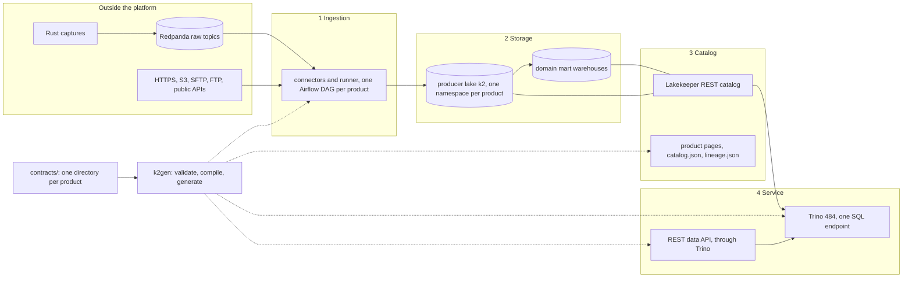
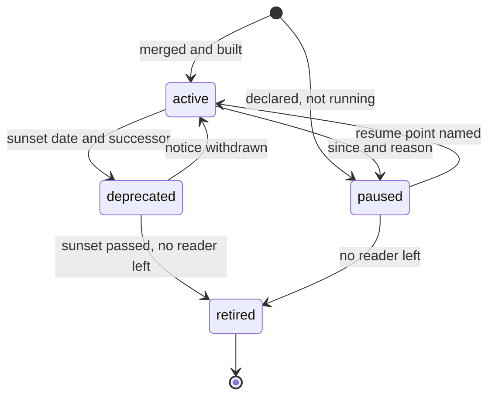
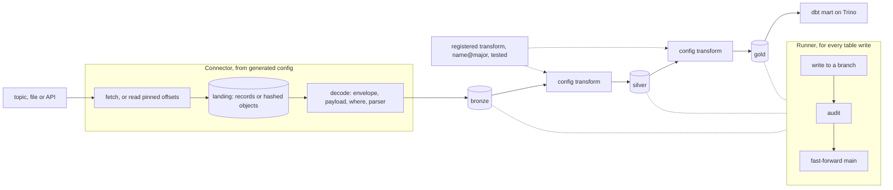
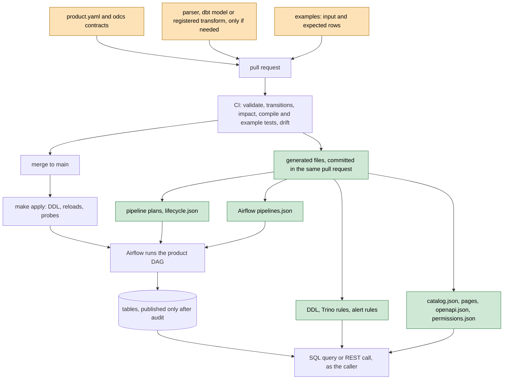
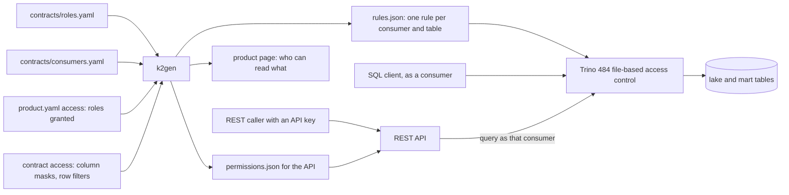
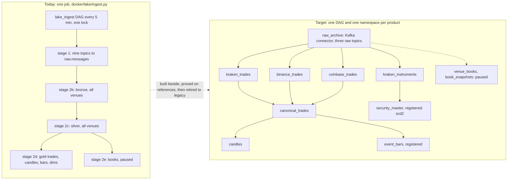

# Verdict: the K2 unified product platform tournament

Judge's report to the owner, 2026-11-26. Inputs: `BRIEF.md`, addenda 1 to 5 (items A to V),
`JUDGING-CRITERIA.md`, `LEDGER.md`, `CLICKHOUSE-INVENTORY.md`, `PR239-REVIEW.md`, entries A, B and
C, and the repository at `main` `bb6e77f` with branches `origin/feat/file-source-pattern`
(`aa7a73a`) and `origin/docs/adr-product-definition`. I wrote no entry. Every repository claim
carries the path I read; every web claim says where I checked it.

## 1. Verdict in one page

**Decision: a synthesis, with Entry A as the spine.** A's thesis holds: a product is a directory
of YAML in a pull request, the generator `k2gen` compiles it into committed files, and every
runtime part reads those files, so no new service decides anything at run time. I graft six named
parts of C and three of B onto it (3.12), and replace all three migrations with the clean,
greenfield rebuild addendum 5 now allows.

**Why A, in the owner's criteria order.** On *robust*, A and C beat B, and A edges C by
publishing every table through write, audit, fast-forward, which C leaves open. On *easy to
manage*, A and C tie; B adds an always-on registry and database on the path of Trino's access
rules, a new way to fail at night. On *stakeholders*, A wins: it keeps the whole old FX scope and
compiles permissions per consumer, so a user in two roles gets a predictable answer. On *modern
yet tried*, A adds one framework, FastAPI.

**Addendum 5 changes the migration, not the architecture.** The new path is built beside the old
job in per-product namespaces and proved against independent references, never old tables; then
the old ingest retires to `legacy/` and its tables are dropped after a confirmed backup. History
older than Redpanda's retention is let go (3.11).

**Plan: vertical slices.** I accept recommendation V with one change: phase N0 pauses ClickHouse
first, because it stands alone. Slice 1 takes ECB FX through every layer, slice 2 Kraken trades,
slice 3 all crypto and the old job's retirement; later phases widen connectors, permissions,
catalog and API. Twelve phases, about **50 focused working days**, a pre-release tag per phase
from `v3.0.0-alpha.2` (`v3.0.0-alpha.1` exists), and git tag `v3.0.0` (the repo's `v` convention,
version string `3.0.0`) at the gate. The bootstrap peak
goes from 21.30 CPU / 37.812 GiB today (`docker-compose.yml`, resource summary) to 17.30 / 29.812
with ClickHouse paused and 17.90 / 30.375 with the API and Alertmanager, under 25 / 48 (ADR-045).

**The three biggest risks.**
1. **The per-product chain overruns the five-minute slot.** Archive, venue, unified trades and
   candles each start Spark (about 4 s, 7.2) and pay an unmeasured fixed cost per run for catalog
   loads, branch, audit and fast-forward. Slice 2 measures it before slice 3 widens.
2. **Trino 484 masks and row filters behave unlike the documentation** through definer views, on
   the read-only `lake` catalog, or under `SELECT *`. Slice 2 tests them first; the fallback is a
   restricted dbt mart per role, a pattern the repo has (`contracts/market-analytics/delayed-candles/`).
3. **The transform vocabulary grows into a private language, or is too narrow** outside crypto
   and FX. A new operation needs an ADR; anything else is a registered, tested transform.

**Not included:** a continuous consumer mode and a database-pull connector (designed only);
OpenMetadata and OpenLineage capture (deferred); capture changes; book resumption; ClickHouse's
return; AWS code (unless D4); a second host.

### 1.1 Tensions in the requirements, said plainly

All three entries worked around these; none named them all.

| Tension | Where | Resolution |
|---|---|---|
| A pipeline per product includes its connector (addendum 3 L), yet one venue topic carries frames for several products and raw-first keeps every frame | `docker/lake/ingest.py:158-166`; ADR-021 | `raw-archive` owns the Kafka connector; a venue product's connector names that landing and reads its slice, so pausing a venue never gaps the archive |
| One state per product (fixed decision 2), yet the ADR-055 draft puts state on each table | ADR-055 draft, section 1 | regroup products; revise ADR-055, which is Proposed |
| "Never publishes unaudited data", yet the stream landing audits after publishing | ADR-047 | landing tables are granted to the platform role only |
| An IaC phase is fixed (decision 10), yet the old plan made AWS code a separate plan | `docs/plans/2026-11-24-governed-self-serve-platform/README.md:24` | decision D4 |
| Per-role row and column rules, yet Trino on loopback trusts a user name in a header | ADR-044 | decision D3 |
| Shift-left testing, yet ADR-050 says "No Spark in CI" | `docs/adr/ADR-050-...md:133` | decision D5 |
| The API is "built as its own phase after the catalog exists" (decision 5), yet V wants a minimal endpoint in slice 1 | `BRIEF.md` item 5; addendum 5 V | decision D1 |

## 2. Design ethos

Eight principles; each later choice can be predicted from one of them.

- **E1. A product is defined once**, in `contracts/`; every runtime file is generated from it.
- **E2. The generator is the only control plane**: runtimes read committed files, never a service.
- **E3. The platform starts at the topic or the file**: producers, the captures too, are outside.
- **E4. Land verbatim, publish only what passed its audit**: branch, audit, fast-forward.
- **E5. Config for the common shape, registered code for the rest**, never code per product.
- **E6. One product, one pipeline, one state, one namespace**: each runs and fails on its own.
- **E7. One enforcement point per rule**: Trino for reads, the runner for writes, CI for contracts.
- **E8. Nothing moves on a red proof**: each step is shown by a command against independent references.

## 3. The chosen architecture

### 3.1 Terms

A **contract** is an Open Data Contract Standard (ODCS) v3.2.0 file for one table
(`contracts/schema/odcs-json-schema-v3.2.0-20261117.json`); the **descriptor**, `product.yaml`, is
K2's file for the whole product (`contracts/schema/k2.schema.json`), since ODCS deprecated its
product object in v3.1.0. A **product** is an owned unit: descriptor, tables, declared inputs, one
state, permissions and one generated Airflow **DAG** (a scheduled set of tasks). A **connector**
reads a source; the **landing** is the verbatim record of what arrived. The **medallion** is raw,
bronze, silver, gold (ADR-026) plus dbt marts per domain (ADR-044). **Write-audit-publish (WAP)**
writes to a hidden Iceberg branch, audits it, then fast-forwards `main`, the snapshot readers see.
**Generated files** are what `make generate` writes, drift-checked in CI
(`.github/workflows/ci.yml:84-89`). A **registered transform** is code a contract calls as
`name@major`.

### 3.2 The four layers, and the product crossing them

**Ingestion:** connectors configured from contracts, run by one generated Airflow 3.3.2 DAG per
product (`docker-compose.yml:559`). **Storage:** Iceberg on MinIO behind the Lakekeeper v0.13.9
REST catalog; Spark alone writes the producer warehouse `k2`, now with **one namespace per
product**, and each domain's dbt user writes its mart warehouse (ADR-044). **Catalog:** the
contracts in git are the truth; pages, `catalog/catalog.json`, `catalog/lineage.json` and
resolved ODCS contracts are generated projections, and the nightly `contract_schema` audit holds
Lakekeeper to the contracts (`docker/lake/contract_schema.py`). **Service:** Trino 484
(`docker-compose.yml:1072`) is the one SQL endpoint; the REST API answers only through Trino, as
the caller.

**Why one namespace per product.** Marts already read `<domain catalog>.<product>.<table>`
(`market_analytics.candles.ohlcv_1m`, `dbt/models/market_analytics/marts/`). The same shape in the
producer lake makes the permission unit one Trino schema rule, maps one to one onto a future
Lakekeeper namespace grant (ADR-039's target), and makes retiring a product retiring one
namespace. The layer moves into the table name (`lake.kraken_trades.silver_trade`), and the new
layout runs beside today's per-layer namespaces (`docker/lake/ddl/lake.sql`) until they retire.

#### Diagram 1: the four layers and a product crossing them



*Reading guide.* Solid arrows are data; dotted arrows are generated, committed configuration. The
left box is not the platform's. A product, one directory in `contracts/`, passes through `k2gen`
once, and each layer reads the result as a pipeline, a namespace, a page, rules and a route. No
arrow returns to `k2gen`: nothing at run time changes a definition (E2).

### 3.3 The product model

A user writes `contracts/<domain>/<product>/product.yaml`, one `<table>.odcs.yaml` per table, and
`examples/<table>/` with input and expected rows. Shared files: `contracts/domains.yaml` (exists),
`contracts/roles.yaml`, `contracts/consumers.yaml` (service identities, never people) and
`contracts/platform.yaml` (`mode: lab` or `production`), the last three new.

| Field | File | Standard or K2 | Meaning |
|---|---|---|---|
| `name`, `domain`, `owner`, `purpose`, `kind`, `inputs`, `outputs`, `consumers`, `marts` | descriptor | K2, exist | as today (`platform/k2gen/k2gen/cli.py`) |
| `lifecycle` | descriptor | K2, new values | the one state: `active`, `paused`, `deprecated`, `retired` |
| `lifecycleChange` | descriptor | K2, new | `{since, reason, adr?, successor?, sunset?, resume?}`, required unless `active` |
| `maturity` | descriptor | K2, new | `draft`, or `published` once the readiness scorecard passes in CI |
| `pipeline`; `access`; `serves` | descriptor | K2, new | `{trigger: {cron} or {after: [tables]}, driverMemory, timeout}`; roles granted, optionally per output; for serving products `{engine, profile, service, volume, ddl, reload, artefacts}` |
| `apiVersion`, `kind`, `id`, `name`, `version`, `domain`, `description.purpose`, `team.name` | contract | ODCS | identity, semantic version, owner |
| `schema[0]`: `physicalName`, `properties[]` (`name`, `logicalType`, `physicalType`, `required`, `primaryKey`, `primaryKeyPosition`, `logicalTypeOptions`, `description`) | contract | ODCS | always inline: the contract is the DDL of record for every new table |
| `schema[0].quality[]`, `slaProperties[]` | contract | ODCS | product audits; freshness targets |
| `status`, `servers[]`, `roles[]` | resolved contract | ODCS, generated | from `lifecycle`, access points and `access`, for any ODCS reader |
| `layer`, `format`, `partitioning`, `sort`, `classification`, `entitlement`, `retention`, `upstreams` | `customProperties` | K2, exist | as in `contracts/schema/README.md` |
| `connector`, `transform`, `access` | `customProperties` | K2, new | source binding (3.4); computation (3.5); `{columns: [{name, mask or hide: [roles]}], rows: [{roles, filter}]}` |
| `schedule`, `paused` | `customProperties` | **removed** | moved to `pipeline` and `lifecycle` |

`k2gen validate` enforces: one producing product per table; a transform's `from` names only
declared inputs, so the declared graph is the executed graph; an output reading a ruled table
declares rules at least as strict; no grant above a role's clearance; no retirement while any
non-retired product or consumer reads the product. All thirteen descriptors say `lifecycle:
draft` today (`grep -h ^lifecycle contracts/*/*/product.yaml`); that becomes `maturity: draft`
with `lifecycle: active`.

#### Diagram 4: lifecycle states and transitions



*Reading guide.* Each arrow is a pull request editing `lifecycle` in one `product.yaml`; `k2gen
validate --base origin/main` refuses any arrow not drawn or whose guard fails. No arrow goes from
`active` to `retired`, so readers always get notice. `retired` is final and deletes no row
(ADR-028 section 12). Maturity is a separate question, earned on evidence.

| Layer | `active` | `paused` | `deprecated` | `retired` |
|---|---|---|---|---|
| Pipeline DAG | scheduled | built, no schedule, manual runs only | scheduled | not built |
| Audits | run | skipped, with a "stood down: paused" row in `audit.checks` | run | none |
| Alerts, SLOs | generated (warnings while `draft`) | no freshness rules; integrity kept | generated, plus sunset warning | none |
| Trino | granted roles | readable; page says "stale by design" | readable; notice in table comment | owner and platform only |
| REST API | 200 | 200, `K2-Product-State: paused` | 200, `Deprecation`, `Sunset` | 410 Gone |
| Downstream | | flagged `upstream paused` or `partly fed` | flagged `reads deprecated` | CI refuses readers |

At the producer boundary the platform stops consuming; the producer is its owner's business
(addendum 1 A), and `book_capture` in `config/instruments.yaml` stays the captures' own. **Resume
after a long pause:** expiring a step's input snapshot "turns the next run into an error"
(`docker/lake/maintenance.py:165-171`), so a product with Kafka lineage columns (`src_topic`,
`src_partition`, `src_offset`) resumes from its own high-water mark (from C), any other names
`resume: rebuild-from: <day>` in its resume pull request (from A), and a run with neither fails
loudly with the fix in its message.

### 3.4 Connectors

One `connector` custom property per landing or bronze table, by `kind`; secrets are named by
environment variable, never given. Every fetch follows redirects only to another `https://`
address and never to a private, loopback or link-local one: the HIGH finding on
`docker/lake/file_source.py:145-146` (`PR239-REVIEW.md`), made a rule for every kind.

| `kind` | Required fields | Landing | Runs in |
|---|---|---|---|
| `https-file` | `url` (templated by run date), `format` (`csv`, `json`, `xml`), `parser`, `calendar` | `k2-landing/<domain>/<product>/<day>/<sha256>.<ext>`, conditional PUT, never overwritten | Spark container, stdlib fetch |
| `s3-file` | `endpoint`, `bucket`, `key`, `credentialsEnv`, `format`, `parser` | same | the branch's stdlib SigV4 signer |
| `public-api` | `url`, `params`, `pagination` (`none`, `next-link`, `page`), `maxPages`, `minIntervalS`, `authHeaderEnv?`, `records` | one object per run | stdlib fetch |
| `ftp` | `host`, `path`, `tls: required` (plain only for anonymous public data), `credentialsEnv?` | same | `ftplib.FTP_TLS`, present (7.2) |
| `sftp` | `host`, `path`, `user`, `keyFileEnv`, `hostKey` (a known_hosts line) | same | OpenSSH `sftp -b`, present at `/usr/bin/sftp` |
| `kafka` | `brokers`, `registry`, `topics`, `envelope`, `startFrom`, `maxOffsetsPerPartition` | verbatim records, end offsets in the same commit (ADR-022) | Spark container |
| `kafka` + `landing:` | `topic`, `landing`, `envelope`, `payload`, `where`, `required` | none: reads its slice of another product's landing | Spark container |

```yaml
# contracts/market-capture/raw-archive/raw_messages.odcs.yaml (customProperties, abridged)
  - property: connector
    value: {kind: kafka, brokers: "redpanda:9092", registry: "http://redpanda:8081",
            topics: [market.crypto.v3.raw.binance, market.crypto.v3.raw.kraken, market.crypto.v3.raw.coinbase],
            envelope: none, startFrom: committed, maxOffsetsPerPartition: 600000, audits: [batch_offsets]}
```

The archive lands the three **raw** topics only; the `trades` and `book` topics that
`ingest.py:166` also lands are the captures' own normalisation, consumed only by the paused
ClickHouse, which returns rebuilt from the lake. **Latency:** every kind is a scheduled
micro-batch; the archive runs every five minutes, as today (`docker/airflow/dags/lake.py:132`),
and downstream products run when their input moves. No connector needs an always-on consumer:
Redpanda's retention, 48 hours or 2 GiB per partition on raw topics
(`docker/redpanda/init.sh:145-146`), is the buffer. **The reserved second mode**, `mode:
continuous`, is refused until built; it plugs in at the landing only, as a long-running lander,
while bronze onwards stays micro-batch. Candidates: the Iceberg Kafka Connect sink, or Redpanda
Connect, whose Iceberg output needs an enterprise licence (5).

### 3.5 The medallion ETL

| Layer | Guarantee | Filled by | Engine |
|---|---|---|---|
| raw / landing | bytes as received, immutable; position in the commit, or name equals hash | connector | Spark container |
| bronze | source field names and types; an unparseable record is a row of nulls, counted, never dropped | connector's decode step | Spark |
| silver | exact decimals, UTC timestamps, conformed keys, flags, every delivery kept | config or registered transform | Spark |
| gold | one row per entity on a declared key; unions; type-2 history; aggregates | config or registered transform | Spark |
| mart | consumer SQL in the domain warehouse | dbt model, by hand | dbt 1.12.7 on Trino (`dbt/pyproject.toml:10-11`) |

Spark writes the producer lake because its steps need Kafka offsets, the writer lock or per-record
code, and Trino's `lake` catalog refuses every commit (`docker/trino/etc/catalog/lake.properties`).
Config transforms compile to Spark SQL only: one compiler target, one place for a bug.

**The vocabulary** (`k2.schema.json#/$defs/transform`); a new operation needs an ADR.

| Operation | User writes | Compiles to |
|---|---|---|
| `select` | `{column: expression}` | `SELECT expr AS column`: rename, cast, parse time |
| `explode` | `{path, as, index}`, or levels with a flat index | `posexplode`, as at `docker/lake/silver.py:130-135` |
| `filter` | a predicate | `WHERE`; refused in silver unless it names a reason |
| `lookup` | `{column, table or registry, on, as, missing}` | a join, or the registry map that raises on a miss |
| `key` | columns | identifier fields, uniqueness audit, MERGE key |
| `dedupe` | `{key, order, flag or drop, lookback}` | `row_number()` over batch plus lookback |
| `flags` | `{name: boolean expression}` | extra columns |
| `union` | `[{from, where, select}]` | `UNION ALL` |
| `aggregate` | `{group, bucket, order, measures}` | `GROUP BY`, `min_by` and `max_by` over `struct(order)` |
| `scd2` | `{key, tracked, from}` | the planner in `docker/lake/scd2.py`, then MERGE |
| `call` | `{transform: name@major, params}` | a registered transform |

**Expressions are Spark SQL fragments, never statements**, because today's venue logic already
is: the silver specs (`docker/lake/silver.py:88-140`) are explode statements plus `expr AS name`
strings, and the candle measures (`docker/lake/gold.py:316-341`) one parameterised statement. The
rebuild moves strings; it does not translate logic.

**Incremental and idempotent.** The runner owns four modes: `append` reads input snapshots after
the one in `k2.src-snapshot-id` (`docker/lake/offsets.py:38`); `merge` recomputes touched keys;
`touched` recomputes each touched bucket over its whole input (ADR-048); `replace` is for small
reference tables. Resume reads walk `main`'s lineage only (`offsets.py:278`), so a failed branch
never moves a position, and a run with nothing new commits nothing (`scripts/lake-verify.sh`
asserts it). **A changed plan is never silent (from B):** each commit carries `k2.plan-sha256`; a
run whose hash differs refuses to append until the contract declares `effectiveFrom` or a
rebuild. **Schema change:** a nullable column is a minor version and a generated `ADD COLUMN`; a
drop, retype, rename or re-key is a major version and a new table, enforced by `k2gen
check-compat`; producer evolution decodes by writer schema id (ADR-020); unknown keys go to the
drift audit (`docker/lake/bronze.py:115`).

**Testing, shift-left.** (1) A compile test in CI in the pinned Spark image, which CI's `docker`
job already builds (`.github/workflows/ci.yml:146-175`): each plan is analysed against empty
inputs and must yield the output contract's columns, types and nullability. (2) Example tests from
`examples/`, same image. (3) Fixture tests and reference implementations for registered
transforms (ADR-029). (4) Audits on the branch before publish. (5) Independent recomputation:
`make parity-ohlcv`, `make parity-bars` and a new `make parity-silver` (3.11). **Lineage** is
compiled from `inputs`, `from` and `reads`; commits record the snapshots they read; rows carry
`src_*` or `source_file_sha256`.

**The escape hatch.** A registered transform lives in `docker/lake/transforms/<name>.py`, in one
`REGISTRY` dict, with the signature `run(inputs: dict[str, DataFrame], params: dict, state) ->
dict[str, DataFrame]`. Only the runner reads, locks, writes, branches, audits and publishes; a CI
check refuses `writeTo`, `saveAsTable`, `spark.table`, `spark.read` and `CALL` there; `CODEOWNERS`
gives the directory to the platform team; a pattern two products call becomes a built-in
operation (from C). The first four wrap existing code: `trade_flags@1` (`silver.score`,
`silver.py:186`), `event_bars@1` (`docker/lake/bars.py`), `scd2@1` (`scd2.py`) and `book_replay@1`
(`docker/lake/books.py`, with Kraken's checksum). At bronze the hatch is a parser,
`docker/lake/sources/<name>.py`: bytes in, rows out.

#### Diagram 3: the medallion flow, config transforms and the code escape hatch



*Reading guide.* Only the connector touches a source, and it ends at bronze; from there to gold
every product uses the same operations. A registered transform plugs into a step, never replacing
the runner, whose box is what happens on every write: branch, audit, fast-forward. Marts are dbt's.

### 3.6 How runtime parts learn state, and how a change propagates

Each reader takes a generated file from a directory mount when it acts (a file-level mount pins
the inode, `CLAUDE.md`).

| Generated file | Read by | Re-read |
|---|---|---|
| `docker/lake/generated/pipelines/<product>.json`, `lifecycle.json` | `docker/lake/runner.py`, `maintenance.py` (mount `docker-compose.yml:783`) | every run |
| `docker/airflow/dags/generated/pipelines.json` | `docker/airflow/dags/products.py`, the branch's `factory.py` generalised | each parse |
| `docker/lake/generated/{contract_schemas,retention}.json`, DDL | `apply_ddl.py`, `maintenance.py`, the audit | every run |
| `docker/trino/etc/rules.json` | Trino | `security.refresh-period`, added (none set today) |
| `dbt/models/_sources.yml`, `dbt/selectors.yml` | dbt | every invocation |
| `docker/prometheus/rules/generated/*.yml` | Prometheus | `POST /-/reload` (`docker-compose.yml:344`) |
| `catalog/*.json`, `platform/api/generated/*.json` | API, catalog UI | at start |

**Why files, not a service:** the data plane runs when nothing else does, any tag rebuilds its
state, every change is a reviewed diff, and the repo already works this way (`rules.json`,
`selectors.yml`, `retention.json`, `contract_schemas.json`). **Propagation:** CI runs `validate --base origin/main`, `k2gen impact`
(downstream products and consumers, with owners, in the job summary) and the drift check. After
merge, `make apply` runs `apply_ddl.py`, a Prometheus reload, a wait until the DAG processor shows
the new bundle hash as a DAG tag, a Trino rules refresh, an API restart, then `make
lifecycle-verify`, which probes what each part loaded. It refuses to run from anything but a clean
`main` or a tag, closing the hazard that emptied Airflow's DAG folder for 35 minutes on 2026-11-25
(`CLAUDE.md`). **Emergency stop:** an Airflow UI pause still works; the nightly
`lifecycle_applied` audit flags it until a pull request follows. **History:** intent is the git
log of `contracts/`; for SQL, `k2gen` writes the seed `dbt/seeds/product_registry.csv` and a
governance dbt snapshot builds `governance.product_registry.product_state_history` (ADR-046's
pattern, from C); every commit carries `k2.contracts`, the bundle hash.

#### Diagram 2: one product from contract to served query



*Reading guide.* Orange is all a person writes; green is generated and committed in the same pull
request, so a reviewer sees an edit's runtime effect as a diff. CI is the gate, `make apply` the
only deploy. Three generated inputs shape the query: the pipeline, the rules, the catalog.

### 3.7 Pipelines on one host (addendum 3 L)

About twenty DAGs at 3.0: `raw-archive` every five minutes; on its asset `kraken-trades`,
`binance-trades`, `coinbase-trades`, `kraken-instruments`; then `canonical-trades`, `candles`,
`event-bars`, `security-master`; `venue-books` and `book-snapshots` paused; daily FX, monthly ISO
4217, two connector examples, one dbt DAG per mart, `lake_maintenance`. A stream product runs all
steps in one task, one `docker exec`, one Spark session, paying the roughly 4 s JVM start once;
daily file products keep the branch's four tasks. **Concurrency:** an Airflow pool `lake_spark`
with **one slot** to start (from C), so `docker/lake/lock.py`'s single `flock` stays the backstop;
a queued task holds no executor slot, leaving the four LocalExecutor slots
(`docker-compose.yml:92`) free; `raw-archive` has top priority, because the archive must never
queue while retention runs out. **Escape hatches**, only if slice 2 measures the chain's p90 over
200 s (ADR-034's line is 240 s), in order: two slots with A's lock scheme (writers take the global
lock shared and their tables exclusive, maintenance the global lock exclusive); derived products
every 15 minutes; last, one Spark task per tick for the three venues, failures isolated per
product. **Scheduler load:** about 100 runs and a few hundred task instances an hour, with
`airflow db clean` in maintenance. No service is added.

### 3.8 Permissions: product, column and row, from contract to both endpoints

**Model.** `roles.yaml` gives each role a clearance; a product grants roles; a contract narrows a
role on one table with column rules (`mask` by default, or `hide`) and row rules (`filter`); a
consumer's access is the union of its roles; landing tables are platform-only (1.1). **Into
Trino.** The first matching rule applies and no match denies (trino.io/docs/484, verified), so a
consumer in two roles would get whichever rule came first. Instead `k2gen` computes each
consumer's effective rule per table and writes one rule per consumer and table, matched by exact
`user` (from A), after ADR-044's writer and retention-floor rules
(`platform/k2gen/k2gen/generate.py:366-390`); today's catch-all read becomes a final deny. Masks
are typed nulls through `_TRINO_TYPES` (`generate.py:408`). Mask is the default because hiding a
column may break `SELECT *`; the documentation is silent, so slice 2 tests it. **Definer views:**
a dbt view reads base tables as its owner, so 3.3's rule makes every reader of a ruled table carry
rules at least as strict. **Storage keys:** a client with a key bypasses Trino, so a
read-only key (ADR-054) goes only to roles with no rules (from C). **REST:** the API queries Trino
as the authenticated consumer, using `permissions.json` only to pick columns and answer 403 early.
**Stated gap:** on loopback Trino trusts a header's user name (ADR-044); D3 decides the fix.

#### Diagram 5: from a contract's permission to the SQL endpoint and the REST API



*Reading guide.* Four hand-written inputs, one compiler, three outputs. SQL and REST meet at Trino,
which applies one compiled rule to both; the API adds only authentication. The page projects the
same rules, so catalog and Trino cannot disagree without the drift check failing.

### 3.9 Catalog and lineage

Truth is `contracts/` in git. Projections: `docs/products/` pages (they exist and already draw
lineage, `platform/k2gen/k2gen/generate.py`), `catalog/catalog.json`, resolved ODCS contracts,
`catalog/lineage.json`, and a read-only UI of static HTML served by the API at `/catalog` with a
live panel (newest snapshot, `governance.quality_results.dq_results`). A page shows owner, purpose,
state with since, reason, ADR and resume point; maturity and scorecard; the connector, never a
credential; each table's columns, classification, retention and transform steps; quality checks;
how to read it (Trino, REST, DuckDB); a role-by-table access matrix with masks and filters in
words; what it reads and what reads it. **Deferred:** OpenLineage capture, which helps only code
reading undeclared inputs, which the runner forbids (trigger: a second engine writing outside the
runner); OpenMetadata, whose UI invites the edits decision 1 forbids, as an optional projection of
`catalog.json` (trigger: a second team wants search across fifty products).

### 3.10 The service layer

**SQL:** Trino 484 on `127.0.0.1:${K2_TRINO_PORT:-8088}` (`docker-compose.yml:1080`), catalog
`lake` read-only and one catalog per domain; dbt, notebooks and the API all use it. **REST:**
`platform/api/`, its own uv project like `platform/k2gen/`, on `127.0.0.1:8095` (8090 is
Airflow's, `docker-compose.yml:597`); all routes are `GET` under `/v1`.

| Resource | Returns |
|---|---|
| `/products`, `/products/{domain}/{product}` | descriptor, state, lineage, the caller's grants, live panel |
| `/products/{domain}/{product}/contracts/{table}` | the resolved ODCS contract |
| `/data/{domain}/{product}/{table}` | rows: declared-column filters, `fields`, `limit` up to 10,000, keyset cursor, `as_of`; a time range on time-partitioned tables |
| `/lineage/{table}?direction=up\|down&depth=n` | the compiled graph |
| `/openapi.json`, `/catalog` | generated schema; catalog UI |

**Auth:** a `Bearer` API key; `.env` holds only sha256 hashes mapped to consumers, compared with
`hmac.compare_digest`. **It must not** write, accept SQL text, evaluate a rule, read storage,
serve a retired product, return unbounded results, cache rows, or be the source of any metadata.
**Cost:** one worker, 0.5 CPU / 512 MiB; FastAPI pinned at the newest release at least two weeks
old when the PR opens (0.162.5 today); `trino==0.340.0` already pinned
(`scripts/parity-ohlcv.sh:32`).

### 3.11 Crypto onto the framework: a clean, greenfield rebuild (addendum 5 P to V)

#### Diagram 6: today versus target



*Reading guide.* Left: one driver writes every layer for every venue, so one fault stops all.
Right: one DAG and namespace per product, run when its input publishes; arrows are lineage (venue,
unified trades, candles). The dotted arrow is the method: build beside, prove, retire to `legacy/`.

**What proof replaces table-to-table parity.** (1) *Known answers:* synthetic frames in each
venue's format with expected silver and gold rows, in CI in the Spark image; registered
transforms keep their fixtures (`tests/test_lake_scd2.py`, `tests/test_lake_book.py`,
`tests/test_bars.py`). (2) *A lift check*, pure Python: compiled SQL equals what `silver.TRADES`
and `gold.candles` produce (`docker/lake/silver.py:88`, `docker/lake/gold.py:316`), so the config
keeps the logic that passed ADR-029 parity; deliberate changes such as the Binance renames are
listed exceptions. (3) *Independent recomputation* on a pinned live day: a new `make
parity-silver`, where DuckDB recomputes silver from the raw frames' JSON (closing the gap that
`parity-ohlcv` trusts silver), plus `make parity-ohlcv` (lake gold against DuckDB and dbt) and
`make parity-bars` (lake, DuckDB, a Python reference). (4) *Structure:* `make lake-verify`
(gapless offsets, raw reconciled to bronze and explode counts, a double run adds nothing); a
`raw-archive` run killed mid-way resumes exactly once; a Trino smoke test reads every table. (5)
*Determinism:* the pinned day built twice into two `scratch_` namespaces gives an empty `EXCEPT
ALL` both ways (the audit ignores `scratch_`, `docker/lake/contract_schema.py:45`). None proves
capture completeness; that reference is the venue-bars plan (`docs/plans/2026-11-24-venue-reference-bars/`), after 3.0.

**Captured again, and let go.** The new archive starts at Redpanda's earliest retained offsets: up
to 48 hours or 2 GiB per partition of raw frames (`docker/redpanda/init.sh:145-146`). Let go at
the drop of the old namespaces, after a confirmed backup: all older lake history including
`raw.messages`; the parity pin day 2026-11-25 and its tags (`tests/parity/pinned.json`, re-pinned
to a new day); all book data (capture paused since 2026-11-26, ADR-050); type-2 dimension history;
`audit.checks` with its six operator rows; `lake_ingest`'s run history; the stale candles of
2026-08-28. ClickHouse's data stays in its kept volume, disposable; the hot tier returns rebuilt
from the lake.

### 3.12 The synthesis: spine, grafts, rejections

| Part | From | Why it fits without contradiction |
|---|---|---|
| Compiled files with no control service; WAP on every write; per-consumer Trino rules; definer-view rule; config hash and ordered `make apply`; vocabulary; `resume: rebuild-from`; full FX scope | **A, spine** | |
| `lifecycle` apart from `maturity` | C | matches the owner's example list and ADR-055's "two questions"; changes only enum values |
| High-water-mark resume; a `paused/` directory for a paused serving product's artefacts | C | implements A's `resume: committed`; sits beside A's compose-profile check |
| Storage keys only for roles with no rules; a one-slot pool to start; history via a dbt snapshot | C | closes the bypass Trino-only enforcement leaves; the simpler start, with A's lock scheme as the measured escape |
| Per-table plan hash refusing silent recomputation | B | one more snapshot property |
| Venue order Kraken, Coinbase, Binance | B | Kraken exercises `explode`; Binance is busiest and needs the rename fix |
| Paused ClickHouse rules still tested | B | keeps the rules honest for the return |

**Rejected.** *A:* `draft` as a state; `history[]`, a copy of the git log; late pause docs;
Spark Connect, an always-on JVM. *B:* the registry and HTTP-served Trino rules (7.3); three venue
writers to the archive; dlt, sqlglot, Python 3.15; ADR numbers 051 to 055 and port 8090, taken.
*C:* interfaces as the centre (one implementation each; addendum 5 U leaves nothing to strangle);
DuckDB-transpiled tests (DuckDB differs on decimal division, `docker/lake/bars.py` docstring);
paramiko; the `implementation:` switch a clean rebuild does not need; deferred FX models.

## 4. The two acceptance cases, end to end

### 4.1 Kraken trades from its Redpanda topic

`kraken-trades`, `binance-trades` and `coinbase-trades` are separate products; `canonical-trades`
and `candles` are derived products declaring them as inputs; `raw-archive` owns the landing (3.4).
**Written by hand:**

```yaml
# contracts/market-capture/kraken-trades/product.yaml
name: kraken-trades
domain: market-capture
owner: capture-team
purpose: Kraken trades as sent (bronze) and typed per trade (silver), every delivery kept, flagged.
kind: source-aligned
lifecycle: active
lifecycleChange: {since: "YYYY-MM-DD", reason: "slice 2: built on the framework", adr: ADR-059}
maturity: draft
inputs:
  - table: raw_archive.raw_messages
  - {external: config/instruments.yaml, classification: public, description: The instrument registry.}
outputs: [kraken_trades.bronze_trade, kraken_trades.silver_trade]
pipeline: {trigger: {after: [raw_archive.raw_messages]}, driverMemory: 1g}
access: [{role: realtime_reader}, {role: delayed_reader}]
consumers: []
```

```yaml
# contracts/market-capture/kraken-trades/bronze_trade.odcs.yaml (customProperties; columns inline)
  - property: connector
    value: {kind: kafka, topic: market.crypto.v3.raw.kraken, landing: raw_archive.raw_messages,
            envelope: avro-confluent, payload: json, where: "stream = 'trade'", required: channel,
            audits: [decodes, keys_unique]}
# contracts/market-capture/kraken-trades/silver_trade.odcs.yaml (customProperties)
  - property: transform
    value:
      from: kraken_trades.bronze_trade
      incremental: append
      steps:
        - explode: {path: data, as: d, index: src_index}
        - select: {symbol: d.symbol, trade_id: "CAST(d.trade_id AS STRING)", trade_seq: d.trade_id,
                   price: d.price, qty: d.qty, side: d.side, side_native: d.side,
                   exchange_ts: "CAST(d.timestamp AS TIMESTAMP)", ord_type: d.ord_type, frame_type: type}
        - lookup: {column: symbol, registry: instruments, venue: kraken, as: canonical_symbol, missing: fail}
        - flags: {precision_loss: "price != round(price, 8) OR qty != round(qty, 8)"}
        - call: {transform: trade_flags@1, params: {lookback: 1d}}   # venue_replay, seq_gap, missing_before
  - property: access
    value:
      columns: [{name: conn_id, mask: [delayed_reader]}, {name: conn_msg_seq, mask: [delayed_reader]}]
      rows: [{roles: [delayed_reader], filter: "exchange_ts < current_timestamp - INTERVAL '20' MINUTE"}]
```

The expressions are `docker/lake/silver.py:111-125` and `:60-64`; the runner appends the lineage
tail as `_TAIL` does today (`silver.py:157-167`). Also by hand: synthetic rows in
`examples/silver_trade/` (a two-trade frame, a re-sent trade, a skipped id, a nine-decimal price,
an unknown symbol that must fail), and one consumer in `contracts/consumers.yaml`:
`partner-dashboard: {owner: analytics-team, roles: [delayed_reader], reads: [market-capture/kraken-trades]}`.

**Generated:** `pipelines/kraken-trades.json` (read the archive past the recorded snapshot,
pruned by its `topic` partition; decode; transform; WAP); DAG `kraken_trades` on the
`raw_archive.raw_messages` asset in pool `lake_spark`; DDL for namespace `kraken_trades`;
retention and contract-schema entries; Trino rules, including `partner-dashboard`'s on
`silver_trade` with the row filter and `conn_id` masked to `CAST(NULL AS varchar)`; the page; the
`catalog.json` entry; the REST route.

**Through the four layers.** *Ingestion:* `raw-archive` lands the topic; the Kraken DAG decodes
its slice. *Storage:* `lake.kraken_trades.bronze_trade` and `silver_trade`, commits carrying
`k2.src-snapshot-id`, `k2.plan-sha256`, `k2.contracts`. *Catalog:* lineage `raw-archive`,
`kraken-trades`, `canonical-trades`, `candles`; `delayed_reader` sees rows older than 20 minutes,
two columns nulled. *Service:* `SELECT * FROM lake.kraken_trades.silver_trade`, or `GET
/v1/data/market-capture/kraken-trades/silver_trade?from=...` as the caller.

**Derived products.** `canonical-trades` writes `canonical_trades.gold_trade` as a `union` of the
three silver tables, each with `where: NOT venue_replay`, an exchange literal, and `CAST(x *
100000000 AS BIGINT)` for `price_e8` and `qty_e8` (as `docker/lake/gold.py` does), keyed
`[exchange, canonical_symbol, trade_id]`. `candles` writes `candles.gold_ohlcv_1m` by `aggregate`
in 60-second buckets on `exchange_ts`, ordered by `[exchange_ts, recv_ts_ns, trade_seq]`,
`incremental: touched`, with the measures at `docker/lake/gold.py:326-339`; other timeframes
change only `seconds`. **Binance and Coinbase differ only in contracts.** Binance: one trade per
frame (`src_index` 0), strings cast to `DECIMAL(28,10)`, `timestamp_millis(data.T)`, side
`IF(data.m, 'sell', 'buy')` (`silver.py:60-108`), and declared bronze renames for fields differing
only by case, which makes it readable through Trino. Coinbase: two levels, `events` then
`trades`, with `silver.py:130-135`'s flat index; side `lower(t.side)`.

### 4.2 ECB end-of-day FX reference rates

Conventions from old P4 (`docs/plans/2026-11-24-governed-self-serve-platform/004-fx-data-product.md:19-35`):
quote units per euro; a reference fixing on TARGET working days around 16:00 Frankfurt time, not
a market close; `DECIMAL(20,10)` compared as decimals; `rate_available_at` for when a rate could
first be known. **Written by hand:**

```yaml
# contracts/fx-reference/ecb-fx-rates/product.yaml
name: ecb-fx-rates
domain: fx-reference
owner: fx-reference-team
purpose: ECB euro reference rates as published on TARGET days; a reference fixing, not a market close.
kind: source-aligned
lifecycle: active
maturity: draft
inputs:
  - {external: "https://www.ecb.europa.eu/stats/eurofxref/eurofxref-hist-90d.xml", classification: public,
     description: "The ECB 90-day reference rate file; reuse with attribution (NOTICE)."}
  - table: iso_4217.silver_currency
outputs: [ecb_fx_rates.bronze_daily, ecb_fx_rates.silver_rates, ecb_fx_rates.gold_eur_rates]
pipeline: {trigger: {cron: "30 15 * * 1-5"}, driverMemory: 512m}
access: [{role: public_reader}, {role: realtime_reader}, {role: delayed_reader}]
consumers: []
```

```yaml
# contracts/fx-reference/ecb-fx-rates/bronze_daily.odcs.yaml (header abridged)
schema:
  - name: bronze_daily
    physicalName: ecb_fx_rates.bronze_daily
    physicalType: table
    properties:
      - {name: rate_date, logicalType: date, physicalType: DATE, required: true, primaryKey: true, primaryKeyPosition: 1}
      - {name: currency, logicalType: string, logicalTypeOptions: {pattern: "^[A-Z]{3}$"}, physicalType: STRING,
         required: true, primaryKey: true, primaryKeyPosition: 2}
      - {name: rate, logicalType: number, physicalType: STRING, required: true, description: As the file wrote it.}
      - {name: source_file_sha256, logicalType: string, physicalType: STRING, required: true}
customProperties:
  - {property: layer, value: bronze}
  - {property: classification, value: public}
  - property: connector
    value: {kind: https-file, url: "https://www.ecb.europa.eu/stats/eurofxref/eurofxref-hist-90d.xml",
            format: xml, parser: ecb_fx, calendar: target, audits: [rate_positive, no_future_date]}
# silver_rates.odcs.yaml (customProperties)
  - property: transform
    value:
      from: ecb_fx_rates.bronze_daily
      incremental: merge
      lookback: 10d
      steps:
        - select: {rate_date: rate_date, base: "'EUR'", quote: currency, rate: "CAST(rate AS DECIMAL(20,10))"}
        - lookup: {column: quote, table: iso_4217.silver_currency, on: code, as: currency_status, missing: fail}
        - key: [rate_date, quote]
        - flags: {large_move: "abs(ln(rate / lag(rate) OVER (PARTITION BY quote ORDER BY rate_date))) > 0.10"}
# gold_eur_rates.odcs.yaml (customProperties)
  - property: transform
    value:
      from: ecb_fx_rates.silver_rates
      incremental: merge
      steps:
        - select: {rate_date: rate_date, base: base, quote: quote, rate: rate,
                   rate_available_at: "to_utc_timestamp(CAST(concat(rate_date, ' 16:00:00') AS TIMESTAMP), 'Europe/Berlin')"}
        - key: [rate_date, base, quote]
```

```python
# docker/lake/sources/ecb_fx.py (hand-written: nested XML attributes need a parser)
def parse(data: bytes) -> list[dict]:
    """One row per <Cube time><Cube currency rate/>: rate_date, currency, rate as written."""
```

Also by hand: `examples/`, and the attributed 90-day sample plus a corrupted copy, which the old
plan allows (`docs/plans/2026-11-24-governed-self-serve-platform/README.md:94-97`). **Generated:**
DDL for `ecb_fx_rates`; the DAG (fetch, load to a branch, audit, publish, transforms); Trino rules;
page; catalog entry; REST route; a dbt source once `fx-crosses` reads it.
**Through the four layers.** *Ingestion:* the file lands under its hash, and the same bytes write
nothing. *Storage:* `bronze.source_files` records the file; a bad file fails `audit`, `publish`
never runs, `main` keeps its snapshot. *Catalog:* the page quotes "a reference fixing, not a
market close", with lineage URL, landed file, bronze, silver, gold, `fx-crosses`. *Service:*
`SELECT * FROM lake.ecb_fx_rates.gold_eur_rates`, or `GET
/v1/data/fx-reference/ecb-fx-rates/gold_eur_rates?from=...`. The derived SQL product
`fx-crosses` is a `marts` entry and `dbt/models/fx_reference/marts/fx_crosses/fx_rates_daily.sql`,
dividing two euro legs as decimals.

## 5. Technology table

Checked on 2026-11-26 through PyPI JSON, the GitHub releases API, vendor documentation and
`docker exec` on the running stack.

| Technology | For | Pin | First stable | Latest | Licence | Criterion 5 | Fallback | Verified |
|---|---|---|---|---|---|---|---|---|
| FastAPI | REST API, UI | newest at least 2 weeks old at PR (0.162.5) | 0.1.0, 2018-12-08; 0.x | 0.165.0, 2026-11-18 | MIT | passes; exact pin for 0.x | Starlette | PyPI |
| uvicorn | API server | 0.54.0 | 0.x since 2017 (per B) | 0.54.0, 2026-09-25 | BSD-3-Clause | passes | 0.52.4 in the Airflow image | PyPI; `pip list` |
| trino client | API to Trino | 0.340.0 | 0.303.0, 2020-12-28 | 0.340.0, 2026-09-23 | Apache-2.0 | passes; already pinned | stdlib HTTP | PyPI |
| `python:3.12-slim` | API image | by digest | 3.12.0, 2023-10 | not checked | PSF | passes; Airflow runs 3.12.14 | Airflow image | `python3 --version` |
| Trino 484 masks, filters, refresh | entitlements | 484 (`docker-compose.yml:1072`) | 484 released 2026-10-16 | 484 | Apache-2.0 | passes | restricted dbt marts | 484 docs; **not run** |
| Airflow 3.3.2 assets, pools | triggers, concurrency | 3.3.2 | 3.0 in 2025 | 3.4.0, 2026-11-06 | Apache-2.0 | passes; stay until cosmos supports 3.4 (ADR-034:237) | cron offsets | GitHub API |
| Iceberg branches, `fast_forward` | WAP everywhere | Iceberg 1.8.1 | in use on #239, ADR-048 | not checked | Apache-2.0 | passes | audit after publish (ADR-047) | branch `file_source.py` |
| OpenSSH `sftp`; `ftplib.FTP_TLS` | SFTP; FTP | in the Spark image; Python 3.10.16 stdlib | decades | n/a | BSD; PSF | passes | FTPS for SFTP | `which sftp`; `docker exec` |
| Alertmanager | alert delivery | v0.35.0 (2026-11-09) | Prometheus project, about 2015 | v0.35.1, 2026-11-24 | Apache-2.0 | passes | Grafana alerting (11.5.0 runs) | GitHub API |
| OpenTofu, if D4 | AWS modules | v1.13.9 | 1.6.0, 2024-01 (per B) | v1.13.10, 2026-11-23 | MPL-2.0 | passes; Linux Foundation | AWS as a separate plan | GitHub API |
| dbt snapshots | state history | dbt-core 1.12.7 | 1.0.0, 2021-12-03 | 1.12.7, 2026-11-12 | Apache-2.0 (v2 is proprietary, with an Apache "dbt OSS") | passes; stay on 1.x | Spark `scd2.py` | PyPI; docs.getdbt.com |

**Not added:** dlt 1.32.0 (Apache-2.0, 1.0.0 on 2024-09-16, borderline), a needless second writer;
Airbyte (GitHub v2.0.0, 2025-10-15; ELv2, Kubernetes in Docker); Meltano 4.4.1 and SQLMesh 0.236.4
(Linux Foundation, 2026-03-25), second runtimes; the Kafka Connect Iceberg sink, kept for the
continuous mode; Redpanda Connect v4.119.0, whose Iceberg output "runs with a Redpanda Enterprise
Edition license"; sqlglot, paramiko and Mermaid CLI, covered by Spark, `sftp` and GitHub.

## 6. The new plan

`docs/plans/2026-11-27-unified-product-platform/`, written with `/plan`, supersedes P4 to P7 of
`docs/plans/2026-11-24-governed-self-serve-platform/`, whose files stay as dated records. Rules
for every phase: one review round per pull request; a phase audit fixing critical and high only,
the rest to N10; every exit includes `make generate && test -z "$(git status --porcelain)"` and
`make gates`; a tag `v3.0.0-alpha.N` after the audit; every drop through `make drop`, which runs
`scripts/backup-lake.sh` first and refuses unless the backup completed (addendum 5 S). ADR
numbers are taken at merge: 037 to 041 keep their subjects (ADR-031), 042 and 051 to 055 are in
flight, new ones start at 056. Days are focused working days, a judgement, not a measurement.

### 6.1 Phases

| Phase | Scope | Exit, proved by a command | Depends | Days | Carries |
|---|---|---|---|---|---|
| **N0 ClickHouse paused** | 6.2; ADR-056; drop `lake.scratch_p4`, `lake.scratch_p4_pr1`, bucket `scratch-p4-landing` after a backup; starts 2026-11-28 UTC, after the trades-only measurement day | 6.2's commands | none | 1.5 | |
| **N1 Slice 1: ECB FX, every layer** | #239 with the HIGH fix, then generalised (6.3); 3.3's descriptor fields; ADR-055 revised (6.4) and ADR-050's Outcome; transition checks; `runner.py` and the compiler (`select`, `key`, `flags`, `lookup`, `merge`); WAP; plan hash; compile and example tests in CI (ADR-057, ADR-058); `products.py` factory; pool `lake_spark`; per-product namespaces; ECB to gold, ISO 4217 to silver; `roles.yaml`, `consumers.yaml`, grants in Trino; `catalog.json` and the page; **a minimal REST route** (ADR-060, D1); landing bucket in the backup; chapter 20 with diagrams 1, 2, 4 | `docker exec k2-airflow-scheduler airflow dags test ecb_fx_rates`; `bash scripts/chaos/fx-bad-file.sh` leaves `main` unmoved; a second load adds no row; `make test-transforms` in CI; `docker exec k2-trino trino --execute "SELECT count(*) FROM lake.ecb_fx_rates.gold_eur_rates"` non-zero; an ungranted consumer denied; `curl -s -H "Authorization: Bearer $KEY" '127.0.0.1:8095/v1/data/fx-reference/ecb-fx-rates/gold_eur_rates?limit=5'` equals Trino's rows; a forbidden transition fails `make test-k2gen` | N0 | 7 | P4 PR1, PR2; P6 lifecycle gate, part |
| **N2 Slice 2: Kraken trades** | `connectors/kafka.py` reusing `docker/lake/offsets.py` and `wire.py`; `raw-archive` on three raw topics; decode, `explode`, `trade_flags@1`; `kraken-trades`, and `canonical-trades` and `candles` on Kraken alone; masks and filters with the Trino spike (`SELECT *` with a mask, a filter through a view, the read-only catalog); `make parity-silver`; parity files into `CODEOWNERS`; **spike S2**, fixed cost per run | a `raw-archive` run killed mid-way resumes exactly once; `make parity-silver PRODUCT=kraken-trades`; `make parity-ohlcv` on Kraken; `bash scripts/entitlements-verify.sh`: `partner-dashboard` sees nothing newer than 20 minutes and a null `conn_id`; REST equals Trino for that consumer; S2 in a `/benchmark-report` | N1 | 7 | P5 entitlements, part |
| **N3 Slice 3: all crypto; old job retired** | Coinbase, then Binance (bronze renames); `canonical-trades` over three venues; candles 1m, 5m, 1h, 1d (`touched`, building ADR-048); `event_bars@1`; `security-master` (`scd2@1`); book products declared paused with `book_replay@1` fixtures; every `lake_ingest` reader moved (6.5); a new parity pin; then stop `lake_ingest`, `make drop` the `raw`, `bronze`, `silver`, `gold` namespaces, move the stage code of `ingest.py`, `bronze.py`, `silver.py`, `gold.py` to `legacy/v3-lake-ingest/` with a README, remove their contracts; ADR-059; chapter 21 with diagrams 3, 6 | `make parity-silver` per venue; `make parity-ohlcv` three legs; `make parity-bars`; `make lake-verify`; the determinism `EXCEPT ALL` empty; Trino smoke test; `airflow dags list` lacks `lake_ingest`; `git grep -n VENUE_TABLES docker/lake` empty | N2 | 7 | |
| **N4 Widen connectors** | `public-api`, `ftp`, `sftp`, `s3-file`; the two short examples to gold; SFTP and FTPS test servers from the pinned Debian base under a `test` profile | `airflow dags test` each; `make test-connectors` with no network; an unknown host key fails; a redirect to `http://` or a private address fails | N1 | 3 | |
| **N5 FX derived products** | `fx-crosses` and the `fx_rate` macro; returns, volatility; bars in reporting currencies; stablecoin basis and decomposition (cut order); `make parity-fx`; `scripts/trace-product.sh`; ADR-037 | `make parity-fx`; old P4's dbt unit tests; `bash scripts/trace-product.sh ecb_fx_rates.gold_eur_rates <day>` prints the landed file | N1, N3 | 3 | P4 PR3 |
| **N6 Permissions, catalog, lineage** | every grant; definer-view rule; landing platform-only; read-only consumer key (ADR-054); resolved contracts; `lineage.json`; `k2gen impact` in CI; static UI; bring-your-own-engine page; privacy note; retention as code; ADR-038, ADR-039; chapter 22 with diagram 5 | `make access-verify` (per role and table, Trino's visible columns and newest row match `permissions.json`); `make check-docs` | N3, N5 | 4 | P5 PR1 to PR4 |
| **N7 REST API complete** | 3.10's resources: cursor, `as_of`, headers, 410; the UI's live panel | `make api-verify`: every `openapi.json` route answers; REST equals Trino per consumer; a retired fixture returns 410 | N6 | 3 | lifts ADR-028 section 6 |
| **N8 Controls, SLOs, alerts, release** | controls and evidence; scorecard gating `published`; SLO and burn-rate alerts incl. ingest p90; **Alertmanager** to D2's destination; `check-compat`; ADR-042's manifest, immutable tags, build info, rollout record, version in `make health`; blue/green dbt (cut order); ADR-040, ADR-041 | `make compliance-report`; `make check-alerts`; `amtool` delivers a test alert; a column drop without a major version fails CI | N6 | 4 | P6 PR1 to PR3 |
| **N9 IaC for the host** | buckets, keys, policies, warehouses, namespaces, topics, Postgres roles, pools, Trino catalogs declared and converged by the existing init scripts with `--check`; rename `prefect-db` to `postgres`; ADR-061; plus D4 | `make plan` shows nothing on a converged host and one change after a hand edit; `make apply` twice changes nothing | N8 | 2 | P6 drift control |
| **N10 Hardening sprint** | deferred medium and low findings; 6.6's risks; addendum 5 R's controls (ADR-053 recoverable deletes, ADR-052 off-host copy and nightly timer, `make drop` reading `platform.yaml`); Trino authentication (D3); ADR-051; decide ADR-049 | each finding `Resolved in <commit>` or given a dated trigger | N9 | 6 | P6 PR4 |
| **N11 Release gate** | clean rebuild from empty (`/release-check` from a fresh clone); **restore drill** into a fresh stack, then `make lake-verify` and the parities; `platform.yaml` to `production`; branch protection with required CI (your switch); governance pack, capability traceability, golden path per connector kind, README tour, verification index, `/benchmark-report`; current chapters; ask about `legacy/` layout and lakehouse mode; tag `v3.0.0` | `/release-check` passes; the drill's `make lake-verify` passes; `make check-docs`; `git tag -l v3.0.0` | N10 | 3 | P7 |

**Total about 50 days**; N5 can run in N3's waits. **Cut order:** stablecoin basis and
decomposition, blue/green dbt, the live panel, ADR-051, `s3-file`; never the proofs, failure-mode
tests, runbooks, restore drill or a number's provenance. **Chapters** 20 to 22 under
`docs/architecture/` land in N1, N3 and N6; a pull request that changes what a diagram draws
updates it, and `make check-docs` holds every path a reading guide links. **Why vertical slices:**
slice 1 tests in days every seam the entries verified least, and the vocabulary grows only when a
slice needs it, capping second-system growth; lest an FX-shaped design anchor, slice 2 takes the
hardest case next (Kafka, `explode`, a registered transform, masks and filters).

### 6.2 The ClickHouse pause (N0): every item in `CLICKHOUSE-INVENTORY.md`

**Scope.** `profiles: ["hot-tier"]` on the service (`docker-compose.yml:223-274`) so `make up`
skips it, volumes `clickhouse-data` (`:31`) and logs kept. Remove the scrape job
(`docker/prometheus/prometheus.yml:45-52`), or `ClickHouseDown` fires forever; move the rules and
their test to `rules-paused/`, still run by `make check-alerts`. `scripts/health.sh:89-92` step
(2) reads `k2_capture_last_message_ts_seconds{stream="trade"}` and prints `SKIP (paused: hot-tier,
ADR-056)`. `make gates` runs parity with `--skip-clickhouse --dbt` (`scripts/parity_ohlcv.py:480`).
The two ClickHouse chaos scripts leave `make chaos` (`Makefile:220-221`); screenshots 08 and 09
are skipped (`scripts/screenshots/shots.py:51,121,130`); the ClickHouse blocks of
`.claude/skills/release-check/SKILL.md` and `.claude/skills/benchmark-report/SKILL.md:36-66` run
only with the profile (all three entries missed the second). `clickhouse-overview.json` moves to
`dashboards/paused/`, and panels at `k2-pipeline-overview.json:89,149-315,525-640` are marked
paused. The `consumers:` lines in `contracts/market-analytics/*/product.yaml` become inputs of a
paused `hot-gold` product. In the same PR: `README.md`, `CLAUDE.md:15-16`, `docker/README.md`,
seven `docs/operations/` pages, five runbooks, `docs/architecture/04`, `10`, `A1`, the budget lines
(`docker-compose.yml:1328,1350,1364`), `scripts/check-budget.py` comments and the ADR-010
Outcome; never the doc strings in `schemas/avro/*.avsc`, which would change the registered
schema. **Kept:** `make test-clickhouse` and CI's throwaway job. The Kafka-engine groups go idle
and their offsets expire after 7 days, so the return is a lake reload
(`docs/runbooks/clickhouse-rebuild-from-lake.md`); N0 records two unknowns (24.3's
`auto.offset.reset` default; whether `docker compose down` removes a stopped profiled container)
and answers the second. **Exit:** `docker compose config --services | grep -cx clickhouse` prints
0 and the `--profile hot-tier` form lists it; `docker volume ls -q | grep clickhouse-data`;
`make health` exits 0 with the SKIP line; `curl -s 127.0.0.1:9090/api/v1/alerts | jq
'[.data.alerts[]|select(.labels.alertname|startswith("ClickHouse"))]|length'` prints 0; `make
check-alerts` runs the paused tests; `make gates` passes printing "clickhouse not compared";
`python3 scripts/check-budget.py` reports 17.30 CPU / 29.812 GiB.

### 6.3 PR #239: adopt with named changes

**Before merge, in its one review round,** fix only the HIGH finding (`file_source.py:145-146`):
refuse redirects to non-`https` or private addresses, with a test. **In N1, after merge:** run `lake-ddl` before the nightly
`contract_schema` audit; add the landing bucket to `scripts/backup-lake.sh`; rename `fileSource`
to `connector: {kind: https-file}` (`contracts/schema/k2.schema.json:232`, `generate.py:519-531`,
`cli.py:245-273`), safe because `file_sources.json` is `{}`; apply the review's seams (a batch id
plus rows, lineage per kind, `source_files` written by the connector, a factory not tied to four
steps at `factory.py:30-59`, credentials built once, `JOB` per product); fix the medium finding
(the audit queues on the pool, not the lock; file schedules inside the 03:00 window are refused);
build the sample seeding and merge to silver the old plan specified. It is adoption, not a redo:
the review found the hard parts sound (publish guard, hashing, lock, caps, XML safety).

### 6.4 ADR-055: revise and accept in N1

It is Proposed, so it may be edited. The revision makes state per product (fixed decision 2);
moves `deprecated` into `lifecycle` and `draft` and `published` into `maturity`; replaces its five
`source` patterns with `connector` and `transform`; generates no capture subscriptions (addendum
1 A); points `BOOK_SCOPES` (`docker/lake/maintenance.py:785-827`) at `lifecycle.json`; records
history through the dbt snapshot; refuses retiring a product with readers; and puts source and
status on every contract. ADR-050 gains its Outcome: section 4's `dim_venue.book_capture` is
superseded by product-state history.

### 6.5 Every reader of `lake_ingest`, moved in N3

`git grep -l lake_ingest` finds `scripts/lake-verify.sh`, `scripts/health.sh`,
`scripts/chaos/lib.sh` (its `_lake_busy` at `:215-222` must also match `runner.py`),
`lake-ingest-kill.sh`, `lake-corrupt-payload.sh`, `lake-lakekeeper-stop.sh`, `lake-minio-stop.sh`,
`scripts/screenshots/capture.py` and `shots.py`, `docker/prometheus/rules/airflow-alerts.yml` and
its test, and the `Makefile`. All move in the same pull request, with the dbt sources,
`notebooks/k2lake.py`, chapters `08-lake-ingest.md` and `09-lake-layers.md`, and the ingest
runbooks; `docker/lake/metrics.py` reads the per-product `k2.job` values.

### 6.6 Every ledger item, assigned

| Ledger item | Where | How |
|---|---|---|
| #239 and ADR-036; sample seeding; merge to silver; landing bucket not backed up; review HIGH and medium | before merge (HIGH), N1 | 6.3; ADR-036 Accepted |
| #240 ADR-055 and its four open questions | N1 | 6.4 |
| #225 ADR-042 versioning | N8 | manifest, tags, build info, rollout record, version in `make health` |
| #225 ADR-051 telemetry (Loki via Alloy, JSON logs, correlation ids, host exporter) | N10 | cut order |
| #227 ADR-052 backup; ADR-053 deletes and guards; ADR-054 scoped credentials | N1, N6, N10, N11 | 052: landing bucket (N1), off-host copy and timer (N10), restore drill (N11); 053: `make drop` (N1), recoverable deletes (N10); 054: consumer key (N6), per-engine keys (N10) |
| ADR-049 Proposed | N10 | your decision; if accepted, `event_bars@2` under `make parity-bars` |
| ADR-048 Accepted, not built; ADR-034 trigger fired | N3 | `touched` mode and `event_bars@1`; ADR-048 Outcome |
| P4: ECB FX, ISO 4217, bad-file chaos script; FX marts, `make parity-fx`, trace-product script | N1; N5 | |
| Lineage (OpenLineage), catalog (OpenMetadata); entitlements from contracts; retention as code; privacy note | N2, N6 | projections; OpenLineage and OpenMetadata deferred with triggers (ADR-038) |
| IaC: Terraform modules, CI validate, lint, scan; AWS docs, cost model | N9, D4 | host IaC; AWS only if D4 |
| Controls, evidence, compliance report; SLO and burn-rate alerts; contract semver; blue/green dbt | N8 | blue/green in cut order |
| Governance pack, traceability file, golden path, README tour, `/release-check`, tag `3.0.0` | N11 | tagged `v3.0.0` |
| Ask about `legacy/` layout and lakehouse mode | N11 | |
| MinIO default root credential shared by all engines; catalog allow-all with hard deletes; Lakekeeper as Postgres superuser | N10 | ADR-054, ADR-053, a non-superuser role |
| Alerts delivered nowhere; no ingest p90 alert; restore never drilled; backup copy on the same host; nightly timer not installed | N8, N10, N11 | Alertmanager and a duration rule (N8); D2's off-host target and your timer (N10); drill at the gate (N11) |
| `bronze.binance_trade` unreadable through Trino; no Trino smoke test | N3 | bronze renames; smoke test in the exit |
| Quality-results rollback undetected | N10 | a control with evidence |
| Stale candles of 2026-08-28 | dropped | history let go at N3 (T) |
| Parity files not in CODEOWNERS; `_lake_busy` in `scripts/chaos/lib.sh` | N2; N3 | 6.5 |
| Prometheus image vulnerabilities; #228 gate holes; README test count | N10; N11 | |
| ADR-050 section 4 unbuilt, Outcome owed; Postgres named `prefect-db` | N1 (6.4); N9 | |
| Order-book pause; six operator rows; book compaction then one `maintenance.py --with-paused` run owed | dropped | the pause stands (decision 8); rows and book tables go at N3, so the audit would check data being let go (T) |
| Trades-only measurement day 2026-11-27; parity pin 2026-11-25, tags lapse about 2027-05-25 | before N0; N3 | baseline for S2; re-pinned to a new day |
| ClickHouse running; reader inventory | N0 | 6.2 |
| `v3.0.0-alpha.1`; a tag per phase; `3.0.0` at the gate | every phase | `v3.0.0-alpha.2` to `.12`, then `v3.0.0` |
| `lake.scratch_p4`, `lake.scratch_p4_pr1`, `scratch-p4-landing` | N0 | dropped after a backup (P) |
| A non-K2 listener on 0.0.0.0:5432 | dropped from the plan | not K2's; yours to resolve |

## 7. Scorecard, fact checks and attacks

### 7.1 Scorecard (1 to 5)

| Criterion | A | B | C |
|---|---|---|---|
| 1 Robust | **4.5**: WAP on every write; byte-level landing proof; config hash; explicit resume | **3**: careful fail-static gates, but Trino's rules depend on the registry (failure behaviour unverified) and a venue pause gaps the archive | **4**: files; one-flag rollback; high-water mark; WAP left open for streams |
| 2 Easy to manage | **4**: no service but the API; one deploy; many generated files; a new lock scheme | **2**: registry, database, cache, acknowledgements, fallbacks, two modes | **4**: files; pool of one |
| 3 Stakeholders | **4**: full FX; predictable per-consumer access; live panel | **4**: richest live catalog | **3**: most FX models after 3.0; thin API |
| 4 Best practice | **4**: ODCS with generated standard fields; Iceberg REST; declarative transforms; compiled lineage | **4**: adds OpenLineage and column lineage | **4**: ODCS; column lineage |
| 5 Modern, tried | **5**: FastAPI and uvicorn only | **3**: dlt (borderline), sqlglot, psycopg, Mermaid CLI, Python 3.15 | **4**: sqlglot; unneeded paramiko; FastAPI pin 8 days old |
| Completeness | **4** | **3** | **3.5** |
| Migration realism (old rule) | **4**: 48 h byte shadow; vague venue cutover | **3**: per-table dispatch; the landing split is its own top risk | **4.5**: explicit flag, `--stage` seam, lookback seeding, 7-day rollback window |
| Honesty about code | **4.5**: 1,000 to 1,500 lines stated | **4** | **4.5**: 600 to 900 lines stated |
| Fit to one host | **4** | **3.5** | **4** |

**Missed or contradicted.** All three missed the benchmark skill's ClickHouse queries. *A:* defers
the pause's doc updates against `CLAUDE.md`; needs Spark in CI without an ADR lifting ADR-050:133;
a wrong group-provider claim. *B:* reuses ADR-051 to 055, held by in-flight drafts on
`origin/docs/adr-versioning-and-telemetry`, `-platform-hardening` and `-product-definition`; puts
its API on Airflow's port 8090 (`docker-compose.yml:597`); no per-phase tag; a venue pause breaks
ADR-021. *C:* moves old-P4 goals past 3.0 unannounced (brief item 9); a paramiko spike on a wrong
fact; no per-phase tag.

### 7.2 Fact checks: ten load-bearing claims per entry

| Entry | Claim | Result | How |
|---|---|---|---|
| A | Trino 484: column `allow`, `mask`; row `filter`; `security.refresh-period`; not `information_schema` | verified | trino.io/docs/484/security/file-system-access-control.html |
| A | File group provider documented only on a 476 mirror | **wrong** | the 484 group-mapping page documents `group-provider.name=file` |
| A | `ftplib.FTP_TLS` on Python 3.10.16, `/usr/bin/sftp`, in the Spark image | verified | `docker exec k2-spark-iceberg` |
| A | `lake_ingest` averages 151 s per run over 6 h | verified (147 s when I ran it) | the entry's Prometheus query |
| A | First Kafka call 4.0 s after `docker exec` | verified (06:26:00.99 to 06:26:05.03) | task log |
| A | `AIRFLOW__CORE__PARALLELISM` is 4; bootstrap 21.30 / 37.812 over 24 services, ClickHouse 4.0 / 8 | verified | `docker-compose.yml:92` and summary |
| A | Airflow image has fastapi 0.136.3, uvicorn 0.52.4 | verified | `pip list` |
| A | `lock.py` is one global `flock`; `lake` is `read_only` | verified | `lock.py`; `lake.properties` |
| A | Airbyte 2.5, 2026-11-06 | could not verify | GitHub latest is v2.0.0 |
| B | Trino rules over HTTP with JSON pointer and refresh | verified | 484 docs |
| B | Trino keeps working when an HTTP refresh fails | could not verify | docs silent |
| B | Redpanda Connect `iceberg` output needs an Enterprise licence | verified | docs.redpanda.com |
| B | dlt 1.32.0 (2026-10-29, Apache-2.0, 1.0.0 on 2024-09-16); FastAPI 0.162.5, uvicorn 0.54.0, psycopg 3.3.9 | verified | PyPI |
| B | ADR-051 to ADR-055 are free | **wrong**: all in flight | `git ls-tree`, three branches |
| B | API on `127.0.0.1:8090` | **wrong**: Airflow's port | `docker-compose.yml:597` |
| B | First SFTP product adds the OpenSSH client | **wrong**: present | `which sftp` |
| B | "No Spark in CI" is a standing constraint | verified | `ADR-050:133` |
| B | `raw.messages` partitioned by `days(kafka_ts), topic`; `main_lineage` at :278 | verified | `lake.sql:59`; `offsets.py:278` |
| C | Trino 484 documents the file group provider; first match applies, no match denies | verified | group-mapping page; 484 docs |
| C | ODCS deprecated `dataProduct` in v3.1.0; all thirteen descriptors say `draft` | verified | vendored schema; `grep` |
| C | SQLMesh to the Linux Foundation, announced 2026-03-25 | verified | press releases |
| C | dbt v2 proprietary with an Apache-2.0 "dbt OSS" | verified | docs.getdbt.com |
| C | Spark image lacks an SFTP client | **wrong** | `which sftp` |
| C | Raw topics 48 h or 2 GiB per partition; others 7 days | verified | `init.sh:145-152` |
| C | `ingest.py` takes `--stage raw` and `--stage bronze` | verified | `ingest.py:559` |
| C | Audit ignores `scratch_`; Grafana `foldersFromFilesStructure: true` | verified | `contract_schema.py:45`; `default.yml:14` |

**A shared caution:** the 4 s is the JVM start, not a product run's fixed cost; catalog loads,
branch, audit and fast-forward come on top, and no entry measured them, hence spike S2 in slice 2.

### 7.3 Attacks: three likely failures per design, including 03:00

**A, the spine, with the synthesis's answer.** (1) A contract merges and nobody runs `make
apply`; the probe shows the mismatch, but at 03:00 alerts go nowhere. *Answer:* N8's config-hash
alert through Alertmanager. (2) The chain overruns while `maintenance.py` holds the lock at 03:00,
and the raw backlog grows toward the 2 GiB cap. *Answer:* `raw-archive` priority, 3.7's measured
escapes, ADR-047's backlog alert. (3) A compiler bug skews silver and `parity-ohlcv` passes,
because its DuckDB leg reads the same silver. *Answer:* `parity-silver` from raw JSON, the plan
hash, the examples.

**B.** (1) The registry dies at 03:00: gates run from cache, but Trino loads rules from it over
HTTP, and if a failed refresh fails checks (unverified) all SQL fails; a restarted Trino may not
start. (2) A venue product paused or failing over a weekend owns its topics, so frames are evicted
after 48 h or 2 GiB, a hole in the system of record. (3) The registry polls the live checkout, so
a branch switch on the host (the 2026-11-25 incident, `CLAUDE.md`) changes production state in 30
seconds.

**C.** (1) With a one-slot pool and no measured escape, one slow run holds the slot until timeout
and the chain backs up. (2) DuckDB examples pass in CI while Spark differs (decimal division,
explode order), so the bug surfaces at run time. (3) "Mixed mode is a supported state" keeps the
legacy tuples alive beside YAML: two ways to do each thing, and at 03:00 nobody knows which writer
wrote a table.

## 8. Decisions the owner must make before building starts

| # | Decision | Options | Recommendation | Consequence |
|---|---|---|---|---|
| D1 | Vertical slices with a minimal REST route in slice 1 | (a) yes, bending fixed decision 5's order; (b) slices, API waits for N7; (c) layer by layer | **(a)** | (a) shows SQL and REST with permissions within two weeks; (b) delays that proof about five weeks; (c) risks the growth V warns of |
| D2 | Two external destinations only you can provide: alerts and an off-host backup | chat webhook or email; a second disk or object store | **both, before N8 and N10** | without them "fails loudly" and "backup proven" (addendum 5 R) are not true at the tag |
| D3 | Identity strength at 3.0 | (a) trusted header: rules stop mistakes, stated on every page; (b) Trino password auth over TLS, API impersonation, in N10 | **(b)** | (b) about 3 days, every client changes; (a) production behind a fence any host process can step over |
| D4 | What the IaC phase builds | (a) host IaC only, AWS a separate plan (old README:24); (b) also OpenTofu AWS modules, validated, never applied | **(a)** | (a) 2 days, fully provable; (b) about 3 more days that nothing beyond `validate` proves |
| D5 | Lift ADR-050's "No Spark in CI" for compile and example tests | (a) yes, in the image CI already builds; (b) no, run them in `make gates` | **(a)** | (a) minutes per run, errors caught in the pull request; (b) caught on the stack |
| D6 | 3.0 scope cuts | db-pull connector; stablecoin basis and decomposition; blue/green dbt; ADR-051 | **db pull design only; the rest in the cut order** | each cut saves 1 to 2 days and one demonstration |
| D7 | Raw archive retention for the demonstration data | (a) never expired (ADR-021, `lake.sql:29`); (b) rolling 30 days in the lab, reviewed at the gate | **(b)** | (b) keeps the set small (addendum 5 T) and needs an ADR, since "keep forever" is a recorded requirement (`lake.sql:29`); (a) grows on one disk, guarded by an 80% disk alert |

## 9. What I am least sure of

- **The fixed cost per run.** About twelve table writes a tick, each with branch, audit and
  fast-forward, are unmeasured; at 10 s each, WAP on every stream table will not fit, and
  ADR-047's audit-after-publish spreads beyond the landing.
- **Trino on a failed HTTP refresh, and masks through views.** I marked B down partly on behaviour
  I could not verify; my confidence in masks rests on the documentation alone.
- **The vocabulary's reach**: it comes from crypto code; a third domain may lean on the hatch more.
- **Fifty days**: P0 to P3 took three calendar days (`git log`), and the old plan priced P0 to P7 at
  12 to 13; I may be pessimistic for that pace, or optimistic for the slices' integration work.
- **Per-product namespaces** touch more readers than per-layer namespaces with new table names; a
  reviewer could prefer the latter. **A dbt snapshot's** `valid_from` is build time, not obey time.
- **B's live convergence** shows "applied everywhere" better than A's probes; with many operators I
  might judge that worth a service.
