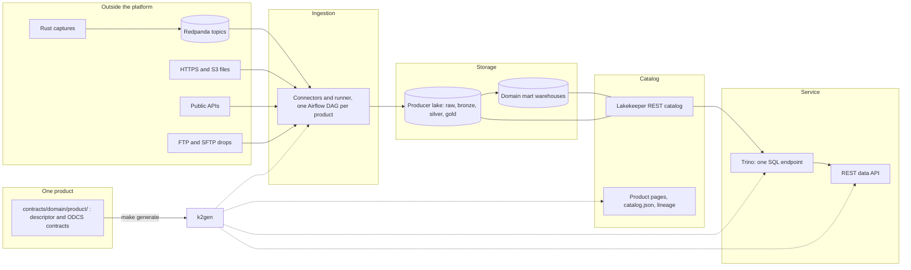
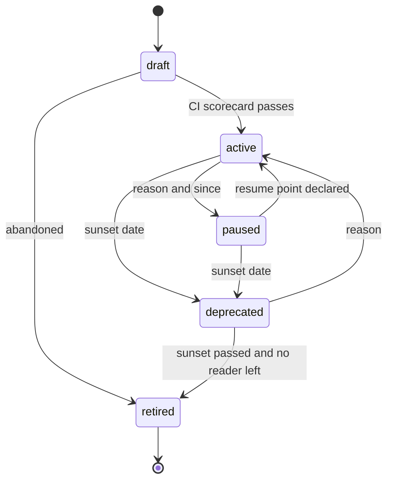
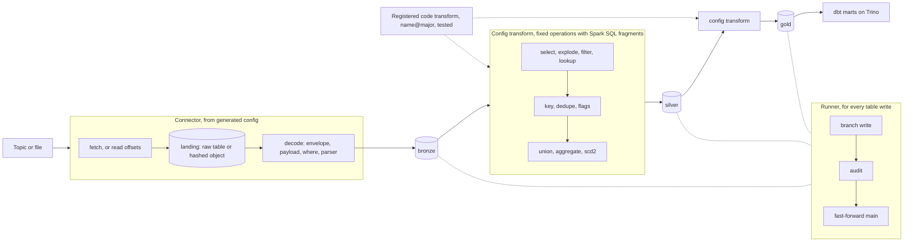
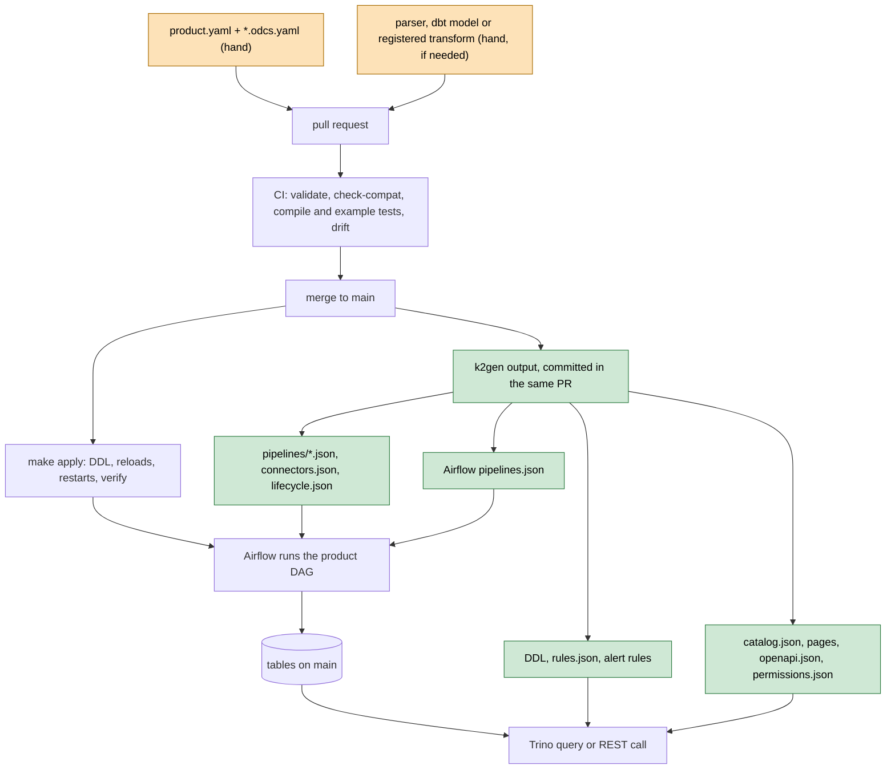
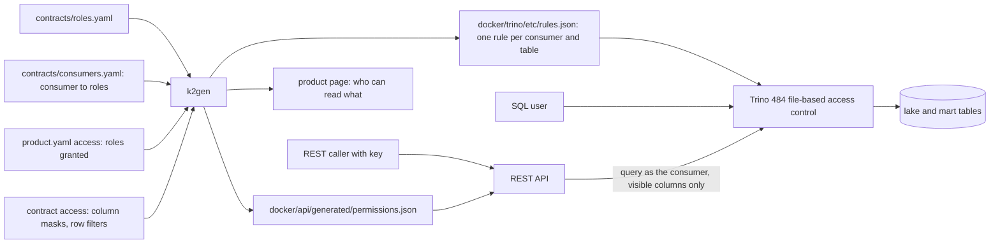
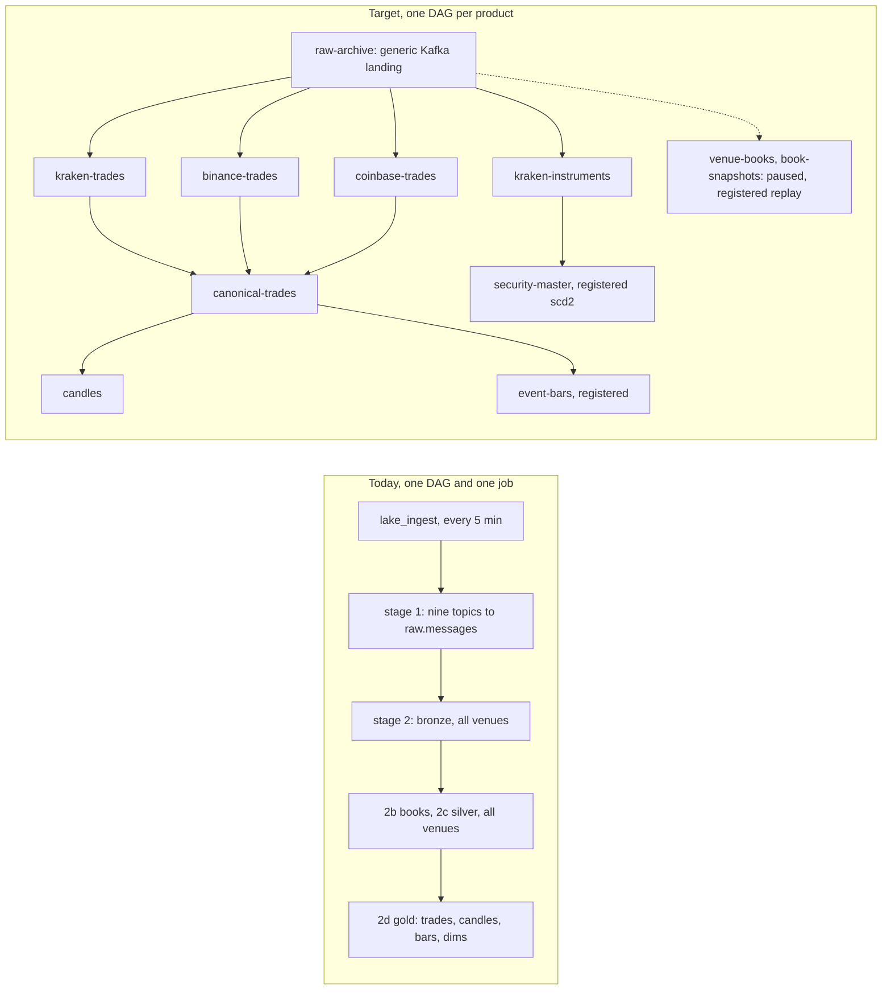

# Entry A: the contract is the program, and k2gen is its compiler

**Thesis.** A data product is a directory of YAML files in a pull request. `k2gen` (the
generator in `platform/k2gen/`) compiles it into static, committed files every runtime component
reads: pipeline plans, DAG configuration, connector settings, DDL, Trino access rules, alert
rules, the lifecycle table, the catalog bundle, the REST API's schema. No new service decides
anything at runtime: the platform's state at any commit is that commit, and a change of state is
a reviewed diff plus a deploy, never a message to a server.

Section 1 is the one-page picture, section 3 the ETL design (the centre), section 4 the two
acceptance cases, section 10 the plan. The brief's nine items are sections 1, 2, 5, 6, 7, 8, 10,
11 and 12; addenda 1 to 4 are folded in, and win where they override the brief.

## Design ethos

Each later section names the principles it follows as (E1) to (E8).

- **E1. A product is defined once**, in its contract, in a pull request; everything else is
  generated from it or checked against it.
- **E2. The generator is the only control plane**: runtime components read committed,
  generated files and never ask a service what to do.
- **E3. The platform starts at the topic or the file**: producers (the Rust captures, kept in
  `services/capture-rust/`, outside every contract) are not the platform's, and the boundary
  is a topic and its schema, or a URL and its format.
- **E4. Land verbatim, then refine**: every byte a source sent is kept as sent before anything
  interprets it, and each later layer is a function of the layer below.
- **E5. Config for the common shape, registered code for the rest**: a transform is a fixed set
  of operations holding Spark SQL fragments, and logic that does not fit is a named, tested,
  versioned function the runner calls, never a pipeline of its own.
- **E6. One product, one pipeline, one state**: each product runs, fails, pauses and is
  permissioned on its own, and every layer obeys its single lifecycle state.
- **E7. One enforcement point per rule**: Trino enforces access, the runner enforces
  incrementality and publish, CI enforces the contract; nothing re-implements another's rule.
- **E8. Nothing moves on a red proof**: every step, and every step of the crypto migration in
  particular, has a command whose output decides whether it ships.

## Terms used throughout

- **Contract**: a YAML file in the Open Data Contract Standard v3.2.0 (ODCS, vendored in
  `contracts/schema/`), one per output table, beside the product's **descriptor**
  `product.yaml` (ADR-032). A **product** is an owned unit: a descriptor, its output tables or
  marts, declared inputs, one lifecycle state, its own permissions.
- **Connector**: the part of a product that fetches from a source and lands it. **Landing**:
  the verbatim record of what arrived, a table of Kafka records or an object named by the
  sha256 of its bytes. **Medallion**: ADR-026's layers raw (landing), bronze, silver, gold.
- **Snapshot, branch, fast-forward**: an Iceberg table is a series of snapshots; `main` is the
  one readers see; a branch is a hidden line of snapshots; a fast-forward moves `main` to a
  branch atomically. **Write-audit-publish (WAP)** writes to a branch, audits, and
  fast-forwards only on a pass.
- **DAG, asset, pool**: Airflow's scheduled unit; a dataset whose update triggers a DAG; a task cap.
- **Generated artefact**: a file `make generate` writes; CI regenerates and fails on any diff,
  the **drift check** (`.github/workflows/ci.yml:84-89`). A **projection** is a generated view
  of the contracts (a page, a JSON bundle, an API response), never edited, never the source.

## 1. The architecture in one page (E1, E2, E3)

Four layers, one unit. **Ingestion**: connectors configured from contracts, scheduled by Airflow
3. **Storage**: Iceberg on MinIO behind the Lakekeeper REST catalog, the producer lake (warehouse
`k2`, Spark only) and a mart warehouse per domain (its dbt user, ADR-044). **Catalog**: the
contracts in git, with generated projections, and Lakekeeper's technical metadata held to them by
the nightly `contract_schema` audit (ADR-032 Outcome). **Service**: one SQL endpoint (Trino 484)
and a read-only REST API through it. The product crosses all four: one contract set compiles into
a connector config, a pipeline plan, tables, access rules, a catalog entry and API routes.

### Diagram 1: the four layers and the product crossing them



*Reading guide.* Solid arrows are data; dotted arrows are generated configuration, written at
build time and committed. The left box is everything the platform does not own: the captures
publish to topics (addendum 1, A), and files, APIs and SFTP drops are someone else's servers.
A product is only the box in the middle: its contracts go through `k2gen` once, and every layer
to the right reads what came out. There is no arrow from any runtime box back to `k2gen`:
nothing at runtime changes a product's definition.

## 2. Product model (E1, E6)

### 2.1 Where each field lives

The descriptor is K2's own (`contracts/schema/k2.schema.json#/$defs/product`); each output table
has an ODCS contract. Bold fields are new in this design.

| Field | File | ODCS standard or K2 custom | Meaning |
|---|---|---|---|
| `name`, `domain`, `owner`, `purpose`, `kind`, `inputs`, `outputs`, `consumers`, `marts` | product.yaml | K2 (exists) | as today, `contracts/schema/k2.schema.json` |
| **`lifecycle`** `{state, since, reason, sunset?, replacedBy?, resume?, history[]}` | product.yaml | K2 | the one state (2.2); replaces the `draft/published/deprecated` enum and the table-level `paused` mark of ADR-050 |
| **`pipeline`** `{trigger: {cron} or {after: [tables]}, driverMemory}` | product.yaml | K2 | how its generated DAG starts (section 6.4) |
| **`access`** `[{role, outputs?}]` | product.yaml | K2 | which roles may read the product (section 7.3) |
| **`serves`** `{engine, profile, service, volume, ddl, reload}` | product.yaml | K2 | a serving product such as ClickHouse (2.4) |
| `apiVersion`, `kind`, `id`, `name`, `version`, `domain`, `description.purpose`, `team.name` | contract | ODCS | as today |
| `schema[0].physicalName`, `properties[]` (`name`, `logicalType`, `physicalType`, `required`, `primaryKey`, `primaryKeyPosition`, `logicalTypeOptions.pattern`, `description`) | contract | ODCS | the columns, inline for new tables, from `lake.sql` for existing ones (ADR-032) |
| `schema[0].quality[]`, `slaProperties[]` | contract | ODCS | checks and service levels, as today |
| `status`, `servers[]`, `roles[]`, column `transformLogic` | resolved contract in `catalog/` | ODCS, **generated** | written by `k2gen` from `lifecycle`, the access points, `access` and `transform`, so an ODCS tool reading the catalog sees standard fields |
| `layer`, `format`, `partitioning`, `sort`, `classification`, `entitlement`, `retention`, `upstreams`, `schedule` | contract `customProperties` | K2 (exists) | as today; `schedule` becomes `cron ...` or `after <table>` |
| **`connector`** | contract `customProperties` | K2 | the source binding of a table a connector fills (2.3); generalises `fileSource` on `feat/file-source-pattern` |
| **`transform`** | contract `customProperties` | K2 | how a table is computed from its inputs (section 3.3) |
| **`access`** `{columns[], rows[]}` | contract `customProperties` | K2 | column and row rules per role (section 7.3) |

Two new platform files sit beside `contracts/domains.yaml`: **`contracts/roles.yaml`** (the
roles a product may grant) and **`contracts/consumers.yaml`** (each consumer: owner, roles, the
products it reads). Neither holds a secret. **Declared inputs** stay as today: lake tables
(another product's output) and external sources with their own classification
(`platform/k2gen/k2gen/cli.py:185-219`). Two rules are added: every table has exactly one
producing product, and a table with row or column rules may only be read by an output that
declares rules at least as strict for the same roles (7.3).

### 2.2 Lifecycle, one state per product (diagram 4)



*Reading guide.* Every arrow is a pull request that edits `lifecycle` in one `product.yaml`.
`k2gen validate` compares it with `origin/main` and refuses an edge not drawn here, an edited
(not appended) `history`, and a guarded edge whose guard fails: `active` needs every offline
scorecard item (old P6); `retired` needs no non-retired product or consumer to read it. `paused`
to `active` names a resume point (`committed`, `now`, `rebuild-from: <day>`), because the snapshot
a stopped pipeline last read may have expired at the seven-day floor, which "turns the next run
into an error" (`docker/lake/maintenance.py:165-171`). `retired` is terminal; no row is ever
deleted (ADR-028 §12).

What every layer does in each state, all from generated files:

| Layer | draft | active | paused | deprecated | retired |
|---|---|---|---|---|---|
| Pipeline DAG | built, manual trigger only | scheduled | built, schedule none, history kept | scheduled | not built |
| Audits and alerts | run on trigger; no alert rules | generated | none filed, no rules | generated, plus a sunset warning | none |
| Trino | owner and platform only | granted roles | granted roles, page says stale by design | granted roles | platform only |
| REST data | 404 | 200 | 200 with `X-K2-Lifecycle: paused` | 200 with `Deprecation` and `Sunset` headers | 410 Gone |
| Catalog | listed as draft | listed | flagged | flagged with sunset | listed under retired |
| Downstream products | | | flagged `upstream_paused` | flagged `reads_deprecated` | CI refuses readers |

No state touches a producer (addendum 1, A): paused means the platform stops consuming for that
product; whether a producer keeps publishing is its owner's business, and ADR-050's
`book_capture` switch in `config/instruments.yaml` stays the captures' own, never generated.

### 2.3 Source binding per connector kind

One `connector` custom property, by `kind`; a secret is named by its environment variable, never given.

| `kind` | Required fields | Landing | Where it runs |
|---|---|---|---|
| `https-file` | `url` (templated by run date `{ds}`), `format` (`xml`, `csv`, `json`), `parser`, `calendar` | landing bucket, `landing/<domain>/<product>/<day>/<sha256>.<ext>`, conditional PUT that refuses an existing name (ADR-036 spike) | Spark container, stdlib fetch (`docker/lake/file_source.py` on the branch) |
| `s3-file` | `endpoint`, `bucket`, `key` (templated), `credentialsEnv`, `format`, `parser` | same | same; the stdlib SigV4 signer the branch already tests |
| `public-api` | `url`, `params`, `pagination` (`none`, `next-link`, `page`), `maxPages`, `minIntervalS`, `authHeaderEnv?`, `format: json`, `records` (dot path) | one object per page | same |
| `ftp` | `host`, `path`, `tls: required` (plain FTP only with `anonymous: true` and classification `public`), `credentialsEnv?` | same | same; `ftplib.FTP_TLS` is present (`docker exec k2-spark-iceberg python3 -c "import ftplib; print(hasattr(ftplib, 'FTP_TLS'))"` printed `True`, Python 3.10.16) |
| `sftp` | `host`, `path`, `user`, `keyFileEnv`, `hostKey` (a known_hosts line, public) | same | same; OpenSSH `sftp -b` is in the image (`docker exec k2-spark-iceberg which sftp` printed `/usr/bin/sftp`) |
| `kafka` | `brokers`, `topic`, `envelope` (`avro-confluent` or `none`), `registry`, `payload` (`json`, `avro`), `where?`, `startFrom` (`committed`, `earliest`, `latest`), `landing?` | the table named in `landing`, or a generated `raw.<product>` | Spark container, the stage-1 code path (`docker/lake/ingest.py:172`) |

Every kind takes `mode: batch`; `continuous` is reserved and refused until built (3.8).

### 2.4 Short worked examples

Section 4 has the full Kafka and file cases; these are short (addendum 3, J), columns cut.

**FTP / SFTP: a CSV drop, to a gold table.** Synthetic: `.invalid` never resolves.

```yaml
# contracts/reference-data/venue-calendars/product.yaml
name: venue-calendars
domain: reference-data
owner: reference-data-team
purpose: Planned venue maintenance windows, as a partner drops them each night.
kind: source-aligned
lifecycle: {state: draft, since: "2027-01-05", reason: "plan N3", history: []}
inputs: [{external: "sftp://sftp.example.invalid/out", classification: internal, description: Partner drop.}]
outputs: [bronze.venue_calendar_rows, silver.venue_calendar, gold.venue_maintenance]
pipeline: {trigger: {cron: "15 2 * * *"}, driverMemory: 512m}
access: [{role: realtime_reader}]
consumers: []
# bronze.venue_calendar_rows.odcs.yaml, customProperties (columns inline: venue, start_utc, end_utc, note)
  - property: connector
    value: {kind: sftp, host: sftp.example.invalid, path: "/out/maintenance_{ds}.csv", user: k2,
            keyFileEnv: K2_SFTP_VENUE_CALENDARS_KEY, hostKey: "sftp.example.invalid ssh-ed25519 AAAA...",
            format: csv, audits: [non_empty]}       # built-in CSV parser: header row, STRING values
# silver.venue_calendar.odcs.yaml
  - property: transform
    value:
      from: bronze.venue_calendar_rows
      incremental: merge
      steps:
        - select: {venue: lower(trim(venue)), note: note,
                   starts_at: "to_timestamp(start_utc, \"yyyy-MM-dd'T'HH:mm:ssX\")",
                   ends_at: "to_timestamp(end_utc, \"yyyy-MM-dd'T'HH:mm:ssX\")"}
        - flags: {inverted: "ends_at <= starts_at"}
        - key: [venue, starts_at]
# gold.venue_maintenance.odcs.yaml
  - property: transform
    value:
      from: silver.venue_calendar
      incremental: replace
      steps:
        - filter: "NOT inverted"
        - lookup: {column: venue, table: gold.dim_venue, on: exchange, missing: fail}
        - select: {exchange: venue, starts_at: starts_at, ends_at: ends_at, note: note}
```

**Public API: JSON records, to a gold table.** The endpoint is the venue's published symbol
list; it was not fetched for this entry, and N3's first task confirms its shape and terms.

```yaml
# contracts/reference-data/binance-symbol-rules/bronze.binance_symbols.odcs.yaml (customProperties)
  - property: connector
    value: {kind: public-api, url: "https://api.binance.com/api/v3/exchangeInfo", pagination: none,
            minIntervalS: 60, format: json, records: symbols, audits: [non_empty, keys_unique]}  # built-in parser
# silver.binance_symbol_rules.odcs.yaml
  - property: transform
    value:
      from: bronze.binance_symbols
      incremental: replace
      steps:
        - select: {symbol: symbol, status: status, base: baseAsset, quote: quoteAsset}
        - lookup: {column: symbol, registry: instruments, venue: binance, as: canonical_symbol, missing: "null"}
        - key: [symbol]
# gold.venue_symbol_rules.odcs.yaml: transform scd2 over silver, key [exchange, canonical_symbol]
```

**Derived SQL product (dbt mart).** SQL is already the config language for marts (ADR-035), so
the user writes the model, and the contract declares grain and reads, as today.

```yaml
# contracts/fx-reference/fx-crosses/product.yaml (abridged)
inputs: [{table: gold.fx_eur_rates}]
outputs: []
marts:
  - {table: fx_reference.fx_crosses.fx_rates_daily, grain: [rate_date, base, quote], reads: [gold.fx_eur_rates]}
```
```sql
-- dbt/models/fx_reference/marts/fx_crosses/fx_rates_daily.sql (hand-written)
select a.rate_date, a.quote as base, b.quote,
       cast(b.rate as decimal(38,18)) / cast(a.rate as decimal(38,18)) as rate
from {{ ref('stg_gold__fx_eur_rates') }} a
join {{ ref('stg_gold__fx_eur_rates') }} b on a.rate_date = b.rate_date
```

**ClickHouse as a paused serving product** (fixed decision 7).

```yaml
# contracts/market-analytics/hot-gold/product.yaml
name: hot-gold
domain: market-analytics
owner: analytics-team
purpose: >-
  Low-latency SQL over recent gold in ClickHouse 24.3. Paused behind the hot-tier profile,
  volume kept; it returns rebuilt from the lake (ADR-025), not fed from Redpanda.
kind: consumer-aligned
lifecycle: {state: paused, since: "2026-12-01", reason: ADR-058, resume: {rebuild-from: lake},
            history: [{state: active, since: "2026-08-27", reason: "Phase E cutover"}]}
inputs: [{table: gold.trades}, {table: gold.ohlcv_1m}]
outputs: []
serves: {engine: clickhouse, profile: hot-tier, service: clickhouse, volume: clickhouse-data,
         ddl: [docker/clickhouse/ddl/10-gold-tables.sql, docker/clickhouse/ddl/20-gold-kafka.sql],
         reload: docs/runbooks/clickhouse-rebuild-from-lake.md}
access: [{role: realtime_reader}]
consumers: []
```

`k2gen validate` checks, and does not generate, the compose side: a serving product is paused
exactly when its `service` names a `profiles:` entry in `docker-compose.yml` (the same "check
the hand-written file" rule ADR-032 applies to `lake.sql`).

## 3. The ETL design (E3, E4, E5, E7)

### 3.1 Layers and their guarantees

| Layer | Holds | Guarantee | Filled by | Engine |
|---|---|---|---|---|
| raw / landing | Kafka records byte for byte, or the fetched file under its sha256 | immutable; replayable; position recorded with the data (ADR-022) or name equals hash (ADR-036) | connector | Spark container |
| bronze | the source's own fields and types, one row per record or frame, lineage columns | a pure function of landing; an unparseable record is a row with nulls, counted by an audit, never dropped (`docker/lake/bronze.py:41-48`) | connector's decode step | Spark |
| silver | exact types, UTC timestamps, conformed keys, one row per business event, every delivery kept, flags | a function of bronze plus declared reference data; nothing dropped; duplicates flagged, not removed (`docker/lake/silver.py:12-17`) | config transform, or a registered code transform | Spark |
| gold | canonical, cross-source, deduplicated; dimensions type-2; aggregates | one row per logical entity on a declared key; replaceable from silver | config transform or registered code | Spark, producer lake |
| marts | consumer-aligned derived products | SQL over gold or silver, unit and data tested, one writer per domain | hand-written dbt SQL | dbt on Trino, domain warehouse |

The Spark and dbt split is ADR-035's: Spark writes the producer lake, whose steps need Kafka
offsets, the writer lock or per-record code, and Trino's `lake` catalog is read-only
(`docker/trino/etc/catalog/lake.properties`); dbt builds marts, set-based SQL consumers change
often. Config transforms compile to Spark SQL only: one compiler target, one place for a bug.

**Connectors fill landing and bronze; transforms fill the rest.** A connector's decode step is
config too: an `envelope` (Confluent framing split by `docker/lake/wire.py`, the body decoded by
the writer schema fetched by id, `catalog.py:154`), a `payload` format, a `where` (routing, as
`bronze.route` does at `docker/lake/bronze.py:215`), and a `required` field that is null only
when a record did not parse. A file connector's parser is built in for CSV and flat JSON, and a
function in `docker/lake/sources/<name>.py` (the branch's interface) for XML or deep nesting.

### Diagram 3: the medallion flow



*Reading guide.* Read left to right. The connector box is the only part that touches a source,
and it ends at bronze. Everything between bronze and gold is the same fixed list of operations
whatever the source was; the dotted box at the top is the escape hatch, which plugs into a
transform step and never replaces the runner. The box at the bottom is what the runner does
for every table write, whoever computed the rows: write to a branch, audit, publish by
fast-forward. Marts sit after gold and belong to dbt.

### 3.2 Who writes what

A user writes YAML in `contracts/<domain>/<product>/`, plus at most a parser, a dbt model or a
registered transform (rare, platform-reviewed). `k2gen` compiles the rest; each reader takes its
file from a read-only directory mount when it acts (a file mount pins an inode, CLAUDE.md):

| Generated file | Read by | Re-read |
|---|---|---|
| `docker/lake/generated/pipelines/<product>.json`: steps, input tables, compiled SQL, incremental mode, output, audits; `connectors.json`; `lifecycle.json` | `docker/lake/runner.py` and `maintenance.py` in the Spark container (`./docker/lake` mounted at `docker-compose.yml:783`) | every run |
| `docker/airflow/dags/generated/pipelines.json` | one factory, `docker/airflow/dags/products.py` (the branch's `factory.py`, generalised) | each DAG-processor parse |
| `docker/lake/ddl/generated/*.sql`, `retention.json`, `contract_schemas.json` (exist today) | `apply_ddl.py`, `maintenance.py`, the `contract_schema` audit | every run |
| `docker/trino/etc/rules.json`, domain catalogs (exist today, extended in 7.3) | Trino | `security.refresh-period`, added to `access-control.properties` |
| `dbt/models/_sources.yml`, `dbt/selectors.yml` (exist; selectors become one per product) | dbt and the dbt DAGs | every invocation |
| `docker/prometheus/rules/generated/*.yml` and their tests (N8) | Prometheus | `POST /-/reload` (`--web.enable-lifecycle`, `docker-compose.yml:344`) |
| `catalog/catalog.json`, `catalog/contracts/*.json`, `docs/products/**`, `docker/api/generated/{openapi,permissions}.json` | the REST API and catalog UI | at start; `make apply` restarts it |
| nothing: `config/instruments.yaml` is the captures' own | the captures | at start |

### 3.3 The transform vocabulary

A `transform` names one input (`from`) or several (`union`), an incremental mode, an optional
`lookback` (how much of its own output is read beside the new batch, for window expressions, as
silver's flags do today with one day, `docker/lake/silver.py:54-56`), and an ordered list of
steps, each one operation from this fixed list; the schema (`k2.schema.json#/$defs/transform`)
admits nothing else, and a new operation is an ADR.

| Operation | What the user writes | Compiles to | Covers |
|---|---|---|---|
| `select` | `{column: expression}` in order | `SELECT expr AS column` | rename, cast, compute, parse timestamps |
| `explode` | `{path, as, index}`, or a list of levels | `LATERAL VIEW posexplode(path)`; for nested levels the flat in-frame index (`docker/lake/silver.py:130-135` shows the form) | arrays of records inside a record |
| `filter` | a predicate | `WHERE` | drop by rule (silver may only flag; `filter` is refused in a silver contract unless it names a reason) |
| `lookup` | `{column, table or registry, on, as, missing: fail or null}` | broadcast join or a map literal; `fail` raises on an unknown key, as `instruments.canonical` does | conformed keys |
| `key` | column list | identifier fields, the uniqueness audit, the MERGE key | keys |
| `dedupe` | `{key, order, flag or drop, lookback}` | `row_number() OVER (PARTITION BY key ORDER BY order) > 1` over the batch plus `lookback` of the output | replays, re-sends |
| `flags` | `{name: boolean expression}`, may use `lag` over `lookback` | extra columns | quality flags |
| `union` | list of `{from, where, select}` | `UNION ALL` | cross-source gold |
| `aggregate` | `{group, bucket: {column, seconds, as}, order, measures: {name: expression}}` | `GROUP BY`; `first` and `last` as `min_by` and `max_by` over `struct(order)`; touched buckets only | candles and other rollups |
| `scd2` | `{key, tracked, from}` | the pure planner in `docker/lake/scd2.py` and a copy-on-write MERGE | type-2 history |
| `call` | `{transform: name@major, params}` | a registered code transform (3.7) | everything else |

**The expression language is Spark SQL expressions**, the dialect the silver specs already use
(`CAST(data.p AS DECIMAL(28,10))`, `timestamp_millis(data.T)` at `docker/lake/silver.py:98-102`).
This is the design's strongest argument: `bronze.VenueTable` and `silver.TradeSpec` are already
config, written in Python, so lifting them into contracts changes where the config lives, not
what it says, and the migration can prove compiled SQL equals today's, string for string (9).

**Incremental modes**, all owned by the runner:

- `append`: read the input snapshots after the one recorded in this output's last commit
  (`k2.src-snapshot-id`, as silver does today, `docker/lake/silver.py:36-38`) and append.
- `merge`: recompute the rows of the keys the new input touched, then MERGE on `key`.
- `touched`: for aggregates, recompute every touched bucket over the whole input for that
  bucket, publish by DELETE and append on a branch, then fast-forward (ADR-048's method).
- `replace`: recompute the whole table; for small reference tables only (validate refuses it
  on a table partitioned by time).

**Idempotency** follows from four facts: a commit records the input snapshots it read, so a
re-run with no new input commits nothing (what `scripts/lake-verify.sh` asserts today);
recomputation is deterministic; a failed audit leaves `main` where it was; and both landings are
idempotent by construction (offsets in the commit, ADR-022; name equals hash, ADR-036).

### 3.4 Schema change

- **Additive** (a nullable column at the end): a minor version; `apply_ddl.py --evolve` applies
  only the "missing column" difference `docker/lake/contract_schema.py` already computes.
- **Anything else** (drop, retype, reorder, re-key): a major version, which `k2gen check-compat`
  (old P6, moved to N2) requires, and a rebuild or a new table name. The runner never changes a
  schema on its own.
- **Source drift**: bronze keeps the declared columns and the drift audit files undeclared keys
  to `audit.checks`, generalising bronze's `keys` check (`docker/lake/bronze.py:98-102`). Avro is
  decoded by writer schema id (ADR-020), so producer evolution never breaks a read.
- **Upstream change reaching a transform**: the compile test (3.5) resolves every expression
  against the input contract, so a dropped upstream column fails CI in the pull request that
  drops it, with the downstream product named by `k2gen impact` (6.3).

### 3.5 How each transform is tested

1. **Compile test** (`make test-transforms`, in `make test` and CI): Spark, in the pinned image,
   analyses every compiled plan against empty inputs built from the input contracts; the
   result's columns, types and nullability must equal the output contract, compared the way
   `docker/lake/contract_schema.py` already does.
2. **Example test**: `examples/<table>/` beside the contract holds input and expected output
   rows; `k2gen validate` refuses a transform with none. Same image, no catalog.
3. **Registered transforms**: their own unit tests, and a second implementation where they
   compute numbers (ADR-029).
4. **Runtime audits** on the branch before publish: parses, non-empty, keys unique, in-domain
   patterns, values unchanged (files), offsets (Kafka), plus the contract's own `quality`.
5. **Parity gates** stay for the products ADR-029 covers: `make parity-ohlcv`, `make parity-bars`.

### 3.6 How lineage falls out

Table-level lineage is the union of `inputs`, `upstreams`, each transform's `from` and each
mart's `reads`, compiled into one graph (`catalog/lineage.json`). Runtime evidence comes free:
every commit records the input snapshot ids it read, so "which bronze snapshot made this silver
snapshot" is one query; and every row carries lineage columns the runner appends and a
transform cannot drop (the compile test checks): `src_topic`, `src_partition`, `src_offset`,
`src_index` for Kafka, `source_file_sha256` for files. Column-level lineage from Spark's
analysed plan is a stretch item.

### 3.7 Where config ends and code begins

Some logic is code and stays code: the order-book replay and Kraken checksum
(`docker/lake/books.py`, a streaming state machine over partition iterators), event bars
(`docker/lake/bars.py`, fixed-point rules three engines must agree on), the type-2 planner
(`docker/lake/scd2.py`), and the replay and gap flags (`silver.score`). The escape hatch is a
**registered transform**:

- It lives in `docker/lake/transforms/<name>.py`, is listed in one explicit `REGISTRY` dict, and
  has a name and a major version (`book_replay@1`); two versions can live side by side. A
  contract calls it with `call: {transform: book_replay@1, params: {...}}`.
- Its signature is `run(inputs: dict[str, DataFrame], params: dict, state: DataFrame | None) ->
  dict[str, DataFrame]`: only the DataFrames its calling contract declares in, only DataFrames
  out. **The runner** reads, writes, locks, branches, audits, publishes and appends lineage.
- A CI check parses each module and fails on `writeTo`, `saveAsTable`, `spark.table`,
  `read.table` or `CALL`: a guard, not a proof; lineage evidence (3.6) is the second net.
- It ships unit tests with fixture rows, and a reference implementation where it computes numbers.

Why it cannot become the coupled pipeline again: `ingest.py` decides what to read, in what order,
when to commit and what to skip, for every venue at once; a registered transform decides none of
that. It maps declared DataFrames to DataFrames: testable without a lake, reusable, replaceable.

### 3.8 Latency, and where a continuous mode would plug in

Every connector is a scheduled micro-batch: freshness is at best one trigger interval plus the
run. The landing runs every five minutes, as `lake_ingest` does (`docker/airflow/dags/lake.py:132`),
and products downstream run when their input moved (6.4). **No connector needs an always-on
consumer**: Redpanda's retention (`docker/redpanda/init.sh:80-123`) is the buffer, and the stall
a product survives is that retention, the risk ADR-047 already alerts on. The only always-on
consumers are outside the framework: the captures, and ClickHouse's Kafka engine, paused.

A product that needs seconds would set `mode: continuous`, plugging in at the landing only: a
long-running lander, configured from the same `connectors.json`, writes the product's own landing
table continuously; bronze onwards stays micro-batch, triggered by its commits. Candidates, for a
spike when such a product exists: the Apache Iceberg Kafka Connect sink, whose exactly-once uses a
control topic and a sink-managed consumer group, not ADR-022's snapshot summary (hence a mode, not
a flag), or Redpanda Connect. Seconds end to end also need ClickHouse back as a hot store. None of
this is built.

### 3.9 Build versus adopt

Checked on the web on 2026-11-26; what could not be checked is said. Upload dates of the newest
dlt, Meltano and SQLMesh releases were cut off in the PyPI responses, so each pin is re-checked
in the pull request that adds it (CLAUDE.md).

| Option | Version, licence | Fit here | Verdict |
|---|---|---|---|
| dbt | dbt-core 1.12.7 (Apache-2.0, PyPI), dbt-trino 1.12.0, pinned in `dbt/pyproject.toml` | already builds the marts, gated by `scripts/dbt_manifest_check.py` | **adopt (kept)** for marts |
| Spark SQL driven by config | Spark 3.5.5, Iceberg 1.8.1, already here | keeps offsets in the snapshot, the lock, WAP, the parity gates | **build** the compiler (in `k2gen`) and `runner.py`, estimated 1,000 to 1,500 lines with tests |
| Kafka Connect + Iceberg sink | Apache Kafka 4.4.0, 2026-10-22 (kafka.apache.org downloads); sink in apache/iceberg, exactly-once through a control topic (Iceberg docs) | an always-on JVM worker; offsets in a consumer group, not the snapshot | **reserve** for `mode: continuous` |
| Redpanda Connect | v4.119.0, 2026-11-20 (GitHub releases); community connectors Apache-2.0, enterprise connectors need a paid key (Redpanda docs); whether its Iceberg output is enterprise: not verified | single binary, YAML config; at-least-once to objects | **reserve** for continuous; a CI check would have to refuse enterprise components |
| dlt | 1.32.0, Apache-2.0 (PyPI); Iceberg destination through pyiceberg with REST catalogs, Lakekeeper named in its docs | strong REST pagination and schema handling; but it writes the producer lake from outside Spark and the lock, and lands records, not bytes | **not now**; escape hatch: its REST client as a fetcher for an API whose pagination the three styles cannot express |
| Airbyte | 2.5, 2026-11-06 (release notes); repository LICENSE is Elastic License 2.0; `abctl` runs a kind Kubernetes cluster inside Docker, 4 CPU / 8 GB recommended, 2 / 8 in low-resource mode (docs) | its connections live in its own database and UI, a second source of truth that fixed decision 1 forbids | **reject** |
| Meltano (Singer) | 4.4.1, MIT (PyPI); a maintained Iceberg target: not verified | config in git, the closest philosophical fit; lands records, not bytes; no exactly-once to the snapshot | **not now**; revisit when a requested source has a maintained tap and no simple fetch |
| SQLMesh | 0.236.4, Apache-2.0, has a `trino` extra (PyPI) | a second dbt; dbt already passes the gates here | **reject** for now; revisit if dbt incremental models become the bottleneck |

## 4. The two acceptance cases (E1 to E8)

### 4.1 Kraken trades from its Redpanda topic

**Product grain (addendum 3, K).** Each venue's trades is its own product; unified trades
(`canonical-trades`, `gold.trades`) and `candles` (`gold.ohlcv_*`) are separate derived products.
Today `venue-frames` holds all seven bronze tables and `venue-trades` the three silver ones; N1
regroups the contracts, not the tables, into `binance-trades`, `kraken-trades`, `coinbase-trades`
and `kraken-instruments`, and moves the book frame tables into the paused `venue-books`.
`canonical-trades` already reads the three silver tables
(`contracts/market-analytics/canonical-trades/product.yaml`): venue, then unified, then candles.

**The topic is landed once.** `market.crypto.v3.raw.kraken` carries trade, book, instrument and
heartbeat frames together. The `raw-archive` product lands all nine v3 topics into
`raw.messages`, the system of record (ADR-021), partitioned by `days(kafka_ts), topic`
(`contracts/market-capture/raw-archive/raw.messages.odcs.yaml`). A product whose topic is landed
by another names that landing; a product on a topic nobody lands gets a generated
`raw.<product>` table. Pausing `kraken-trades` therefore stops its reads, not the archive.

**Ingestion layer, what the user writes.** Three files; the two contracts exist and gain blocks.

```yaml
# contracts/market-capture/kraken-trades/product.yaml
name: kraken-trades
domain: market-capture
owner: capture-team
purpose: >-
  Kraken trades as the venue sent them, typed: one row per trade, every delivery kept,
  flagged for venue replay, sequence gaps and precision loss.
kind: source-aligned
lifecycle: {state: active, since: "2027-01-20", reason: "plan N5, step M3 cutover, parity green",
            history: [{state: draft, since: "2026-11-25", reason: "ADR-032 contract"}]}
inputs:
  - table: raw.messages
  - {external: "config/instruments.yaml", classification: public, description: The instrument registry.}
outputs: [bronze.kraken_trade, silver.trades_kraken]
pipeline: {trigger: {after: [raw.messages]}, driverMemory: 1g}
access: [{role: realtime_reader}, {role: delayed_reader}]
consumers: [scripts/parity_ohlcv.py]
```

```yaml
# contracts/market-capture/kraken-trades/bronze.kraken_trade.odcs.yaml, added customProperties
# (columns stay in lake.sql, the DDL of record, ADR-032)
  - property: connector
    value:
      kind: kafka
      brokers: redpanda:9092                 # docker/lake/spark_conf.py:43
      registry: http://redpanda:8081         # docker/lake/spark_conf.py:42
      topic: market.crypto.v3.raw.kraken
      landing: raw.messages                  # landed by raw-archive
      envelope: avro-confluent               # RawMessage, by schema id
      payload: json                          # the frame, parsed with this table's columns
      where: "stream = 'trade'"
      required: channel                      # null only when the frame did not parse
      startFrom: committed                   # mode: batch is the default
      audits: [decodes, keys_unique]
```

```yaml
# contracts/market-capture/kraken-trades/silver.trades_kraken.odcs.yaml, added customProperties
  - property: transform
    value:
      from: bronze.kraken_trade
      incremental: append
      steps:
        - explode: {path: data, as: d, index: src_index}
        - select: {symbol: d.symbol, trade_id: "CAST(d.trade_id AS STRING)", trade_seq: d.trade_id,
                   price: d.price, qty: d.qty, side: d.side, side_native: d.side,
                   exchange_ts: "CAST(d.timestamp AS TIMESTAMP)", ord_type: d.ord_type, frame_type: type}
        - lookup: {column: symbol, registry: instruments, venue: kraken, as: canonical_symbol, missing: fail}
        - flags: {precision_loss: "price != round(price, 8) OR qty != round(qty, 8)"}
        - call: {transform: trade_flags@1, params: {lookback: 1d}}   # venue_replay, seq_gap, missing_before
  - property: access
    value:
      columns:
        - {name: conn_id, mask: [delayed_reader]}
        - {name: conn_msg_seq, mask: [delayed_reader]}
      rows:
        - {roles: [delayed_reader], filter: "exchange_ts < current_timestamp - INTERVAL '20' MINUTE"}
```

Every expression above is copied from `docker/lake/silver.py:111-125` and `:176-183`; the
lineage tail (`recv_ts_ns`, `recv_ts`, `conn_id`, `conn_msg_seq`, `src_*`, `ingest_ts`,
`docker/lake/silver.py:157-167`) is appended by the runner.

**What `make generate` writes for it.** `pipelines/kraken-trades.json` (three steps: read
`raw.messages` past this product's recorded snapshot, filtered by topic and stream, which the
`topic` partition prunes; decode to bronze; transform to silver); one entry in
`docker/airflow/dags/generated/pipelines.json` (DAG `kraken_trades`, triggered by the Airflow
asset `raw.messages`, pool `spark`, owner `capture-team`); retention and contract schema entries
(as today); Trino rules for its two tables (section 7); `docs/products/market-capture/kraken-trades.md`;
its entry in `catalog/catalog.json`; and REST routes for `silver.trades_kraken`.

**Storage layer.** No table moves: both stay in warehouse `k2`, DDL in `docker/lake/ddl/lake.sql`.
Each run writes a branch, audits, fast-forwards `main`; each commit carries `k2.src-snapshot-id`,
the bundle hash `k2.contracts` and the Airflow run id. **Catalog layer.** The page shows owner,
state, the connector (topic, envelope, where), the columns from `lake.sql`, the lineage
`raw-archive`, `kraken-trades`, `canonical-trades`, `candles`, and who can read what:
`realtime_reader` everything; `delayed_reader` rows older than 20 minutes, with `conn_id` and
`conn_msg_seq` null. **Service layer.** `SELECT * FROM lake.silver.trades_kraken` through Trino
at `127.0.0.1:${K2_TRINO_PORT:-8088}` (`docker-compose.yml:1080`), or
`GET /v1/data/market-capture/kraken-trades/silver.trades_kraken?canonical_symbol=BTC/USD&from=...`,
which runs the same query as the caller's Trino user; the rules decide rows and columns.

**Binance and Coinbase differ only in their contracts.** Binance: topic
`market.crypto.v3.raw.binance`, `where: "stream = 'trade'"`, no `explode` (one trade per frame,
index 0), fields under `data.*` with string prices cast to decimals and `timestamp_millis(data.T)`,
side `IF(data.m, 'sell', 'buy')` (`docker/lake/silver.py:60-108`). Coinbase: topic
`market.crypto.v3.raw.coinbase`, `where: "stream = 'market_trades'"`, a two-level `explode`
(`events`, then `trades`) whose flat index the compiler generates in the form at
`docker/lake/silver.py:130-135`, plus `envelope_ts` and `sequence_num`. Each has its own owner,
permissions and lifecycle.

**The two derived products.** `canonical-trades` (`gold.trades`):

```yaml
  - property: transform
    value:
      incremental: append
      union:
        - from: silver.trades_kraken
          where: NOT venue_replay
          select: {exchange: "'kraken'", canonical_symbol: canonical_symbol, symbol: symbol,
                   trade_id: trade_id, trade_seq: trade_seq,
                   price_e8: "CAST(price * 100000000 AS BIGINT)", qty_e8: "CAST(qty * 100000000 AS BIGINT)",
                   side: side, exchange_ts: exchange_ts, seq_gap: seq_gap, missing_before: missing_before}
        # binance and coinbase: the same entry with their table and literal (docker/lake/gold.py:126-150);
        # recv_ts_ns, conn_id, conn_msg_seq, src_* and ingest_ts are the runner's lineage tail
      steps: [{key: [exchange, canonical_symbol, trade_id]}]
```

`candles` (`gold.ohlcv_1m`; the 5m, 1h and 1d contracts differ only in `seconds`):

```yaml
  - property: transform
    value:
      from: gold.trades
      incremental: touched
      steps:
        - aggregate:
            group: [exchange, canonical_symbol]
            bucket: {column: exchange_ts, seconds: 60, as: window_start}
            order: [exchange_ts, recv_ts_ns, trade_seq]
            measures: {open_e8: first(price_e8), high_e8: max(price_e8), low_e8: min(price_e8),
                       close_e8: last(price_e8), trade_count: count(*),
                       open_time: min(exchange_ts), close_time: max(exchange_ts),
                       volume: "CAST(sum(CAST(qty_e8 AS DECIMAL(38,10))) / 100000000 AS DECIMAL(38,10))",
                       quote_volume: "CAST(sum(CAST(price_e8 AS DECIMAL(38,10)) * CAST(qty_e8 AS DECIMAL(38,10))) / 10000000000000000 AS DECIMAL(38,10))"}
```

The measures are the SQL of `gold.candles` (`docker/lake/gold.py:326-339`); `src_snapshot_id`
and `computed_at` are the runner's. So the compiled statement can be compared with today's,
string by string, before any cutover.

### 4.2 ECB end-of-day FX reference rates

Conventions from the old P4 file (`docs/plans/2026-11-24-governed-self-serve-platform/004-fx-data-product.md:19-35`):
quote units per one euro as published, a fixing on TARGET working days around 16:00 Frankfurt
time, `DECIMAL(20,10)`, compared as decimals. Its file-source design is input: the branch
`feat/file-source-pattern` already lands by hash, loads to a branch, audits, fast-forwards.

**Ingestion layer, what the user writes.** Four contract files and one parser.

```yaml
# contracts/fx-reference/ecb-fx-rates/product.yaml
name: ecb-fx-rates
domain: fx-reference
owner: fx-reference-team
purpose: >-
  ECB euro reference rates exactly as published on TARGET working days: a reference
  fixing, not a market close, and not for transactions.
kind: source-aligned
lifecycle: {state: draft, since: "2026-12-08", reason: "plan N2", history: []}
inputs:
  - external: https://www.ecb.europa.eu/stats/eurofxref/eurofxref-hist-90d.xml
    classification: public
    description: The ECB's 90-day reference rate file (reuse allowed with attribution, NOTICE).
outputs: [bronze.ecb_fx_daily, silver.fx_rates_ecb, gold.fx_eur_rates]
pipeline: {trigger: {cron: "30 15 * * 1-5"}, driverMemory: 512m}
access: [{role: realtime_reader}, {role: delayed_reader}]
consumers: []
```

```yaml
# contracts/fx-reference/ecb-fx-rates/bronze.ecb_fx_daily.odcs.yaml (abridged header)
schema:
  - name: ecb_fx_daily
    physicalName: bronze.ecb_fx_daily
    physicalType: table
    properties:
      - {name: rate_date, logicalType: date, physicalType: DATE, required: true, primaryKey: true, primaryKeyPosition: 1, description: The fixing day.}
      - {name: currency, logicalType: string, logicalTypeOptions: {pattern: "^[A-Z]{3}$"}, physicalType: STRING, required: true, primaryKey: true, primaryKeyPosition: 2, description: ISO 4217 code.}
      - {name: rate, logicalType: number, physicalType: STRING, required: true, description: The rate as the file wrote it.}
      - {name: source_file_sha256, logicalType: string, physicalType: STRING, required: true, description: The landed file.}
customProperties:
  - {property: layer, value: bronze}
  - {property: classification, value: public}
  - {property: entitlement, value: none}
  - {property: retention, value: 7}
  - {property: partitioning, value: []}
  - {property: sort, value: []}
  - property: connector
    value:
      kind: https-file
      url: https://www.ecb.europa.eu/stats/eurofxref/eurofxref-hist-90d.xml
      format: xml
      parser: ecb_fx                 # docker/lake/sources/ecb_fx.py
      calendar: target               # skip TARGET closing days; retries until 18:00 UTC
      audits: [rate_positive, no_future_date]
```

```yaml
# silver.fx_rates_ecb.odcs.yaml (columns inline: rate_date, base, quote, rate, source_file_sha256)
  - property: transform
    value:
      from: bronze.ecb_fx_daily
      incremental: merge
      lookback: 10d                  # output rows read beside the batch, for the window below
      steps:
        - select: {rate_date: rate_date, base: "'EUR'", quote: currency, rate: "CAST(rate AS DECIMAL(20,10))"}
        - key: [rate_date, quote]
        - flags: {large_move: "abs(ln(rate / lag(rate) OVER (PARTITION BY quote ORDER BY rate_date))) > 0.10"}
# gold.fx_eur_rates.odcs.yaml (columns inline, plus rate_available_at)
  - property: transform
    value:
      from: silver.fx_rates_ecb
      incremental: merge
      steps:
        - select: {rate_date: rate_date, base: base, quote: quote, rate: rate,
                   rate_available_at: "to_utc_timestamp(CAST(concat(rate_date, ' 16:00:00') AS TIMESTAMP), 'Europe/Berlin')"}
        - key: [rate_date, base, quote]
```

```python
# docker/lake/sources/ecb_fx.py (hand-written: nested XML with attributes needs a parser)
def parse(data: bytes) -> list[dict]:
    """One row per <Cube time><Cube currency rate/>: rate_date, currency, rate as written."""
```

A committed copy of the 90-day file (attributed in `NOTICE`, as the old P4 plan set out) seeds
the landing zone, so a fresh clone builds every FX table without a network.

**Generated:** three DDL files in `docker/lake/ddl/generated/`; the connector entry; the
pipeline plan; DAG `ecb_fx_rates` (the cron, calendar `target`, the branch's four file steps,
then `transform`); retention and contract-schema entries; Trino rules; the page under
`docs/products/fx-reference/`; the catalog entry; REST routes; and, once `fx-crosses` reads it, a
dbt source with a uniqueness test. **Storage:** the landed object in the landing bucket with one
`bronze.source_files` row (the branch's `governance/landed-files` product); three tables in `k2`.
**Catalog:** the page quotes "a reference fixing, not a market close", draws URL, landed file,
bronze, silver, gold, `fx-crosses`, and shows both roles reading every row (public data).
**Service:** `SELECT * FROM lake.gold.fx_eur_rates`, or
`GET /v1/data/fx-reference/ecb-fx-rates/gold.fx_eur_rates?from=2026-11-01`.

## 5. Each layer: today, target, smallest change (E2, E3)

| Layer | Today | Target | Smallest set of changes |
|---|---|---|---|
| Ingestion | one hand-written job, `docker/lake/ingest.py`, venues from `K2_EXCHANGES` and topics built in code (`:158-166`); three hand-written DAGs (`docker/airflow/dags/lake.py:3`); a file-source factory in flight | six connector kinds, one runner, one DAG factory, one DAG per product | `runner.py`, the compiler in `k2gen`, `products.py` factory, three fetchers beside the branch's, per-table locks |
| Storage | warehouse `k2` plus one per domain (ADR-044), MinIO, Lakekeeper; ClickHouse `gold` fed from Redpanda | the same; a landing bucket (ADR-036); generated `raw.<product>` tables for topics nobody else lands; ClickHouse paused | landing bucket on the branch; `apply_ddl.py --evolve`; the compose profile |
| Catalog | contracts, generated pages (`docs/products/`), Lakekeeper checked nightly (ADR-032 Outcome) | plus `catalog/catalog.json`, resolved ODCS contracts, lineage, permissions view, a read-only UI | emitters in `k2gen`; the UI served by the API |
| Service | Trino 484 with a read-only `lake` catalog and writable domain catalogs; no API (ADR-028 §6, lifted for SQL by ADR-035) | Trino plus a read-only REST API | section 7 |

**What still needs code when a user adds a product**, by kind:

| Kind | The user writes | Code needed |
|---|---|---|
| Kafka or Redpanda topic | descriptor, contracts with `connector`, `transform` | none for records the operations can express; a registered transform for state across records |
| Files over HTTPS or S3 | the same | none for CSV or flat JSON; a parser for XML or deep nesting |
| Public API | the same | none for the three pagination styles and a records path; a fetcher otherwise |
| FTP or SFTP | the same, plus a key or password in `.env` by name | none for CSV or flat JSON |
| Database pull | descriptor, a dbt model over a Trino connector catalog `k2gen` generates | the SQL; N6 proves it on a scratch schema in the existing Postgres |
| Internal lake table, or derived SQL | `inputs`, and a transform or a dbt model | the SQL, if a mart |
| A new live venue | outside the platform: a capture module in Rust and a topic | Rust, the producer's business; then a contract like 4.1 |

**ClickHouse is paused in N1.** Everything that reads it today, found with
`git grep -il clickhouse -- ':!legacy' ':!docs'` and read:

| Reader | What happens at the pause |
|---|---|
| `scripts/health.sh:89`, step (2), reads `gold.trades FINAL` | replaced by a check on the captures' Prometheus counters; step (1) needs no change, it reads `docker compose config`, which leaves out profiled services |
| `Makefile:60` gates, `scripts/parity_ohlcv.py:199` side A | `make parity-ohlcv` runs with `--skip-clickhouse --dbt`: lake gold, DuckDB over silver and dbt on Trino keep it three-way (ADR-029) |
| `Makefile:48,93` `test-clickhouse`, CI job `clickhouse` (`.github/workflows/ci.yml:99-112`) | kept: it tests the DDL on a throwaway 24.3 server, and the DDL must stay right for the return |
| `docker/prometheus/rules/clickhouse-alerts.yml` (six alerts), tests `rules/tests/clickhouse-gold-alerts_test.yml`, scrape job `docker/prometheus/prometheus.yml:45` | rules and tests move to `docker/prometheus/rules/paused/`, outside the `rules/*.yml` glob (`prometheus.yml:20-21`); the scrape job goes |
| `docker/grafana/dashboards/clickhouse-overview.json`, `k2-pipeline-overview.json:89,525,631,640` | a "paused, ADR-058" text panel; ClickHouse leaves the regexes |
| `Makefile:220-221` chaos scripts, `.claude/skills/release-check/SKILL.md:43-53`, `scripts/screenshots/shots.py:121-137`, `capture.py:118` | out of `make chaos` (files kept); their ClickHouse steps marked paused |
| `docker/clickhouse/ddl/20-gold-kafka.sql:52,102`, consumer groups `k2-gold-trades`, `k2-gold-book` | idle; the topics are still archived by stage 1 (`ingest.py:166`), so the lake loses nothing; on return the groups are dropped and ClickHouse reloads from the lake |
| contract `consumers` naming the ClickHouse reload (candles, canonical-trades, event-bars, book-snapshots) | become inputs of `hot-gold` |
| `scripts/check-env.py:40-41`, `tests/test_check_budget.py:94`, comments in `docker/lake/gold.py`, `metrics.py`, `services/capture-rust/src/sink.rs:213`, `notebooks/02_book_at_time.ipynb` | unchanged |
| 13 runbook files and 28 architecture and operations pages (`git grep -l -i clickhouse -- docs/runbooks docs/architecture docs/operations`) | a pause note in `10-clickhouse-gold.md` and `clickhouse-rebuild-from-lake.md`; the rest in the N12 docs pass |

The named volume `clickhouse-data` (`docker-compose.yml:31`) stays; `docker compose down` without
`-v` keeps it. The compose summary comment and the ADR-010 Outcome update in the same pull request
(CLAUDE.md).

## 6. Control flow (E2, E6, E8)

### 6.1 How a component learns a product's state and config

It reads a generated file when it acts; 3.2's table lists each reader, file and re-read.

**Why files and not a service.** The data plane keeps running when nothing else does; the state
at any tag can be rebuilt by checking the tag out; every change is a reviewed diff; everything is
testable with no stack, the rule `tests/test_contracts.py:21` states for `pytest tests`; and the
repository already works this way six times (`rules.json`, the domain catalogs, `selectors.yml`,
`retention.json`, `contract_schemas.json`, and `file_sources.json` on the branch).

### 6.2 How a state change propagates (diagram 2: one product from contract to served query)



*Reading guide.* Orange boxes are the only things a person writes; green boxes are generated and
committed in the same pull request, so a reviewer sees the exact runtime effect of a contract
edit as a diff. CI is the gate; `make apply` is the only deploy step, and it runs in a fixed
order. The query at the bottom is shaped by three generated inputs at once: the pipeline that
filled the table, the rules that filter it, and the catalog that describes it.

`make apply` runs, in order: `apply_ddl.py`; a Prometheus reload; a wait until Airflow's DAG
processor shows the new `pipelines.json` hash; a Trino rules refresh; an API restart; then `make
lifecycle-verify`, which compares what each component loaded with `lifecycle.json`. Every reader
exports the hash of the bundle it loaded (`k2_config_hash{component}`), so "has it landed
everywhere" is one query. A pause takes effect at the product's next run; nothing stops mid
commit. After a branch switch of the live checkout it recreates the Airflow containers (the
empty-DAG-folder incident of 2026-11-25, CLAUDE.md). **Emergency stop stays operational**: an
Airflow UI pause still works, and the nightly `lifecycle_applied` audit flags a DAG whose live
state differs from its contract until a pull request follows.

### 6.3 Upstream and downstream impact

`k2gen impact` computes from the lineage graph every product and declared consumer downstream of
the changed contracts, with owners, and CI writes it to each pull request's job summary. Retiring
a product still read fails; a breaking change fails without a major version (`check-compat`);
pausing or deprecating an input sets generated flags on every downstream page, API response and
freshness rule. It is shown in the pull request, on each page ("Read by", "Reads"), and by
`GET /v1/lineage`.

### 6.4 Pipelines on one host (addendum 3, L)

**What runs.** One generated DAG per product. Once migrated: `raw-archive` (every five minutes);
`binance-trades`, `kraken-trades`, `coinbase-trades`, `kraken-instruments`, `security-master`,
`canonical-trades`, `candles`, `event-bars` (each on its input asset); `venue-books`,
`book-snapshots` (paused); `ecb-fx-rates` (daily), ISO 4217 (monthly), the examples, one dbt DAG
per mart product, and `lake_maintenance`, `lake_rebuild`. About 20 DAGs; up to nine per slot.

**What a run costs.** Measured on 2026-11-26: `lake_ingest` averaged 151 s per successful run
over 69 runs in six hours (`curl -s --data-urlencode 'query=increase(airflow_dagrun_duration_success_sum[6h]) / increase(airflow_dagrun_duration_success_count[6h])' http://127.0.0.1:9090/api/v1/query`),
and in the 06:26 UTC run's task log
(`/opt/airflow/logs/dag_id=lake_ingest/run_id=scheduled__2026-11-26T06:26:00+00:00/task_id=ingest/attempt=1.log`
in `k2-airflow-scheduler`) the first Kafka call came 4.0 s after the `docker exec`: one Spark
session start. Nine sessions per slot instead of one add about 32 s per slot (6.4 minutes an
hour), before per-session catalog reads, which N1 measures.

**How it is bounded.**
- One Spark session per stream-product run, all its steps inside it (daily file products keep
  the branch's per-step tasks); asset triggers, so nothing runs on an empty landing.
- **Per-table locks.** `docker/lake/lock.py` holds one global `flock` for every writer, so one
  stuck product would stop all of them, against E6. Each writer instead takes the global lock
  shared and its output tables' locks exclusive; `maintenance.py` takes the global lock
  exclusive, so it still waits out every writer and blocks new ones. Same file, stdlib `flock`.
- **Airflow pools.** `spark` (2 slots) caps concurrent drivers in the 3 CPU / 8 GiB container;
  `raw-archive` has the top priority weight, since the archive must never queue while retention
  runs. Tasks queue in Airflow, not on the lock, so a waiting task holds no executor slot.
- **Scheduler load.** `AIRFLOW__CORE__PARALLELISM` is 4 (`docker-compose.yml:92`): two for
  `spark`, two for dbt, as `docker/airflow/dags/dbt_marts.py` already leaves; about 110 task
  instances an hour.
- **Escape hatches**, if N1 puts the slot's p90 above ADR-034's 240 s trigger: derived products
  every 15 minutes, or a Spark Connect server inside `spark-iceberg` for SQL-only steps (no new
  container), classic sessions kept for registered transforms that use partition iterators.

**Budget.** Today's default bootstrap peak is 21.30 CPU / 37.812 GiB across 24 services (the
`docker-compose.yml` resource summary). Pausing ClickHouse returns 4.0 / 8: 17.30 / 29.812; the
API adds 0.5 / 0.5: 17.80 / 30.312; ADR-051 (in flight) 0.75 / 1.0: 18.55 / 31.312; ClickHouse's
return 4.0 / 8: 22.55 / 39.312, under 25 / 48 (ADR-045). Pipelines add no service; `python3
scripts/check-budget.py` gates each step.

### 6.5 How it is recorded in history

**Declared:** `lifecycle.history` in each descriptor, append-only, checked against `origin/main`,
and the git log of `contracts/`. **Applied:** the nightly `lifecycle_applied` audit files one row
per product in `audit.checks`, and `make apply` writes a rollout record, the mechanism ADR-042 (in
flight) proposes. **In the data:** every commit's snapshot summary carries `k2.contracts`, the
bundle hash, so any snapshot names the contract version that wrote it.

## 7. Service layer and permissions (E7)

### 7.1 The one SQL endpoint

Trino 484 (`docker-compose.yml:1072`), loopback port 8088. Catalog `lake` reads the producer lake
and refuses every commit (`iceberg.security=read_only`); one catalog per domain holds its marts
(ADR-044). It is the one enforcement point for reads: the REST API, notebooks and dbt go through it.

### 7.2 The REST data API

**Resources**, all `GET`, all under `/v1`:

| Resource | Returns | Source |
|---|---|---|
| `/products`, `/products/{domain}/{product}` | descriptor, state, outputs, access points, lineage up and down, and a live panel: newest snapshot time and latest quality results | `catalog.json`; Trino over `$snapshots` and `governance.quality_results.dq_results` |
| `/products/{domain}/{product}/contracts/{table}` | the resolved ODCS contract | `catalog/contracts/` |
| `/data/{domain}/{product}/{table}` | rows; filters only on declared columns (partition source, key, `canonical_symbol`), `fields`, `limit` up to 10,000, a cursor on the sort key, `as_of` snapshot | Trino, as the caller |
| `/lineage/{table}?direction=up|down&depth=n` | the graph | `lineage.json` |
| `/openapi.json`, `/catalog` | the generated schema; the read-only catalog UI | `docker/api/generated/` |

Routes and response schemas come from the generated `openapi.json`, registered at start the
way `factory.py` builds DAGs from a file; an API change shows in the pull request as its diff,
and `check-compat` treats a removed field as breaking.

**Auth.** Each consumer in `contracts/consumers.yaml` gets a random key from `make env`, kept in
`.env`; the API stores its sha256 and compares with `hmac.compare_digest`, then queries Trino as
that consumer. Trino's rules decide rows and columns; the API takes its column list from
`permissions.json`, compiled from the same contracts, so it never asks for a hidden column.

**What it must not do:** write anything; accept SQL text (Trino's job); evaluate access rules of
its own; read storage around Trino; serve data of a `draft` or `retired` product; return
unbounded results; cache rows; keep state; be the source of any metadata.

**Technology:** Python 3.12 on a slim base pinned by digest; `fastapi==0.136.3` and
`uvicorn==0.52.4` (the versions in the Airflow 3.3.2 image here, `docker exec
k2-airflow-scheduler pip list`); `trino==0.340.0` (`scripts/parity-ohlcv.sh:32`). One worker,
0.5 CPU / 512M, bound to 127.0.0.1; each pin re-checked in the pull request that adds it.

**Stated gap.** Trino on loopback takes the user name from a header (ADR-044), so a process on
the host can query as anyone; the API's keys authenticate API callers only. Trino password
authentication over TLS closes it: N7 stretch, else the first hardening item.

### 7.3 Permissions per product, by role, with column and row rules (diagram 5)



*Reading guide.* Four hand-written inputs on the left, one compiler, three outputs. The SQL path
and the REST path meet at Trino, which applies the same compiled rule to both; the API only adds
authentication and uses `permissions.json` to ask for visible columns. The product page is a
third projection of the same compiled rules, so what the catalog says and what Trino enforces
cannot differ without the drift check failing.

**Model.** A product grants roles (`access` in `product.yaml`); a contract narrows a role on one
table with column rules (`mask` or `hide`) and row rules (`filter`). Grants add up: a consumer's
access is the union of its roles', so a row filter binds only when no other role of that
consumer reads unfiltered. Classification sets the ceiling: `restricted` needs an explicit grant.

**Generated into Trino.** Because Trino's file-based rules take the first match in each list
(`platform/k2gen/k2gen/generate.py:366`), `k2gen` computes each consumer's effective rule per
table and writes one rule per consumer and table, matched by exact `user`. No rule depends on
group resolution, and the catch-all read of ADR-044 (`generate.py:390`) becomes a final deny.
For the Kraken case, with one consumer declared:

```yaml
# contracts/consumers.yaml
consumers:
  partner-dashboard: {owner: analytics-team, roles: [delayed_reader], reads: [market-capture/kraken-trades]}
```
```json
{"user": "^partner\\-dashboard$", "catalog": "lake", "schema": "silver", "table": "trades_kraken",
 "privileges": ["SELECT"],
 "filter": "exchange_ts < current_timestamp - INTERVAL '20' MINUTE",
 "columns": [{"name": "conn_id", "mask": "CAST(NULL AS varchar)"},
             {"name": "conn_msg_seq", "mask": "CAST(NULL AS bigint)"}]}
```

The typed null comes from the column's type in `lake.sql` (`conn_id STRING`, `conn_msg_seq
BIGINT`, `docker/lake/ddl/lake.sql:161-162`) through the mapping `generate.py` already has
(`_TRINO_TYPES`, `:408`). `mask` is the default rather than `hide`, because a column a user may
not access makes their `SELECT *` fail (N7 tests this on 484).

**What was verified.** Trino 484's page on file-based access control
(trino.io/docs/484/security/file-system-access-control.html) lists column `allow`, `mask`,
`mask_environment`, row `filter`, `filter_environment`, matching on `user`, `role` and `group`,
and `security.refresh-period`, and says the rules do not apply to `information_schema`. A file
group provider is documented only on a mirror of 476's docs, one reason rules match users, not
groups. Nothing was run on the live Trino; N7 starts with `make test-trino` cases for a mask, a
filter, and both through a view.

**The view caveat.** A dbt view is a definer view: Trino reads its base tables as the view's
owner, so a base-table filter does not reach a reader of the view. So `k2gen validate` requires
any output that reads a table with rules to declare rules at least as strict for the same roles,
the classification rule of ADR-032 extended to rows and columns.

**Shown in the catalog:** every product page carries a table of role by output, with masked
columns and the row filter in words, and the consumers that read it.

## 8. Catalog (E1, E2)

**Source of truth:** `contracts/` (with `domains.yaml`, `roles.yaml`, `consumers.yaml`) in git.
**Projections:** `docs/products/` (exists); `catalog/catalog.json` and the resolved ODCS
contracts with `status`, `servers` and `roles` filled in; `catalog/lineage.json`; the read-only
UI, static HTML `k2gen` renders and the API serves at `/catalog`, with a live panel from
`/v1/products/...`; and Lakekeeper, whose technical metadata the engines write and the nightly
`contract_schema` audit holds to the contracts (ADR-032 Outcome). **Lineage** is declared and
compiled (3.6), with runtime evidence in snapshot summaries, row lineage and
`bronze.source_files`, drawn as a generated Mermaid diagram per page (the pages already draw one,
`generate.py:94-110`).

**A product page shows:** name, domain, owner, purpose; lifecycle state, since, reason, history;
the connector (kind, source, trigger); each output's columns, classification, retention,
partitioning and DDL source; quality checks and service levels; how to read it (Trino name, REST
path, DuckDB recipe); who can read what; reads and read by; offline scorecard items; the live panel.

**Two old P5 goals change.** OpenLineage capture is obsolete: the graph it would record is
declared and compiled, and its runtime evidence is already in snapshot summaries and row lineage,
with no listener in a driver the old plan's risk table feared would run out of memory.
OpenMetadata drops to an optional projection loaded from `catalog.json`: 3.0 CPU / 7.0 GiB at its
bootstrap (the old README's table), a 50 GB engine, and a UI that invites edits, which would make
it a second source of truth.

## 9. Migrating crypto onto the framework (addendum 2, H; E4, E8)

Today `ingest.py` is a hard-coded Kafka connector (stage 1, `:172`) plus every venue's logic
(stages 2 to 2d) in one job, run every five minutes as one task (`lake.py:164`).

### Diagram 6: today versus target



*Reading guide.* The left side is one task in one driver, so a fault anywhere stops every venue
and every derived table. The right side is the same tables with the same names, written by eleven
products, each its own DAG triggered by its input. Solid arrows are asset triggers; the dotted
arrow is a paused product. The left side's order (stage 1, then 2, then 2d) survives on the
right as the trigger chain, which is why the tables and their parity do not change.

**The invariant that makes every step reversible.** Old and new write the same tables with the
same snapshot summary keys (`k2.job`, `k2.kafka-offsets`, `k2.src-snapshot-id`;
`docker/lake/offsets.py:34-35`). Position lives in the table, not in the job (ADR-022), so either
the old or the new code can take the next run. Shadows write only to namespace
`scratch_migration`, which the `contract_schema` audit ignores (ADR-032 Outcome), and run hourly so
they never take the ingest's slot; a cutover is a DAG swap between runs, a rollback the reverse.
Prerequisites: ADR-052's backup with its restore proven, and ADR-053's guards (both in flight).

| Step | What changes | Proof, green before the next step, always with `make lake-verify`, `make parity-ohlcv`, `make parity-bars` | Rollback |
|---|---|---|---|
| M0 | contracts gain `connector` and `transform` blocks equal to today's specs; nothing reads them | `tests/test_spec_equality.py`: compiled SQL equals the strings `bronze.VENUE_TABLES`, `silver.TRADES`, `gold.candles` and `_project_silver` produce, for every venue and timeframe | delete the blocks |
| M1 | generic Kafka landing, shadow: `scratch_migration.messages` from the nine topics | `make parity-landing`: per topic and partition, the same offsets and the same value bytes as `raw.messages` over the overlap, `EXCEPT` both ways empty, over 48 h and a UTC day boundary | drop the shadow DAG and table |
| M1b | `raw-archive` DAG replaces stage 1 and writes `raw.messages` with `k2.job = ingest` | `make lake-verify` (re-run is a no-op); ADR-047 batch audit clean for 24 h; `make parity-ohlcv` | swap back to stage 1; it resumes from the same summary key |
| M2 | bronze trade tables via the runner, shadow, then cutover per venue, Kraken first | per table `EXCEPT` both ways empty over the same raw snapshot range; `bronze_unparseable` counts equal | swap back per venue |
| M3 | silver trades via config plus `trade_flags@1` (`silver.score` moved unchanged), shadow, then cutover per venue | `EXCEPT` both ways on every column, flags included, for 24 h; `make parity-ohlcv`, `make parity-bars` | swap back per venue |
| M4 | `canonical-trades` (union config), `candles` (aggregate config), `security-master` (`scd2@1`), `event-bars` (`event_bars@1`, the ADR-048 shape) | `make parity-ohlcv` (lake, DuckDB over silver, dbt), `make parity-bars`, gold `EXCEPT` against the shadow, ADR-048's old-against-new check | swap back per product |
| M5 | books behind `book_replay@1`, wrapping `books.process` unchanged; generated but paused | a pre-pause day per venue replayed into scratch equals the stored `silver.book_*` and `gold.book_top20` rows; the golden fixtures of ADR-029 | keep the legacy step; nothing flows while paused |
| M6 | `ingest.py` stages 2 to 2d and `lake_ingest` deleted (2b only once M5 is green); venue lists live only in contracts | `make gates` green; 48 h burn-in with the batch audit clean and the slot's p90 under 240 s | `git revert`; tables and summaries are compatible |

**The book resume rule.** ADR-050 kept the book steps running on empty input, because a stopped
step cannot resume once its parent's snapshots expire (its Alternatives table). Here the paused
book products stop, and their resume edge declares `resume: now`; nothing is lost, since the
captures send no book frames while `book_capture` is false. ADR-055 supersedes that clause.

**Why this is the riskiest part, and how it is held.** It touches the system of record. The cheap,
reversible proof comes first (M0 is string comparison, no stack); the archive moves only after a
48 h byte-level shadow; each venue moves alone, so a fault is one venue wide. Only M1b can lose
data (a wrong starting offset skips records); it is held by the new code reading the old code's
own summary key, and by ADR-047's batch audit checking each commit within one run, while the
records can still be re-read.

## 10. The new plan

A new plan, `docs/plans/2026-11-27-unified-product-platform/`, supersedes P4 to P7 of
`docs/plans/2026-11-24-governed-self-serve-platform/`, whose files stay as dated records. Phases
are N1 to N12, never colliding with P-numbers. Each ends with a pre-release tag `3.0.0-alpha.N`
(the owner's decision, ADR-050:527-528) and a phase audit fixing critical and high only; one
review round per pull request. ADR numbers are taken at merge (next free wins); 037 to 041 keep
their reserved subjects; 042 and 051 to 054 are in flight.

| Phase | Scope | Exit, proved by a command | Depends on | Days | Carries from P4 to P7 |
|---|---|---|---|---|---|
| **N1 Foundations** | `lifecycle` object and transition checks; venue-grain regrouping of contracts; `lifecycle.json` read by `maintenance.py`; per-table locks; Airflow pools; the products DAG factory; **ClickHouse paused** behind profile `hot-tier` with every reader in section 5; measure session start and the slot's p90; ADR-055, ADR-058; architecture chapters 20 (ethos, diagrams 1 and 4) and the ClickHouse pause note | `make generate && test -z "$(git status --porcelain)"`; a forbidden transition fails `make test-k2gen`; `docker compose config --services` lacks `clickhouse`; `python3 scripts/check-budget.py`; `make gates` with `--skip-clickhouse --dbt` | P3 done | 3 | P6 lifecycle gate (in part) |
| **N2 Files and transforms** | merge `feat/file-source-pattern` with `fileSource` renamed `connector` (only the branch's synthetic contracts use it), ADR-036 accepted; `s3-file`; CSV and JSON parsers; the compiler and `runner.py` with every operation; compile and example tests in the Spark image; `check-compat`; `apply_ddl.py --evolve`; **ECB case 4.2** to gold; ISO 4217 list as the pattern's second user; ADR-056, ADR-057 | `docker exec k2-airflow-scheduler airflow dags test ecb_fx_rates`; `bash scripts/chaos/fx-bad-file.sh` (main keeps its snapshot); idempotency test (second load adds nothing); `make test-transforms`; `docker exec k2-trino trino --execute "SELECT count(*) FROM lake.gold.fx_eur_rates"` | N1 | 5 | P4 PR1 and the two P4 PR2 products |
| **N3 Public API and FTP/SFTP** | `public-api`, `ftp`, `sftp` fetchers; the two short examples to gold; an SFTP server image, pinned, under a `test` profile only | `airflow dags test` for each; `make test-connectors` against the test SFTP server; secrets only by env name (`scripts/check-env.py`) | N2 | 3 | |
| **N4 Kafka connector** | generic Kafka landing (own `raw.<product>` table) and the shared-landing read path; decode by envelope and payload; a synthetic topic product end to end; **Kraken case 4.1 in shadow** | the synthetic product resumes exactly once across a killed run (`scripts/lake-verify.sh` pattern); `make parity-landing` on Kraken's topic | N2 | 4 | |
| **N5 Crypto migration** | steps M1 to M6, diagram 6 as chapter 21; ADR-059 | each step's proof in section 9; then `make gates` and a 48 h burn-in | N4; ADR-052 restore proven; ADR-053 | 8 | |
| **N6 Derived products** | FX dbt product (crosses, `fx_rate` macro, returns, volatility, stablecoin basis, bars in reporting currencies, decomposition); a database pull through a generated Trino Postgres catalog over a scratch schema; ADR-037 | `make parity-fx`; `airflow dags test` for each mart product; the dbt unit tests the old P4 lists | N2, N5 | 4 | P4 PR3 |
| **N7 Permissions, catalog, lineage** | `roles.yaml`, `consumers.yaml`; per-consumer Trino rules with masks and filters; the definer-view rule; the read-only storage key (ADR-054); `catalog.json`, resolved contracts, `lineage.json`, `k2gen impact` in CI; `trace-product.sh`; diagram 5 as chapter 22; ADR-038, ADR-039 | `make access-verify`: per role and table, Trino's columns and newest row match `permissions.json`; a delayed consumer never sees a row newer than 20 minutes; `bash scripts/trace-product.sh gold.fx_eur_rates <day>` prints the landed file | N5, N6 | 4 | P5 PR1, PR2; P5 PR3 and PR4 changed (section 8) |
| **N8 Controls, SLOs, release** | controls catalogue, readiness scorecard gating `active`, generated SLO rules and burn-rate alerts, ADR-042's release manifest and rollout record; ADR-040, ADR-041 | `make compliance-report`; `make check-alerts`; a `draft` to `active` edit with a failing item fails CI | N7 | 4 | P6 PR1 to PR3 |
| **N9 REST API and catalog UI** | section 7.2; `docker/api/`; the UI at `/catalog`; ADR-060 lifts ADR-028 §6 for HTTP | `make api-verify`: every route in `openapi.json` answers; REST rows equal Trino rows per consumer; a retired product returns 410 | N7, N8 | 4 | |
| **N10 Infrastructure as code** | `make plan` (declared versus live: warehouses, buckets, users and policies, Trino catalogs, DAG states, rule hashes) and `make apply`, idempotent, from generated artefacts; the drift control gets real evidence; ADR-061 | `make plan` prints no difference on a fresh stack; after a hand change it prints it; `make apply` twice changes nothing | N9 | 3 | P6's "infrastructure free of drift" control |
| **N11 Hardening sprint** | every deferred medium and low finding of N1 to N10; Trino authentication; the DR drill and chaos extensions (P6 stretch) | each finding closed with its commit, or deferred with a trigger | N10 | 4 | P6 PR4 |
| **N12 Release gate** | design and adoption documents, verification index, the golden path run once per connector kind, chapters 20 to 22 current, `/benchmark-report`, re-measured fresh install, `/release-check`, tag **3.0.0** | `/release-check` passes from a fresh clone; `make check-docs` | N11 | 3 | P7 |

**Total: about 49 working days**, a judgement, not a measurement; the old 12 to 13 days covered
P0 to P7 before four connector kinds, a transform compiler, the crypto migration and the REST API.
Cut order if time runs short: the UI's live panel, column-level lineage, the database pull, the
FX returns and decomposition models, the drills. Never cut: the migration proofs, the
failure-mode tests, the runbooks, the provenance of a published number.

**Keeping the diagrams current (addendum 4).** Chapters 20 to 22 under `docs/architecture/`
carry the six: 20 (ethos, diagrams 1, 2, 4) in N1, 21 (diagrams 3, 6) in N5, 22 (diagram 5) in
N7, each updated in the pull request that changes what it draws; product and lineage diagrams are
generated, so cannot go stale; `make check-docs` gate (a) holds every path the chapters link.

**In-flight work.** `feat/file-source-pattern` merges as N2's first pull request, renamed.
`docs/adr-versioning-and-telemetry`: ADR-042 becomes N8's release engineering and 6.5's rollout
record; ADR-051 runs on its own track, counted in the budget. `docs/adr-platform-hardening`:
ADR-052 and 053 gate N5, 054 gates N7. ADR-049 (Proposed) would arrive as `event_bars@2`.

## 11. Costs and risks

**Effort:** about 49 days. **Resources:** bootstrap peak 17.80 CPU / 30.312 GiB after N9, 22.55
/ 39.312 with ADR-051 and ClickHouse back (6.4); no new always-on service but the API.

| Risk | Spike | Escape hatch |
|---|---|---|
| The archive cutover (M1b) skips or repeats offsets | M1's 48 h byte-level shadow, and a kill-in-the-middle run on a scratch topic in N4 | swap back to stage 1, which reads the same summary key |
| Nine sessions per slot and lock waits push the slot past ADR-034's 240 s p90 | N1 measures session start and catalog reads per run on the live stack | derived products every 15 minutes; Spark Connect for SQL-only steps |
| The operation list grows into a language | none: a rule | a new operation needs an ADR; anything else is a registered transform |
| Trino 484 masks and filters behave differently through views or Iceberg than documented | N7's first `make test-trino` cases | serve restricted roles from dbt-built filtered marts, ADR-035's delayed-product pattern |
| A component runs stale config (inode pinning, the empty DAG folder of 2026-11-25) | `k2_config_hash` per component in N1 | `make apply` recreates; the nightly `lifecycle_applied` audit flags it |

**Deliberately left out:** the continuous mode (designed, not built, 3.8); OpenLineage and a
mandatory OpenMetadata (section 8); Airbyte, Meltano and SQLMesh (3.9); catalog-level
authorisation in Lakekeeper (ADR-039's target, a separate plan); any form or app that writes
contracts (fixed decision 1); regenerating the captures (addendum 1, A); resuming book capture
(fixed decision 8); multiple hosts (ADR-028 §1).

## 12. Why this design

**Against a control-plane service** (a product registry with a database and a reconciler that
pushes state): it changes state in seconds, answers runtime questions directly and could host a
UI. It is weaker here on the fixed decisions that matter: a database row becomes a second source
of truth beside the contract (decision 1); an always-on service with its own outage sits in front
of every pipeline; history lives in a table, not in reviewed commits; and none of it is testable
by `pytest tests` with no stack.

**Against adopting an integration platform** (Airbyte, or Meltano plus dbt): connector catalogues
and less code to own. Weaker here: they land records, not bytes, so verbatim landing and
hash-keyed replay go; they cannot keep Kafka positions in the Iceberg commit (ADR-022) or publish
through a branch; Airbyte adds Kubernetes inside Docker and keeps its configuration in its own
database; and four connector kinds are a few hundred lines of standard library on a container
that already exists.

**Where this design is weaker, said plainly.** A state change takes a pull request, a merge and
`make apply`, slower than a switch, and an incident stop is a manual Airflow pause followed by a
pull request. Propagation is ordered, not atomic; the config hash makes the gap visible, not
absent. The compile test needs the Spark image in CI. Live facts (freshness, the newest quality
result) are in no generated file, so the live panel needs the API. Logic outside the operation
list waits for the platform team to register a transform. Per-product pipelines cost more Spark
session starts than one job, bounded (6.4), not removed.

**Where it is stronger.** One reviewed diff shows a product change's whole runtime effect. The
platform runs with the generator switched off. Any tag rebuilds its exact state. And the
migration is proved string for string before row for row, because the venue logic was already
config in Python: this design moves it, and does not rewrite it.
