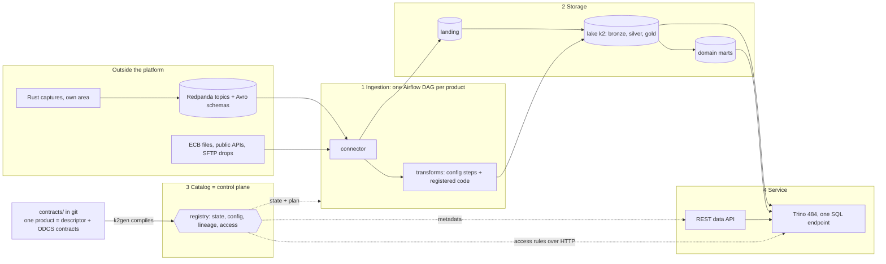
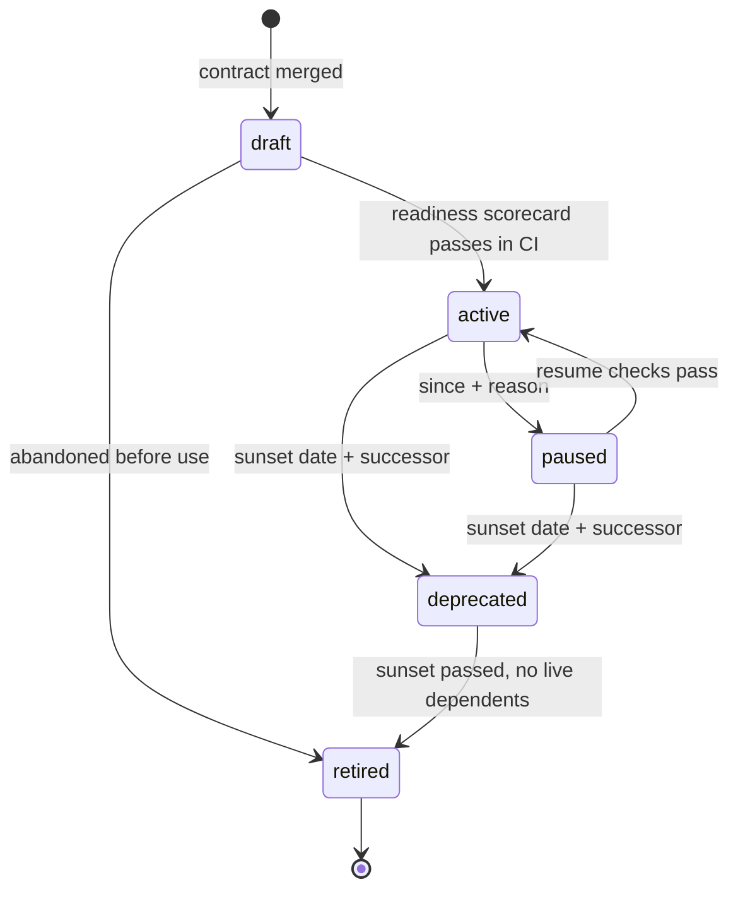
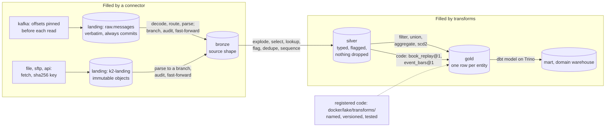
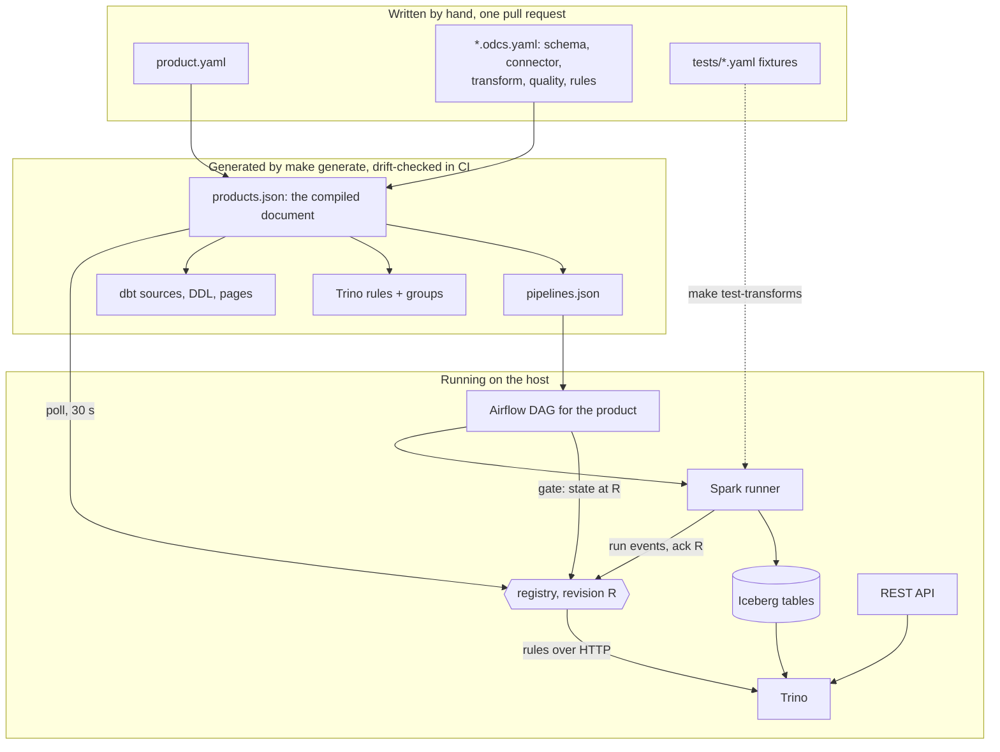
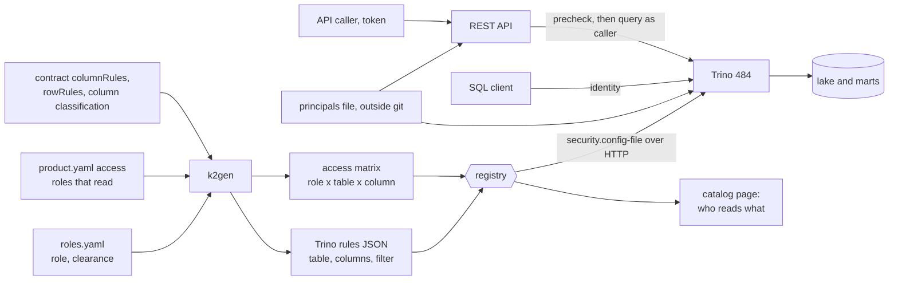
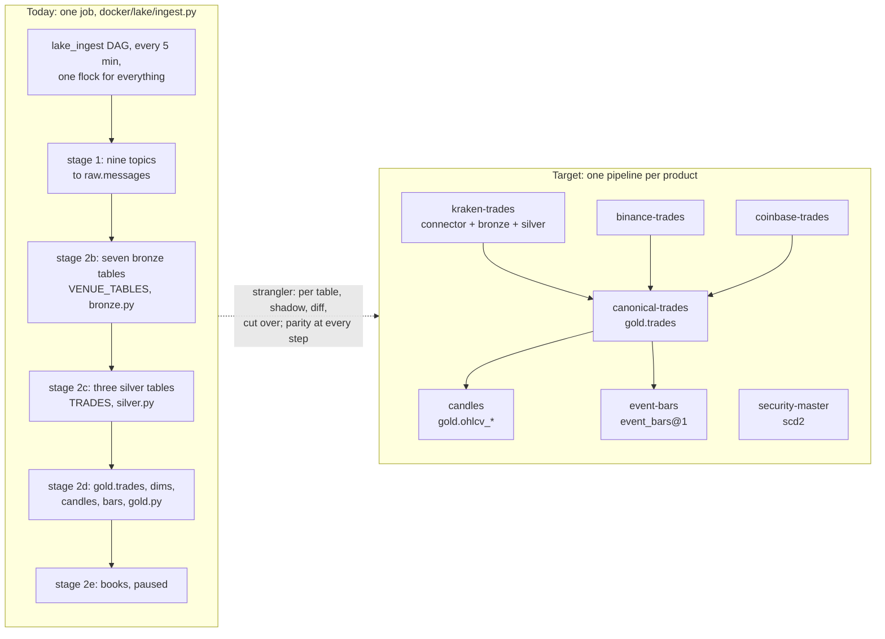

# Entry B: K2 as one live metadata plane over a config-driven medallion

**Thesis.** A product is written once, as a contract in git; `k2gen` compiles every contract into
one product document; a small always-on registry serves that document, the product's live state
and its lineage; and every runtime part (each product's Airflow pipeline, the Spark runner that
executes its connector and config-driven transforms, the audits, the alert rules, Trino's access
rules, the catalog and the REST API) reads the same revision from that one plane at run time, so
a product changes in one pull request and every layer converges on it, visibly.

School argued: **a metadata control plane**. A *control plane* decides what should run and how; the
*data plane* moves the data. Here the data plane (Airflow, Spark, Iceberg on MinIO, Trino) exists;
the control plane is the new piece. Its weaknesses are stated in sections 6, 12 and 13. Repository
claims were read on `main` at `bb6e77f` and `origin/feat/file-source-pattern` at `aa7a73a`,
2026-11-26; owner addenda 1 to 4 are folded in and override the brief.

## 0. Design ethos

Eight principles. Every later section names the ones it follows as [E1] to [E8].

- **E1. A product is defined once.** One descriptor plus one ODCS contract per table, in a pull
  request; everything else is compiled from it or observed against it.
- **E2. The platform starts at the topic, the file or the endpoint.** Producers, the Rust captures
  included, are outside the framework; the boundary is a topic or a URL plus its schema.
- **E3. Land first, unchanged; publish only what passed its audit.** Landing is verbatim and never
  blocked; every later table is a rebuildable function of the one before, written to a branch,
  audited, and only then fast-forwarded to `main`.
- **E4. Config for the common shape, named code for the hard core, never code per product.** A
  transform is a fixed vocabulary of steps whose arguments are Spark SQL expressions; code is a
  registered, versioned, tested operation that contracts call by name.
- **E5. Compiled in CI, delivered live.** The pull request compiles and checks everything; the
  registry hands the compiled revision to every runtime without a restart; nothing at run time
  re-reads YAML.
- **E6. Fail loud, fail static.** When the registry is unreachable, every component keeps its last
  known revision, runs every check and fires every alert; the registry can make the platform do
  less only while it is reachable and says so.
- **E7. One writer per table, one enforcement point per rule.** Each table has one owning product
  and one pipeline; read permissions are enforced by Trino for SQL and for the REST API alike.
- **E8. Every step is proved by a command.** A migration step, a gate or a published number names
  the command that shows it; old and new run side by side until that command agrees.

## 1. The architecture in one page

Four layers, and the product as the unit that crosses them [E1]:

| Layer | What it is | Built from |
|---|---|---|
| **Ingestion** | One generated Airflow pipeline per product: a connector (Kafka/Redpanda, file over HTTPS or S3, SFTP/FTP, public API), its medallion transforms, audits, publish | `docker/airflow/dags/`, `docker/lake/`, the in-flight `factory.py` and `file_source.py` |
| **Storage** | Landing (verbatim), then bronze, silver and gold Iceberg tables in warehouse `k2`, which only Spark writes, and dbt marts in one warehouse per domain | ADR-026, ADR-044, MinIO, Lakekeeper `v0.13.9` (`docker-compose.yml`) |
| **Catalog** | The registry: the compiled product document, lifecycle state, observed runs, lineage, access matrix; its read-only pages are the catalog UI | new, `docker/registry/`, database in the existing Postgres |
| **Service** | Trino 484 as the one SQL endpoint; a REST data API that reads only through Trino as the caller | `docker/trino/`, new `api` service |

A **data product** is one owned unit of data: a descriptor (`product.yaml`) and one contract per
table, in the Open Data Contract Standard v3.2.0 (ODCS, vendored in `contracts/schema/`). It is
what has an owner, a state, a pipeline, permissions and a catalog page.

### Diagram 1: the four layers and the product crossing them



**Reading guide.** Solid arrows carry data, dotted arrows metadata. Data enters from producers the
platform does not run, passes through ingestion into storage, and leaves only through Trino; the
API is a client of Trino, not a second path. Every dotted arrow starts at the registry, which is fed
only by the compiler from git: that is the whole control plane. A product (say Kraken trades) is in
every box at once: contract in git, DAG in ingestion, tables in storage, page and state in the
registry, grants in Trino.

## 2. The product model

### 2.1 Files a user writes, and fields

Under `contracts/`: `domains.yaml` (exists, ADR-033, ADR-044), `roles.yaml` (new: roles and their
clearance), and per product `<domain>/<product>/product.yaml` (the descriptor, validated by
`contracts/schema/k2.schema.json`), one `<table>.odcs.yaml` per table, and `tests/<table>.yaml`
(given and expected rows per transform).

| Field | Where | Standard or custom | New? |
|---|---|---|---|
| `apiVersion`, `kind`, `id`, `name`, `version`, `domain`, `description.purpose`, `team.name` | contract | ODCS standard | exists |
| `schema[0]` with `physicalName`, inline `properties` (name, `physicalType`, `required`, `primaryKey`, per-column `classification`) or `authoritativeDefinitions` to `lake.sql` | contract | ODCS standard | exists (`contracts/schema/README.md`) |
| `servers`: where the data is read from (types `kafka`, `s3`, `sftp`, `api`) and reached at (`trino`, `iceberg`) | contract | ODCS standard (vendored schema lists those types; `KafkaServer` has `host`, `format`, `encoding`; `SftpServer` has `location`, `format`, `delimiter`) | new use |
| `quality` (type `sql` or `custom`), `slaProperties` | contract | ODCS standard | exists |
| `status`, `roles`, per-column `transformSourceObjects` and `transformLogic` | contract | ODCS standard | **never hand-written**: the registry's ODCS export fills them from the descriptor and the compiler, so state, grants and column lineage are each defined once [E1] |
| `layer`, `format`, `partitioning`, `sort`, `classification`, `entitlement`, `retention`, `upstreams` | contract | custom (`customProperties`) | exist |
| `connector` | bronze contract | custom | new: generalises the in-flight `fileSource` |
| `transform` | silver and gold contracts | custom | new |
| `columnRules`, `rowRules` | contract | custom | new |
| `lifecycle: {state, since, reason, sunset, successor}` | descriptor | K2 | replaces the enum `draft, published, deprecated` and ADR-050's per-table `paused` |
| `inputs` as `{product, table}` or `{external, classification}` | descriptor | K2 | `product` key new |
| `access: {read: [roles], delayed: {...}}` | descriptor | K2 | new |
| `pipeline: {schedule, mode, driverMemory, after}` | descriptor | K2 | new; the per-table `schedule` custom property becomes derived |
| `serving: {engine, tables, feed}` | descriptor | K2 | new, for a serving product such as ClickHouse |

Today `lifecycle` is maturity only (enum `draft, published, deprecated`) and ADR-050 §5 put a
separate `paused` property on nine tables because a product could not be half paused. Fixed
decision 2 wants one state per product, so ADR-051 records the merge and the three bronze book
tables move from `venue-frames` into `venue-books`, making every paused table part of a wholly
paused product. The names follow ODCS, whose `status` examples are `proposed, draft, active,
deprecated, retired` (vendored schema).

### 2.2 Lifecycle states and what each layer does

| State | Pipeline | Audits | Alerts | Catalog and API | SQL | Downstream |
|---|---|---|---|---|---|---|
| `draft` | runs on schedule | run | warning severity only | flagged "no promise" | readable by its roles | an `active` product reading it is flagged |
| `active` | runs | run | full, with SLOs | normal | readable | normal |
| `paused` | the gate task skips: the connector stops consuming, offsets stay where they are | skipped, no row filed (manual `--with-paused` as ADR-050) | freshness and volume rules suppressed, integrity rules kept | "paused since, reason"; API header `K2-Product-State: paused` | readable | flagged `upstream paused`; freshness SLOs suspended |
| `deprecated` | runs | run | full | sunset date and successor shown; API `Deprecation` header | readable | CI refuses a new product that lists it as input |
| `retired` | no DAG generated | none | none | tombstone page; API `410 Gone` with successor | readable at pinned snapshots, nothing written; no row deleted (ADR-028 §12, ADR-032) | CI refuses retirement while any non-retired product reads it |

**At the producer boundary [E2].** Pausing a topic product means the platform stops consuming; the
producer keeps publishing (its owner's business) and the topic's retention clock runs. The
registry shows a *resume deadline*, pause start plus the topic retention the contract declares;
resuming past it stops the connector on the gap, as `ingest.py` does today (`_accept_data_loss`,
`:429`), and `--accept-data-loss` records the hole. Pausing a product that feeds the shared landing
stops the archive for its topics, so `k2gen validate` requires `archiveGapAccepted: true`. ADR-050's
`book_capture` switch stays the producer's own; the book products are paused by lifecycle, and the
audit skip that today reads the producer's switch (`maintenance.py:785-827`) reads product state.

### Diagram 4: lifecycle states and transitions



**Reading guide.** Each arrow is a pull request editing one field, `lifecycle.state`, with `since`
and `reason`. `k2gen check-lifecycle` compares the descriptor with `origin/main` and refuses any
arrow not drawn, so no product jumps from `active` to `retired` and orphans its readers. Nothing
leaves `retired`: a revival is a new product. Only a product that has run can be `paused`; a draft
is simply not promised.

### 2.3 Worked YAML examples

The acceptance cases, Kraken trades and ECB FX, are in section 4 in full; the other four are here.
**A paused serving product: ClickHouse (fixed decision 7).** No lake table, no transform; its DDL
of record stays `docker/clickhouse/ddl/10-gold-tables.sql`.

```yaml
# contracts/market-analytics/hot-tier/product.yaml
name: hot-tier
domain: market-analytics
owner: analytics-team
purpose: Sub-second reads of recent gold. Paused behind compose profile hot-tier, volume kept.
kind: consumer-aligned
lifecycle: {state: paused, since: "2026-12-01", reason: ADR-054}
inputs: [{product: canonical-trades, table: gold.trades}, {product: candles, table: gold.ohlcv_1m},
         {product: event-bars, table: gold.bars}]
outputs: []
serving: {engine: clickhouse, ddl: docker/clickhouse/ddl/10-gold-tables.sql,
          tables: [gold.trades, gold.ohlcv_1m, gold.ohlcv_5m, gold.ohlcv_1h, gold.ohlcv_1d, gold.bars],
          feed: {today: redpanda-kafka-engine, target: lake-reload}}
access: {read: [realtime_reader]}
consumers: [docker/grafana/dashboards/clickhouse-overview.json]
```

**A CSV over SFTP (short, synthetic).** A partner drops a daily fee schedule. Being synthetic, it
lives under `platform/k2gen/tests/synthetic/`, as the in-flight `synthetic-rates` does, never under
`contracts/`, where it would become a production DAG.

```yaml
# .../venue-fees/bronze.venue_fees.odcs.yaml (excerpt)
servers: [{server: partner, type: sftp, location: "sftp://sftp.example.invalid/out/fees_{date}.csv",
           format: csv, delimiter: ","}]
schema:
  - name: venue_fees
    physicalName: bronze.venue_fees
    physicalType: table
    properties:   # every column STRING, as sent: venue and tier are the primary key
      - {name: venue, physicalType: STRING, required: true, primaryKey: true, description: As sent}
      - {name: tier, physicalType: STRING, required: true, primaryKey: true, description: As sent}
      - {name: maker_bps, physicalType: STRING, required: true, description: As sent}
      - {name: effective_date, physicalType: STRING, required: true, description: As sent}
customProperties:
  - property: connector
    value: {kind: file, transport: sftp, calendar: none, parse: {format: csv, header: true},
            hostKey: "ssh-ed25519 AAAA-placeholder",   # pinned; never StrictHostKeyChecking=no
            credentials: {secret: K2_SFTP_PARTNER},    # a name in .env, never a value
            audits: [non_negative_fees]}
```

Silver is one `select` (`CAST(maker_bps AS DECIMAL(9,4)) AS maker_bps`, `to_date(effective_date)`);
gold one `scd2` keyed on `(venue, tier)`, the type-2 mechanism of `gold.dim_venue` (ADR-030, `scd2.py`).

**A public API returning JSON (short).** Kraken's public asset-pair list returns top-level `error`
and `result`, `result` an object keyed by pair with fields such as `altname`, `base`, `quote`,
`pair_decimals`, `lot_decimals`, `tick_size` and `status` (fetched 2026-11-26; reference data).

```yaml
# contracts/reference-data/kraken-asset-pairs/bronze.kraken_asset_pairs.odcs.yaml (excerpt)
servers: [{server: kraken-public, type: api, location: "https://api.kraken.com/0/public/AssetPairs"}]
customProperties:
  - property: connector
    value: {kind: api, engine: dlt-rest-api, paginator: single_page, auth: none,   # section 3.9
            land: jsonl,                                   # one landed file per run, sha256 key
            parse: {format: json, records: "$.result", map: {key: pair}}}   # object keyed by pair: a row each
```

Silver is one `select` (`CAST(tick_size AS DECIMAL(28,10)) AS tick_size`, ...); the security master
may declare it as an input. **A derived SQL product: FX crosses (dbt on Trino)**, old P4's, kept.

```yaml
# contracts/fx-reference/fx-crosses/product.yaml
name: fx-crosses
domain: fx-reference
owner: fx-reference-team
purpose: >-
  Any-pair cross rates from the ECB euro legs, carried forward at most five TARGET working days,
  then null (conventions: docs/plans/2026-11-24-governed-self-serve-platform/004-fx-data-product.md).
kind: consumer-aligned
lifecycle: {state: draft, since: "2027-01-10", reason: ADR-037}
inputs: [{product: ecb-reference-rates, table: silver.fx_rates_ecb}]
outputs: []
marts: [{table: fx_reference.fx_crosses.fx_rates_daily, grain: [as_of_date, base, quote],
         reads: [silver.fx_rates_ecb]}]
access: {read: [realtime_reader, delayed_reader, public_reader]}
pipeline: {after: [ecb-reference-rates]}
```

The SQL is `dbt/models/fx_reference/marts/fx_crosses/fx_rates_daily.sql` with its unit tests;
`marts` is an existing field (`k2.schema.json`, `product.marts`).

## 3. The ETL design (the centre)

### 3.1 Layers, guarantees and who fills them

The repository's medallion is raw, bronze, silver, gold (ADR-026 Decision table) plus marts
(ADR-035, ADR-044). *Medallion* means each layer is derived only from the layer above and keeps a
stated promise. The framework keeps those promises and generalises them beyond crypto [E3]:

| Layer | Promise | Filled by | Engine | Today's example |
|---|---|---|---|---|
| **Landing** | every record or file exactly as received, with its position (topic, partition, offset; or content sha256), never blocked by a check | connector | Spark (stream), stdlib or dlt fetch (files, APIs) | `raw.messages` (`lake.sql:47`, "never expired", `:29`); `k2-landing` bucket (in-flight `file_source.py`) |
| **Bronze** | the source's own field names, nesting and JSON types, one row per landed record; unparseable rows kept with null payload columns and counted | the connector's load steps (`decode`, `route`, `parse`) | Spark | `bronze.kraken_trade` (`bronze.py:137`) |
| **Silver** | typed (exact decimals, UTC timestamps), exploded to one row per business record, conformed keys *added*, quality flags set, nothing dropped | transform | Spark | `silver.trades_kraken` (`silver.py:110`) |
| **Gold** | one row per business entity, decided once; cross-source unions; type-2 history; aggregates | transform or registered code | Spark | `gold.trades`, `gold.ohlcv_*` (`gold.py`) |
| **Marts** | consumer-shaped SQL over gold and silver, in the consuming domain's warehouse | dbt model | Trino 484 | `market_analytics.candles.ohlcv_1m` (`dbt/models/market_analytics/marts/`) |

**Why Spark below marts.** Landing to gold needs offsets in the same commit as the data, the writer
lock and per-record decoding (ADR-022, ADR-035's boundary table), and Trino reads `k2` through a
connector that refuses every commit (`lake.properties`, `iceberg.security=read_only`) because
ADR-044 measured that file rules cannot fence table procedures. Silver in dbt would reopen that fence.

### 3.2 What a user writes: the transform vocabulary

A **transform** is an ordered list of **steps** from a fixed vocabulary, written in the table's
contract under `customProperties.transform`. Step arguments are **Spark SQL expressions**
(fragments, never statements). One generic runner, `docker/lake/transform.py`, turns the steps into
DataFrame operations; nothing per product is Python [E4].

| Step | Arguments | Layers | Today's equivalent |
|---|---|---|---|
| `decode` | `envelope: k2-raw-message` (Confluent-framed Avro, decoded per writer schema id) or `none` | bronze | `bronze._decoded_raw` |
| `route` | the envelope fields that select this table's records, e.g. `{stream: trade}` | bronze | `bronze.route` |
| `parse` | `format` (`json`, `csv`, `xml`, `jsonl`), Spark DDL `schema`, `required` field, `mode: permissive`, `drift` keys per path; for XML `records`, `inherit`, `fields` | bronze | `VenueTable.schema/required/keys` (`bronze.py:89-102`) |
| `explode` | `path`, `as`, `index`; a list for nested arrays with `index: flat` | silver | `TradeSpec.explode` (`silver.py:113`, `:133`) |
| `select` | list of `expr AS name`; `keep: lineage` appends the lineage columns | all | `TradeSpec.venue_columns` |
| `lookup` | `ref` (a declared input table or config file), `from`, `add`, `onMissing: fail, null` | silver | `instruments.canonical`, which raises on an unknown symbol |
| `flag` | `name: boolean expression` | silver | `precision_loss` (`silver.py:181`) |
| `dedupe` | `mode: flag` (silver: mark later deliveries) or `keep-first` (gold), `key`, `order`, `lookback` | silver, gold | `silver.score` replay window |
| `sequence` | `partition`, `seq`, `as`, `count`, `skip`, `lookback`: gap flag over sequential ids | silver | `silver.score` gap window |
| `filter` | boolean expression | bronze routing and gold only; `k2gen` refuses it in silver, which drops nothing (ADR-026) | `WHERE NOT venue_replay` (`gold.py:128`) |
| `union` | inputs with a per-input `add` (e.g. `exchange: "'kraken'"`), by column name | gold | `gold._project_silver` over three venues |
| `aggregate` | `groupBy`, `bucket {column, seconds, as}`, `measures` (expressions), `recompute: touched` | gold | `gold.candles` (`gold.py:316-341`) |
| `scd2` | `key`, `tracked`, `from` (table or declared config file) | gold | `gold._merge_dim`, `scd2.py` |
| `code` | `name@major`, `params`: the escape hatch, section 3.7 | silver, gold | `books.replay`, `bars` |
| `write` (always last) | `mode: append, merge, replace-touched`, `key` (identifier fields) | all | `writeTo(...).append()`, MERGE |

Today's silver and gold Python is already this vocabulary in disguise: `TradeSpec` is an explode
statement plus `expr AS name` strings (`silver.py:67-150`), `VenueTable` a schema string, a required
field and drift keys (`bronze.py:89-210`), the candles one parameterised statement (`gold.py:316`).
So the migration (section 10) moves strings from Python into YAML; it does not translate logic.

**Why Spark SQL expressions, not a new language.** Spark runs these layers and the logic is already
Spark SQL; a home-made language would need its own documentation and evaluator and would still
compile to Spark. The guardrails are offline: `k2gen` parses each fragment with `sqlglot` (MIT,
Spark dialect), refuses statements, subqueries, table references and non-deterministic functions,
checks every referenced column exists in the step's input (propagated from the declared columns),
and extracts column lineage. Spark's analyser is the final word, in the runner's `--plan` dry run.

### 3.3 Incremental and idempotent, by construction

The repository already has the mechanism and the framework reuses it [E3]:

- **Streams.** Each partition is read from the committed offset to a bound fixed before the read,
  and the end offsets go into the Iceberg snapshot summary in the same commit as the rows
  (`ingest.py:15-61`, ADR-022). A crash before commit writes nothing; after it, the next run starts
  at the new position.
- **Every later layer.** A step reads only the parent snapshots added since the one recorded in
  `k2.src-snapshot-id` (`silver.py:36-38`, `:240-241`), a map `k2.src-snapshot-ids` for several
  inputs, and records the new one in its own commit. If the parent advanced but nothing matched, it
  commits an empty snapshot so its resume point stays inside snapshot expiry (ADR-050 §3).
- **Aggregates and history.** `recompute: touched` recomputes each touched bucket over *all* its
  input and MERGEs it (`gold.py:20-27`), so a late record rewrites its candle; `scd2` compares an
  attribute hash per key, so a re-run opens no version.
- **Publish only after audit, for every source.** Files and API responses land keyed by content
  hash with a conditional PUT (in-flight `file_source.py`). Then every table above landing, stream
  or file, is written to a branch, audited (contract `quality` rules, key uniqueness, landing counts,
  explode reconciliation) and fast-forwarded to `main` only if clean: *write-audit-publish*, where a
  *fast-forward* moves `main` to the audited snapshot with no new commit. Resume reads walk `main`'s
  lineage only (`offsets.main_lineage`, `offsets.py:278`; the same walk in `metrics.py` and `notebooks/k2lake.py`), so a failed branch never moves a position.
  A failure leaves `main` as it was and alerts; landing keeps committing, so the next run catches up.
- **A changed plan is not silent.** Each commit carries the sha256 of the table's compiled steps
  (`k2.plan-sha256`). A run whose plan hash differs refuses to append unless the contract declares
  `effectiveFrom` (new logic from now, recorded) or a rebuild (`transform.py rebuild --from <day>`,
  the pattern of `docker/lake/rebuild.py`): one table silently computed two ways is what this closes.

### 3.4 Schema change

| Change | What happens | Gate |
|---|---|---|
| Producer adds an Avro field | decoded against each record's writer schema id (`bronze._decoded_raw`); invisible until the bronze contract adds the column | registry `BACKWARD_TRANSITIVE` (ADR-020), `tests/test_wire_format.py` |
| Source sends a new JSON key | kept in landing; the nightly `bronze_schema_drift` audit names it against the contract's `drift` keys | audit row, alert |
| Source changes a type | permissive parse writes null payload columns; the `bronze_unparseable` audit fails; landing is intact so nothing is lost | audit, alert, then a contract change |
| Contract adds a nullable column | minor version; `k2gen` writes `ALTER TABLE ... ADD COLUMN` at the end of the table for generated tables; `lake.sql` tables go through `/schema-change` | the nightly `contract_schema` audit compares live tables with `contract_schemas.json` (ADR-032 Outcome) |
| Rename, retype, drop | major version; a new table (`..._v2`) rebuilt from the layer above, the old one `deprecated` then `retired` | `k2gen check-compat` against `origin/main` (old P6 goal, carried) |

### 3.5 How each transform is tested

1. **Offline, in CI:** `k2gen validate` (vocabulary per layer, expressions, columns, keys, one owner
   per table and per topic). No Spark in CI is a standing rule (ADR-050, Constraints).
2. **Fixtures:** `tests/<table>.yaml` beside the contract holds `given` rows per input and `expect`
   rows; `make test-transforms` runs them through the real runner in local mode in the built Spark
   image (`docker run`, as `make test-clickhouse` runs its server), inside `make gates`. Revisit when
   a CI runner builds the Spark image in under 15 minutes: then it joins CI.
3. **Live audits:** the contract's `quality` entries plus generic ones per step (uniqueness of every
   `write.key`, landing-to-bronze counts as `lake-verify.sh` check 2, explode reconciliation).
4. **Parity** where a second computation exists (ADR-029): `make parity-ohlcv`, `make parity-bars`.

### 3.6 Lineage falls out of the config

Table lineage is each transform's `from` and each descriptor's `inputs`, known before anything
runs. Column lineage comes from the parsed expressions (per output column, the input columns it
reads), exported in the standard `transformSourceObjects` and `transformLogic` fields. Run lineage:
each commit records its input snapshot ids, and the runner posts the same facts to the registry as
an OpenLineage run event (an open JSON format for "this job read these datasets and wrote these").
A registered code transform is opaque at column level unless it declares its mapping.

### 3.7 Where config ends and code begins: the escape hatch

Some logic is real code: the order-book replay with Kraken's CRC32 checksum, a state machine over
a connection's frames (`books.py:1-40`, `rdd.mapPartitions` at `:331`), and event bars, whose SQL
is generated per engine so three computations agree at tolerance zero (`bars.py:1-25`). The escape
hatch is a **registered code transform**:

```python
# docker/lake/transforms/event_bars.py
NAME, VERSION = "event_bars", "1.0.0"
PARAMS = {"type": "object", "required": ["thresholds"], "properties": {"thresholds": {"type": "string"}}}
def run(ctx, inputs: dict, params: dict) -> dict:
    """{"trades": DataFrame} -> {"bars": DataFrame}; wraps bars.bars_sql unchanged."""
```

A contract calls it as `- code: {name: event_bars@1, params: {thresholds: config/bars.yaml}}`.
Rules, enforced by `tests/test_transforms_registry.py`, so the coupled pipeline cannot come back:

- **The runner reads and writes; code maps DataFrames to DataFrames.** An AST check refuses
  `writeTo`, `saveAsTable`, `spark.table`, `spark.read` and table names in `docker/lake/transforms/`.
- **Named by operation, never by product or venue.** The check also refuses string literals equal
  to a declared table, product or venue. Venue protocol knowledge (how a Kraken book delta applies)
  is a named protocol module, `transforms/book_protocols/kraken_book.py`, chosen by a parameter.
- **Versioned and tested.** An output change is a major version, and the plan hash (3.3) forces a
  declared rebuild or `effectiveFrom`; each has a pure test with committed fixtures (the replay
  fixtures whose output hashes are committed, ADR-050 §1 item 6, become `book_replay`'s).
- **Owned and counted.** `docker/lake/transforms/` is the platform team's in `CODEOWNERS`. At 3.0
  there are two, `book_replay` and `event_bars`; if the crypto trade path needs a third, the
  vocabulary is revisited before it merges.

A file format `parse` cannot express is the same hatch at bronze: `docker/lake/sources/<name>.py`,
bytes to rows, the in-flight pattern (`sources/synthetic_rates.py`).

### Diagram 3: the medallion flow



**Reading guide.** Left to right, each cylinder is a layer with section 3.1's promise; edge labels
are the steps a contract lists, all YAML except the `code` edge, a registered transform called by
name. Landing always commits and is audited after (ADR-047), since a blocked archive lets the
broker evict unread records; every edge after it publishes through branch, audit, fast-forward.

### 3.8 Latency: micro-batch now, a continuous mode reserved

Every connector is a scheduled micro-batch: a run reads what arrived, commits and stops. None of
the four kinds needs an always-on consumer; the host's only one today, ClickHouse's Kafka engine
(`docker/clickhouse/ddl/20-gold-kafka.sql`), pauses in U0. Freshness is schedule plus run time: the
five-minute ingest took about 135 s per run in the six runs from 06:01 to 06:28 UTC on 2026-11-26
(`lake_ingest` task logs in `k2-airflow-scheduler`), so a stream product's floor is five to eight
minutes. Topic retention must exceed the longest tolerated gap; the contract declares it and
`LakeIngestBacklogSustained` generalises per product.

The reserved second mode is `pipeline.mode: continuous`, which `k2gen` refuses until it is built.
It plugs in at one place: `k2gen` emits a long-running compose service under a profile instead of
an Airflow DAG, running the same compiled plan in a loop with a short commit interval and holding
its product lock for life; the DAG becomes a monitor; the registry receives the same run events.
Likely first user: the hot tier's return. Candidate engines: Spark Structured Streaming calling the
runner per micro-batch (`foreachBatch`), or a serving-side consumer. Neither is built.

### 3.9 Build versus adopt

Checked on 2026-11-26 from PyPI JSON, the GitHub API and the projects' documentation pages.

| Option | Version (release date), licence | What it would do here | Verdict |
|---|---|---|---|
| dbt-core + dbt-trino | 1.12.7 (2026-11-12) and 1.12.0 (2026-11-13), Apache-2.0; pinned in `dbt/pyproject.toml` | marts on Trino | **keep** for marts; cannot write warehouse `k2` (ADR-044) |
| Spark SQL driven by config | Spark 3.5.5, Iceberg 1.8.1, already built (`docker/spark/Dockerfile`) | landing to gold | **build** the runner: keeps the lock, offsets in the commit, per-record code, and today's code is already shaped this way |
| dlt | 1.32.0 (2026-10-29), Apache-2.0, Python `>=3.10,<3.15` | declarative REST source (paginators `json_link`, `header_link`, `header_cursor`, `offset`, `page_number`, `cursor`, `single_page`, `auto`; auth `bearer`, `http_basic`, `api_key`, `oauth2_client_credentials`); filesystem destination writes JSONL (default), Parquet or CSV to S3-compatible storage via `endpoint_url`; it can also write Iceberg through PyIceberg | **adopt for the `api` connector's fetch only**, landing JSONL in `k2-landing`; never as an Iceberg writer, which would be a second writer to `k2` and keep offsets outside the commit |
| Kafka Connect | Apache Kafka 4.4.0 (Docker tag 2026-10-22), Apache-2.0 | always-on JVM workers; an Iceberg sink | **reject**: a second writer whose positions live in Kafka, against ADR-022 and ADR-044; reconsider only for the continuous mode, into its own warehouse |
| Redpanda Connect | v4.119.0 (2026-11-20); Apache-2.0 for most components plus the Redpanda Community License for enterprise ones; its `iceberg` output "runs with a Redpanda Enterprise Edition license" (its docs, introduced in 4.82.0) | YAML pipelines for HTTP, SFTP and Kafka | **reject now**: another runtime to pin and secure, and the Iceberg output is licensed; candidate landing engine for the continuous mode |
| Airbyte | platform v2.0.0 (GitHub release 2025-10-15), Elastic License 2.0; `abctl` v0.30.4, MIT | connectors with a UI | **reject**: runs on Kubernetes inside Docker; its quickstart recommends 4 or more CPUs and 8 GB, or 2 CPUs and 8 GB in low-resource mode, which is most of the remaining CPU headroom (3.70 at the bootstrap peak, `scripts/check-budget.py`), and a second scheduler beside Airflow |
| Meltano | 4.4.1 (2026-10-07), MIT | Singer taps and targets | **reject**: a second plugin and runtime model; dlt covers the API case with less |
| SQLMesh | 0.236.4 (2026-10-22), Apache-2.0; the repository now sits under the `SQLMesh` GitHub organisation | dbt-compatible models, virtual environments, column lineage | **not now**: dbt is wired into CI, Airflow (cosmos) and parity; revisit when a mart needs a virtual environment or column lineage dbt cannot give |

Not verified: dlt co-installing with Airflow 3.3.2's constraints (spike S3); dlt's filesystem
*source* over SFTP (SFTP uses the OpenSSH client instead); Kafka Connect's footprint; SQLMesh on Lakekeeper.

## 4. The two acceptance cases, through all four layers

### 4.1 Case 1: Kraken trades from its Redpanda topic

Product grain [E1, E7]: `kraken-trades`, `binance-trades` and `coinbase-trades` are separate
products, each with its own contract, owner, permissions and pipeline; `canonical-trades` (the
unified `gold.trades`, name kept) and `candles` are derived products declaring them as inputs.
Lineage: venue product, unified trades, candles. **Written by hand: the descriptor.**

```yaml
# contracts/market-capture/kraken-trades/product.yaml
name: kraken-trades
domain: market-capture
owner: capture-team
purpose: >-
  Every Kraken trade frame as the venue sent it, and one typed row per trade with the canonical
  symbol added and replay, gap and precision flags set. Every delivery kept.
kind: source-aligned
lifecycle: {state: active, since: "2026-12-10", reason: ADR-055}
inputs:
  - {external: "redpanda:market.crypto.v3.raw.kraken", classification: internal,
     description: "Raw Kraken frames from services/capture-rust, outside the framework."}
  - {external: config/instruments.yaml, classification: public,
     description: "The instrument registry: native to canonical symbol per venue."}
outputs: [bronze.kraken_trade, silver.trades_kraken]
pipeline: {schedule: "1-59/5 * * * *", mode: micro-batch, driverMemory: 1536m}
access:
  read: [realtime_reader, delayed_reader]
  delayed: {roles: [delayed_reader], column: recv_ts, minutes: 20}
consumers: [notebooks/k2lake.py]
```

**Written by hand: the bronze contract (connector and parse).** Columns stay in `lake.sql`, the DDL
of record for existing tables (ADR-032); the standard header (`apiVersion`, `kind`, `id`, `name`,
`version: 1.1.0`, `domain`, `description`, `team`) is as in every existing contract.

```yaml
# contracts/market-capture/kraken-trades/bronze.kraken_trade.odcs.yaml (after the header)
servers: [{server: redpanda, type: kafka, host: "redpanda:9092", format: avro}]
schema:
  - {name: kraken_trade, physicalName: bronze.kraken_trade, physicalType: table,
     authoritativeDefinitions: [{type: implementation, url: docker/lake/ddl/lake.sql}]}
customProperties:   # layer, format, partitioning, sort, classification, entitlement, retention,
                    # upstreams: unchanged from today's contract; then two new properties:
  - property: connector
    value:
      kind: kafka
      topics: [market.crypto.v3.raw.kraken]
      archiveOnly: [market.crypto.v3.trades.kraken, market.crypto.v3.book.kraken]
      landing: raw.messages            # shared landing, partitioned by (days(kafka_ts), topic)
      start: committed                 # first run: the offsets the legacy ingest committed
      maxOffsetsPerPartition: 600000   # ingest.py:155
      retentionHours: 48               # placeholder: the producer states it; drives the resume deadline
      onGap: fail                      # resume past retention stops; --accept-data-loss records it
  - property: transform
    value:
      from: {landing: raw.messages, topic: market.crypto.v3.raw.kraken}
      steps:
        - decode: {envelope: k2-raw-message}
        - route: {stream: trade}
        - parse:
            {format: json, mode: permissive, required: channel,
             schema: "channel STRING, type STRING, data ARRAY<STRUCT<symbol: STRING, side: STRING,
               price: DECIMAL(28,10), qty: DECIMAL(28,10), ord_type: STRING, trade_id: BIGINT,
               timestamp: STRING>>",
             drift: {"$": [channel, type, data],
                     "$.data[0]": [symbol, side, price, qty, ord_type, trade_id, timestamp]}}
        - select: {keep: lineage}      # symbol, recv_ts_ns, recv_ts, conn_id, conn_msg_seq, src_*
        - write: {mode: append, key: [src_topic, src_partition, src_offset]}
```

The schema string and drift keys are copied verbatim from `bronze.py:137-149`.

**Written by hand: the silver contract (config transform and rules).**

```yaml
# contracts/market-capture/kraken-trades/silver.trades_kraken.odcs.yaml (customProperties only)
  - property: transform
    value:
      from: {product: kraken-trades, table: bronze.kraken_trade}
      steps:
        - explode: {path: data, as: d, index: src_index}
        - select:
            [d.symbol AS symbol, CAST(d.trade_id AS STRING) AS trade_id, d.trade_id AS trade_seq,
             d.price AS price, d.qty AS qty, d.side AS side, d.side AS side_native,
             CAST(d.timestamp AS TIMESTAMP) AS exchange_ts, d.ord_type AS ord_type,
             type AS frame_type]
          keep: lineage
        - lookup: {ref: config/instruments.yaml, venue: kraken, from: symbol, add: canonical_symbol, onMissing: fail}
        - flag: {precision_loss: "price != round(price, 8) OR qty != round(qty, 8)"}
        - dedupe: {mode: flag, as: venue_replay, key: [symbol, trade_id],
                   order: [recv_ts_ns, src_partition, src_offset, src_index], lookback: 1d}
        - sequence: {as: seq_gap, count: missing_before, partition: [symbol], seq: trade_seq,
                     skip: venue_replay, lookback: 1d}
        - write: {mode: append, key: [src_topic, src_partition, src_offset, src_index]}
  - property: columnRules
    value: {conn_id: {hide: [delayed_reader]}, conn_msg_seq: {hide: [delayed_reader]}}
```

Each line maps to `silver.py`: the explode at `:113`, the columns at `:114-125`, the flag at
`:181`, the two windows in `score` at `:186-221`, the one-day lookback at `:56`.

**Written by hand: fixtures**, `tests/silver.trades_kraken.yaml`, all synthetic (the repository
ships no real venue data, plan README): a two-trade frame, a re-sent trade, a skipped id
(`missing_before = 1`), a nine-decimal price, and an unknown symbol that must fail the run.

**Generated by `make generate`** (committed, drift-checked in CI):

| File | What it holds |
|---|---|
| `docker/registry/generated/products.json` | the compiled product document: every product, table, connector, plan, plan hash, closure of downstream products, access matrix |
| `docker/lake/generated/products.json` | the same document, the Spark runner's fallback copy |
| `docker/airflow/dags/pipelines.json` | per product: DAG id, schedule, pool, tasks, driver memory (the factory's input) |
| `docker/trino/etc/rules.json`, `docker/trino/etc/groups.txt` | table rules with column and row rules; role groups for service identities |
| `docker/lake/generated/contract_schemas.json`, `retention.json` | as today (ADR-032 Outcome) |
| `dbt/models/_sources.yml` | `silver.trades_kraken` as a source, with its uniqueness test and freshness |
| `docs/products/market-capture/kraken-trades.md` | the review-time page |

**Ingestion layer.** The DAG `kraken_trades` has three tasks: `gate` (asks the registry for the
state at the current revision; skips if paused), `run` (one `docker exec` into `k2-spark-iceberg`:
one Spark session lands the topic, batch-audits that commit, then writes bronze and silver through
branch, audit, fast-forward), `ack`
(posts the revision acted on and the snapshot ids written). One session per run, not per step, so
a five-minute product pays the driver start once (section 6.4). **Storage layer.** Kraken frames
land in the `raw.messages` partitions of its topics (partitioned by `days(kafka_ts), topic`,
`lake.sql:59`); bronze and silver are today's tables, unchanged in shape. **Catalog layer.** The
registry holds the product at revision R, state `active`, its last runs (input offsets, output
snapshot ids) and observed lineage; its page shows owner, state, connector (topic and broker, no
secrets), schedule, columns with types and descriptions, who can read what (`delayed_reader` sees
rows older than 20 minutes and no connection columns), latest quality results, freshness against
its SLO, and upstream and downstream products. **Service layer.** As `realtime_reader` in Trino:
`SELECT canonical_symbol, count(*), count_if(seq_gap) FROM lake.silver.trades_kraken WHERE recv_ts
>= current_timestamp - INTERVAL '1' HOUR GROUP BY 1`. Through the API, with a `delayed_reader`
token, `GET /v1/products/kraken-trades/tables/silver.trades_kraken/rows?from=...&to=...&limit=1000`
returns only rows older than 20 minutes, without `conn_id` and `conn_msg_seq`, and the header
`K2-Snapshot: <id>`.

**What differs for Binance and Coinbase** (all config, no code):

| | Binance (`bronze.py:116-124`, `silver.py:89-109`) | Coinbase (`bronze.py:182-195`, `silver.py:127-149`) |
|---|---|---|
| explode | none: one trade per frame, `src_index` is `0` | two levels, `events[]` then `trades[]`, `index: flat` (the running offset of `silver.py:133-135`) |
| select | strings cast to `DECIMAL(28,10)`; `timestamp_millis(data.T)`; side `IF(data.m, 'sell', 'buy')` | `CAST(t.size AS DECIMAL(28,10)) AS qty`; `CAST(t.trade_id AS BIGINT) AS trade_seq`; `envelope_ts`, `sequence_num` |
| access point | Spark only for bronze: Trino cannot read `bronze.binance_trade`, whose struct has field names that differ only by case (ADR-050, Review changes); the catalog says so | Trino reads all |
| connector | `market.crypto.v3.raw.binance` and its two Avro topics | heartbeats stay in landing, counted, not decoded |

**The derived products.**

```yaml
# contracts/market-analytics/canonical-trades/gold.trades.odcs.yaml (transform only)
from: [{product: binance-trades, table: silver.trades_binance, add: {exchange: "'binance'"}},
       {product: kraken-trades, table: silver.trades_kraken, add: {exchange: "'kraken'"}},
       {product: coinbase-trades, table: silver.trades_coinbase, add: {exchange: "'coinbase'"}}]
steps:
  - filter: "NOT venue_replay"
  - select: [exchange, canonical_symbol, symbol, trade_id, trade_seq, side, exchange_ts, recv_ts_ns,
             "CAST(price * 100000000 AS BIGINT) AS price_e8", "CAST(qty * 100000000 AS BIGINT) AS qty_e8",
             conn_id, conn_msg_seq, seq_gap, missing_before, src_topic, src_partition, src_offset, src_index]
  - union: {by: name}
  - write: {mode: append, key: [exchange, canonical_symbol, trade_id]}
---
# contracts/market-analytics/candles/gold.ohlcv_1m.odcs.yaml (transform only)
from: {product: canonical-trades, table: gold.trades}
steps:
  - aggregate:
      groupBy: [exchange, canonical_symbol]
      bucket: {column: exchange_ts, seconds: 60, as: window_start}
      recompute: touched
      measures:
        - min_by(price_e8, struct(exchange_ts, recv_ts_ns, trade_seq)) AS open_e8
        - max(price_e8) AS high_e8
        - min(price_e8) AS low_e8
        - max_by(price_e8, struct(exchange_ts, recv_ts_ns, trade_seq)) AS close_e8
        - CAST(sum(CAST(qty_e8 AS DECIMAL(38,10))) / 100000000 AS DECIMAL(38,10)) AS volume
        - count(*) AS trade_count
  - write: {mode: merge, key: [exchange, canonical_symbol, window_start]}
```

The measures are `gold.py:328-336` verbatim (`quote_volume`, `open_time`, `close_time` left out for
width); 5-minute, hourly and daily differ only in `seconds`. Each derived product runs after its
inputs (`pipeline.after`, compiled to Airflow asset triggers, spike S2).

### 4.2 Case 2: ECB end-of-day FX reference rates

Conventions are old P4's (`004-fx-data-product.md`): a reference fixing published about 16:00
Frankfurt time on TARGET working days, not a close; values compared as decimals. The ECB files
(`eurofxref-daily.xml`, `-hist-90d.xml`, `-hist.xml`) answered `200 text/xml` on 2026-11-26; the XML
nests `Cube time` elements holding `Cube currency rate` elements.

```yaml
# contracts/fx-reference/ecb-reference-rates/product.yaml
name: ecb-reference-rates
domain: fx-reference
owner: fx-reference-team
purpose: >-
  ECB euro foreign exchange reference rates exactly as published, typed, one row per date and
  currency. A reference fixing, not a market close; the ECB discourages transaction use.
kind: source-aligned
lifecycle: {state: draft, since: "2026-12-20", reason: ADR-037}
inputs:
  - {external: "https://www.ecb.europa.eu/stats/eurofxref/eurofxref-daily.xml", classification: public,
     description: The ECB daily reference rates file.}
  - {product: iso-4217, table: silver.currency_master}
outputs: [bronze.ecb_fx_daily, silver.fx_rates_ecb]
pipeline: {schedule: "30 15 * * 1-5", retryUntil: "18:00", mode: micro-batch, driverMemory: 512m}
access: {read: [public_reader, delayed_reader, realtime_reader]}
consumers: []
```

```yaml
# contracts/fx-reference/ecb-reference-rates/bronze.ecb_fx_daily.odcs.yaml (after the header)
servers:   # ODCS has no HTTPS-file server type; api with location is the nearest
  - {server: ecb, type: api, location: "https://www.ecb.europa.eu/stats/eurofxref/eurofxref-daily.xml"}
schema:
  - name: ecb_fx_daily
    physicalName: bronze.ecb_fx_daily
    physicalType: table
    properties:
      - {name: rate_date, physicalType: STRING, required: true, primaryKey: true, primaryKeyPosition: 1,
         description: The enclosing Cube's time attribute, as published}
      - {name: currency, physicalType: STRING, required: true, primaryKey: true, primaryKeyPosition: 2,
         logicalTypeOptions: {pattern: "^[A-Z]{3}$"}, description: ISO 4217 code as published}
      - {name: rate, physicalType: STRING, required: true, description: Currency units per euro, as written}
      - {name: source_file_sha256, physicalType: STRING, required: true, description: The landed file}
quality:
  - {type: sql, name: positive_rate, mustBe: 0,
     query: "SELECT count(*) FROM {table} WHERE CAST(rate AS DECIMAL(20,10)) <= 0"}
customProperties:
  - property: connector
    value:
      kind: file
      transport: https
      calendar: target              # TARGET working days; added with this first user
      history: {url: "https://www.ecb.europa.eu/stats/eurofxref/eurofxref-hist.xml", run: manual}
      parse: {format: xml, records: "Cube/Cube/Cube", inherit: {rate_date: time},
              fields: {currency: currency, rate: rate}}
      audits: [positive_rate, no_future_date, currency_in_master, currency_set_change_warns,
               move_over_10pct_warns]
```

```yaml
# contracts/fx-reference/ecb-reference-rates/silver.fx_rates_ecb.odcs.yaml (customProperties excerpt)
  - property: transform
    value:
      from: {product: ecb-reference-rates, table: bronze.ecb_fx_daily}
      steps:
        - select: [to_date(rate_date) AS rate_date, currency,
                   CAST(rate AS DECIMAL(20,10)) AS eur_rate, source_file_sha256]
        - lookup: {ref: bronze.source_files, from: source_file_sha256, add: fetched_at, onMissing: fail}
        - lookup: {ref: silver.currency_master, from: currency, add: currency_status, onMissing: fail}
        - write: {mode: merge, key: [rate_date, currency]}
```

The audit names follow old P4's product audits; `inherit` takes `time` from the enclosing element.

**Ingestion.** The DAG `ecb_reference_rates` is the in-flight four tasks plus the transform:
`gate >> fetch >> load >> audit >> publish >> silver >> ack`, one task per step because a daily
product pays the Spark start once a day and the audit verdict deserves its own line. A bad file
fails `audit`; `publish` never runs; `main` keeps its snapshot; the runbook is the in-flight
`docs/runbooks/file-source-audit-failed.md`. "A published value is never changed by a later file"
is the generic `values_unchanged` check (`GENERIC` in the in-flight `file_source.py`, named by its
`k2.schema.json`). **Storage.** The file at `k2-landing/fx-reference/ecb-reference-rates/<date>/<sha256>.xml`,
recorded in `bronze.source_files`; bronze and silver in `k2`, DDL generated into
`docker/lake/ddl/generated/`. **Catalog.** Public; freshness SLO "the day's fixing by 18:00 UTC on
TARGET working days" (old P4); lineage URL, landed object, bronze, silver, `fx-crosses`.
**Service.** `SELECT rate_date, eur_rate FROM lake.silver.fx_rates_ecb WHERE currency = 'USD' ORDER
BY rate_date DESC LIMIT 5`, or `GET /v1/products/ecb-reference-rates/tables/silver.fx_rates_ecb/rows?currency=USD&from=2026-12-01`.
The gold of this case is the `fx-crosses` mart (section 2.3), built by dbt in catalog `fx_reference`.

### Diagram 2: one product's journey, hand-written versus generated



**Reading guide.** Top to bottom: what a person writes, what the compiler writes, what runs. No
runtime reads the top box; each reads the compiled document (via the registry, or its fallback
copy) or a file generated from it. That is the school's claim: one revision, R, which the gate, the
Spark run, Trino's rules and the API agree on and acknowledge back.

## 5. Each layer: today, target, smallest change

| Layer | Today | Target | Smallest change | Generated / hand-written |
|---|---|---|---|---|
| Ingestion | three hand-written DAGs, "there is no factory" (`docker/airflow/dags/lake.py:1-30`), plus `dbt_marts`; one Spark job holds the Kafka connector and every venue's logic (venue lists at `ingest.py:158`, `bronze.py:115`, `silver.py:88`, `gold.py:72`); in flight, a factory DAG per file source | one factory building one DAG per non-retired product from `pipelines.json`; one runner, `docker/lake/run.py`, executing a product's compiled plan in one Spark session | extend the in-flight factory; rename `fileSource` (its `file_sources.json` is `{}`, nothing uses it); move `ingest.stage_raw` into `connectors/kafka.py` unchanged; add the step interpreter | DAGs and plans generated; factory, runner, connectors and registered transforms written once by the platform team |
| Storage | warehouse `k2` written by Spark only, one mart warehouse per domain (ADR-044); `raw.messages` partitioned by day and topic (`lake.sql:59`) | layout unchanged; `raw.messages` gains one writer per topic (section 10, S4); one landing bucket keyed `<domain>/<product>/<date>/<sha256>` | per-topic resume in `offsets.py` | DDL for new tables, warehouses, retention generated |
| Catalog | generated pages with a Status row (`docs/products/market-capture/venue-books.md`); OpenMetadata planned in old P5 | the registry and its read-only pages; generated pages stay as the review-time view | one service, one database | everything generated from the compiled document |
| Service | Trino 484 on `127.0.0.1:8088` (`docker-compose.yml:1080`) with generated file rules (`docker/trino/etc/access-control.properties`); ClickHouse SQL; no API (ADR-028 §6) | Trino with rules served by the registry; a REST API through Trino; ClickHouse paused | `security.config-file` to the registry URL | rules generated; API written once |

What still needs code when a user adds a product:

| Source kind | Config only when | Code needed when |
|---|---|---|
| Kafka / Redpanda | Avro with a registry, or JSON, CSV in the value; steps express the logic | a stateful semantics (a book replay): a registered transform |
| Files over HTTPS or S3 | CSV, JSONL, JSON, attribute-style XML | another format: a parser in `docker/lake/sources/` |
| SFTP / FTP | as files; host key pinned, secret named | none after the first product, which adds the OpenSSH client to the fetch image; plain FTP only for anonymous public files, FTPS otherwise (stdlib `ftplib.FTP_TLS`) |
| Public API | dlt-supported pagination and auth | a custom paginator: a registered dlt paginator class |
| Database pull (modelled, less depth) | | a JDBC driver jar baked and sha256-pinned in `docker/spark/Dockerfile`, then config |
| Derived SQL | the dbt model is the definition | the SQL itself, which is the product |

**The stream path, honestly.** A new venue is producer work first (a Rust module in
`services/capture-rust/src/exchanges/`, its topics in `docker/redpanda/init.sh`, the registry
`config/instruments.yaml`), all outside the framework [E2]; on the platform it is three contracts
and no Python if its frames fit the vocabulary. `docs/operations/adding-new-exchanges.md` is rewritten so.

## 6. Control flow: the registry

### 6.1 What it is

`k2-registry` is one small Python service on lake-metrics' pinned base, `python:3.15.1-slim-trixie`
(`fastapi==0.162.5` of 2026-11-11, `uvicorn==0.54.0`, `psycopg[binary]==3.3.8` of 2026-11-04,
`prometheus-client==0.26.0`; PyPI has 3.15 wheels for `pydantic-core` 2.50.5 and `psycopg-binary`),
with a database `registry` in the existing Postgres (`prefect-db`, already hosting Lakekeeper and
Airflow) created by `docker/postgres/ddl/20-registry-db.sql`, plus a `SELECT`-only `registry_reader`.

Tables: `revision`, `product` (revision, name, state, compiled JSON), `lifecycle_event` (product,
from, to, since, reason, revision), `run` (OpenLineage run events with input offset or snapshot
ranges and output snapshot ids), `ack` (component, product, revision, action), `edge_observed`.
Every desired fact derives from the compiled document, so the database is disposable: dropped, it
is rebuilt from git plus the nightly export (6.6). Published on `127.0.0.1:8091`; every `POST`
needs the platform token from `.env`. `GET /v1/runtime/products/{name}` (with `ETag` = revision)
serves gates, the runner and maintenance; `GET /v1/runtime/trino-rules` serves Trino as its
`security.config-file`; `GET /metrics` exports `k2_product_state{product,state}`,
`k2_registry_revision_info` and `k2_registry_up`; `POST /v1/runs` and `/v1/acks` take run events and
acknowledgements; `GET /catalog/...` is the HTML catalog, GET only.

### 6.2 How a runtime learns its state and config, and why this way

A stdlib client, `docker/registry/client/k2registry.py`, is mounted as a directory into the Spark,
Airflow and lake-metrics containers. `get(product)` asks the registry; on success it caches the
answer on local disk with its revision; on failure it uses the cache, else the compiled document
on the component's own mount, and reports `k2_registry_fallback{component} 1`.

Why a live plane rather than only generated files [E5]:

1. **One revision, not N mounts.** Today each runtime reads its own mounted copy, each stale in its
   own way: ADR-050 had to add a check of the host's switch against the Spark container's copy
   (`scripts/health.sh` step 4); CLAUDE.md records pinned inodes and a checkout switch that left
   Airflow with an empty DAG folder for 35 minutes. Here one process reads one mount, and
   `health.sh` checks one equality: registry revision equals the checkout's compiled-document hash.
2. **Desired versus observed.** Each component acknowledges the revision it acted on, so the
   registry can say "venue-books paused at R: gate at 10:05, maintenance pending until 03:00,
   Trino rules at R". No set of files can show convergence.
3. **Trino can load rules over HTTP.** Its 484 documentation says the file-based configuration "can
   either point to the local disc or to a http endpoint", with `security.json-pointer` and
   `security.refresh-period` (read 2026-11-26, not yet run here: spike S4). A grant changes with no restart.
4. **The catalog and API need a live store anyway** (old P6: generated pages "carry no live
   results"). **Not everything is live:** DAG shapes come from the generated file at parse time
   (a parse failure removes DAGs) and DDL from `lake-ddl`; state, plan, access rules and facts are.

### 6.3 Fail-static rules [E6]

| Situation | Behaviour |
|---|---|
| Registry down, component has a cache | acts on the cached revision; `RegistryUnreachable` alert after 5 minutes |
| A product was active and is now paused, registry down | keeps running until the registry returns (bounded by the outage, alerted) |
| A product was paused, registry down | stays paused |
| Audits | if the state is unknown, every audit runs: a skip requires a reachable "paused" |
| Alerts | paused products are subtracted with `unless on(product) k2_product_state{state=~"paused\|retired"} == 1`; when the registry series vanish, nothing is subtracted, so every alert fires |
| The landing of a stream | the gate never blocks an active stream product on the registry: a cached or fallback "active" runs, because the broker evicts unread records |

### 6.4 One pipeline per product on one host

Counted at 3.0: every five minutes `kraken-trades`, `binance-trades`, `coinbase-trades`,
`canonical-trades`, `candles`, `event-bars`; `security-master` after its inputs; daily
`ecb-reference-rates`, `fx-crosses`, `kraken-asset-pairs`; monthly `iso-4217`; the existing marts
hourly as today; `venue-books`, `book-snapshots`, `hot-tier` paused (one light skipped gate per
tick). About sixteen DAGs, plus the platform's maintenance DAG.

- **Spark start cost.** In the newest `lake_ingest` log the driver made its first Kafka call about
  4 s after the `docker exec` (06:26:01 to 06:26:05 UTC, 2026-11-26; one sample). Stream products run
  all steps in one Spark task, so six frequent products add about six starts per tick: an estimated
  30 to 60 s over today's single run, measured in U4 before the old DAG is retired.
- **Concurrency.** An Airflow pool `lake_spark` of two slots: at most two drivers inside
  `spark-iceberg`'s 3 CPU / 8G at 1536m each, leaving two LocalExecutor slots for gates, acks and
  dbt, the rule `dbt_marts.py:34` already keeps. Scheduler load: about 100 DAG runs and 300 task
  instances an hour at parallelism 4; maintenance gains `airflow db clean` beyond 30 days.
- **The writer lock.** `lock.py`'s one container-wide `flock` becomes one lock per product
  (`/tmp/k2-lake/<product>.lock`; each table has one owning product, validated) plus a `landing`
  lock held only around a commit to `raw.messages`, so the system of record never sees two
  concurrent commits. Always product then landing; maintenance takes every product lock in sorted
  order, then `landing`. No cycle, no deadlock.
- **Escape hatch.** A pipeline group: the three venue products in one Spark task per tick with
  failure isolated per product; state, permissions and pages stay per product. Trigger: tick p95
  above 240 s over a 24 h benchmark.

### 6.5 How a state change propagates, and impact

1. A pull request edits `lifecycle.state`; CI runs `k2gen check-lifecycle` (legal arrow, `since`,
   `reason`), `k2gen impact <product>` (downstream closure with owners; refuses `retired` while a
   dependent is live) and the drift gate. Merge; the host's checkout is updated (`git pull`).
2. Within 30 s the registry sees a new document hash and writes the revision and one
   `lifecycle_event` per changed product.
3. Each layer converges and acknowledges: alerts subtract at the next scrape; the next gate skips
   or runs; the next maintenance skips or runs audits; Trino reloads within its refresh period; the
   catalog and API show it at once.

Impact is computed once, by `k2gen`, from declared inputs (closures stored in the compiled
document). Observed edges are compared with it, and an edge seen but not declared is a finding,
closing the gap ADR-032 named ("a job that starts reading a table without its contract saying so
is invisible until lineage is captured").

### 6.6 History

Intent and authorship are git; when each layer acted is `lifecycle_event`, `ack` and `run`, queryable
in SQL through a Trino catalog `registry` (PostgreSQL connector, as `registry_reader`) and copied
nightly by a governance dbt model into Iceberg (`governance.product_history.*`, ADR-046's pattern).

## 7. Permissions

### 7.1 The model

- **Roles** in `contracts/roles.yaml`: name, description, `clearance` (highest classification
  readable), `delayed` (served only delayed rows). Start: `realtime_reader` (internal),
  `delayed_reader` (public plus delayed rows), `public_reader` (public), `platform_reader` (restricted).
- **Grants per product**, `access.read`; `k2gen` refuses a grant whose clearance is below the
  product's classification.
- **Column rules** per contract: `hide` (Trino `allow: false`) or `mask` (an expression) per role; a
  column whose ODCS `classification` exceeds a role's clearance is hidden from it automatically.
- **Row rules** per contract: a filter per role, or the `delayed` shorthand, which compiles to
  `<column> < current_timestamp - INTERVAL '<n>' MINUTE`.
- **Membership** (identity to roles) stays outside the public repository, in a mounted principals file.

### 7.2 Into the SQL endpoint

`k2gen` compiles the rules into Trino's file-based format. Verified on the Trino 484 documentation
(2026-11-26), not yet on the stack: table rules match `user`, `role` or `group` and carry
`privileges`, `columns` and `filter` (and `filter_environment`); a column entry has `name`, `allow`,
`mask`, `mask_environment`; the first matching rule applies and no match denies; groups need a
group provider; an `impersonation` section has `original_user`, `new_user`, `allow`. Generated
order: ADR-044's writer and retention-floor rules unchanged, then per table one rule per granted
role group with its columns and filter, then deny. Two cautions for spike S4: filters and masks
meet ADR-044's definer views (the owner reads the base table, so each derived product carries its
own rules on its own view or mart), and the read-only `lake` connector is untested with filters.

### 7.3 In the REST API, and in the catalog

The API authenticates a bearer token (hashes in a mounted secrets file), maps it to an identity and
queries Trino as that identity (`X-Trino-User`; an `impersonation` rule lets only the `k2_api`
service user do so), so Trino applies the same masks and filters: one enforcement point [E7]. Its
precheck against the compiled matrix only refuses early and filters listings;
`scripts/access-verify.sh` asserts the precheck and Trino agree for every role and table. ADR-044's
limit stands: on loopback Trino takes the user from a header, so rules stop mistakes, not a liar;
revisit when a second person gets host access (Trino authentication first). Each catalog page's
"Access" section is generated from the matrix: roles per table, hidden or masked columns per role,
each row rule in words and as its expression, and when `make access-verify` last proved it.

### Diagram 5: from a contract's permission to the SQL endpoint and the API



**Reading guide.** Three hand-written inputs compile once into the rules Trino enforces and a
matrix the API and catalog read, both delivered by the registry. Both users end at Trino, the only
place a mask or filter applies; the API's precheck can refuse earlier, never allow more. Membership
enters separately because it names people.

## 8. Service layer

**The one SQL endpoint.** Trino 484 at `127.0.0.1:8088`: catalog `lake` (read-only over `k2`), one
per domain for marts, and `registry` for metadata; dbt, notebooks and the API all use it. **The REST
data API** lifts ADR-028 §6 by ADR-056, on that section's own trigger ("a consumer that cannot open
a database connection").

| Resource | Returns |
|---|---|
| `GET /v1/products?domain=&state=` | products the caller can read |
| `GET /v1/products/{p}` | descriptor, state, owner, SLOs, access summary |
| `GET /v1/products/{p}/contracts/{table}` | the ODCS export, `status`, `roles` and column lineage filled |
| `GET /v1/products/{p}/lineage?direction=up,down&depth=` | declared closure with states, observed edges |
| `GET /v1/products/{p}/history`, `/quality` | lifecycle events and runs; latest `governance.quality_results.dq_results` rows |
| `GET /v1/products/{p}/tables/{t}/rows?<key filters>&from=&to=&snapshot=&limit=&cursor=` | bounded rows through Trino as the caller; `snapshot` pins `FOR VERSION AS OF` |
| `GET /v1/me` | identity, roles, readable products |

Headers: `K2-Product-State`, `K2-Contract-Version`, `K2-Snapshot`; `Deprecation` and `Sunset` for
deprecated products; `410` for retired ones; `422` for an unbounded request.

**What it must not do.** Write anything; change a contract or a state (fixed decision 1); accept
SQL text; read Iceberg or S3 directly or hold storage keys; return unbounded results (at most
10,000 rows a page, a time range required on time-partitioned tables); hold permission logic beyond
the precheck; sit on any pipeline's path. **Technology and cost.** A second service from the
registry's image (FastAPI 0.162.5, uvicorn 0.54.0, the `trino==0.340.0` client already pinned in
`scripts/parity-ohlcv.sh`), OpenAPI at `/v1/openapi.json`, 0.5 CPU / 512M; the heavy work runs in
Trino (2.0 CPU / 5G, existing). A separate process, so a costly data request cannot starve the
control path.

## 9. Catalog

**Source of truth versus projection.** Git is the truth for what should be (products, contracts,
states, grants); the lake and runtimes for what happened (snapshots, `audit.checks`, dbt test
results, runs). The registry joins the two and is rebuildable; the catalog UI projects the
registry, the generated pages the compiled document. Nothing writes back into git [E1]. **Lineage**
is declared, column level and observed (3.6), drawn per product with each node's state. **A
product page shows** section 4.1's "Catalog layer" list plus contract versions, last and next runs,
lifecycle history, and how to read it (Trino SQL, API URL, notebook helper).

## 10. Moving crypto onto the framework (the riskiest part)

Addendum H replaces fixed decision 4's "regenerate later": the split happens in this plan, as a
*strangler* (old and new code paths in one process, a per-table switch deciding which writes) with
a *shadow* (the new path writing `scratch_migration.*`, a namespace the nightly `contract_schema`
audit ignores by its `scratch_` rule, ADR-032 Outcome, so both are compared at the same input
snapshots). Proof at every step [E8]: `make lake-verify` (offsets gapless, raw rows equal bronze
rows, a double run adds nothing: `scripts/lake-verify.sh:6-9`), `make parity-ohlcv` (lake gold
against DuckDB over silver and against dbt; ClickHouse side stood down from U0), `make parity-bars`
(against DuckDB and the Python reference), and a new `make shadow-diff TABLE= FROM= TO=` (Spark
`EXCEPT ALL` both ways, `ingest_ts` and `computed_at` excluded, non-zero on any row; Spark because
Trino cannot read `bronze.binance_trade`).

| Step | What changes | Proof before the next step | Rollback |
|---|---|---|---|
| S0 baseline | nothing; pins refreshed | the three gates green, recorded in a `/benchmark-report` | none |
| S1 extract config | `VENUE_TABLES`, `TRADES`, `OHLCV`, the dims' tracked columns move into contracts; legacy code reads them from `docker/lake/generated/products.json` | a unit test that the generated values equal the old constants, written before the constants are deleted; then the three gates | revert the pull request |
| S2 shadow, per venue, per layer | the runner writes `scratch_migration.*` hourly from the same input snapshots legacy read (a separate DAG, waiting on the locks) | `shadow-diff` zero for bronze and silver over 24 h, and over one full pinned historical day rebuilt from raw; order Kraken, Coinbase, Binance | drop the scratch tables |
| S3 cut over per table | `implementation: framework` per table in its contract; `ingest.py` dispatches per table. Both paths write the same `k2.job` and `k2.src-snapshot-id`, so either resumes from the other | the three gates after each table; 24 h of `shadow-diff` with roles swapped (legacy now in shadow) | set `implementation: legacy` for that table |
| S4 landing split | (a) `connectors/kafka.py` is `stage_raw` moved unchanged, one writer, nine topics; (b) per-topic resume in `offsets.py`, proved equal to today's rule over the whole live snapshot history by a pure test; (c) three venue connectors, each owning its venue's three topics, serialised by the `landing` lock | `lake-verify` gapless across the boundary; the ADR-047 batch audit clean; first post-split end offsets equal the last pre-split ones per partition | after (c) the rollback is mode (a), not the legacy stage: legacy reads the newest snapshot's offsets, which would hold one venue's topics only and rewind the others |
| S5 gold | `canonical-trades` and `candles` as config, `event-bars` as `event_bars@1` wrapping `bars.bars_sql`, the dims as `scd2`; shadow then cutover per table | `parity-ohlcv` (its B side is now framework output, C and D independent) and `parity-bars` (A framework, B DuckDB, C Python); dims compared on key, `attr_hash` and version count, since `valid_from` is run time | per-table switch |
| S6 pipelines split | one DAG per product replaces `lake_ingest`; per-product locks; pool `lake_spark` | 48 h: `lake-verify` per venue, both parities, no `LakeCommitAgeHigh`, backlog flat, tick time p95 recorded by `/benchmark-report` | unpause `lake_ingest`, kept for 7 days, which calls the same framework steps in one run |
| S7 delete legacy | the stage code in `ingest.py`, `bronze.py`, `silver.py`, `gold.py`; books as `book_replay@1` wrapping `books.replay` unchanged | replay fixture hashes in CI unchanged; one kept book day rebuilt in shadow, `shadow-diff` zero | git revert (the framework path is already live) |

Venue order: Kraken first (multi-trade frames exercise `explode`, and its instrument frames sit in
the same topic), Coinbase second (two-level explode), Binance last (the busiest, and Spark-only for
bronze). Books go last because they are paused and their code is the escape hatch, not config.

### Diagram 6: today versus target for crypto



**Reading guide.** Left, one Spark job under one lock: a failure anywhere fails every venue. Right,
the same tables written by seven products, each with its own DAG, lock, state and grants; arrows are
lineage, which Airflow also uses to trigger derived products. The dotted arrow is section 10's
table: one table moves at a time, after the shadow and parity commands agree.

## 11. The new plan

Plan directory `docs/plans/2026-11-26-unified-product-platform/` (via `/plan`), superseding old P4
to P7, whose files stay as dated records. Effort is working days at the pace P0 to P3 were built
(2026-11-24 to 2026-11-26 by the git log): a judgement, not a measurement. Every exit includes
`make gates` and `make generate && test -z "$(git status --porcelain)"`.

| Phase | Scope | Exit, provable by command | Depends | Days | Carries from old P4 to P7 |
|---|---|---|---|---|---|
| **U0** Pause ClickHouse; land the in-flight file source | merge `feat/file-source-pattern` after its review round (ADR-036 to Accepted); ClickHouse behind profile `hot-tier`, volume kept, checks stood down visibly (list below); ADR-054 | `docker compose config --services \| grep -c clickhouse` prints 0; `docker compose --profile hot-tier config --services \| grep clickhouse`; `python3 scripts/check-budget.py` reports the default bootstrap 4.00 CPU and 8 GiB lower; `make health` prints `SKIP (paused: hot-tier, ADR-054)` for the hot tier; `make check-alerts` still tests the ClickHouse rules from `docker/prometheus/rules-paused/` | none | 1 | P4 PR 1 |
| **U1** Product model v2 | lifecycle state machine and `check-lifecycle`; `roles.yaml`, `access`, `pipeline`, `connector`, `transform` schemas; per-venue products; book bronze tables into `venue-books`; `paused` property retired (ADR-051, superseding ADR-050 §5); compiled `products.json`; stdlib client in file mode; architecture chapters 20 to 23 with the six diagrams | `make test-k2gen` includes a refused illegal transition and a refused grant above clearance; `jq '.products["kraken-trades"].lifecycle.state' docker/registry/generated/products.json` prints `"active"`; `make check-docs` | U0 | 2 | P6 PR 1 scorecard gate (draft to active) |
| **U2** Kafka connector, transform runner, venue bronze and silver | steps S0 to S3 of section 10 for the three venues; `make test-transforms`; `make shadow-diff`; ADR-052 (vocabulary and escape hatch) | `make shadow-diff TABLE=silver.trades_kraken ...` exits 0 over 24 h; same for every venue bronze and silver; `make lake-verify`, `make parity-ohlcv`, `make parity-bars` pass after each cutover | U1 | 4 | none (new) |
| **U3** File, SFTP and API connectors; ECB FX | the `file` kind with `https`, `s3`, `sftp`, `ftp`; the `api` kind on dlt (spike S3 first); `ecb-reference-rates` and `iso-4217` (both old P4 users); the SFTP and API examples on synthetic fixtures; `scripts/chaos/fx-bad-file.sh` | `docker exec k2-airflow-scheduler airflow dags test ecb_reference_rates`; `bash scripts/chaos/fx-bad-file.sh` shows `main` unmoved; `make test-connectors` runs SFTP and API against throwaway local servers with no network | U1 | 3 | P4 PR 1 and 2 |
| **U4** Gold on the framework, one pipeline per product | steps S4 to S7; per-product locks; pool `lake_spark`; ADR-055 (product grain, per-topic resume, locks) | 48 h window: `make lake-verify` per venue, both parities, tick p95 under 240 s in a `/benchmark-report`; `airflow dags list` shows one DAG per product and no `lake_ingest` | U2 | 4 | none (new) |
| **U5** The registry | service, database, poll, runtime endpoints, acks, `k2_product_state`, alert `unless` clauses, audits keyed on state, gates in every DAG, retention read from the compiled document; ADR-053 | `curl -s 127.0.0.1:8091/v1/runtime/products/venue-books \| jq -r .state` prints `paused`; `scripts/chaos/registry-stop.sh`: 30 minutes down, no run skipped or stalled that was active, `RegistryUnreachable` fires, every audit runs | U4 | 3 | P5 PR 2 (retention as code) |
| **U6** Permissions | roles, grants, column and row rules compiled into Trino; rules served over HTTP (spike S4 first); read-only MinIO consumer key; bring-your-own-engine page; ADR-039 | `bash scripts/entitlements-verify.sh`: `delayed_reader` gets no row newer than 20 minutes from `lake.silver.trades_kraken` and no `conn_id`; `make access-verify` passes for every role and table; `make test-trino` gains these cases | U5 | 2 | P5 PR 1 |
| **U7** Lineage, history and the catalog UI | run events from the runner, dbt and connectors; declared versus observed; Trino catalog `registry`; nightly history export; catalog pages; ADR-038 (registry in place of OpenMetadata) | `bash scripts/lineage-verify.sh` finds ECB URL, landed object, bronze, silver, `fx-crosses` and `kraken-trades` to `canonical-trades` to `candles`; `curl -s 127.0.0.1:8091/catalog/products/kraken-trades` returns 200 with an Access section | U5, U6 | 3 | P5 PR 3 and 4 goals |
| **U8** FX derived products | old P4 PR 3 models, `fx_rate` macro, `make parity-fx`; ADR-037 | `make parity-fx`; every listed dbt unit test passes | U3, U7 | 2 | P4 PR 3 |
| **U9** REST data API | section 8; ADR-056 | `bash scripts/api-verify.sh`: per role and table, API status equals Trino's outcome; `410` on a retired fixture product; `curl -s 127.0.0.1:8090/v1/openapi.json \| jq .info.version` | U6, U7 | 3 | none (ADR-028 §6 lifted) |
| **U10** Controls, SLOs, release engineering | controls catalogue with evidence; scorecard; SLO rules generated (none on paused tables; freshness from data time, ADR-050 §5); `check-compat`; release workflow (the changelog exists: `CHANGELOG.md`); ADR-040 to 042 | `make compliance-report`; `make check-alerts`; a column drop without a major bump fails `make test-k2gen` | U5, U9 | 3 | P6 |
| **U11** Infrastructure as code | the stack's stateful objects (buckets, keys and policies, warehouses, namespaces, topics' declarations, database roles) declared with a plan and a drift check; tool chosen by a spike between OpenTofu with pinned providers and the existing idempotent init scripts given `--check` | `make infra-plan` prints no change on the live stack; a hand-made bucket policy change is reported; the controls' infrastructure-drift control passes from real evidence | U10 | 2 | P6's drift control |
| **U12** Hardening sprint | medium and low findings deferred by the phase audits (fixed decision 10) | each deferred finding has `Resolved in <commit>` or a dated reason in its audit | U11 | 3 | the deferred items |
| **U13** Release gate 3.0.0 | design and adoption documents, verification index, golden path proven once per connector kind, docs chapters final, `/benchmark-report`, fresh-clone `/release-check`, tag | `/release-check` passes from a fresh clone; `make check-docs`; `git tag -l 3.0.0` | U12 | 2 | P7 |

Total about 37 days. Each phase ends with its phase audit (fixed decision 10: fix critical and high
only).

Connectors come first (U2, U3; addendum D) and run in file mode through the same client until the
registry (U5), so the control plane is additive. **Architecture chapters (addendum O):** U1 lands
`docs/architecture/20-product-platform.md` (ethos, diagrams 1, 2, 4), `21-etl-and-transforms.md`
(3), `22-access-and-serving.md` (5), `23-crypto-migration.md` (6); each later phase updates its
chapter in the same pull request, and `scripts/check-docs.sh` renders every Mermaid block through
the pinned Mermaid CLI, so a diagram that does not parse fails the gate.

**Everything that reads ClickHouse today, and what U0 does with it.**

| Reader | U0 |
|---|---|
| `docker-compose.yml` service `clickhouse`, volumes `clickhouse-data`, `clickhouse-logs` | `profiles: [hot-tier]`; volumes kept |
| `docker/prometheus/prometheus.yml` job `clickhouse` | removed, with a comment naming the profile |
| `docker/prometheus/rules/clickhouse-alerts.yml` (six alerts) and `rules/tests/clickhouse-gold-alerts_test.yml` | moved to `rules-paused/`, not loaded, still tested by `make check-alerts` |
| `docker/grafana/dashboards/clickhouse-overview.json`, `k2-pipeline-overview.json` | titles say "paused"; panels kept |
| `scripts/health.sh` step 2 (per-venue trades from ClickHouse `gold.trades`) | reads the lake's newest silver commit per venue instead; the hot tier prints `SKIP (paused)` |
| `scripts/parity_ohlcv.py` side A, `scripts/parity-ohlcv.sh`, `make parity-ohlcv` in `make gates`, gaps with side `clickhouse` in `tests/parity/pinned.json` | `--skip-clickhouse` by default while paused; the existing message "not applied: clickhouse not compared in this run" stays visible |
| `.claude/skills/release-check/SKILL.md` hot-tier smoke queries | skipped with the profile named |
| `scripts/screenshots/capture.py` (`open_clickhouse`) | shot skipped while paused |
| `scripts/chaos/clickhouse-stop.sh`, `clickhouse-corrupt-record.sh` (in `make chaos`) | removed from `make chaos` while paused |
| `scripts/check-env.py`, `.env.example` (ClickHouse passwords) | kept: the profile still needs them |
| `scripts/check-budget.py` | reports the `hot-tier` profile's bootstrap, gates the default |
| `make test-clickhouse`, `scripts/clickhouse-schema-test.sh`, `tests/clickhouse/assertions.sql`, CI job `clickhouse` (`.github/workflows/ci.yml:99-112`), `tests/test_wire_format.py:199` | kept: they test the kept DDL on a throwaway server, not the live one |
| `consumers:` "ClickHouse gold reload" in `candles`, `canonical-trades`, `event-bars`, `book-snapshots` | replaced by the `hot-tier` product's inputs |
| The Kafka engine's consumer groups (`20-gold-kafka.sql`) | idle; on return the tier is reloaded from the lake (`docs/runbooks/clickhouse-rebuild-from-lake.md`) |

**In-flight work.** `feat/file-source-pattern` merges in U0 as it is and its `fileSource` is renamed
in U1; old P4 to P7 items carry as the table says, and only old P5's OpenMetadata is made obsolete.

## 12. Costs and risks

**Resource budget** (`python3 scripts/check-budget.py` on 2026-11-26: bootstrap default 21.30 CPU /
37.812 GiB over 24 services; ceiling 25 / 48, ADR-045).

| Change | CPU | GiB | Phase |
|---|---|---|---|
| Today, bootstrap peak | 21.30 | 37.812 | |
| ClickHouse to profile `hot-tier` (limit 4.0 / 8G, `docker-compose.yml`) | -4.00 | -8.000 | U0 |
| `registry` | +0.25 | +0.250 | U5 |
| `api` | +0.50 | +0.500 | U9 |
| dlt in the Airflow image, OpenSSH client in the fetch image | 0 | 0 | U3 |
| **Target, bootstrap peak** | **18.05** | **30.562** | |
| With `--profile hot-tier` (reported, not gated) | 22.05 | 38.562 | |

Old P5's OpenMetadata estimate (+2.50 CPU / +5.5 GiB, old README) is not spent. Postgres (1.0 CPU)
gains a third database, with per-role connection limits set in U5.

**Each added technology against criterion 5** (PyPI JSON and GitHub API, 2026-11-26). Everything
else is already on the stack: Airflow, Spark, Iceberg, Trino and its PostgreSQL connector, dbt,
Postgres, Lakekeeper, Prometheus, the `python:3.15.1-slim-trixie` base lake-metrics runs.

| Added | First stable | Latest release | Licence | Pin | Fallback | Verdict |
|---|---|---|---|---|---|---|
| FastAPI (registry, API) | 0.1.0, 2018-12; still 0.x, in wide production use | 0.165.0, 2026-11-18 | MIT | 0.162.5 | Starlette beneath it, or stdlib `http.server` for the registry's few routes | passes; 0.x numbering is why the pin is exact |
| uvicorn | 0.0.1, 2017-06; 0.x | 0.54.0, 2026-09-25 | BSD-3-Clause | 0.54.0 | stdlib `http.server` | passes |
| psycopg 3 | 3.0, 2021-10-12 | 3.3.9, 2026-11-12 | LGPL-3.0, imported as a library | 3.3.8 | `psycopg2` | passes |
| dlt (API fetch only) | 1.0.0, 2024-09-16; vendor-backed | 1.32.0, 2026-10-29 | Apache-2.0 | 1.32.0 | stdlib fetch with three paginators in the connector | borderline on age; reason: a documented pagination and auth vocabulary; exit: one module |
| sqlglot (`k2gen` checks) | 1.0.0, 2021-07-24 | 30.35.0, 2026-11-24 | MIT | a release two weeks old at the PR | drop the offline checks; the runner's `--plan` dry run catches the same errors later | passes |
| OpenSSH `sftp` client | decades | with the Debian base image | BSD-style | image digest | FTPS sources via stdlib `ftplib` | passes |
| OpenTofu (U11, if the spike picks it) | 1.6.0, 2024-01-10; Linux Foundation | v1.13.10, 2026-11-23 | MPL-2.0 | v1.13.9 (2026-11-05) | the existing init scripts with `--check` | passes |
| Mermaid CLI (docs gate) | repository since 2020 | 12.2.0, 2026-11-02 | MIT | 12.2.0 | no render gate; GitHub renders | passes |

Not verified: production-use breadth beyond the projects' claims; OpenTofu provider maturity (U11 spike).

**Five biggest risks.**

| Risk | Spike first | Escape hatch |
|---|---|---|
| R1. The landing split (S4) corrupts the system of record's positions | S1 of U4: the per-topic resume function run over every snapshot of `raw.messages` must equal today's rule while one writer exists | stop at S4(a): one framework connector for nine topics; venue products start at bronze; product grain above landing unchanged |
| R2. Sixteen pipelines do not fit the five-minute tick | S2: run the six frequent products in shadow for 24 h with pool 2 and record tick p95 | pipeline groups (6.4); raise the pool to 3 if `spark-iceberg` memory allows, measured |
| R3. The registry becomes the platform's single point of failure | `registry-stop.sh` chaos in U5 | file mode is the first mode built and stays: delete the registry and the platform runs on compiled files, losing only the live views |
| R4. Trino over HTTP rules, row filters with definer views, masks on a read-only catalog behave unlike the documentation | S4 on `k2-trino-check` before U6 builds anything | rules as a generated file with `security.refresh-period` (today's mechanism, now refreshed); the delayed entitlement as views (ADR-035's existing pattern) |
| R5. The vocabulary cannot reproduce today's outputs exactly (flat index, tie order, decimals) | S1 of U2: every venue's bronze and silver shadow-diffed before any cutover | the step in question becomes a registered transform; a third one on the trade path stops the phase for a vocabulary review |

Also tracked: dlt against Airflow 3.3.2's constraints (S3; escape: a fetch image run by `docker
exec`); asset triggers for `after:` (S2; escape: cron offsets); branch-audit-fast-forward cost per
five-minute run (measured in U2; escape: audit after publish for that product, recorded, as ADR-047).

**Deliberately left out.** OpenMetadata or DataHub (revisit at 100 products or a second team
needing search); the continuous mode (3.8); Kafka Connect, Airbyte, Meltano (3.9); a form writing
contracts; catalog-level authorisation and cloud infrastructure (separate plans); a database pull
connector until a product needs one; column lineage through registered code; resuming books.

## 13. Why this design

Against the two obvious alternatives, on the owner's criteria in order: generating every runtime
file from contracts (the current trajectory), and a metadata platform as the hub (OpenMetadata, as
old P5 planned).

| Criterion | This design | Files only | Metadata platform as hub |
|---|---|---|---|
| 1 Robust | write-audit-publish on every published table; fail-static registry; parity and rollback at every migration step | same data path and no runtime dependency: stronger on failure modes | a JVM and a search engine on the "should I run" path: weaker |
| 2 Easy to manage | one revision, visible with per-component acknowledgements; one more service and database | fewest parts, but one mounted copy per runtime, each stale its own way (ADR-050's host-versus-Spark check; CLAUDE.md's 35-minute empty DAG folder) | heaviest (+2.50 CPU / +5.5 GiB estimated, old README), its own upgrades |
| 3 Stakeholders | contract plus pull request; live catalog with state, access, lineage; SQL and API | static pages with no live results (old P6) | richest UI and search; invites the edits fixed decision 1 forbids |
| 4 Best practice | ODCS, Iceberg REST, declarative transforms, OpenLineage events, access as code | the same contracts, no observed lineage | strong, but its permissions are not Trino's, so compiled twice |
| 5 Tried and tested | adds FastAPI, dlt and sqlglot (section 12) | adds least | adds the most |

**Where this design is weaker than both.** It puts an always-on service and a database in the
control path, kept from becoming an outage only by section 6.3's rules; desired state exists twice
(git and the registry's rows), mitigated by deriving the second and making it disposable; and it is
more code for one maintainer. The bet is that one revision observed everywhere, one front door for
metadata, and a vocabulary that turns venue code into reviewable YAML are worth it, and that the
fallback to compiled files, the first mode built, keeps the bet reversible.
