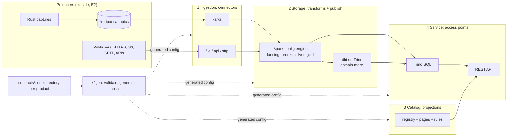
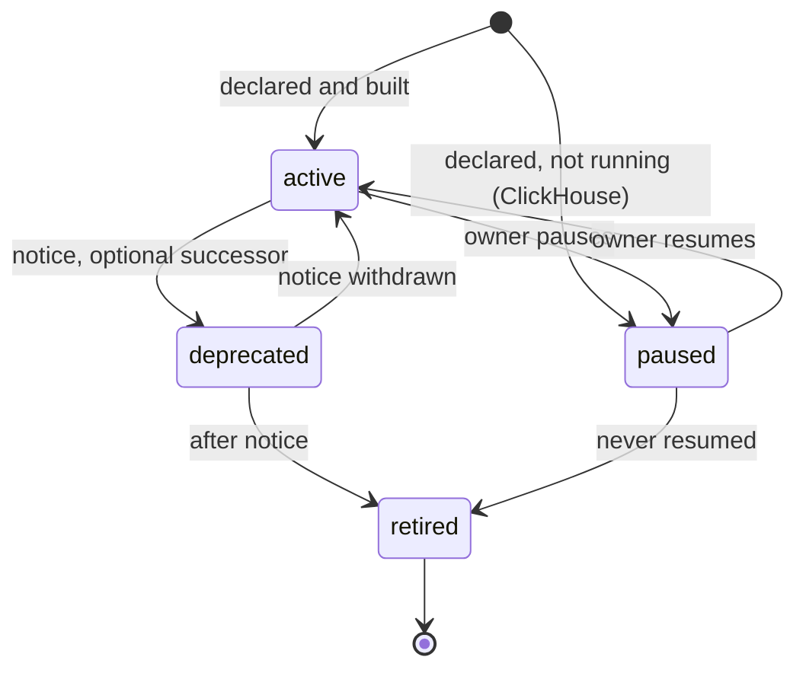
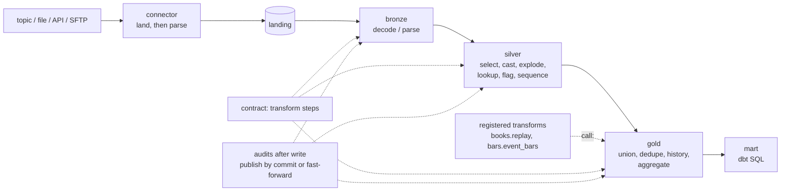
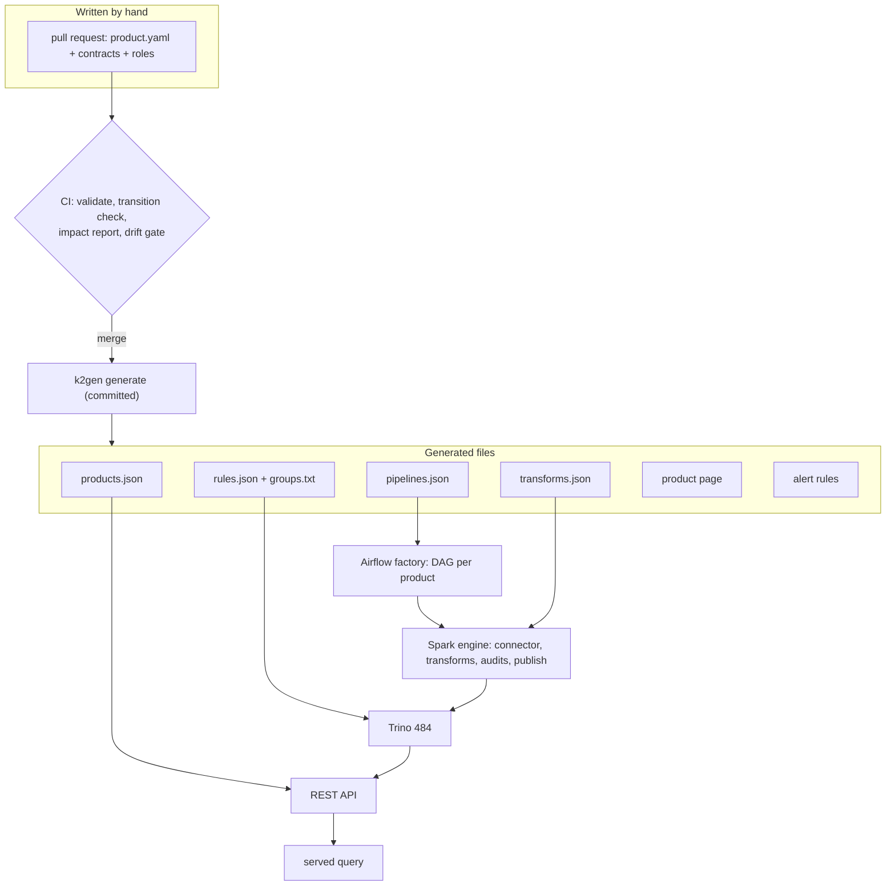
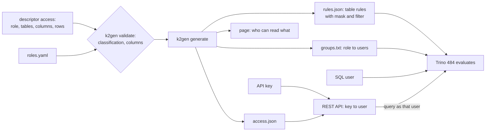
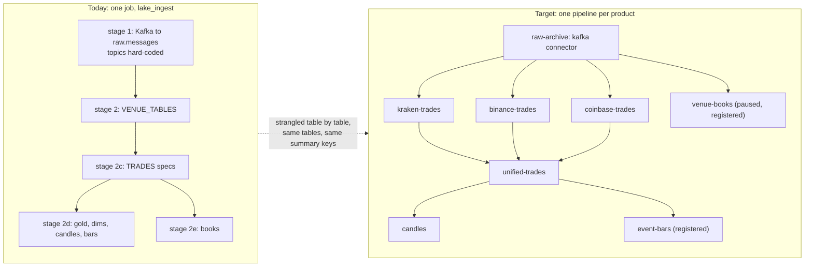

# Entry C: four small interfaces, adapters behind them, grown by strangling

**Thesis.** Give each layer one small, stable interface (connector, transform and publish,
catalog projection, access point), make every engine K2 already runs an adapter behind one of
them, and move the crypto pipeline onto those interfaces one table at a time, old and new side by
side, because the existing code is already shaped like configuration and the cheapest proof that
config is right is that it equals the code it replaces.

Reading this file: section 0 is the ethos, and every later heading carries the principles it
rests on in brackets, such as [E3]. Terms are defined where they first appear. Repository paths
are ones I read on 2026-11-26 at `main` `bb6e77f`, or on the named branch.

---

## 0. Design ethos

A new engineer should be able to predict a design choice from these eight sentences.

- **E1. A product is defined once.** Its directory under `contracts/` is the only hand-written
  description of it; every file a runtime reads is generated from it or checked against it.
- **E2. The platform starts at the topic or the file.** Producers (the Rust captures, a
  publisher's web server) are outside; the boundary is a topic and its schema, or a URL and its
  format, and the platform never configures a producer.
- **E3. Every layer is a small interface with adapters.** A new source kind, engine or access
  point is a new adapter; it never edits another product's pipeline.
- **E4. Config first, registered code second.** A transform is a list of named operations whose
  arguments are SQL expressions; logic SQL cannot say is a registered, versioned, tested transform
  the config calls by name.
- **E5. Strangle, do not rewrite.** New code runs beside the old on real data until a command
  proves they agree, then the old path is switched off by one flag and deleted a week later.
- **E6. One state per product, obeyed through generated files.** No runtime asks a service what
  a product's state is; it reads a file the generator wrote and CI checked.
- **E7. A rule is enforced by the engine that owns the data.** Trino evaluates every permission;
  the REST API passes the caller's identity through and never re-implements a rule.
- **E8. Fit the host before adding a box.** A new long-running service needs a measured reason
  and a line in the budget gated by `scripts/check-budget.py` (25 CPU / 48 GiB, ADR-045).

---

## 1. The architecture in one page [E1, E2, E3]

Four layers, each one interface:

| Layer | Interface (what every adapter implements) | Adapters at 3.0.0 |
|---|---|---|
| Ingestion | **Connector**: `land(binding, since) -> landed batch`; batch kinds add `parse(bytes) -> rows` | Kafka / Redpanda, file (HTTPS, S3), public API, FTP / SFTP |
| Storage | **Transform and publish**: `run(spec, inputs) -> DataFrame`, then the engine writes, audits and publishes | Spark config engine (producer lake), dbt on Trino (domain marts), registered code transforms |
| Catalog | **Projection**: `render(registry) -> files` | product pages, registry JSON, Trino rules and catalogs, Lakekeeper warehouses, dbt sources, Prometheus rules, Airflow configs |
| Service | **Access point**: `describe(product)` and `smoke(product)` | Trino SQL, REST API, DuckDB notebook helper, open Iceberg catalog; ClickHouse (paused) |

A **data product** (the unit an owner publishes) is the thing that crosses all four: it is
declared once, landed by a connector, refined by transforms, projected into the catalog and
served through access points. An **adapter** is the code that makes one engine fit one interface.
**Strangling** means growing the new path around the old one until the old one has nothing left
to do.

### Diagram 1: the four layers and a product crossing them



**Reading guide.** Read left to right for data and top to bottom for control. Producers sit
outside the platform: the captures publish to Redpanda and the platform's ingestion starts at the
topic. The only hand-written input on the control side is `contracts/`; `k2gen` turns it into the
config each layer reads (dotted line), so no layer learns a product from another layer. Data moves
through one connector, then Spark writes the four lake layers in the producer lake and dbt builds
marts in each domain's warehouse; Trino is the one SQL endpoint, and the REST API is a client of
Trino, never of storage.

---

## 2. Product model [E1, E6]

### 2.1 The files and fields

A product is a directory `contracts/<domain>/<product>/` holding a **descriptor** `product.yaml`
(K2's own format, validated by `contracts/schema/k2.schema.json`) and one **ODCS contract** per
lake table it writes (`<table>.odcs.yaml`). ODCS is the Open Data Contract Standard, vendored at
v3.2.0 (`contracts/schema/odcs-json-schema-v3.2.0-20261117.json`); the standard deprecated its
product object (`dataProduct`) since v3.1.0, which is why the product level stays K2's. Roles live
once in a new `contracts/roles.yaml`.

| Field | File | Standard or K2 | New | Meaning |
|---|---|---|---|---|
| `name`, `domain`, `owner`, `purpose`, `kind`, `inputs`, `outputs`, `consumers`, `marts` | descriptor | K2 | no | as today (`platform/k2gen/k2gen/cli.py` checks place, owner, kind, inputs) |
| `lifecycle` | descriptor | K2 | **values change** | the product's one state: `active`, `paused`, `deprecated`, `retired` |
| `lifecycleChange` | descriptor | K2 | yes | required unless `active`: `since` (quoted day), `reason`, optional `adr`, `successor` |
| `maturity` | descriptor | K2 | yes | today's `draft` / `published` values, gated later by the readiness scorecard |
| `pipeline` | descriptor | K2 | yes | `schedule` (cron) or `after` (products whose publish triggers this one); optional `retryUntil`, `group` (8) |
| `access` | descriptor | K2 | yes | grants per role, with column and row rules (section 5.3) |
| `serving` | descriptor | K2 | yes | only for a serving product: engine, compose profile, the tables it serves, its artefacts |
| `apiVersion`, `kind`, `id`, `name`, `version`, `domain`, `description.purpose`, `team.name` | contract | **ODCS** | no | identity, semver version, owner |
| `schema[0].properties[]`: `name`, `physicalType`, `logicalType`, `logicalTypeOptions`, `required`, `primaryKey`, `primaryKeyPosition`, `description` | contract | **ODCS** | no | inline columns for a new table; a table `lake.sql` creates references it through `authoritativeDefinitions` instead (ADR-032) |
| `schema[0].quality[]`, `slaProperties[]` | contract | **ODCS** | no | audits by name; latency and freshness targets |
| `servers[]` | contract | **ODCS** | yes | access points, type `trino` (the vendored schema lists it) |
| `layer`, `format`, `partitioning`, `sort`, `classification`, `entitlement`, `retention`, `upstreams` | contract `customProperties` | K2 | no | as today (`contracts/schema/README.md`) |
| `connector` | contract `customProperties` | K2 | yes, replaces the branch's `fileSource` | the source binding of a landing table (2.3) |
| `transform` | contract `customProperties` | K2 | yes | how this table is computed (section 3.3) |
| `schedule`, `paused` | contract `customProperties` | K2 | **removed** | the schedule moves to `pipeline`; `paused` becomes the product's `lifecycle` |

Why `lifecycle` and not ODCS `status`: the owner fixed one state per product, and ODCS `status`
sits on each dataset. Writing it in 26 contracts would be 26 copies of one fact. The generated
registry emits `status` per dataset for any ODCS reader. All thirteen descriptors say
`lifecycle: draft` today (`grep -h ^lifecycle contracts/*/*/product.yaml`), so the migration is
mechanical: `draft` becomes `maturity: draft` plus `lifecycle: active`, except the book products.

**Product grain.** Each venue's trades is its own product, and the cross-venue trades and the
candles are separate derived products that name the venue products as inputs. Today one product,
`market-capture/venue-trades`, holds all three silver trade tables and `venue-frames` holds all
seven bronze tables. U1 splits them by contract moves only; no table changes:

| Product (domain) | Outputs | Reads |
|---|---|---|
| `raw-archive` (market-capture) | `raw.messages` | the nine Redpanda topics (connector) |
| `kraken-trades`, `binance-trades`, `coinbase-trades` (market-capture) | `bronze.<venue>_<trade stream>`, `silver.trades_<venue>` | `raw.messages` |
| `venue-books` (market-capture), paused | the three bronze book tables, `silver.book_*`, `gold.book_state` | `raw.messages` |
| `unified-trades` (market-analytics) | `gold.trades` | the three venue trade products |
| `candles` (market-analytics) | `gold.ohlcv_1m`, `_5m`, `_1h`, `_1d` | `unified-trades` |
| `event-bars`, `book-snapshots` (paused), `security-master` | as today | as today |

`raw.messages` stays one shared landing table because ADR-021 keeps every frame received, and one
venue topic carries trade, book and instrument frames for different products. So the Redpanda
connector belongs to `raw-archive`, and each venue product's pipeline starts at its slice of the
landing table. A venue product still runs, fails, pauses and is permissioned on its own.

### 2.2 Lifecycle states [E6]

### Diagram 4: lifecycle states and transitions



**Reading guide.** A state is the owner's decision about whether the platform brings data in and
computes the product, and it changes only by a pull request that edits `lifecycle`. There is no
arrow from `active` to `retired`: a reader always gets a deprecation notice first, and CI refuses
the jump by comparing the pull request with `origin/main`. `retired` is final, and no row is ever
deleted (ADR-028 section 12 stays in force); bringing the data back is a new product. Maturity
(`draft`, `published`) is a separate question, earned on evidence, so a paused product keeps it.

What each layer does, reading the generated registry:

| Layer | `active` | `paused` | `deprecated` | `retired` |
|---|---|---|---|---|
| Connector | runs on its schedule | DAG generated with no schedule and a gate task; the platform stops consuming; offsets and landed files stay | runs | no DAG |
| Transforms | run | do not run; resume from the recorded snapshot, or from the lineage high-water mark if it expired (3.3) | run | do not run |
| Nightly audits | run | skipped and logged as stood down | run | skipped |
| Alerts and SLOs | generated | not generated; listed by `make health` under "stood down" | generated, with the notice | none |
| Catalog page | state | state, since, reason, ADR; downstream flagged | successor shown | history shown |
| Trino | grants | grants: rows stay readable | grants; notice in the table comment | `SELECT` for the owner role only |
| REST API | 200 | 200 and `K2-Product-State: paused` | `Deprecation` and `Sunset` headers | 410 Gone |
| Readers | | flagged "upstream paused" | flagged | `k2gen validate` fails an active reader |

Under ADR-050 the captures stopped subscribing to books through `book_capture` in
`config/instruments.yaml`. That switch stays the producer's own (E2). The platform's side is that
`venue-books` and `book-snapshots` are declared `paused` with `lifecycleChange.adr: ADR-050`, and
the nightly audit skip in `docker/lake/maintenance.py` (`audits_to_run`, which today reads
`instruments.book_capture`) reads the registry instead, so the platform obeys its own product
state rather than a producer's file.

### 2.3 Source binding per connector kind

The `connector` custom property sits on the landing table's contract. One schema per kind in
`k2.schema.json`; validation accepts only kinds that are built.

| Kind | Required fields | Optional | Landing | Built in |
|---|---|---|---|---|
| `kafka` | `cluster` (a name from `contracts/clusters.yaml`), `topics`, `format` (`avro-confluent`, `json`, `bytes`) | `start` (`earliest`, `latest`, an instant), `maxRecordsPerRun`, `mode` (`micro-batch`; `continuous` reserved) | an Iceberg table of verbatim records with offsets in the snapshot summary | U4 |
| `file` | `url` (`https://` or `s3://`), `format` | `calendar`, `compression`, `credentials` (env var names) | object `k2-landing/<domain>/<product>/<day>/<sha256>.<ext>` | U2 |
| `api` | `url` (`https://`), `format: json` | `params`, `auth` (header name plus env var name), `paging` (`none`, `page`, `cursor`), `rateLimitPerMinute` | as `file`: each run's pages landed as one JSON Lines object | U3 |
| `sftp`, `ftp` | `host`, `path` (a glob), `format`; `sftp` also `hostKeySha256` | `port`, `credentials`, `pick` (`newest`, `all-new`), `tls` (`required` default for ftp) | as `file` | U3 |
| `jdbc` (database pull) | designed only: `connection`, `query`, `watermark` column | | as `file`: the result set as Parquet | after 3.0.0 |
| `lake` (internal source) | no connector: the first transform's `from` names a lake table or mart | | none | today |

Secrets are never values: a binding names an environment variable, and `scripts/check-env.py`
already refuses default passwords in `.env`.

### 2.4 Declared inputs and flags

`inputs` (descriptor) and `upstreams` (contract) stay as ADR-032 defined them, and a transform's
`from` must name only those, so the declared graph is the executed graph (3.3). Downstream
products keep their own state; the generator computes **flags** on them: `upstream paused`,
`upstream deprecated`, `partly fed` (some but not all inputs paused). A reader of a retired product
fails validation.

### 2.5 Worked examples

The Kraken trade topic and the ECB file are the two acceptance cases, walked through every layer
in 3.6 and 3.7; the public JSON API and the SFTP CSV are in 3.8; the derived SQL product is
`fx-crosses` in 3.7. ClickHouse, the paused serving product, is here.

```yaml
# contracts/market-analytics/hot-tier/product.yaml
name: hot-tier
domain: market-analytics
owner: analytics-team
purpose: >-
  Low-latency SQL over gold for dashboards. Paused: it returns as a serving product loaded from
  the lake gold tables (ADR-025's reload by iceberg()), no longer fed from the Redpanda topics.
kind: consumer-aligned
lifecycle: paused
lifecycleChange: {since: "2026-11-27", reason: "paused during the platform build", adr: ADR-056}
maturity: draft
inputs: [{table: gold.trades}, {table: gold.ohlcv_1m}, {table: gold.bars}]
outputs: []
consumers: [the Grafana dashboard "ClickHouse Overview (gold)"]
serving:
  engine: clickhouse
  composeProfile: hot-tier          # docker compose --profile hot-tier up -d
  volume: clickhouse-data           # kept
  serves: [gold.trades, gold.ohlcv_1m, gold.bars]
  artefacts:                        # paused: each must sit under a paused/ directory
    - docker/prometheus/paused/clickhouse-alerts.yml
    - docker/prometheus/paused/clickhouse-gold-alerts_test.yml
    - docker/prometheus/paused/clickhouse-scrape.yml
    - docker/grafana/dashboards/paused/clickhouse-overview.json
```

`k2gen validate` checks the paused rule: every artefact a paused serving product lists sits under
a `paused/` directory. Prometheus does not load it (`rule_files: rules/*.yml` in
`docker/prometheus/prometheus.yml`), nor do the promtool gates (c) and (c2) in
`scripts/check-docs.sh`; Grafana's file provider (`foldersFromFilesStructure: true` in
`docker/grafana/provisioning/dashboards/`) shows the dashboard in a folder named `paused`, which is
the visible part. Resuming is moving them back, and the validator then requires that.

---

## 3. Each layer, starting with the ETL design [E3, E4, E5]

### 3.1 The medallion layers

The repository's medallion (ADR-026): raw verbatim, bronze per venue in the venue's own schema,
silver per venue typed and annotated, gold canonical. The framework keeps those guarantees and
makes them the contract every product's layers keep.

| Layer | Guarantee | Filled by | Engine |
|---|---|---|---|
| Landing (raw) | bytes as received, immutable, addressed by `(topic, partition, offset)` or by sha256; never parsed | the **connector** | Spark (Kafka), stdlib fetch (batch) |
| Bronze | the source's own field names and types; one row per source record; lineage columns; nothing renamed | Kafka: the `decode` transform; batch: the connector's `parse` step on a write-audit-publish branch | Spark |
| Silver | typed (exact decimals, UTC timestamps), keys and canonical codes added, quality flags, every delivery kept | config transform | Spark |
| Gold | one row per logical entity, conformed across sources, type-2 history where declared | config transform, or registered code | Spark |
| Mart | a `SELECT` over published tables for a consumer | dbt model | dbt on Trino, in the domain's warehouse (ADR-044) |

Gold is required only where a product conforms several inputs or computes entities; a
single-source product such as the ECB rates publishes silver, and its consumer-facing derivation
is a mart. **Engine rule:** a table in the producer lake is written by Spark, because it needs the
writer lock, snapshot-incremental reads or code per record (ADR-035), and Trino's `lake` catalog
is read-only at the connector (`docker/trino/etc/catalog/lake.properties`); a mart is dbt.

### Diagram 3: the medallion flow, connector, config and the escape hatch



**Reading guide.** Solid arrows are data; each box after landing is one table written by one
transform. The connector is the only part that talks to the outside world, and it stops at
landing (batch connectors also parse into bronze on a branch). Everything to the right of landing
is the same engine reading the contract's `transform` steps (dotted line from the contract). When
a step cannot be said in the operation list, the contract names a registered transform through
`call:`, and the engine still does the reading, writing, auditing and publishing, so code never
commits on its own.

### 3.2 Connectors [E2, E3]

**Today.** One hard-coded Kafka connector lives inside stage 1 of `docker/lake/ingest.py`: the
topic list is `topics(kind)` over `EXCHANGES` (env `K2_EXCHANGES`, default
`binance,kraken,coinbase`) for the kinds `raw`, `trades` and `book`; offsets are pinned before the
read and committed in the snapshot summary key `k2.kafka-offsets` (`docker/lake/offsets.py`),
followed by the batch audit (ADR-047). The file connector exists on `feat/file-source-pattern`:
`docker/lake/file_source.py` with `fetch` (stdlib download, sha256, conditional PUT so a landed
key is never replaced), `load` (to branch `wap_<sha16>`), `audit` (the generic checks `parses`,
`non_empty`, `keys_unique`, `in_domain`, `values_unchanged`, `staged`, plus the product's own) and
`publish` (fast-forward), driven by `docker/airflow/dags/factory.py`.

**Target interface.** Two calls per kind: `land(binding, since)` returns what it landed (offset
ranges, or a landed object key) and `parse(bytes)` returns rows for batch kinds. Built-in parsers
for `csv`, `json` (with a `records` JSON pointer) and `jsonl` map fields to the contract's columns
by name, so most sources need no code; `xml` and odd formats use a registered parser module
`docker/lake/sources/<name>.py` with the branch's contract `parse(data: bytes) -> list[dict]`.

**Run modes and latency.** Everything runs as **scheduled micro-batches**: Airflow starts a run,
the run reads what arrived since its recorded position, commits, and exits. No connector needs an
always-on consumer, because Kafka retention is the buffer and the position is in the Iceberg
snapshot (ADR-022). Latency is the schedule interval plus queueing for the writer plus run time:
for the five-minute crypto pipelines, about five to ten minutes end to end, not seconds. The
recent `lake_ingest` runs took between about 130 and 150 seconds each (Airflow task logs for the
runs scheduled 05:31 to 06:21 UTC on 2026-11-26, read in `k2-airflow-scheduler`). The retention
buffer is set in `docker/redpanda/init.sh`: 48 hours or 2 GiB per partition on the raw topics,
7 days on the trades and book topics; a pipeline stalled past it fails until a person runs the
recorded-loss path, as `ingest.py --accept-data-loss` does today.

**Where the continuous mode plugs in.** The Kafka binding reserves `mode: continuous`, which
validation refuses until built. It would be an always-on consumer service writing the same landing
table contract (verbatim records, offsets kept in the table's commits), so every transform
downstream is unchanged: they read landing incrementally by snapshot whatever wrote it. The
candidate adapter is the Apache Iceberg Kafka Connect sink (3.5), and the trigger is a product
whose contract declares a latency target under one minute. It costs a resident JVM, and its first
spike must show that a sink built on Iceberg 1.12 writes tables the pinned Iceberg 1.8.1 readers
read. The paused ClickHouse Kafka-engine feed (`docker/clickhouse/ddl/20-gold-kafka.sql`) is the
historical example of such a consumer.

### 3.3 Config-driven transforms [E4]

**The observation the design rests on.** The venue logic is already configuration written in
Python. Bronze is the tuple `VENUE_TABLES` in `docker/lake/bronze.py`: per table a name, venue,
stream, a Spark DDL for `from_json`, a required field and the expected JSON keys per path. Silver
is the tuple `TRADES` in `docker/lake/silver.py`: per venue an `explode` SQL fragment and a list
of `expr AS name` columns, with `score()` adding `venue_replay`, `seq_gap` and `missing_before`
over a one-day `LOOKBACK`. The transform vocabulary lifts exactly these shapes into YAML, so the
first migration step can be proven by an equality test with no Spark (section 7.2).

**The vocabulary.** A `transform` is `from`, an ordered list of `steps`, and `write`. Each step is
one operation from a closed list. Arguments are **Spark SQL expressions and predicates, never
statements**.

| Operation | Arguments | Covers | Implemented by |
|---|---|---|---|
| `from` | `table`, `where`, or `union: [tables]` | source selection, internal lake sources | engine |
| `decode` | `envelope: avro-confluent`, `subject`, `stream`, `payload: json`, `required` | Kafka landing to bronze | `docker/lake/wire.py` framing, `from_avro`, `from_json` as `bronze.py` does |
| `parse` | `format`, `records`, `delimiter`, `header` | batch landing to bronze | connector parsers |
| `select` | `name: expression` pairs; `keep: lineage` | select, rename, cast, parse timestamps, derive | `selectExpr` |
| `explode` | `column` or nested path, `as`, `position` (`index` or `flat`) | arrays, nested arrays, map entries | `posexplode` |
| `filter` | predicate | filter | `where` |
| `lookup` | `name`, `table` or `registry`, `key`, `columns`, `required` | canonical codes, reference joins | join, or `instruments.canonical` which raises on a miss |
| `flag` | `name`, `when` | quality flags that keep the row | `withColumn` |
| `sequence` | `partitionBy`, `id`, `seq`, `order`, `lookback`, `emit` | redelivery and gap flags over a lookback | `silver.score()` |
| `dedupe` | `key`, `order`, `keep: first` | one row per entity | window `row_number` |
| `history` | `key`, `tracked` | type-2 history | `docker/lake/scd2.py` `plan()` |
| `aggregate` | `by`, `window` (time column and sizes), `measures` with `first`/`last` by an order | candles and other rollups | `GROUP BY`, as `gold.py` candles |
| `call` | `transform`, `version`, `params` | the escape hatch (3.4) | a registered module |
| `write` | `append`, `merge: {key}`, `replaceTouched: {keys}` | incremental merge, recompute of touched keys | Iceberg `append` / `MERGE` |

**Why SQL fragments and a fixed list, not a new language.** The fragments are what `silver.py`
already writes (`CAST(d.trade_id AS STRING)`, `timestamp_millis(data.T)`), they are learnable from
Spark's documentation, and they parse. `k2gen validate` parses every fragment with sqlglot (MIT,
30.35.0 on PyPI on 2026-11-26) in its Spark dialect and resolves every column against the input's
generated schema (`docker/lake/generated/contract_schemas.json`), so a misspelt column fails in CI,
not at 03:00. A fixed list keeps the config reviewable; anything else is code with an owner.

**Incremental and idempotent.** Every Spark transform records the input snapshot it read in
`k2.src-snapshot-id` on its own commit and reads only snapshots added since, as bronze, silver and
gold do today (`docker/lake/offsets.py` constant `SRC_SNAPSHOT_ID`). A run with nothing new commits
nothing. `append` relies on identifier fields unique by lineage; `merge` and `replaceTouched`
recompute and replace whole keys, so a late row rewrites its candle rather than adding one
(`gold.py`'s rule). Snapshot expiry removes resume points after seven days, so a paused product
would otherwise lose its place: when the recorded snapshot is gone, the engine falls back to the
**lineage high-water mark**, the highest `(src_topic, src_partition, src_offset)` its own table
already holds, which bronze and silver carry (`bronze.py` `LINEAGE_COLUMNS`). Batch products are
idempotent by content: the same file lands at the same key and loads no new row (the branch's
`load`).

**Schema change.** Adding a nullable column is a minor version: the contract gains the column, the
generator emits an additive `ALTER TABLE ... ADD COLUMN` beside the generated DDL, and old rows
read NULL. Dropping, retyping or renaming is a major version and a new table name (`_v2`), with the
old one `deprecated` and `successor` set, so no reader breaks silently; `k2gen check-compat`
(planned in old P6) refuses a breaking change without the major bump. Source drift is a bronze
concern, as today: unknown keys are counted by the drift audit (`bronze_schema_drift`); a missing
required field is a refused batch for a file (the branch's `parses` check) and a NULL-columned row
plus the `bronze_unparseable` audit for a stream (`bronze.py` docstring), because a stream must
never stall behind its own audit (ADR-047).

**Testing, four levels.** (1) Static, in CI: schema, sqlglot resolution, operation allowed for the
layer, every `call:` registered. (2) Examples, in CI: each transform may carry
`tests/<table>.yaml` with input rows and expected rows; CI transpiles the steps to DuckDB with
sqlglot and runs them with the `duckdb==1.4.4` that `make test-python` already installs. (3) The
same examples on Spark on the live stack (`make transform-test`, joining `make gates`), because
Spark is the engine that matters and DuckDB differs on decimal division (`docker/lake/bars.py`
docstring). (4) After every write, the generic audits per layer (identifier uniqueness, row counts
between layers, as `scripts/lake-verify.sh` checks raw rows against bronze rows) and, for products
with a second computation, the parity scripts.

**Lineage falls out.** Table level: `from`, `union` and `lookup` are the only way a transform
reads, so the declared graph is the executed graph, which closes ADR-032's stated risk that a job
can read a table its contract does not name. Column level: sqlglot's lineage over the same parsed
fragments, written to product pages and to ODCS `transformSourceObjects`. Row level: the lineage
columns (`src_topic`, `src_partition`, `src_offset`, `src_index`) and `source_file_sha256`.

### 3.4 Where config ends and code begins [E4]

Two things in the lake are real code: the order-book replay with Kraken's checksum
(`docker/lake/books.py`, a streamed state machine over partition iterators) and event bars
(`docker/lake/bars.py`, a cumulative bucket that three engines must agree on at tolerance zero).
Two smaller pieces of `gold.py`, the Kraken precision join (`_kraken_pairs`) and the dimension
merge, become the built-in `lookup` and `history` operations. The first two become **registered
transforms**:

- **Registered, not imported.** `docker/lake/transforms/<name>.py` exposes `run(ctx, params) ->
  DataFrame` and is listed with a version, an owner and its declared inputs. A contract calls it as
  `call: {transform: books.replay, version: 1}`; `k2gen validate` refuses an unregistered name.
- **The engine keeps the dangerous parts.** `ctx.read(table)` refuses any table the contract does
  not declare, and the code returns a DataFrame; the engine writes, records `k2.src-snapshot-id`,
  audits and publishes (by fast-forward of a branch for bars, as ADR-048 decided). Code never
  commits, takes the lock or reads Kafka.
- **A pure core with its own tests.** Each has a Spark-free core tested in CI, as `scd2.plan()`,
  `docker/lake/book.py` and `bars.py` already are (`tests/test_lake_scd2.py`,
  `tests/test_lake_book.py`, `tests/test_bars.py`), and a version bump means its outputs are rebuilt.
- **Owned by the platform team** under `CODEOWNERS`. A product team asks for an operation; a
  pattern two products call becomes a built-in operation, as `history` is (type 2 is generic,
  `scd2.py` says the natural key is the caller's business).

That last rule is what stops the escape hatch becoming the coupled pipeline again: code is shared,
named, versioned and behind the same interface, never a product-specific script.

### 3.5 Build versus adopt

Versions and licences read from primary sources on 2026-11-26 (PyPI JSON, GitHub releases, vendor
documentation); "not verified" means exactly that.

| Option | Version, licence | Fit on this host | Verdict |
|---|---|---|---|
| dbt-core + dbt-trino | 1.12.7 and 1.12.0, Apache-2.0 (pinned in `dbt/pyproject.toml`). Note: dbt v2 is proprietary under dbt Labs' product licence, with `dbt-oss` the Apache-2.0 v2 distribution (docs.getdbt.com licensing page) | already running; cannot write the producer lake (read-only connector, ADR-044), no Kafka offsets, no branch publish | **keep for marts only**; stay on 1.x until the v2 licence is reviewed |
| Spark SQL driven by config (build) | Spark 3.5.5, Iceberg 1.8.1 already baked (`docker/spark/Dockerfile`) | zero new services; reuses `offsets.py`, `silver.score`, `scd2.plan`, `wire.py` | **build**: a thin interpreter over functions that exist |
| SQLMesh | 0.236.4, Apache-2.0; Fivetran acquired its maker in 2025 and gave it to the Linux Foundation (announced 2026-03-25) | strong column lineage and virtual environments, but a second transform framework beside dbt, and its incrementality is by time range, not by Iceberg snapshot with offsets | **not now**; revisit if dbt's marts exceed 50 models or blue/green becomes must-have |
| dlt | 1.32.0, Apache-2.0; Iceberg destination through pyiceberg with REST catalogs (its docs); whether that destination is open source was not verified | good REST paging and SFTP sources; but a second writer engine into the lake, outside the lock and the branch publish | **not now**; candidate as a fetch library inside the `api` connector if more than two paging styles are needed |
| Airbyte | ELv2 licence (repository LICENSE); abctl 0.30.4; runs Kubernetes in a kind cluster; quickstart asks 4 CPUs and 8 GB, low-resource mode 2 CPUs and 8 GB; Iceberg via its S3 Data Lake destination with REST catalogs | a sixth of the memory ceiling for a second scheduler | **reject** (E8) |
| Meltano | 4.4.1, MIT; Singer taps and targets; an Iceberg target was not verified | adds a Singer runtime beside Airflow | **reject** |
| Kafka Connect + Iceberg sink | Kafka 4.4.0, Iceberg 1.12.0, both Apache-2.0 per the projects (licence files not opened); sink supports a REST catalog (Iceberg docs) | always-on JVM; its own commit coordination beside ADR-022's offsets | **reserve** for the continuous mode (3.2) |
| Redpanda Connect | v4.119.0; core Apache-2.0, enterprise parts under the Redpanda Community License; its Iceberg output needs an enterprise licence (Redpanda docs) | light Go binary | **reject** for Iceberg on licence grounds |

The honest cost of building: K2 owns an interpreter (estimated 600 to 900 lines, plus tests) and
its operation list. The honest gain: the crypto layers move onto it with byte-identical output by
construction, which no adopted tool can promise for code it did not write.

### 3.6 Acceptance case 1: Kraken trades, through all four layers

**The connector it starts from**, written once by the platform team for all crypto topics: the
cluster in `contracts/clusters.yaml` (the addresses `docker/lake/spark_conf.py` uses today) and the
binding on `raw.messages`.

```yaml
# contracts/clusters.yaml
redpanda: {bootstrap: "redpanda:9092", registry: "http://redpanda:8081"}
# contracts/market-capture/raw-archive/raw.messages.odcs.yaml (customProperties, added)
- property: connector
  value: {kind: kafka, cluster: redpanda, format: bytes, start: earliest, mode: micro-batch,
          topics: ["market.crypto.v3.{raw,trades,book}.{binance,kraken,coinbase}"],
          implementation: legacy}   # ingest.py stage 1 runs it until M2 (7.2), then `engine`
```

**Files a user writes.** Three, for a venue whose bronze and silver tables `lake.sql` already
creates (a new venue writes inline columns instead, and gets generated DDL).

```yaml
# contracts/market-capture/kraken-trades/product.yaml
name: kraken-trades
domain: market-capture
owner: capture-team
purpose: Kraken trades as the venue sent them (bronze) and typed per trade (silver).
kind: source-aligned
lifecycle: active
maturity: draft
pipeline: {after: [market-capture/raw-archive]}     # runs when raw.messages publishes
inputs:
  - table: raw.messages
outputs: [bronze.kraken_trade, silver.trades_kraken]
consumers: []
access:
  - {role: analyst, tables: all}
  - role: research-partner
    tables: [silver.trades_kraken]
    columns: {deny: [conn_id, conn_msg_seq]}         # connection internals not shared
```

```yaml
# contracts/market-capture/kraken-trades/bronze.kraken_trade.odcs.yaml (customProperties only;
# identity, team, authoritativeDefinitions: docker/lake/ddl/lake.sql, quality as today)
- property: transform
  value:
    from: {table: raw.messages, where: "topic = 'market.crypto.v3.raw.kraken'"}
    steps:
      - decode: {envelope: avro-confluent, stream: trade, payload: json, required: channel}
      - driftKeys: {"$": [channel, type, data],
                    "$.data[0]": [symbol, side, price, qty, ord_type, trade_id, timestamp]}
    write: append
```

```yaml
# contracts/market-capture/kraken-trades/silver.trades_kraken.odcs.yaml (customProperties)
- property: transform
  value:
    from: {table: bronze.kraken_trade}
    steps:
      - explode: {column: data, as: d, position: src_index}
      - select:
          symbol: d.symbol
          trade_id: CAST(d.trade_id AS STRING)
          trade_seq: d.trade_id
          price: d.price
          qty: d.qty
          side: d.side
          side_native: d.side
          exchange_ts: CAST(d.timestamp AS TIMESTAMP)
          ord_type: d.ord_type
          frame_type: type
        keep: lineage
      - lookup: {name: canonical_symbol, registry: instruments, venue: kraken, key: symbol, required: true}
      - flag: {name: precision_loss, when: "price != round(price, 8) OR qty != round(qty, 8)"}
      - sequence: {partitionBy: [symbol], id: trade_id, seq: trade_seq, lookback: 1d,
                   order: [recv_ts_ns, src_partition, src_offset, src_index],
                   emit: {redelivery: venue_replay, gap: seq_gap, missing: missing_before}}
    write: append
# and, in the ODCS slaProperties of the same file:
#   - {property: latency, value: 15, unit: min, element: silver.trades_kraken.recv_ts}
```

Every value above is today's code: the `kraken_trade` entry of `VENUE_TABLES` (`bronze.py`), the
Kraken `TradeSpec` and `SIDE_SQL['kraken']` (`silver.py`), the registry lookup that raises on an
unknown symbol, `precision_loss` and `score()` with `LOOKBACK = timedelta(days=1)`.

The two derived products the owner asked for, with their own contracts and permissions:

```yaml
# contracts/market-analytics/unified-trades/gold.trades.odcs.yaml (customProperties)
- property: transform
  value:
    from: {union: [silver.trades_binance, silver.trades_kraken, silver.trades_coinbase]}
    steps:
      - filter: "NOT venue_replay"
      - select: {price_e8: "CAST(price * 100000000 AS BIGINT)", qty_e8: "CAST(qty * 100000000 AS BIGINT)"}
        keep: [exchange, canonical_symbol, trade_id, trade_seq, side, exchange_ts, recv_ts_ns, lineage]
    write: {append: {unique: [exchange, canonical_symbol, trade_id]}}
# contracts/market-analytics/candles/gold.ohlcv_1m.odcs.yaml (customProperties)
- property: transform
  value:
    from: {table: gold.trades}
    steps:
      - aggregate:
          by: [exchange, canonical_symbol]
          window: {time: exchange_ts, size: 1m, as: window_start}
          order: [exchange_ts, recv_ts_ns, trade_seq]          # gold.py's total order
          measures: {open: first(price_e8), high: max(price_e8), low: min(price_e8),   # abridged:
                     close: last(price_e8), volume: sum(qty_e8), trade_count: count(*)}  # names as lake.sql
    write: {replaceTouched: {keys: [exchange, canonical_symbol, window_start]}}
```

The `select` above stands for `gold.py`'s `_project_silver`, whose exact columns the migration's
shadow comparison holds it to (7.2); the candles' descriptor grants `delayed-reader` a row rule
(5.3).

**What is generated** by `make generate`, committed, and drift-checked in CI:

| Generated file | For | Layer |
|---|---|---|
| `docker/lake/generated/products.json` entry: state, pipeline, inputs, flags, grants | Spark engine, `lake-metrics`, REST API | all |
| `docker/lake/generated/transforms.json` entries for the two tables | the Spark config engine | storage |
| `docker/airflow/dags/pipelines.json` entry; the factory renders DAG `market_capture__kraken_trades`, triggered by `raw-archive`'s publish | Airflow | ingestion |
| `contract_schemas.json` entries (exist today) | nightly `contract_schema` audit | storage |
| `docker/trino/etc/rules.json` rules and `groups.txt` lines for both roles | Trino | service |
| `docker/prometheus/rules/products.generated.yml`: freshness alert from the latency target | Prometheus | storage |
| `docs/products/market-capture/kraken-trades.md`: lineage, columns, access matrix, state | readers | catalog |

**The four layers.** *Ingestion*: the capture publishes Confluent-framed Avro `RawMessage` records
to `market.crypto.v3.raw.kraken` (outside, E2); `raw-archive`'s Kafka connector lands them in
`raw.messages` every five minutes with `k2.kafka-offsets` merged by `offsets.merge_committed`, then
publishes. *Storage*: the Kraken pipeline, one Spark session, runs `decode` into
`bronze.kraken_trade` and the silver steps into `silver.trades_kraken`, each commit carrying
`k2.src-snapshot-id`, then the batch audits; `unified-trades` and `candles` follow on their own
triggers. *Catalog*: the page shows `raw-archive -> kraken-trades -> unified-trades -> candles`,
columns from `lake.sql` comments, column lineage, and who can read what. *Service*:
`SELECT * FROM lake.silver.trades_kraken WHERE recv_ts > current_timestamp - INTERVAL '1' HOUR`
through Trino as any granted user; `research-partner` gets the same query without the two denied
columns; the API serves `/v1/products/market-capture/kraken-trades/datasets/silver.trades_kraken/rows`.

**What differs for the other venues.** Binance: one trade per frame, so no `explode` (`src_index`
is 0); side is `IF(data.m, 'sell', 'buy')` from the buyer-is-maker flag; prices arrive as strings
and are cast to `DECIMAL(28,10)`; times are epoch milliseconds (`timestamp_millis`). Coinbase: two
levels, `events[].trades[]`, exploded with `position: flat`, the running index `silver.py` computes
with `aggregate(slice(...))`; side is `lower(t.side)`; times are RFC 3339 strings. Binance's bronze
stream name is `trade`, Coinbase's `market_trades` (`bronze.py`).

### 3.7 Acceptance case 2: ECB end-of-day FX reference rates

Conventions come from old P4 (`004-fx-data-product.md`): reference fixings published on TARGET
working days at about 16:00 Frankfurt time, not market closes; `rate` is units of quote per unit of
base; published values parse to `DECIMAL(20,10)`; a cross divides two euro legs; carry-forward at
most five TARGET working days. Its file-source design is the `file` connector here.

**Files a user writes.**

```yaml
# contracts/fx-reference/ecb-rates/product.yaml
name: ecb-rates
domain: fx-reference
owner: fx-reference-team
purpose: ECB euro reference rates exactly as published, landed unchanged and typed.
kind: source-aligned
lifecycle: active
maturity: draft
pipeline: {schedule: "30 15 * * 1-5", retryUntil: "18:00"}   # UTC; TARGET days filter in the gate
inputs:
  - external: "https://www.ecb.europa.eu/stats/eurofxref/eurofxref-hist-90d.xml"
    classification: public
    description: The ECB's 90-day reference rate file (URL checked in U2 before merge).
  - table: silver.currency_master
outputs: [bronze.ecb_fx_daily, silver.fx_rates_ecb]
consumers: []
access: [{role: all, tables: all}]                            # classification public
```

```yaml
# contracts/fx-reference/ecb-rates/bronze.ecb_fx_daily.odcs.yaml (abridged: columns inline)
schema:
  - name: ecb_fx_daily
    physicalName: bronze.ecb_fx_daily
    physicalType: table
    properties:
      - {name: rate_date, physicalType: DATE, required: true, primaryKey: true, primaryKeyPosition: 1,
         description: The fixing date.}
      - {name: currency, physicalType: STRING, required: true, primaryKey: true, primaryKeyPosition: 2,
         logicalTypeOptions: {pattern: "^[A-Z]{3}$"}, description: ISO 4217 code quoted against EUR.}
      - {name: rate, physicalType: STRING, logicalType: number, required: true,
         description: Units of currency per euro, as the file wrote it.}
      - {name: source_file_sha256, physicalType: STRING, required: true, description: The landed file.}
customProperties:
  - property: connector
    value: {kind: file, url: "https://www.ecb.europa.eu/stats/eurofxref/eurofxref-hist-90d.xml",
            format: xml, parser: ecb_eurofxref, calendar: target, audits: [positive_rates, no_future_dates]}
  - property: layer
    value: bronze
  # format, partitioning [], sort [], classification public, entitlement none, retention 7, upstreams [url]
```

```yaml
# contracts/fx-reference/ecb-rates/silver.fx_rates_ecb.odcs.yaml (customProperties)
- property: transform
  value:
    from: {table: bronze.ecb_fx_daily}
    steps:
      - select: {rate_date: rate_date, currency: currency, eur_rate: "CAST(rate AS DECIMAL(20,10))",
                 fetched_at: fetched_at}
        keep: [source_file_sha256]
      - lookup: {name: currency_status, table: silver.currency_master, key: currency, columns: [status],
                 required: true}                          # a code outside the master fails the audit
    write: {merge: {key: [rate_date, currency]}}
```

Plus one code file, `docker/lake/sources/ecb_eurofxref.py` (bytes to rows, stdlib XML with the
branch's expat version check) and its two audit functions; plus a synthetic sample under the
branch's test layout. The derived SQL product is `fx-reference/fx-crosses`: a descriptor `marts`
entry (`fx_reference.fx_crosses.fx_rates_daily`, grain `[as_of_date, base, quote]`, reads
`silver.fx_rates_ecb`) and the dbt model `dbt/models/fx_reference/marts/fx_crosses/fx_rates_daily.sql`
with its unit tests, including old P4's direction anchor. The other FX models of old P4 follow
after 3.0.0 (7.1).

**Generated.** The `pipelines.json` entry renders DAG `fx_reference__ecb_rates` with the branch's
four tasks (fetch, load to branch, audit, publish by fast-forward) then the silver transform; the
generated DDL for both tables under `docker/lake/ddl/generated/`; the dbt source with freshness
for `silver.fx_rates_ecb` in `dbt/models/_sources.yml`; Trino rules; a freshness alert ("the day's
fixing by 18:00 UTC on TARGET days"); the page with lineage from the URL to the mart.

**The four layers.** *Ingestion*: `fetch` lands the file by sha256 (same bytes, no write).
*Storage*: `load` writes bronze on branch `wap_<sha16>`; `audit` runs the generic and product
checks; a bad file never moves `main`; `publish` fast-forwards, then the silver merge runs;
`bronze.source_files` records the file. *Catalog*: page, lineage URL to mart, public classification.
*Service*: `SELECT eur_rate FROM lake.silver.fx_rates_ecb WHERE currency = 'USD' ORDER BY rate_date
DESC LIMIT 5` and the mart through the domain catalog `fx_reference`; the API serves both.

### 3.8 The other two connector kinds, short

**Public JSON API** (`reference-data/kraken-asset-pairs`; the URL is the venue's public pair
listing, checked before use). Landing is each run's response as one JSON Lines object.

```yaml
- property: connector
  value: {kind: api, url: "https://api.kraken.com/0/public/AssetPairs", format: json,
          records: /result, paging: none, rateLimitPerMinute: 10}
- property: transform            # on silver.kraken_asset_pairs
  value:
    from: {table: bronze.kraken_asset_pairs}
    steps:
      - select: {pair: record_key, altname: "record.altname", price_decimals: "CAST(record.pair_decimals AS INT)",
                 lot_decimals: "CAST(record.lot_decimals AS INT)", status: "record.status"}
      - history: {key: [pair], tracked: [altname, price_decimals, lot_decimals, status]}
    write: merge
```

**CSV over SFTP** (`reference-data/venue-holidays`, a synthetic example).

```yaml
- property: connector
  value: {kind: sftp, host: sftp.example.invalid, path: "/outbound/holidays_*.csv", pick: all-new,
          hostKeySha256: "<pinned fingerprint>", credentials: {user: K2_HOLIDAYS_USER, key: K2_HOLIDAYS_KEY},
          format: csv, header: true}
- property: transform            # on silver.venue_holidays
  value:
    from: {table: bronze.venue_holidays}
    steps:
      - select: {venue: lower(venue), holiday: "to_date(day, 'yyyy-MM-dd')", note: note}
      - dedupe: {key: [venue, holiday], order: [ingest_ts DESC], keep: first}
    write: {merge: {key: [venue, holiday]}}
```

SFTP needs a client the Spark image lacks (it has no pip layer, plan README ground truth): U3
spikes a hash-pinned `paramiko==5.1.0` layer (newest on PyPI on 2026-11-26), with OpenSSH's `sftp`
batch mode as the escape hatch. FTP uses the standard library's `ftplib`, with `FTP_TLS` unless
the binding says `tls: none` on a `public` table. The host key is pinned in the contract and never
learnt on first use.

### 3.9 The four layers: today, target, smallest change, and what still needs code

| Layer | Today (paths) | Target | Smallest change |
|---|---|---|---|
| Ingestion | Kafka inside `ingest.py` stage 1; file pattern on `feat/file-source-pattern`; three hand-written DAGs in `docker/airflow/dags/lake.py` | four connector adapters; one generated DAG per product from `pipelines.json` | extend the branch's factory to every product; extract stage 1 into `connectors/kafka.py` reusing `offsets.py` |
| Storage | `bronze.py`, `silver.py`, `gold.py`, `books.py`, `bars.py` as one job; dbt marts per domain (`dbt_marts.py`) | Spark config engine plus registered transforms; dbt unchanged | `docker/lake/engine.py` interpreting `transforms.json` with the existing functions |
| Catalog | generated pages `docs/products/`, Trino catalogs and rules, warehouses (`platform/k2gen/k2gen/generate.py`) | the same projections plus registry, permissions, alerts, pipelines, API catalog | new emitters in `generate.py` |
| Service | Trino 484 on `127.0.0.1:8088`, every user may `SELECT` everything (`docker/trino/etc/rules.json`); ClickHouse running | Trino with per-product grants, masks and filters; REST API; ClickHouse paused | rules emitter, `platform/api/` |

Generated versus hand-written: hand-written are the contracts, `roles.yaml`, `clusters.yaml`, dbt
models, parser modules and registered transforms; everything a runtime reads is generated.

| Source kind | What a user writes | Code still needed |
|---|---|---|
| Kafka topic, known format | contracts | none; a new payload shape needs only `decode` columns |
| File (HTTPS, S3), CSV or JSON | contracts | none |
| File, XML or binary | contracts and a parser module | one parser function |
| Public API | contracts | none for `none`/`page`/`cursor` paging; a new auth or paging style is platform code once |
| FTP / SFTP | contracts | none after U3 |
| Database pull | contracts (designed) | the `jdbc` connector and a driver per database |
| Internal lake source, derived SQL | contracts, or a dbt model | none, or the SQL |
| A new venue | contracts | the capture's venue module in Rust (outside); a registered transform only if the venue needs book replay |

---

## 4. Control flow [E1, E6]

### Diagram 2: one product from contract to served query



**Reading guide.** Only the top box is written by a person, and it reaches the stack only through
review and CI. CI checks the contract against the standard, the lake and the previous state on
`origin/main`, prints which products and readers a state change touches, and fails if a generated
file differs from what the contracts produce. Each generated file is read by exactly one kind of
runtime: Airflow renders pipelines, the Spark engine reads its transforms, Trino reloads its rules,
the API reads the registry. No runtime calls another to learn a product's state.

### 4.1 How a runtime learns state and config

Each runtime reads a generated file from a directory it already mounts (a file-level bind mount
pins the inode, the gotcha `CLAUDE.md` records, so every new mount is a directory):

| Runtime | File | Mount (`docker-compose.yml`) | When read |
|---|---|---|---|
| Airflow dag-processor | `docker/airflow/dags/pipelines.json` | `./docker/airflow/dags` | each parse |
| Spark engine and maintenance | `docker/lake/generated/{products,transforms}.json` | `./docker/lake` | start of each run |
| `lake-metrics` | `docker/lake/generated/products.json`, exported as `k2_product_state{domain,product,state}` | `./docker/lake` (read-only) | each scrape |
| Trino | `docker/trino/etc/rules.json`, `groups.txt` | `./docker/trino/etc` | every `security.refresh-period` (Trino 484 docs; `file.refresh-period` for groups, default 5 s) |
| REST API | `products.json`, `access.json` | `./docker/lake/generated` | start, and on file change |
| Prometheus | `rules/products.generated.yml` | rules directory | reload after deploy |

Why files and not a registry service: the contracts are not mounted in any container (ADR-032
Outcome), a file needs no new box (E8), it is reviewed and drift-checked before a runtime sees it,
and a stack restored from git reads the same state it had.

### 4.2 How a state change propagates

1. A pull request edits `lifecycle` and `lifecycleChange`.
2. CI runs `k2gen validate --base origin/main` (refuses an illegal transition) and
   `k2gen impact <domain>/<product> --to <state>`, which prints the downstream products, their
   flags, the access points and the declared consumers into the job summary.
3. After merge, `make apply` on the host: `git pull`, then recreate only services whose generated
   inputs changed and send Prometheus its reload. Airflow and Spark pick changes up on their own.
4. `make health` compares declared with observed: the generated DAG's schedule (paused means
   none), `k2_product_state`, and, for a paused product, no new commit since `since`.

### 4.3 Upstream and downstream impact

The graph is the union of descriptor `inputs`, contract `upstreams`, `transform.from`, mart
`reads` and serving products' `serves`. `k2gen impact` walks it downstream to a fixed point and
upstream one hop (what this product would starve of). It is shown in three places from one
computation: the CI summary, an "Upstream status" and "Readers" section on every product page,
and `/v1/products/{id}/impact` in the API.

### 4.4 History

Git is the authoritative record (who, when, why, review). For queries, the generator also writes
`dbt/seeds/product_registry.csv` (product, state, since, reason, ADR, maturity), and a dbt snapshot,
dbt's built-in type-2 history, builds `governance.product_registry.product_state_history` as the
governance domain's own writer, the pattern ADR-046 set for quality results. `audit.checks` rows
carry "stood down: paused" for every audit skipped, so silence is never read as a pass (ADR-050's
constraint).

---

## 5. Service layer [E7]

### 5.1 The one SQL endpoint

Trino 484 at `127.0.0.1:8088` (`docker-compose.yml`, 2.0 CPU / 5 GiB), catalog `lake` read-only
over the producer warehouse and one writable catalog per domain (ADR-044). Every consumer, dbt and
the REST API reach data through it. Identity is the `X-Trino-User` header, asserted, not
authenticated, on a single host with no TLS; `scripts/trino-rules-test.sh` says the same. That
limit is stated on every page that describes access.

### 5.2 The REST data API

Technology: Python 3.12, `fastapi==0.165.0`, `uvicorn==0.54.0`, `trino==0.340.0` (PyPI latest on
2026-11-26; FastAPI and uvicorn upload dates not verified, and the build pull request re-checks as
`CLAUDE.md` requires), its own uv project `platform/api/` like `platform/k2gen/`, an image pinned
by digest, `127.0.0.1:8095`, limits 0.5 CPU / 512 MiB. Why FastAPI: an OpenAPI document generated
from the handlers, and the repository already locks it (`legacy/v1/uv.lock`).

| Resource | Returns |
|---|---|
| `GET /v1/products` | products the caller may read, with state and flags; filter by domain, state |
| `GET /v1/products/{domain}/{product}` | descriptor, lifecycle, lineage, access points, the caller's grants |
| `GET /v1/products/{domain}/{product}/datasets/{table}/schema` | columns the caller may see, types, descriptions |
| `GET /v1/products/{domain}/{product}/datasets/{table}/rows` | rows: `columns`, typed filters on declared columns (`eq`, `in`, `gte`, `lt`), a required time range on a time-partitioned table, `limit` at most 10,000, a keyset `cursor` on the identifier fields; decimals as strings |
| `GET /v1/products/{domain}/{product}/quality` | the newest rows of `governance.quality_results.dq_results` for its tables |
| `GET /v1/products/{domain}/{product}/impact` | 4.3 |
| `GET /catalog`, `/catalog/{domain}/{product}` | the read-only catalog UI (6) |

**Auth model.** An API key in `Authorization: Bearer`; `.env` holds only sha256 hashes mapped to a
Trino user (`K2_API_KEYS`), never a key. The API sends every query to Trino as that user with bound
parameters, so the generated rules (grants, column masks, row filters) apply unchanged. It reads
the generated `access.json` only to answer 403 instead of a Trino error and to hide products from
listings.

**What it must not do.** Write anything; accept SQL text (that is the SQL endpoint's job); read
object storage or the catalog for rows; evaluate a mask or filter itself; cache rows; serve a
retired product's rows; run an unbounded scan (a time range, a row limit, a concurrency cap of
four queries and a per-request timeout bound every request).

### 5.3 Permissions declared once, enforced twice, evaluated once

`contracts/roles.yaml` names each role, its members (Trino user names) and the highest
classification it may hold. A descriptor's `access` grants roles tables, with optional `columns`
(`deny`, or `mask: {column: expression}`) and `rows` (a predicate). `k2gen validate` refuses a
grant above a role's classification and a rule naming a column the table lacks.

```yaml
# contracts/market-analytics/candles/product.yaml (access only)
access:
  - {role: analyst, tables: all}
  - role: delayed-reader
    tables: [gold.ohlcv_1m]
    rows: "window_start < current_timestamp - INTERVAL '20' MINUTE"
```

Verified against the Trino 484 documentation for file-based access control
(`trino.io/docs/484/security/file-system-access-control.html`, read 2026-11-26): table rules
accept `user`, `role` and `group` regexes, `privileges`, `columns` with `allow: false` or a `mask`
expression, and a row `filter`; the first matching rule applies and no match denies;
`security.refresh-period` reloads without a restart; the rules do not apply to
`information_schema`. Group rules need a group provider: the file provider
(`group-provider.name=file`, `file.group-file`, `group:user,user` lines; Trino 484 group mapping
page). Not documented: masks and filters on views, so permissioned products are tables, and the
dbt view `ohlcv_delayed_20m` keeps its own logic. Not verified: the combined performance of a
filter and a mask on the largest table, spiked in U6.

### Diagram 5: from a contract permission to both endpoints



**Reading guide.** A permission is written once, in the product's descriptor, and checked against
the role's classification before anything is generated. Trino is the only place a row filter or a
column mask is evaluated, for a SQL user and for an API caller alike, because the API runs every
query as the caller's mapped user. The API's own copy, `access.json`, only decides what to list
and when to answer 403. The catalog page is generated from the same declaration, so what a page
says a role can read is what Trino enforces. Direct readers of storage (DuckDB, any Iceberg
client with a storage key) bypass Trino, so only roles with no masks or filters get a storage key,
and the page says so.

---

## 6. Catalog [E1, E3]

**Source of truth versus projection.** `contracts/` in git is the only source. Every catalog
surface is a projection generated from it: product pages under `docs/products/` (built today by
`generate.py`), the registry JSON, Trino catalogs and rules, Lakekeeper warehouses
(`docker/lake/generated/warehouses.txt`), dbt sources, alert rules and the API's catalog UI. A
projection never writes back. The read-only catalog UI is two server-rendered pages inside the API
service (a product list and a product page from `products.json`), so it costs no new box (E8).
OpenMetadata, old P5's catalog, becomes an optional projection adapter behind a `governance`
profile, built when a trigger fires: a second team asks for search or a glossary across more than
fifty products.

**Lineage.** Table level from the declared graph, which equals the executed graph for config
transforms (3.3); column level from sqlglot over the transform fragments; marts from dbt's
manifest (`scripts/dbt_manifest_check.py` already reads it); row level from lineage columns and
`source_file_sha256`, with `bronze.source_files` holding one row per landed file (the branch).
Runtime capture by OpenLineage, old P5's must-have, becomes optional: it only adds value for code
that reads undeclared inputs, and registered transforms cannot.

**A product page shows**: name, domain, owner, purpose; lifecycle with since, reason, ADR and
successor; maturity and the readiness items; flags from upstream; connector kind and binding
summary (hosts, never credentials); pipeline schedule or trigger and the DAG name; the medallion
path with each table's transform steps; a lineage diagram from source to access point; columns
with types, descriptions and column lineage; classification, entitlement, retention; quality
checks by name with the query that returns live results (pages carry no live numbers); access
points with a ready query; and the access matrix, role by table, with masked and denied columns
and row rules.

---

## 7. The new plan [E5, E8]

### 7.1 Phases

Supersedes P4 to P7 of `docs/plans/2026-11-24-governed-self-serve-platform/`, whose files stay as
dated records. New plan directory: `docs/plans/2026-11-27-unified-product-platform/`, written with
`/plan`. Days are focused working days, a judgement, not a measurement.

| Phase | Scope | Days | Depends | Carries from old P4 to P7 |
|---|---|---|---|---|
| U1 | product model (lifecycle, maturity, pipeline, access, serving), product regrain, registry, impact, state history; **ClickHouse paused**; crypto declared (M0); architecture chapter 20 with diagrams 1, 2, 4 | 4 | | P6's lifecycle field, recast |
| U2 | connector framework and factory, `lake_writer` pool, Spark config engine v1; **file connector (HTTPS, S3)**; ECB and ISO 4217 to silver; `fx-crosses` mart; chapter 21 with diagram 3 | 5 | U1 | P4 pattern and the ECB and currency products; P4's other FX models move after 3.0.0 |
| U3 | **public API and FTP / SFTP connectors**; the two short examples to gold | 4 | U2 | |
| U4 | **Kafka / Redpanda connector**; raw landing shadow and cutover (M1, M2) | 4 | U2 | |
| U5 | crypto migration onto the engine, venue by venue, then gold (M3 to M7); diagram 6 | 8 | U4 | |
| U6 | catalog projections, per-product permissions with masks and filters, `make access-verify`, read-only consumer storage key, retention read from contracts; diagram 5 in chapter 22 | 5 | U1, U5 | P5 access points, entitlements, bring your own engine, retention as code; lineage and OpenMetadata become optional (6) |
| U7 | **REST data API** and the read-only catalog UI | 4 | U6 | lifts ADR-028 section 6 for an API |
| U8 | controls catalogue, readiness scorecard gating `maturity: published`, generated SLO alerts, `check-compat`, changelog, release workflow | 4 | U6 | P6 in full |
| U9 | **infrastructure as code for the host**: topics, buckets, users and policies, warehouses, Airflow pools, Trino groups declared and converged by `make plan` / `make apply`, drift as control evidence | 3 | U8 | the drift control P6 left "not applicable" |
| U10 | **hardening sprint**: deferred medium and low findings, ADR-052 to ADR-054 if accepted, drills, chaos extensions, Airflow metadata cleanup | 5 | U9 | P6's stretch drills |
| U11 | **release gate**: solution design, adoption guide, golden path proven from zero with a new product, verification index, benchmark, `/release-check`, tag `3.0.0` | 3 | U10 | P7 in full |

Total: 49 days. The cloud infrastructure plan stays separate (ADR-031). Each phase ends with the
phase-level audit, fixing critical and high findings only; each pull request gets one review round.

**Exit criteria, each a command.**

| Phase | Exit |
|---|---|
| U1 | `make generate && test -z "$(git status --porcelain)"`; `uv run --project platform/k2gen k2gen impact market-analytics/hot-tier --to paused` lists every reader in 7.3; `docker compose ps clickhouse` lists nothing while `docker volume ls` shows `clickhouse-data`; `python3 scripts/check-budget.py` prints a 17.30 CPU / 29.812 GiB default bootstrap; `make gates` green with parity printing ClickHouse's leg as stood down |
| U2 | `docker exec k2-airflow-scheduler airflow dags test fx_reference__ecb_rates`; `bash scripts/chaos/fx-bad-file.sh` (corrupted file: `main` keeps its snapshot); the reload test adds no row; `docker exec k2-trino trino --execute "SELECT count(*) FROM lake.silver.fx_rates_ecb"` is non-zero; `make test-dbt` passes the cross anchor |
| U3 | `airflow dags test` for both examples against throwaway servers (a pinned SFTP container in `make test-connectors`); an unknown host key fails the run |
| U4 | `make migration-parity LAYER=raw` over 24 h shadow equal; after cutover, `make lake-verify`, `make parity-ohlcv`, `make parity-bars` green for 24 h |
| U5 | per venue and layer, `make migration-parity LAYER=<table>` empty both ways, then the three gates green 24 h after each cutover; `git grep -n VENUE_TABLES docker/lake` empty at the end |
| U6 | `make access-verify`; `bash scripts/entitlements-verify.sh` shows `delayed-reader` gets only rows older than 20 minutes and `research-partner` gets no `conn_id` |
| U7 | `make api-verify`: every resource for a granted, a denied and a masked key; the API's results equal Trino's for the same user |
| U8 | `make compliance-report`; a column drop without a major bump fails CI; `published` with a failing item fails CI |
| U9 | `make plan` prints no change on a converged host and one change after a manual topic edit |
| U11 | `/release-check` from a fresh clone; the golden-path product runs one scheduled pipeline; tag `3.0.0` |

**Architecture chapters.** U1, U2 and U6 land the six diagrams as `docs/architecture/20-product-platform.md`,
`21-etl-and-medallion.md` and `22-permissions-and-serving.md`, and U5 adds diagram 6 to chapter 08.
Each reading guide links the files its diagram depicts, so gate (a) of `scripts/check-docs.sh`
fails when a depicted file moves; a pull request that changes an interface updates its chapter.

**ADRs.** U1: ADR-055 (Proposed on `docs/adr-product-definition`) revised to per-product state and
the producer boundary, then accepted; ADR-056, ClickHouse paused. U2: ADR-036 accepted (file
sources), ADR-037 (FX domain), ADR-057 (connectors, micro-batch, continuous reserved), ADR-058
(config transforms and registered transforms). U4: ADR-059 (migration method). U6: ADR-038
(catalog as projections), ADR-039 (permissions). U7: ADR-060 (REST API, with an Outcome on
ADR-028). U8: ADR-040, ADR-041, ADR-042. U9: ADR-061.

**In-flight work.** `feat/file-source-pattern` merges in U2 after `fileSource` becomes
`connector: {kind: file}`; its factory becomes the pipeline factory and its lock change (bounded
wait) stays. ADR-055 is revised, not superseded, since it is Proposed. ADR-052 to ADR-054
(`docs/adr-platform-hardening`) go to U10, with ADR-054's scoped keys used in U6.
ADR-042 and ADR-051 (`docs/adr-versioning-and-telemetry`) go to U8 and U10. ADR-049 (Proposed)
becomes a version bump of the registered `bars.event_bars` transform if accepted. The order-book
pause stays as ADR-050 decided; nothing here plans its resumption.

### 7.2 Migrating crypto onto the framework: the riskiest part

### Diagram 6: today versus target



**Reading guide.** On the left, the existing job runs every stage in one Spark session behind one
lock, with venue logic held in Python tuples. On the right, the same tables are written by one
generated pipeline per product, triggered in the order of the arrows, and lineage reads venue
product, then unified trades, then candles. The dotted arrow is the method: no table is renamed or
recreated, each new writer writes the same snapshot-summary keys as the old one, so either writer
can resume from the other's last commit, and that is what makes every step reversible.

Two facts make the method safe. The resume rule takes the newest snapshot whose `k2.job` matches
(`offsets.latest_summary`), and offsets for partitions a run did not read are carried forward
(`offsets.merge_committed`); a new writer that sets the same `k2.job` and keys is, to the next run,
indistinguishable from the old one. And `ingest.py` already splits at `--stage raw` and
`--stage bronze`, the seam the first cut uses.

| Step | What changes | Proof (all on the live stack unless marked CI) | Rollback |
|---|---|---|---|
| M0 (U1) | contracts carry `transform` specs describing today's code; nothing reads them | CI: specs compile to objects equal to `VENUE_TABLES`, `silver.TRADES` and `gold.OHLCV`, imported with the pyspark stubs `tests/test_lake_silver.py` already uses | delete the specs |
| M1 (U4) | the generic Kafka connector lands all nine topics into `scratch_raw.messages` (the `--namespace-map` mechanism of `apply_ddl.py`) every 15 minutes, beside stage 1 | `make migration-parity LAYER=raw`: per topic and partition, equal offset ranges, counts and a sha256 over values, for 24 h | drop the scratch namespace |
| M2 (U4) | DAG `raw-archive` runs the connector into `raw.messages` with `k2.job = ingest`; `lake_ingest` runs `ingest.py --stage bronze` on its publish | `make lake-verify` (gapless offsets, raw equals bronze, idempotent rerun), `make parity-ohlcv`, `make parity-bars`, no batch-audit finding, 24 h | `implementation: legacy` in `raw-archive`'s binding regenerates `lake_ingest --stage all`; resume works both ways |
| M3 (U5) | the engine runs `kraken-trades` into `scratch_bronze` and `scratch_silver` every 15 minutes, its silver lookback seeded from the live table so flags start with the same history | `make migration-parity LAYER=silver.trades_kraken`: `EXCEPT` both ways at pinned snapshots, all columns but `ingest_ts`, empty for 24 h | drop scratch |
| M4 (U5) | cutover: the legacy stages skip products the registry marks `implementation: engine` (one filter on the tuples), and the Kraken pipeline writes the real tables | the three gates for 24 h; parity C (DuckDB over silver) unchanged for Kraken | flip the flag back; legacy resumes from the engine's `k2.src-snapshot-id` |
| M5 (U5) | Binance, then Coinbase, each as M3 and M4 | as M3, M4 | as M4 |
| M6 (U5) | `unified-trades` and `security-master` (`history` replaces `gold.py`'s dimension merge) | shadow `EXCEPT` on `gold.trades` and both dimensions; `tests/test_lake_scd2.py` | flag |
| M7 (U5) | `candles` (aggregate) and `event-bars` (registered `bars.event_bars`) | `make parity-ohlcv` B against C and D, `make parity-bars` at tolerance zero, the shadow `EXCEPT` | flag |
| M8 (U5) | `venue-books`, `book-snapshots`: registered `books.replay`, declared, paused, so no run | CI: the synthetic fixture tests ADR-050 kept; the live proof waits for a resume | none needed |
| M9 (U10) | legacy stage code removed and archived under `legacy/` with a README; rollback window closed | `make gates` | git revert |

Rules for every step: one step per pull request; the old path stays callable for seven days after a
cutover, because snapshot expiry removes resume points after seven days (`maintenance.py` floor);
a shadow writes only `scratch_` namespaces, which the nightly `contract_schema` audit already
ignores (ADR-032 Outcome); shadows run every 15 minutes, not 5, to stay inside the ingest slot;
and if a shadow disagrees, the step stops and the difference is explained before anything moves.
The second escape hatch is to leave a layer on legacy indefinitely: mixed mode is a supported
state, not a transition.

### 7.3 The ClickHouse pause (U1), and everything that reads ClickHouse today

The service gets `profiles: ["hot-tier"]` in `docker-compose.yml`; the `clickhouse-data` volume is
kept. Its readers, found with `git grep -i clickhouse` outside `legacy/` and the dated surfaces:

| Reader | Path | Treatment while paused |
|---|---|---|
| health step (2), venues in the last two minutes, queries `gold.trades FINAL` | `scripts/health.sh` | reads the capture gauge `k2_capture_last_message_ts_seconds{stream="trade"}` from Prometheus, the series `ClickHouseGoldFeedStale` already reads |
| parity leg A, `clickhouse_connect` on port 8123 | `scripts/parity_ohlcv.py`, `scripts/parity-ohlcv.sh`, `make gates` | the wrapper reads the registry and passes the existing `--skip-clickhouse`, printing "leg A stood down: hot-tier paused (ADR-056)"; B against C, plus D with `--dbt` |
| scrape job `clickhouse` on `clickhouse:9363` | `docker/prometheus/prometheus.yml` | moved to `docker/prometheus/paused/clickhouse-scrape.yml` |
| six alerts and their promtool test | `docker/prometheus/rules/clickhouse-alerts.yml`, `rules/tests/clickhouse-gold-alerts_test.yml` | moved under `docker/prometheus/paused/` |
| dashboards (Prometheus metrics only; the one datasource is Prometheus, `docker/grafana/provisioning/datasources/prometheus.yml`) | `docker/grafana/dashboards/clickhouse-overview.json`, ClickHouse panels in `k2-pipeline-overview.json` | overview moved to `docker/grafana/dashboards/paused/`; pipeline panels titled "(paused)" |
| chaos scenarios | `scripts/chaos/clickhouse-stop.sh`, `clickhouse-corrupt-record.sh`, in `make chaos` | removed from the `make chaos` list |
| release smoke queries | `.claude/skills/release-check/SKILL.md` | the ClickHouse block runs only when `hot-tier` is active |
| screenshots 08 and 09 | `scripts/screenshots/shots.py` | skipped while paused |
| Kafka consumer groups `k2-gold-trades`, `k2-gold-book` on the trades and book topics | `docker/clickhouse/ddl/20-gold-kafka.sql` | stop with the server; the lake already archives those topics (`ingest.py` `ALL_TOPICS`); the return reloads from the lake |
| declared consumers "ClickHouse gold reload" | `contracts/market-analytics/{book-snapshots,candles,canonical-trades,event-bars}/product.yaml` | replaced by the `hot-tier` product's `inputs`, flagged paused |
| runbooks and chapters | `docs/runbooks/clickhouse-rebuild-from-lake.md`, `failure-recovery.md`, `lake-recovery.md`, `docs/architecture/10-clickhouse-gold.md`, `CLAUDE.md` | a paused banner linking ADR-056 |
| kept running, no server needed | `make test-clickhouse` (CI job at `.github/workflows/ci.yml:99-112`), `tests/test_wire_format.py` reading `20-gold-kafka.sql`, `scripts/check-env.py` passwords | unchanged: the DDL is what returns |

`make health` gains a "stood down" section listing each item above with its reason, so the pause
is visible, not silent.

---

## 8. Costs and risks [E8]

**Effort.** 49 focused days (7.1), of which U5 is the largest and least certain.

**Resource budget.** From the compose summary (`docker-compose.yml`): steady 19.30 CPU / 35.312 GiB
and bootstrap peak 21.30 CPU / 37.812 GiB today.

| Change | CPU | GiB | Phase |
|---|---|---|---|
| ClickHouse behind `hot-tier` | -4.00 | -8.000 | U1 |
| REST API with catalog UI | +0.50 | +0.500 | U7 |
| **Default bootstrap at 3.0.0** | **17.80** | **30.312** | |
| With `hot-tier` opted in | 21.80 | 38.312 | |

Under the 25 / 48 ceiling either way. No other service is added: connectors and transforms run in
the existing Spark container (3.0 CPU / 8 GiB), one driver at a time.

**Pipelines on one host.** About twenty generated pipelines at 3.0.0; eight are Spark pipelines on
a five-minute cadence or its triggers (`raw-archive`, three venue products, `unified-trades`,
`candles`, `event-bars`, `security-master`), the rest daily or hourly. Each Spark pipeline run is
one `docker exec` and one Spark session for all its steps; the fast cadence runs as one Airflow
task, the daily batch products keep the four visible tasks. Starting a session is cheap here: the
latest ingest run went from its `docker exec` to its first Kafka admin call in about five seconds
(task log of the run at 06:26 UTC on 2026-11-26; one observation), so eight sessions add about 40
seconds to the roughly 130 to 150 seconds of work in each five-minute window. Writers share the
lake through an Airflow pool `lake_writer` with one slot: a queued task holds no executor slot, so
the scheduler's four LocalExecutor slots (`dbt_marts.py` docstring) stay free for dbt, and
`docker/lake/lock.py`'s flock remains the backstop for manual runs. Scheduler load: about 100
pipeline runs an hour, a few thousand task instances a day, which needs `airflow db clean` on a
schedule (U10). Gate: the pool's occupancy per five minutes, p90 under 240 seconds, the threshold
ADR-034 already used; if it fires, products on one cadence share one Spark session per tick
through a declared `pipeline.group`, designed now, built only then.

**The five biggest risks.**

| Risk | Spike or escape hatch |
|---|---|
| The crypto migration changes data or breaks exactly-once | M0's equality test before any runtime change; shadows on `scratch_`; identical summary keys so either writer resumes the other; rollback by flag inside seven days; a layer may stay on legacy indefinitely |
| Writer contention: eight pipelines plus shadows overrun the five-minute slot | measure pool occupancy from U2; shadows every 15 minutes; escape: `pipeline.group`, or a slower cadence for derived products |
| The operation list grows into a language and recreates the coupled pipeline | closed list in `k2.schema.json`; a new operation needs two users and an ADR line; anything else is a registered transform with an owner |
| Trino masks and filters: semantics on views undocumented, cost on large tables, storage readers bypass them | U6 spike on `gold.trades` with a filter and a mask; escape: serve a restricted role a dbt-built restricted mart; storage keys only for unrestricted roles |
| SFTP and API clients and secrets in an image with no pip layer | U3 spike: hash-pinned `paramiko` layer; escape: OpenSSH `sftp` batch mode; secrets only by environment variable name, checked by `scripts/check-env.py` |

Also watched: sqlglot's Spark dialect may reject valid Spark (escape: validation warns and the
Spark example run is authoritative); FastAPI's 0.x releases break minor APIs (escape: pin, and
`make api-verify` in CI).

**Deliberately left out.** The continuous mode (designed, 3.2); ClickHouse's return (a later
serving product); resuming order books (ADR-050); the database pull connector beyond design;
OpenMetadata and OpenLineage runtime capture (optional adapters, 6); an identity provider and
catalog-level credentials (ADR-039's target, a separate plan); cloud infrastructure code (separate
plan, ADR-031); old P4's returns, volatility, stablecoin basis and reporting-currency bars (the
first product after 3.0.0, built by the framework as a second team would); multi-host anything.

---

## 9. Why this design

**Against "generate every pipeline from contracts in one move".** That design writes a new
framework and regenerates the crypto job from it, then hopes parity holds. This one is stronger
where the risk is: the first proof is that the config equals the code, in CI, with no Spark, and
every later step runs old beside new on real data with a one-flag rollback. It is weaker in
elegance and calendar: for weeks the lake has mixed writers, the legacy tuples and the YAML
coexist, and the interfaces are shaped by today's crypto code, so a source unlike anything here
may find an operation missing.

**Against "adopt an integration platform" (Airbyte or dlt for extraction, SQLMesh for
transforms).** Those tools are broader and better documented than anything K2 will write. On this
host they cost a second scheduler, a second writer into the producer lake outside the lock and the
branch publish, and, for Airbyte, a Kubernetes cluster and a licence that is not open source. None
can take over the crypto layers without rewriting them. This design is weaker in breadth: K2 owns
an interpreter, four connectors and an operation list, which is maintenance a tool would carry.

**Where it is strongest.** Least change to code that is correct today; the four layers visible end
to end with real products from U2 onward (ECB to silver and a mart, permissioned and catalogued);
every runtime learns state from a reviewed file; every permission is evaluated by one engine; and
the escape hatch is named, versioned and behind the same interface, so it cannot quietly become
the next coupled pipeline.

**Where it is weakest, said plainly.** Adapters designed from one domain's code may be the wrong
abstraction for the second domain; the API and the catalog UI are thin by choice and will look it;
per-product pipelines cost about 40 seconds of Spark start-up per five-minute window that one job
did not pay; and identity on this host remains an asserted header, so every permission here is a
fence against mistakes, not against a liar.
