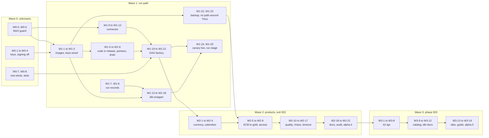

# Phases 002 and 003: the build breakdown

**Question:** what exactly is built in phase 002 (the run spine, through ECB FX) and phase 003 (serving and
teaching), in what order, in steps of 15 to 30 minutes, each with its files, its dependencies and the one
command that proves it?
**Status:** analysis before the work, not a decision. It re-cuts section B of
[`IMPLEMENTATION-N0-N1.md`](./2026-11-26-unified-platform-architecture/IMPLEMENTATION-N0-N1.md) (rows N1-xx)
against what phase 001 froze and measured. Where they differ, these win, later over earlier: the plan files
[`002-run-spine-through-ecb-fx.md`](../plans/2026-11-26-unified-product-platform/002-run-spine-through-ecb-fx.md)
and [`003-serving-and-teaching.md`](../plans/2026-11-26-unified-product-platform/003-serving-and-teaching.md);
[`DECISIONS-FINAL.md`](./2026-11-26-unified-platform-architecture/DECISIONS-FINAL.md) and the
[decisions addendum](./2026-11-26-decisions-addendum.md); ADR-055, 036, 058, 059, 060, 061 with their Outcomes;
the frozen interfaces [`phase-001-interfaces.md`](../development/phase-001-interfaces.md) and
[`platform/k2gen/INTERFACES.md`](../../platform/k2gen/INTERFACES.md); the
[release spine spikes](./2026-11-26-release-spine-spikes.md); the
[phase 001 audit](../audits/2026-11-27-phase-001-release-and-rules-spine.md).

## Terms used once and then assumed

- **Write-audit-publish (WAP):** new rows go to a side branch of the Iceberg table (`audit`), are checked
  there, and `main` is fast-forwarded to them only if every check passed. Readers of bronze read `main`.
- **The tested-data marker:** the Iceberg tag `audited` on each dbt output; readers reach the output only
  through a generated view that reads the table at that tag (ADR-061). The wrapper moves the tag after tests.
- **dbt unit test:** a test that runs one model's SQL on a few rows written in YAML instead of its real
  inputs, and compares the result with expected rows. It proves logic, not data.
- **dbt seed:** a small CSV file in the project that `dbt seed` (or `dbt build`) loads as a table; here, the
  TARGET closing days a person writes.
- **Incremental model:** a dbt model that, after its first run, merges only new or changed rows into the
  existing table on a unique key, instead of rebuilding it.
- **Remote signing:** Lakekeeper signing each storage request for an engine with its own credential; while it
  is on, the engine's own storage key decides nothing (spike (b)).
- **`$PYTEST`:** shorthand below for the runner `make test-python` uses,
  `uv run --no-project --with pytest==9.2.0 --with pyyaml==6.0.4 --with fastavro==1.12.2 --with duckdb==1.4.4 pytest`.

## Method

- **One pull request for both phases**, from branch `phase/002-003-run-spine-and-serving`, with tag
  `v3.0.0-alpha.4` at 002's exit and `v3.0.0-alpha.5` at 003's. Each step is a short-lived branch merged into
  the phase branch; release-candidate tags (`v3.0.0-alpha.4-rc.N`) are what the orchestrator deploys between.
- **Riskiest unknowns first** (wave 0), each proven on a throwaway (a throwaway lake from
  `scripts/lib/throwaway-lake.sh`, or a throwaway compose project) before anything builds on it.
- **Steps of 15 to 30 minutes on disjoint files.** A step that must touch a shared file does so in the order
  of the shared-file table. Per step, run only its own tests: the proof column, plus the unit gate of what it
  touched (`make test-k2gen`, `make test-airflow`, `make test-dbt`, `$PYTEST <its tests>`).
- **`make spine-e2e` after every merge into the phase branch.** It gains a `run` stage (W1-25, widened in
  W2-11) as soon as the first product runs: on a throwaway lake, land, bronze WAP, the dbt wrapper and the
  marker. The fetch itself stays proven by `make test-connectors`, since a local fixture server sits on a
  private address the fetch must refuse, so the stage seeds the spool as the fetch would.
- **Before any tag, and after any change to compose or an image pin,** `make release TAG=<scratch tag>`
  against real images: spine-e2e compiles with placeholder digests, so a real image reference is the one
  thing it cannot prove.
- **Independent review only where a mistake leaks or locks out:** access, identity, secrets, deploy. These
  are the rows marked access-critical. Mechanical rows get the author's tests and CI.
- **Documents once, at the end of each phase, by one writer** (W2-18 to W2-21, W3-17 to W3-19), from what ran.

## Facts this builds on

Checked in the tree: the stack runs sealed releases (`make release`, `make deploy`, `make release-verify`,
`make rollback`); Trino over HTTPS with passwords (ADR-060); Lakekeeper on `k2-catalog` alone with no host port,
its members held to `tests/access/catalog-fence-allow.txt` by `tests/test_catalog_fence_compose.py`. MinIO is
still published on `127.0.0.1:9000` and `:9001` (`docker-compose.yml`, service `minio`). Trino holds the MinIO
root pair (`.env.example`, `K2_TRINO_S3_*`). Airflow, Spark and Prometheus mount the releases root but read
`./docker/airflow/dags` and `./docker/prometheus/prometheus.yml` from the checkout; `docker/airflow/dags/` is
empty. `fetch`, `dbt-runner` and `k2-api` are `alpine:3.20` stubs behind profiles `fetch`, `build` and `api`,
already carrying the plan's limits. A release holds `compiled/airflow/dags.json` (one entry per scheduled
product, tasks a subset of `resolve fetch load audit publish build expire record maintain`),
`compiled/oneshots.json` (per kind: image, limits, env names, networks, secret mounts),
`compiled/lake/storage-plan.json`, `compiled/lake/backup-set.json` (landing prefixes, tables at their ref,
`lakekeeper-db`, `releases`), `compiled/dbt/`, `compiled/catalog/` and `compiled/api/principals.json` (the
principals k2-api may act as, not keys). A release holds no code: there is no `platform/` tree, and
`model.NEEDS_BY_PREFIX` raises on any path it does not classify. `make test-connectors` and `make backup-verify`
do not exist; `make test-notebooks` prints a SKIP until phase 004.

## Wave 0: the unknowns, in three parallel tracks

| Id | Builds | Files | Deps | Proof | Size | Profile |
|---|---|---|---|---|---|---|
| W0-1 | `ensure_warehouse` creates every warehouse with remote signing off and turns it off on existing ones (spike (b)) | `docker/lake/init-lake.sh`, `tests/test_init_lake.py` | none | `$PYTEST tests/test_init_lake.py -q` exits 0 | S | access-critical |
| W0-2 | `lake-init` makes one MinIO user and policy per engine (Spark, Trino, maintenance, backup, tools read-only), idempotently; fetch gets none | `docker/lake/minio/policies/` (new, one JSON per engine), `docker/lake/init-lake.sh`, `tests/test_init_lake.py` | W0-1 | as W0-1 | M | access-critical |
| W0-3 | A sixth expectation row shape, a storage-key probe (engine, warehouse or bucket, `refused` or `allowed`), and its runner | `contracts/schema/expectations.schema.json` (frozen: orchestrator), `scripts/access_verify.py`, `tests/access/test_access_verify.py`, `tests/access/expectations.yaml` (the rows) | none | `$PYTEST tests/access/test_access_verify.py -q` exits 0 | M | access-critical |
| W0-4 | On a throwaway lake: `lake-init` twice gives the same users; each key works in its warehouse and is refused elsewhere; Spark `expire_snapshots` by id with the maintenance key reports `deleted_manifest_lists_count` at least the ids | `scripts/verify/storage-keys.sh` (new) | W0-2, W0-3 | `bash scripts/verify/storage-keys.sh` (new, this step) prints `0 FAIL`, exit 0 | M | access-critical |
| W0-5 | The fetch address guard, ported from `9b7d664` (`require_public_https`, at most five redirects): resolve `allowHosts`, refuse private, loopback, link-local and unique-local IPv4 and IPv6, connect only to the address checked | `docker/fetch/fetch.py` (new), `tests/test_fetch.py` (new), `mk/run.mk` (new: `test-connectors`) | none | `make test-connectors` (new, this step): redirect to `http://`, off-list host, private and unique-local address all exit 20, with no network | M | access-critical |
| W0-6 | The fetch run contract: 64 MiB cap, timeouts, TLS verification; `raw.<ext>` and `fetch.json` written before parsing; the registered parser loaded from the release's `domains/`; exits 0, 10, 20, 30 | `docker/fetch/fetch.py`, `tests/test_fetch.py` | W0-5 | `make test-connectors` exits 0 | M | access-critical |
| W0-7 | The one-shot operator: `docker run --rm --name k2-<kind>-<dagId>-<try>` with exactly what `oneshots.json` names; `on_kill` runs `docker kill`; imports nothing from `domains/` | `docker/airflow/dags/oneshot.py` (new), `docker/airflow/tests/test_oneshot.py` (new) | none | `make test-airflow` exits 0, including the argument-list and no-product-import tests | M | access-critical |
| W0-8 | On a throwaway Airflow: four LocalExecutor slots, pools `lake_spark` 1, `fetch` 1, `dbt` 2; a fifth task queues; a task killed in Airflow leaves no container | `scripts/verify/oneshot-slots.sh` (new) | W0-7 | `bash scripts/verify/oneshot-slots.sh` (new, this step) exits 0 | M | access-critical |

What each track settles, and its escape. **R1** (W0-1 to W0-4): the plan's "one key per engine while
Lakekeeper vends no credentials" does not hold while Lakekeeper signs; with signing off, the key is what MinIO
checks. If signing must stay on, the plan's escape applies: an engine that needs more is listed among the
trusted paths with its reason, and `expire` falls back to Trino as `svc.platform`. **R2** (W0-5, W0-6): if the
in-process guard cannot pin the connection to the checked address, the escape is a forward proxy with its own
allow-list. **R3** (W0-7, W0-8): ADR-059's Outcome of 2026-11-27 puts the scheduler inside the catalog's trust
boundary because it holds the Docker socket; what keeps that tolerable is that the scheduler runs only DAGs
generated from a release and no product code (parsers run in `fetch`, models in `dbt-runner`). W0-7's test
holds that line. The escape if slots starve: five-minute runs only, no continuous consumer.

## Wave 1: the run path

| Id | Builds | Files | Deps | Proof | Size | Profile |
|---|---|---|---|---|---|---|
| W1-1 | The fetch image, pinned by digest, non-root, read-only root; compose `fetch` real: `k2-net` only, the spool volume, no `K2_*_S3_*` | `docker/fetch/Dockerfile` (new), `docker-compose.yml`, `.github/workflows/ci.yml` (its build leg) | W0-6 | `docker compose --profile fetch config fetch \| grep -c S3_` prints 0; `python3 scripts/check-budget.py` PASS | S | mechanical |
| W1-2 | The dbt-runner image (dbt from `dbt/uv.lock`); compose `dbt-runner` real: environment exactly the seven names of the wrapper contract, the three password files and the CA mounted | `docker/dbt-runner/Dockerfile` (new), `docker-compose.yml`, `.github/workflows/ci.yml` | W1-1 | `docker compose --profile build config dbt-runner \| grep -A12 'environment:'` lists only the seven names | M | access-critical |
| W1-3 | Engines on their own keys: Spark, Trino, tools and backup read `K2_*_S3_*`; `check-env.py` refuses a scoped pair equal to the root pair. Trino's root pair ends at the deploy of this step's release, once the owner sets its scoped pair | `docker-compose.yml`, `.env.example`, `docker/lake/spark_conf.py`, `scripts/check-env.py`, `tests/test_check_env.py` | W0-4, W1-2 | `$PYTEST tests/test_check_env.py -q`; live after the rc deploy, `make access-verify LIVE=1` storage-key rows PASS | M | access-critical |
| W1-4 | The release carries the run code under `platform/` (A1's layout): the DAG factory, the Spark scripts, the Prometheus rules, `domains/`; each new prefix classified in `model.NEEDS_BY_PREFIX` | `platform/k2gen/k2gen/release.py`, `platform/k2gen/k2gen/model.py` (frozen: orchestrator), `platform/k2gen/tests/` | none | `make test-k2gen` exits 0 | M | mechanical |
| W1-5 | Airflow's DAG folder, Spark's script path and Prometheus's rules read through their pointers; the checkout bind mounts of `docker/airflow/dags` go | `docker-compose.yml`, `docker/prometheus/prometheus.yml` | W1-3, W1-4 | `make deploy-rehearsal` exits 0 with the DAG folder under `/k2/releases/pointers/airflow` | M | access-critical |
| W1-6 | Deploy's drain becomes real: on `dagShapeChange` or `trinoRestart` it pauses the affected DAGs, waits for running tasks up to a bound, then proceeds; no longer a SKIP (ADR-058) | `scripts/deploy.py`, `tests/test_deploy.py` | W1-5 | `$PYTEST tests/test_deploy.py -q` exits 0 | M | access-critical |
| W1-7 | The `governance/run-records` product over the existing run-record table, `build: platform` | `contracts/governance/run-records/` (new) | none | `bash scripts/verify/ci-validate.sh <out dir>` exits 0 | S | mechanical |
| W1-8 | The one run-records client: `record(...)` as `svc.runs` over TLS with its password file; `newest_audited(table)` | `platform/runs/k2runs.py` (new), `platform/runs/test_k2runs.py` (new) | W1-7 | `uv run --no-project --with pytest==9.2.0 --with trino==0.340.0 pytest platform/runs -q` exits 0 | M | mechanical |
| W1-9 | Land: recompute the spool's sha256 against `fetch.json`, refuse a mismatch, conditional PUT to `model.landing_key`, one `landing_files` row (from #239's generic half) | `docker/lake/connector.py` (new), `tests/test_lake_connector.py` (new) | W0-6 | `$PYTEST tests/test_lake_connector.py -q` exits 0 | M | mechanical |
| W1-10 | Load onto the fixed `audit` branch, refusing a new batch while `audit` holds another unpublished one; batch-scoped audits (count, parse errors, declared checks) into `audit_checks` | `docker/lake/connector.py`, `tests/test_lake_connector.py` | W1-9 | as W1-9 | M | mechanical |
| W1-11 | Publish by fast-forward only when the batch passed; `expire` by id with `older_than` the epoch, failing unless `deleted_manifest_lists_count` covers the ids | `docker/lake/connector.py`, `docker/lake/expire.py` (new), `tests/test_lake_connector.py` | W1-10 | as W1-9 | M | mechanical |
| W1-12 | The connector on a throwaway lake from a synthetic spool: a failed batch blocks the next, both landings kept, the same bytes add no row | `scripts/verify/connector-wap.sh` (new) | W1-11, W0-4 | `bash scripts/verify/connector-wap.sh` (new, this step) exits 0 | M | mechanical |
| W1-13 | The results hook writes every test result with `k2_run_id` to the writer's own results table; `make test-dbt`'s build on a throwaway Trino stops being a SKIP | `dbt/macros/k2_results.sql`, `scripts/dbt-test.sh` | none | `make test-dbt` exits 0 with no SKIP line for the build | M | mechanical |
| W1-14 | Wrapper steps 2 to 4: each input's tested snapshot from `t$refs`, read twice and compared (exit 4 if a required input was never tested); `started` with `snapshot_before`; one `dbt build --selector <fence>`, unit tests included (spike (d)) | `docker/dbt-runner/k2_dbt.py` (new), `docker/dbt-runner/test_k2_dbt.py` (new) | W1-2, W1-8 | `$PYTEST docker/dbt-runner -q` exits 0 | M | access-critical |
| W1-15 | Step 5: every output whose `main` moved is restored as the builder, by `rollback_to_snapshot`, or by `CREATE OR REPLACE TABLE t AS SELECT * FROM t FOR VERSION AS OF <id>` when its schema changed (spike (f)); `rolled_back`; exits 1, 2, 3; the XCom line | `docker/dbt-runner/k2_dbt.py`, `docker/dbt-runner/test_k2_dbt.py` | W1-14 | as W1-14 | M | access-critical |
| W1-16 | Step 6, as the publisher: `emit/lake.view_update` to C ∩ old ∩ new, one compare-and-set tag commit for all outputs (a 409 exits 3), views to C ∩ new, `audited` | `docker/dbt-runner/k2_dbt.py`, `docker/dbt-runner/test_k2_dbt.py` | W1-15 | as W1-14 | M | access-critical |
| W1-17 | Step 1, reconcile: the drift check; an unfinished run's outputs restored to their tag (none: `DROP TABLE`), `reconciled`; a tag ahead of the records gets its `audited` row; the drift check's run-record comparison stops being a SKIP | `docker/dbt-runner/k2_dbt.py`, `scripts/verify/catalog_drift.py`, tests | W1-16 | as W1-14 | M | access-critical |
| W1-18 | The wrapper on a throwaway lake with the access canary: a pass moves `audited`; a planted failing test leaves the base at its tag while a reader polling the view sees no failed row; a run killed after `started` is reconciled by the next | `scripts/verify/dbt-wrapper.sh` (new) | W1-17, W1-13 | `bash scripts/verify/dbt-wrapper.sh` (new, this step) exits 0 | M | access-critical |
| W1-19 | The DAG factory: one DAG per `dags.json` entry; `resolve` once, by XCom; fetch and build through `oneshot.py`; load, audit, publish, expire as Spark tasks on the release's script path; `record` on every outcome; `maintain` daily; pools; `max_active_runs=1` | `docker/airflow/dags/factory.py` (new), `docker/airflow/tests/test_factory.py` (new) | W0-7, W1-4 | `make test-airflow` exits 0 | M | mechanical |
| W1-20 | `record` writes each task's outcome through `k2runs` as `svc.runs`; its password file and the CA mounted read-only in the scheduler | `docker/airflow/dags/factory.py`, `docker-compose.yml` | W1-19, W1-8, W1-5 | `make test-airflow`; `docker compose config airflow-scheduler \| grep -c runs.password` prints 1 | S | access-critical |
| W1-21 | `maintain` expires snapshots by `compiled/lake/retention.json` and landings older than 14 days (the owner's O6) | `docker/lake/maintain.py` (new), `tests/test_lake_maintain.py` (new) | W1-11 | `$PYTEST tests/test_lake_maintain.py -q` exits 0 | S | mechanical |
| W1-22 | The backup copies what the live release's `backup-set.json` lists (landings, tables at their ref, the Lakekeeper database, the releases root) in `tools` with the backup key; `make backup-verify` lists each snapshot id and landing; `make drop` calls the same copy | `scripts/backup-lake.sh`, `scripts/drop.sh`, `mk/run.mk` (`backup-verify`), `tests/test_backup_lake.py`, `tests/test_drop.py` | W1-3 | `$PYTEST tests/test_backup_lake.py tests/test_drop.py -q`; live once W2-8 has landed a file, `make backup && make backup-verify` lists the ECB landing | M | mechanical |
| W1-23 | No path around Trino: MinIO's host ports go; every host-side user of them (`git grep -n '127.0.0.1:9000'`) moves into `tools`; probe rows from the host and from `fetch` refused | `docker-compose.yml`, the scripts that grep finds, `tests/access/expectations.yaml` | W1-22, W1-1 | `make access-verify RELEASE=<scratch release>`: the probe rows PASS | M | access-critical |
| W1-24 | The access canary runs through its DAG and publishes; its three readers' password files exist; the live suite runs | `docs/runbooks/verify-access-after-a-release.md` (the step's own lines) | W1-18, W1-20, deployed | `make access-verify LIVE=1` exits 0 with no `not yet published` SKIP | S | access-critical |
| W1-25 | spine-e2e stage `run`: the canary's build through the wrapper and the marker on a throwaway lake | `scripts/verify/spine-e2e.sh` | W1-18 | `ONLY="run" make spine-e2e` (stage new, this step) prints `PASS run` | S | mechanical |

## Wave 2: the products, and 002's exit

Product documents follow the access canary's layout (`contracts/governance/access-canary/`: product file,
one `.odcs.yaml` per table, `grants.yaml`, `models/`, `seeds/`). Each model step's proof is `make test-dbt`
(after W1-13 it runs every compiled product's unit tests on a throwaway Trino) and, live after the rc deploy,
the plan's `airflow dags test` line.

| Id | Builds | Files | Deps | Proof | Size | Profile |
|---|---|---|---|---|---|---|
| W2-1 | `currency-master` documents: an `https-file` connector for the ISO 4217 list, bronze, one dbt output `currency` | `contracts/reference-data/currency-master/` (new) | W1-19 | `bash scripts/verify/ci-validate.sh <out dir>` exits 0 | S | mechanical |
| W2-2 | The ISO 4217 parser and its audit, with a fixture as the owner decides | `domains/reference-data/parsers/iso4217.py` (new), `domains/reference-data/tests/` (new) | W0-6 | `$PYTEST domains/reference-data -q` exits 0 | S | mechanical |
| W2-3 | The `currency` model and its unit test | `contracts/reference-data/currency-master/models/` (new) | W2-1 | `make test-dbt`; live `docker exec k2-airflow-scheduler airflow dags test currency_master` | S | mechanical |
| W2-4 | `calendars`: a dbt-only product, table `target_days` from a seed a person writes | `contracts/reference-data/calendars/` (new, with `seeds/`) | W1-19 | `make test-dbt`; live `docker exec k2-airflow-scheduler airflow dags test calendars` | S | mechanical |
| W2-5 | `ecb-fx-rates` documents: connector (`allowHosts` `www.ecb.europa.eu`), `bronze_daily`, two outputs, licence and terms as read on the ECB's terms page; no non-owner grant yet | `contracts/fx-reference/ecb-fx-rates/` (new) | W2-1 | `bash scripts/verify/ci-validate.sh <out dir>` exits 0 | S | mechanical |
| W2-6 | The ECB parser, audits `rate_positive` and `no_future_date`, a good and a corrupt fixture | `domains/fx-reference/parsers/ecb_fx.py` (new), `domains/fx-reference/tests/` (new) | W0-6 | `$PYTEST domains/fx-reference -q`: the corrupt fixture fails its audit | S | mechanical |
| W2-7 | `silver_rates`: incremental merge keyed with the partition column (spike (a)), `DECIMAL(20,10)`, newest file wins; unit tests | `contracts/fx-reference/ecb-fx-rates/models/` | W2-5 | `make test-dbt` exits 0 | M | mechanical |
| W2-8 | `gold_eur_rates_daily`: one row per TARGET day and currency, a missing rate carried at most five days, `rate_available_at`; unit tests | `contracts/fx-reference/ecb-fx-rates/models/` | W2-7, W2-4 | `make test-dbt`; live `docker exec k2-airflow-scheduler airflow dags test ecb_fx_rates` | M | mechanical |
| W2-9 | ECB access: `p.analyst-a` declared and granted after the terms are recorded; rows for gold readable, bronze and `silver_rates$files` denied, a consumer `optimize` on `silver_rates` denied (a statement row) | `contracts/access/principals.yaml`, `contracts/fx-reference/ecb-fx-rates/grants.yaml`, `tests/access/expectations.yaml` | W2-8, W1-23 | `make access-verify RELEASE=<scratch release>` exits 0 | S | access-critical |
| W2-10 | `governance/quality-results` rebuilt over each writer's own results table (ADR-046 is the prior record) | `contracts/governance/quality-results/` (new), `platform/k2gen/k2gen/emit/dbt.py` if the union is generated | W1-13 | `make test-k2gen && make test-dbt` exit 0 | M | mechanical |
| W2-11 | spine-e2e `run` widened: ECB from a seeded spool through land, WAP, wrapper and marker | `scripts/verify/spine-e2e.sh` | W2-8, W1-25 | `ONLY="run" make spine-e2e` prints `PASS run` | S | mechanical |
| W2-12 | Chaos: a corrupt file lands, bronze `main` does not move, the next file waits | `scripts/chaos/fx-bad-file.sh` (new) | W2-8 | `bash scripts/chaos/fx-bad-file.sh` (new, this step) exits 0 | S | mechanical |
| W2-13 | The same bytes again add no row | `scripts/verify/fx-idempotent.sh` (new) | W2-8 | `bash scripts/verify/fx-idempotent.sh` (new, this step) exits 0 | S | mechanical |
| W2-14 | A failing test rolls silver back; `rolled_back` and `expired` rows; a reader polling through the window never saw a failed row | `scripts/chaos/dbt-failing-test.sh` (new) | W2-8 | `bash scripts/chaos/dbt-failing-test.sh` (new, this step) exits 0 | S | access-critical |
| W2-15 | Trino stopped mid-build; the next run writes `reconciled` first; the runner's env names captured before the stop | `scripts/chaos/trino-stop-mid-build.sh` (new) | W2-8 | `bash scripts/chaos/trino-stop-mid-build.sh` (new, this step) exits 0 | S | mechanical |
| W2-16 | A deploy during a run: the run finishes on R-1 and its run record says R-1 | `scripts/chaos/deploy-mid-run.sh` (new) | W2-8, W1-6 | `bash scripts/chaos/deploy-mid-run.sh` (new, this step) exits 0 | S | access-critical |
| W2-17 | The ECB timeout from 20 triggered runs (their maximum times a stated factor) in the product's schedule; the times published with their command | `contracts/fx-reference/ecb-fx-rates/product.odps.yaml`, a `docs/benchmarks/` file (new) via `/benchmark-report` | W2-8, deployed | `make check-docs` exits 0 with the benchmark's command per row | S | mechanical |
| W2-18 | ADR-054 (a storage key per engine, remote signing off) finished from #227, ADR-062 (dbt builds silver and gold per product), ADR-035's status line, the ADR-010 Outcome line | `docs/adr/` | W0-4, W1-18 | `make check-docs` exits 0 | M | access-critical |
| W2-19 | Runbooks: a failed audit, connector failure, backup and restore of a file product, each command run first | `docs/runbooks/file-source-audit-failed.md` (new), `docs/runbooks/connector-failure.md` (new), `docs/runbooks/lake-backup-and-restore.md` | W2-12, W1-22 | `make check-docs` exits 0 | M | mechanical |
| W2-20 | Current-state documents: the ECB diagram in chapter 21 with its limits (audit LOW 17), `CLAUDE.md`'s phase 002 sentences, `docs/development/spine-e2e.md`'s new stage | `docs/architecture/21-releases-and-deploy.md`, `CLAUDE.md`, `docs/development/spine-e2e.md` | W2-11 | `make check-docs` exits 0 | M | mechanical |
| W2-21 | The phase audit with `/audit`, critical and high fixed; a scratch `make release` against real images; tag `v3.0.0-alpha.4` | `docs/audits/` (new file) | all of 002 | `make release TAG=<scratch tag>` exits 0; the audit's Verification table holds | M | access-critical |

## Wave 3: phase 003

| Id | Builds | Files | Deps | Proof | Size | Profile |
|---|---|---|---|---|---|---|
| W3-1 | k2-api's skeleton (FastAPI 0.162.5, uvicorn 0.54.0, `trino` 0.340.0, locked): `/healthz`, `/v1/release` from its pointer, `/v1/openapi.json` from the frozen `openapi.yaml` | `services/k2-api/pyproject.toml` (new), `services/k2-api/uv.lock` (new), `services/k2-api/k2api/` (new), `services/k2-api/tests/` (new) | W2-21 | `cd services/k2-api && uv run --locked pytest` exits 0; the served document says `3.1.0` | M | mechanical |
| W3-2 | `/v1/products`, `/v1/products/{domain}/{product}` (with `access` asked of Trino with `LIMIT 0` as the caller), the contract route | `services/k2-api/k2api/`, tests | W3-1 | as W3-1 | M | mechanical |
| W3-3 | Keys: `Authorization: Bearer`, sha256 looked up in `/run/k2-secrets/api/keys.json`, served only for a principal in `compiled/api/principals.json`; 401 without one | `services/k2-api/k2api/`, tests | W3-1 | as W3-1; live, the plan's 401 `curl` | M | access-critical |
| W3-4 | `/v1/data/...`: `fields`, `limit` up to 10,000, equality on declared columns only, the reader relation as the caller; 403 on a Trino denial, 404 off the release, 422 `result_too_large` and `as_of_unavailable` | `services/k2-api/k2api/`, tests | W3-2, W3-3 | as W3-1; live, the plan's `limit=5` and 403 `curl` lines | M | access-critical |
| W3-5 | The image by digest; compose `k2-api` real on `127.0.0.1:8095`, `k2-net` only, its secret mounts | `services/k2-api/Dockerfile` (new), `docker-compose.yml`, `.github/workflows/ci.yml` | W3-4 | `python3 scripts/check-budget.py` PASS; `$PYTEST tests/test_catalog_fence_compose.py tests/test_secret_mounts.py -q` | S | access-critical |
| W3-6 | `make release-verify` reads `/v1/release` | `scripts/deploy.py`, `tests/test_deploy.py` | W3-5 | `$PYTEST tests/test_deploy.py -q`; live `make deploy RELEASE=<rc> && make release-verify` | S | access-critical |
| W3-7 | `make access-verify` runs every `via: rest` row through k2-api, on the throwaway lake and live; the ECB rows gain `rest` | `scripts/access_verify.py`, `scripts/lib/throwaway-lake.sh`, `tests/access/expectations.yaml` | W3-5 | `make access-verify RELEASE=<scratch release>` exits 0 with REST rows | M | access-critical |
| W3-8 | The product documents and `/v1/products` validate against `catalog-product.schema.json` | `scripts/verify/api-schema.sh` (new) | W3-2 | `bash scripts/verify/api-schema.sh` (new, this step) exits 0 | S | mechanical |
| W3-9 | The catalog site generator, run in `tools` as `svc.catalog`: the release's catalog JSON plus run-time facts (newest audited publish, tests, freshness) | `platform/catalog-site/` (new) | W2-10 | `$PYTEST platform/catalog-site -q` exits 0 | M | mechanical |
| W3-10 | A page per product: owner, purpose, state, schema with descriptions, keys, roles and policies in words, terms, examples, the `/dbt-docs/` link; no credential | `platform/catalog-site/`, `scripts/verify/catalog-site.sh` (new) | W3-9 | `bash scripts/verify/catalog-site.sh` (new, this step) exits 0 | M | mechanical |
| W3-11 | The dbt docs site generated from the release's dbt tree in `dbt-runner`; k2-api serves `/catalog/` and `/dbt-docs/` read-only | `docker/dbt-runner/`, `services/k2-api/k2api/`, `docker-compose.yml` | W3-10, W3-5 | live `curl -s -o /dev/null -w '%{http_code}\n' 127.0.0.1:8095/dbt-docs/` prints 200 | M | mechanical |
| W3-12 | The site reruns after each deploy and on a schedule | `scripts/deploy.py`, `scripts/systemd/` (new unit) | W3-11, W3-6 | `$PYTEST tests/test_deploy.py -q` | S | mechanical |
| W3-13 | dbt lab 1: a source and a model, on the ECB products | `docs/development/dbt-labs/` (new) | W2-21 | `make check-docs` exits 0 | M | mechanical |
| W3-14 | dbt lab 2: an incremental merge with a unit test | `docs/development/dbt-labs/` | W3-13 | as W3-13 | M | mechanical |
| W3-15 | dbt lab 3: a failing test that rolls back | `docs/development/dbt-labs/` | W3-14 | as W3-13 | M | mechanical |
| W3-16 | The owner's guide to reviewing dbt work (a model, its YAML and tests, `k2gen diff`) and the "What this does and why" section every dbt pull request carries | `docs/development/reviewing-dbt-work.md` (new), `.github/pull_request_template.md` (new) | W3-13 | as W3-13 | S | mechanical |
| W3-17 | Runbook: onboard a file product, written last, from a whole-path run on the live stack | `docs/runbooks/onboard-a-file-product.md` (new) | W3-12 | as W3-13 | M | mechanical |
| W3-18 | Current-state documents: `README.md`, `docs/operations/`, chapter 22's k2-api section, the ADR-010 Outcome line for k2-api | those files | W3-17 | as W3-13 | M | mechanical |
| W3-19 | The phase audit, a scratch `make release` against real images, tag `v3.0.0-alpha.5` | `docs/audits/` (new file) | all of 003 | `make deploy RELEASE=v3.0.0-alpha.5 && make release-verify` exits 0 | M | access-critical |

## Shared files: who edits, in what order

| File | Steps, in order | Rule |
|---|---|---|
| `docker-compose.yml` | W1-1, W1-2, W1-3, W1-5, W1-20, W1-23, W3-5, W3-11 | one at a time, each rebased on the last; `python3 scripts/check-budget.py` and `make deploy-rehearsal` after each |
| `.github/workflows/ci.yml` | W1-1, W1-2, W3-5 | one build leg each; nothing else |
| `Makefile` | none | it only includes `mk/*.mk`; new targets go in `mk/run.mk` (new): W0-5, then W1-22 |
| `tests/access/expectations.yaml` | W0-3, W1-23, W2-9, W3-7 | rows appended; the owner reviews every row (the file is hand-written by rule) |
| `scripts/deploy.py` | W1-6, W1-23, W3-6, W3-12 | sequential |
| `scripts/verify/spine-e2e.sh` | W1-25, W2-11 | one stage line each |
| `scripts/access_verify.py` | W0-3, W3-7 | sequential |
| `docker/lake/init-lake.sh`; `docker/fetch/fetch.py`; `docker/lake/connector.py`; `docker/dbt-runner/k2_dbt.py`; `docker/airflow/dags/factory.py` | W0-1, W0-2; W0-5, W0-6; W1-9 to W1-11; W1-14 to W1-17; W1-19, W1-20 | each a chain in id order |
| `platform/k2gen/k2gen/model.py`, `contracts/schema/` | W1-4; W0-3 | frozen: the orchestrator approves and tells every dependent step |
| `CLAUDE.md` | W2-20, W3-18 | the documents writer only |
| `CHANGELOG.md`, index files | any | the orchestrator adds the line at merge; one appended row per index |

## Order

*Reading guide.* Boxes are groups of steps; an arrow means the later group cannot merge before the earlier.
Groups with no arrow between them build in parallel. The critical path is R1, the images and keys, the
pointers, the DAG factory, the ECB products, the chaos scripts, the exit of 002, then k2-api.

## Budget

The plan's table ([README](../plans/2026-11-26-unified-product-platform/README.md), Budget): the fetch container
adds 0.50 CPU and 0.500 GiB (profile `fetch`), two dbt runners 1.00 CPU and 1.500 GiB (profile `build`), both in
002; k2-api 0.50 CPU and 0.500 GiB in 003; the bootstrap peak with both profiles is stated as 19.40 CPU /
32.375 GiB, under the 25 / 48 ceiling of ADR-045. That table starts from the peak before phase 000; what the gate
prints today, `python3 scripts/check-budget.py`, is `bootstrap default 16.80 CPU 28.750 GiB` with each profile on
its own line, because the stubs already carry those limits. So the real images move no figure unless a step
changes a limit, and any that does records it in ADR-010's Outcome and the compose summary comment.

## Decisions the owner takes inside these phases

| Decision | Default the documents imply | Recorded in | Before |
|---|---|---|---|
| Committing the ECB and ISO 4217 published files as fixtures | synthetic files in the publishers' formats, named so; the real ECB sample with attribution only if the owner allows it (IMPLEMENTATION E4) | the plan's "Depends on" answer, the fixtures' README | W2-2, W2-6 |
| Rotating the MinIO root credential | the owner rotates it after W1-23; agents never see the value | `SECURITY.md`, the backup runbook | W2-21 |
| The canary readers' password files | the owner runs `make password PRINCIPAL=<p.canary-...> TO_FILE=1` once per reader, as `verify-access-after-a-release.md` gives; files under `${K2_SECRETS}`, never in a release | that runbook | W1-24 |
| A storage-key row shape in the frozen expectations schema | add it as a sixth shape; the plan's `make access-verify` line asks for key probes per engine | `contracts/schema/expectations.schema.json`, `phase-001-interfaces.md` | W0-3 |
| A `platform/` code tree in the release | add it, as A1 drew it; without it nothing can be read through the Airflow, Spark or Prometheus pointers | `platform/k2gen/INTERFACES.md`, release paths | W1-4 |
| Who reads the catalog site's run-time facts, and where the site lives | the generator runs in `tools` as `svc.catalog` and writes a volume k2-api mounts read-only, so k2-api keeps its one Trino identity, `svc.api` (`openapi.yaml`); served at `/catalog/` (plan 003) | `services/k2-api/openapi.yaml` description, chapter 22 | W3-9 |
| The site's schedule | after each deploy and daily from a host timer, the pattern of `make backup-install` | `scripts/systemd/`, the onboarding runbook | W3-12 |
| ADR-054's number | finish it out of #227 (open, parked for the hardening sprint with 052 and 053), as N1-6 planned; else the next free number | `docs/adr/` | W2-18 |
| ADRs needed | two, both in the plan: ADR-054 (keys, with remote signing off, which no earlier draft had) and ADR-062 (dbt per product, the number `phase-001-interfaces.md` holds for phase 002). None for the socket (ADR-059's Outcome), the fetch rules (ADR-036) or k2-api (ADR-056); a reversal of any default above that costs more than a day to unwind gets its own | `docs/adr/README.md` | W2-18 |
| The ECB terms before a non-owner grant | the owner confirms the terms page reading; `k2gen check` refuses a non-owner grant without terms | the product's ODPS document | W2-9 |
| REST `as_of` | phase 007's; refused with 422 until then (`openapi.yaml`) | `openapi.yaml` | none here |

## Not in these phases

- **Phase 004:** notebooks through Trino (`notebooks/` is archived and `make test-notebooks` says it returns in
  004); the `kafka` and `public-api` connector kinds; the first restore drill; the five-minute contention soak.
- **Phase 005:** the FX content the owner fixed (rates, cross rates and euro-valued candles).
- **Phase 006:** the catalog site's search, lineage diagram and quality history; usage; OpenLineage.
- **Phase 007:** cursors, `as_of`, state headers, 410, key rotation; `make demo` and `make api-verify`.
- **Hardening sprint:** a read-only socket proxy for cAdvisor or its replacement (ADR-059 Outcome, trigger 9);
  replacing MinIO (`CHANGELOG.md` 3.0.0-alpha.3, Security); folding the review's C1 rows into the main rules
  suite; a fresh install of the release-shaped stack on an empty host (the owner's ruling of 2026-11-27).
- **Follow-on plan:** the duration alert, controls, the off-host backup copy.

## Departures from the outline

- **One `dbt build`, unit tests inside it**, not unit tests then build: spike (d) and the frozen wrapper contract
  dropped the split, which fails on a product's first run.
- **Restore by schema:** a rollback across a create-or-replace restores rows, not schema (spike (f)), so W1-15
  restores a changed schema by create-or-replace from the old snapshot.
- **k2-api keys** come from `${K2_SECRETS}/api/keys.json`; the release holds only `compiled/api/principals.json`,
  the principals k2-api may act as (`emit/api.py`), not a key map. Plan 003's "the release's key map" is read so.
- **k2-api reads the tested snapshot through the reader view** (`openapi.yaml`, the compose comment), not run
  records through `k2runs` as A12 had it.
- **A `platform/` tree in the release (W1-4)** is added: the outline names the pointer switch but no release
  carries the code to read through those pointers.
- **The storage-key probe is a new row shape (W0-3):** the frozen schema has five shapes and none is a key.
- **Notebooks through Trino move to phase 004**, where `notebooks/` returns.
- **Lakekeeper is already off the host** (phase 001); W1-23 only unpublishes MinIO.
- **The releases root in the backup (W1-22)** closes audit finding 10 here, which the audit left to the
  hardening sprint, because `backup-set.json` already lists it and W1-22 implements that file.
- **Landing retention (W1-21)** is built here: the addendum assigns the owner's 14 days to the phases that build
  landings.
- **ADRs are written at each phase's end** by the documents writer, from what the steps measured, since both
  decisions are already taken by the plan and the spikes; no fork waits on them.

## Plan verification lines and the step that proves each

Plan 002: the three `airflow dags test` lines, W2-3, W2-4, W2-8; `fx-bad-file.sh` W2-12; `fx-idempotent.sh`
W2-13; `dbt-failing-test.sh` W2-14; `trino-stop-mid-build.sh` W2-15; `deploy-mid-run.sh` W2-16;
`make test-connectors` W0-5, W0-6; the `dbt-runner` environment line W1-2; `make access-verify` key probes and
refusals W0-4, W1-3, W1-23; `make backup && make backup-verify` W1-22; `check-budget.py` W1-1, W1-2;
`make test` and `make check-docs` every step and W2-20. Plan 003: deploy and `release-verify` W3-6, W3-19;
REST `access-verify` W3-7; the three `curl` lines W3-3, W3-4; `api-schema.sh` W3-8; the OpenAPI line W3-1;
`catalog-site.sh` W3-10; `/dbt-docs/` W3-11; `uv run --locked pytest` W3-1 to W3-4.

**A line no step proves as written:** plan 002's `docker exec k2-trino trino --execute "ALTER TABLE
fx_reference.ecb_fx_rates.silver_rates EXECUTE optimize"` names no user, password or HTTPS server, so it cannot
run against a Trino that refuses a statement without a password. W2-9 proves the same claim as a statement row
of `tests/access/expectations.yaml`, run as the consumer over TLS.
