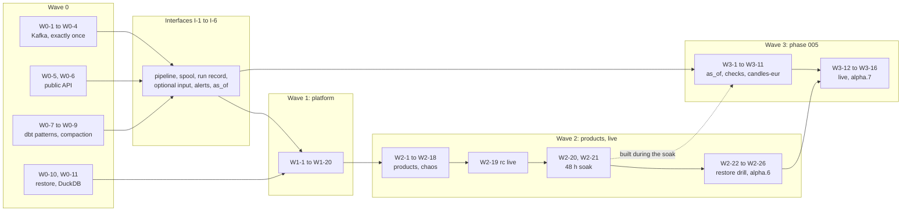

# Phases 004 and 005: the build breakdown

**Question:** what exactly is built in phase 004 (Kraken trades, instruments and the security master) and
phase 005 (the enriched product), in what order, in steps of 15 to 30 minutes, each with its files, its
dependencies and the one command that proves it, and where does the 48-hour soak fall?
**Status:** analysis before the work, not a decision. Where it differs from an earlier document, these win,
later over earlier: the plan files
[`004-kraken-trades-instruments-security-master.md`](../plans/2026-11-26-unified-product-platform/004-kraken-trades-instruments-security-master.md)
and [`005-the-enriched-product.md`](../plans/2026-11-26-unified-product-platform/005-the-enriched-product.md);
[`DECISIONS-FINAL.md`](./2026-11-26-unified-platform-architecture/DECISIONS-FINAL.md) and the
[decisions addendum](./2026-11-26-decisions-addendum.md); the owner's decisions of 2026-11-28 below; ADR-056, 022,
030, 047, 054, 058, 061 and 062 with their Outcomes; the frozen interfaces
[`phase-001-interfaces.md`](../development/phase-001-interfaces.md) and the schemas under `contracts/schema/`; the
[phases 002 and 003 audit](../audits/2026-11-27-phases-002-003-run-spine-and-serving.md) and `CHANGELOG.md`
3.0.0-alpha.4 to 3.0.0-alpha.5.1. Its shape is the
[phases 002 and 003 breakdown](./2026-11-27-phases-002-003-build-breakdown.md); its step ids (`I-n`, `W0-n` to
`W3-n`) are this document's own.

## Terms used once and then assumed

- **Landing (Kafka):** the Iceberg table `lake.<fence>.landing`, the kept topic records byte for byte, its end
  offsets in the snapshot summary of the same commit (ADR-022; columns in `model.PLATFORM_TABLES`).
- **Connector snapshot:** a commit the connector made, marked by its `k2.job` summary property; compaction and
  expiry make snapshots that carry no offsets (`docker/lake/offsets.py`, header).
- **Type-2 (SCD2):** one row per version of a thing, with `valid_from` and `valid_to`; the open row's `valid_to` is
  `9999-12-31 23:59:59` and the first version opens at `1970-01-01` (ADR-030).
- **Optional input:** an input port with `required: false`; a product whose optional input is paused, never
  audited or later than its `maxLagMinutes` is `partial: <inputs>`, else `complete`.
- **Container slot:** the one container job this host runs at a time (a throwaway lake, a Spark run, a
  `make test-dbt`, a deploy). **Unit-only:** a step whose proof starts no container.
- **`$PYTEST`:** `uv run --no-project --with pytest==9.2.0 --with pyyaml==6.0.4 --with fastavro==1.12.2 --with duckdb==1.4.4 pytest`.

## Method

- **One pull request for both phases**, branch `phase/004-005-kraken-and-enriched`, tag `v3.0.0-alpha.6` at 004's
  exit and `v3.0.0-alpha.7` at 005's. Each step is a short-lived branch merged into the phase branch;
  `v3.0.0-alpha.6-rc.N` tags are what the maintainer deploys between merges.
- **Interfaces first.** Six small steps (`I-1` to `I-6`) freeze the surfaces several steps share; a step that
  reads a surface depends on its `I` step. An `I` step that a wave 0 proof informs merges after that proof.
- **Riskiest unknowns first** (wave 0), each proven on a throwaway before anything builds on it.
- **Steps of 15 to 30 minutes on disjoint files.** A shared file is edited in the order of the shared-file table.
- **One container job at a time.** Every step is marked `unit` or `slot`. Slot steps form one queue in the order
  of the tables; unit steps run beside it in parallel. Throwaway scripts already refuse to start under their
  memory floor (`scripts/lib/run-path-lib.sh`: 10 GiB available; `throwaway-lake.sh`: 6 GiB).
- **`make spine-e2e` after every merge into the phase branch** (stage table below), `FULL=1` before each tag.
- **A deploy-path change is proven by an rc tag deployed to live before it merges** (rows marked `rc`).
- **Independent adversarial review** (access, identity, secrets, deploy) and a phase audit with `/audit` when the
  pull request opens; critical and high fixed before each tag. Documents once, at the end of each phase.
- **No real venue data or market-derived numbers are committed.** Every fixture is synthetic: Kafka frames come
  from `services/capture-rust/tests/fixtures/synthetic-kraken-20s.jsonl`, the `AssetPairs` response is written by
  hand in the publisher's format, a parity pin holds snapshot ids only.

## What exists today that each phase reuses

Checked in the tree at `f437254`.

| Piece | Where | What 004 or 005 does with it |
|---|---|---|
| The Kafka and public-API connector kinds, frozen in phase 001 | `contracts/schema/k2-v2.schema.json` (`kafkaConnector`, `publicApiConnector`) | compiled and run; no field added unless `I-1` or `I-2` proves one missing |
| The Kafka landing's columns and name | `platform/k2gen/k2gen/model.py` (`KAFKA_LANDING`, `PLATFORM_TABLES`); `contracts/schema/pipeline.schema.json` (`landing.table`) | written by the Spark connector |
| A Kafka DAG's shape: no `fetch`, Spark `load`, `audit`, `publish` | `platform/k2gen/k2gen/emit/pipeline.py` (`tasks`) | run by the factory as it is |
| Exactly-once offset bookkeeping, pure and tested | `docker/lake/offsets.py`, `tests/test_lake_offsets.py` | reused whole: `bounded_offsets`, `evicted`, `skip_evicted`, `latest_summary`, `batch_audit`, `offset_gaps` |
| Confluent framing and the broker and registry calls | `docker/lake/wire.py`, `docker/lake/catalog.py` | `wire.py` split from its trade constants (plan 004) |
| Kafka source, Avro codec and Kafka sink in Spark | `docker/spark/Dockerfile` (`spark-sql-kafka-0-10`, `spark-avro`, `kafka-clients` by sha256) | read Redpanda; on a throwaway, also produce synthetic frames |
| The file connector: land, load onto `audit`, audit, publish | `docker/lake/connector.py`, `tests/test_lake_connector.py` | the public-API kind lands through it; the Kafka kind adds its own load beside it |
| Daily per-product maintenance with landing expiry at 14 days | `docker/lake/maintain.py` (`LANDING_DAYS = 14`) | gains a Kafka branch (never expired) and compaction |
| The fetch container, https-file only | `docker/fetch/fetch.py` (`kind != "https-file"` refused) | gains the public-API kind |
| The dbt wrapper and its publish guard | `docker/dbt-runner/k2_dbt.py` (`resolve`, `built_here`, `publish`, `verdict`) | gains input lag, input state and a `degraded` result; `warn` tests already pass (`verdict`) |
| `k2_input` | `dbt/macros/k2_input.sql` | an optional input with no snapshot is today a compile error; `I-4` fixes the rule |
| Relationships with `asOf`, policies `delay`, `mask`, `rowScope` | `k2-v2.schema.json` (`relationships`, `relationshipProperty`); `emit/dbt.py` (`_relationship`); `emit/trino_rules.py` | 005's checks read them |
| Roles, the delayed and masked canary | `contracts/access/roles.yaml` (`delayed_reader`); `principals.yaml` (`p.canary-delayed`) | the delay and mask path on Trino 484 is already proven |
| The run record, with each input's `state` and `lagMinutes` | `contracts/schema/run-record.schema.json`; `platform/runs/k2runs.py` | the wrapper writes `lagMinutes: None` today (`k2_dbt.py`, `run`) |
| The run path on a throwaway lake | `scripts/verify/run-path.sh` (9 claims), `scripts/lib/run-path-lib.sh`, `scripts/lib/throwaway-lake.sh` | the `run` stage gains a Kafka product and a Redpanda |
| Backup of the compiled backup set; restore classes `restore` and `rebuild` | `scripts/backup-lake.sh`, `scripts/backup_lake.py`; `k2-v2.schema.json` (`backup`) | `make restore` and the drill are new |
| The nightly backup timer, not installed | `make backup-install`, `scripts/systemd/k2-backup.timer` | not installed (owner, 2026-11-28) |
| Topics and their retention | `docker/redpanda/init.sh`: `market.crypto.v3.raw.<ex>`, 12 partitions, 48 h or 2 GiB per partition | `kraken-trades` reads the raw Kraken topic |
| Book capture off on every venue | `config/instruments.yaml` (`book_capture`, ADR-050) | the raw topic holds trade and control frames; the filter counts the rest |
| The archived candle model | `legacy/v3-lake-ingest/dbt/models/market_analytics/marts/candles/ohlcv_1m.sql` | the bucket recompute order |
| The `AssetPairs` connector as the architecture drew it | `ARCHITECTURE-V2.md` (`kind: public-api`, `allowHosts: [api.kraken.com]`) | `kraken-instruments`' connector |
| Run times of one file product | `docs/benchmarks/2026-11-27-ecb-fx-run-times.md` | the only measured basis for the chain estimate |

Not there yet: `make product-verify`, `make rebuild`, `make restore`, `make restore-drill`, `make hold`,
`make parity-silver`, `scripts/verify/delete-files.sh`, every chaos script plan 004 names, a `SELECTOR` for
`make test-dbt` (`scripts/dbt-test.sh` reads none), DuckDB in the `tools` image (`docker/tools/Dockerfile`), and
any computation of `partial` (no file outside the schemas names it).

## Owner decisions

**Taken (2026-11-28):**

| Decision | Consequence here |
|---|---|
| The Kafka landing is never expired (plan option (a)); no ADR | `maintain.py`'s 14-day expiry stays for file landings (O6) and never touches `lake.<fence>.landing`; snapshot expiry still runs on it, never past the newest connector snapshot. The soak's benchmark reports the landing's growth on disk |
| `LAKEKEEPER_ENCRYPTION_KEY` is deferred | the first restore drill reads it from `.env` on this host, so it does not prove a host loss; that stays open for the 3.0 gate |
| The nightly backup timer is not installed yet | the drill runs after a manual `make backup`; the scheduled path stays unproven |

**Still open, for phase 005:**

| Question | Options and each one's consequence | Needed by |
|---|---|---|
| FX content at 3.0 | (a) `ecb-fx-rates`, `fx-crosses`, `candles-eur` only: phase 005 is `W3-1` to `W3-16` without `W3-13`. (b) Also the old P4 content (returns, volatility, bars in reporting currencies, the stablecoin basis and its decomposition, `make parity-fx`): `W3-13` grows to about eight steps and one more container slot each; the architecture judged it at about 3 more days. The addendum of 2026-11-26 records the owner choosing (a), "capability only"; plan 005 still lists it as open, so this asks whether (a) stands | `W3-5` |
| `k2_as_of`'s signature, frozen before 005 builds (`I-6`) | Proposed: `k2_as_of(fact_time, target_alias, mode)`, a join predicate over the target's `valid_from` and `valid_to` (`mode='valid'`) or `recorded_at` (`mode='known'`), half-open `[valid_from, valid_to)`. Taking the target relation instead of an alias would let the macro also pin it through `k2_input`, one call per join, at the cost of one more argument kind to test | `W3-1` |
| The `relationships` and `asOf` rules | Proposed: a relationship names an existing column of the same physical type in a non-retired product, in the host-less form the schema's pattern already holds; a target table with `valid_from` requires `asOf`. A stricter rule (the target must be a declared input port of the referring product) makes every relationship test runnable through `k2_input` and refuses a reference the build never reads (`docs.foreign-key-not-read` exists today) | `W3-2` |
| An optional input with no snapshot | Proposed (`I-4`): `k2_input` renders zero rows of the contracted columns, so a paused ECB gives `rate_missing` rows at once. The alternative, reading its last audited snapshot, gives stale rates until the carry limit runs out and a `partial` badge with full-looking rows | `W0-7` |

## Interfaces first

| Id | Freezes | Files | Profile | Proof | Depends on |
|---|---|---|---|---|---|
| I-1 | A Kafka product's pipeline: bronze key `(kafka_partition, kafka_offset)` and its lineage columns, the summary keys `k2.kafka-offsets` on landing commits and `k2.src-snapshot-id` on bronze commits, the envelope contract's home (a `raw_message` contract under `market-capture`), the accept-data-loss `conf` shape | `contracts/schema/pipeline.schema.json`, `platform/k2gen/k2gen/model.py` (`SNAPSHOT_SUMMARY_KEYS`), `docs/development/phase-001-interfaces.md` (a dated section) | unit | `make test-k2gen` exits 0 | W0-4 |
| I-2 | The public-API spool: one `raw.<n>.json` per changed page, `fetch.json` listing pages with sha256, the request log, `volatileFields` stripped only for the change test, never from the landed bytes | `docs/development/phase-001-interfaces.md`, `contracts/schema/k2-v2.schema.json` (descriptions only) | unit | `make test-k2gen` exits 0 | W0-6 |
| I-3 | Run-record additions: event `offset_gap` (accept-data-loss), the `lagMinutes` rule (now minus the input's audited commit time), the state rule `complete` / `partial: <inputs>` / `degraded`, a governance `holds` table for the operator hold | `contracts/schema/run-record.schema.json`, `platform/runs/run_record.sql`, `docs/development/phase-001-interfaces.md` | unit | `make test-platform && make test-k2gen` exit 0 | none |
| I-4 | `k2_input` for an optional input with no snapshot (owner question above) | `dbt/macros/k2_input.sql` (its header contract only), `docs/development/phase-001-interfaces.md` (A7, dated line) | unit | `make check-docs` exits 0; W0-7's cases hold the rule | W0-7 |
| I-5 | Per-product alerts and dashboards: what Prometheus reads (Airflow statsd per DAG for failure and duration, today's only per-DAG series) and what the page reads (run records, through the catalog site as `svc.catalog`); emitted into the release, read through Prometheus's pointer | `docs/development/phase-001-interfaces.md`, `platform/k2gen/INTERFACES.md` | unit | `make check-docs` exits 0 | none |
| I-6 | `k2_as_of`'s signature and the relationship, `asOf` and inheritance rules (owner questions above) | `docs/development/phase-001-interfaces.md`, `contracts/schema/k2-v2.schema.json` (descriptions) | unit | `make test-k2gen` exits 0 | owner's answer |

## Wave 0: the unknowns

| Id | Unknown | Why risky | Throwaway proof | Command | Profile | Fallback if it fails |
|---|---|---|---|---|---|---|
| W0-1 | Offsets planned from the landing's newest connector snapshot, bounded per partition, eviction refused with the partitions named (pure) | the resume point is one JSON value in a summary; ADR-022's Outcome: a bound under the arrival rate makes eviction certain | `docker/lake/kafka.py` (new) `plan()` over `offsets.py`, `tests/test_lake_kafka.py` (new) | `$PYTEST tests/test_lake_kafka.py tests/test_lake_offsets.py -q` | unit | none needed: pure code |
| W0-2 | One Spark commit writes the kept records and their end offsets; landed plus skipped equals the span; bronze is staged from the landing's range, never from the topic, so a blocked bronze still lands (ADR-047) | two writes in two commits would be ADR-022's two facts in two systems | `docker/lake/kafka.py` `land()`, `stage()`; `docker/lake/connector.py` dispatch on kind | as W0-1 | unit | none: W0-4 proves it live |
| W0-3 | A throwaway lake with a Redpanda on compose's pinned image, the RawMessage subject registered from `schemas/avro/raw-message.avsc`, synthetic frames produced by Spark's Kafka sink with `to_avro` and the Confluent header | the `run` stage has no broker today; `k2-capture replay` has no Kafka sink, by design | `scripts/lib/throwaway-lake.sh` (`redpanda_up`), `scripts/lib/kafka_seed.py` (new) | `bash scripts/lib/throwaway-lake.sh up kafka-seed <release> && bash scripts/lib/throwaway-lake.sh down kafka-seed`, the seed's count line equal to the fixture's trade lines | slot | `rpk topic produce --schema-id` in the Redpanda container, if its `rpk` encodes Avro |
| W0-4 | Exactly-once resume through write-audit-publish on the throwaway: a load killed before and after its landing commit adds no row twice; below the log start fails loudly, an accept-data-loss run records `offset_gap`; Spark's own key writes warehouse `k2`; after a compaction and an expiry the next run still resumes from the newest connector snapshot | the plan's first exit line; compaction and expiry make offset-less snapshots, and ADR-022 says expiring the last connector one restarts from the earliest offset | `scripts/verify/kafka-path.sh` (new) | `bash scripts/verify/kafka-path.sh <release>` prints `0 FAIL`, exit 0 | slot | resume from `max(kafka_offset) + 1` per partition read from the landing itself, the summary kept as a cross-check |
| W0-5 | The public-API fetch: `next-link` and `page` pagination up to `maxPages`, `minIntervalS` between requests, every hop through the existing address guard, `volatileFields` ignored for the change test, every fetch logged | a second page is a second redirect-free request the guard must also check | `docker/fetch/fetch.py`, `tests/test_fetch.py` | `make test-connectors` exits 0, every socket faked | unit | pagination `none` only (all `AssetPairs` needs), the other two refused by `k2gen check` until a product needs them |
| W0-6 | A run with several pages lands one object per changed page and stages them as one batch | `connector.py` loads exactly one `raw.<ext>` per run today | `docker/lake/connector.py` (load of N files), `tests/test_lake_connector.py` | `$PYTEST tests/test_lake_connector.py -q` | unit | one object per run, the pages concatenated by fetch in a JSON array |
| W0-7 | An optional input that is paused or never audited: the wrapper passes no snapshot and `k2_input` renders zero rows of its columns; the run record says `paused` and its lag | today it is a compile error (`k2_input.sql`, header), which fails the product the plan says goes `partial` | `dbt/macros/k2_input.sql`, `dbt/tests/k2_input/`, `docker/dbt-runner/k2_dbt.py` (`resolve`), `docker/dbt-runner/test_k2_dbt.py` | `make test-dbt && $PYTEST docker/dbt-runner -q` (the render cases are `scripts/dbt-test.sh` step 4) | slot | read the input at its last audited snapshot (owner question above) |
| W0-8 | Three dbt patterns through the wrapper on a throwaway lake: (a) type-2 from a listing as a `table` model with window functions, rebuilt equal by `--full-refresh`; (b) a held table plus a silver that takes held rows back once they resolve; (c) a `warn` test that publishes and reports `degraded` | the publish guard knows only statements carrying this run's client tag (alpha.4, Fixed); dbt snapshots would hold history nowhere else, so `make rebuild` and the `rebuild` backup class could not recreate it, and their first version opens at the first run, not `1970-01-01` | `scripts/verify/dbt-patterns.sh` (new), a fixture product set under `platform/k2gen/tests/fixtures/` | `bash scripts/verify/dbt-patterns.sh` prints `0 FAIL`, exit 0 | slot | (b) as a `delete+insert` incremental; (a) as an incremental merge keyed with the partition column (spike (a)) |
| W0-9 | Compaction of a dbt output moves `main` past its `audited` tag, and the next build's reconcile would restore it, undoing the compaction; the proof: compaction inside the wrapper after the tests and before the tag commit (`ALTER TABLE ... EXECUTE optimize` as the builder, carrying the client tag), then `audited`; delete files counted before and after | the plan's soak exit is a delete-file bound; maintenance writing a data-preserving snapshot is a write the marker's invariant never met | `scripts/verify/dbt-patterns.sh` (claim 4), `docker/dbt-runner/k2_dbt.py` | as W0-8 | slot | maintenance compacts and moves the tag by the same compare-and-set commit, recording `audited` with its reason |
| W0-10 | `make restore` on a throwaway: a `restore` table's copy put back in MinIO and registered in Lakekeeper; a `rebuild` table's entry dropped without purge, recreated and rebuilt; the Lakekeeper database from its dump with the key from `.env`; tags equal to run records after | never drilled (plan README, open items); Iceberg metadata holds absolute paths | `scripts/restore.py` (new), `scripts/verify/restore.sh` (new) | `bash scripts/verify/restore.sh <release>` prints `0 FAIL` and its time | slot | restore by rebuild for every table but the landings and run records |
| W0-11 | DuckDB in `tools` reads the Kafka landing at a pinned snapshot through Lakekeeper with the read-only `tools` key, its Iceberg extension baked into the image | `tools` has no DuckDB; an extension fetched at run time is a network call the image must not make | `docker/tools/Dockerfile`, `scripts/verify/duckdb-landing.sh` (new) | `bash scripts/verify/duckdb-landing.sh <release>` exit 0 | slot | the plan's lighter form of `parity-silver`: accounting plus unit tests plus the determinism check (owner's choice) |
| W0-12 | Whether the five-minute chain fits: a prediction from W0-4's Spark task times and W0-8's build times, written before the soak, then measured by it | the ECB run that landed a new file took 121.7 s end to end and an unchanged one at most 34.8 s (the benchmark above); `kraken-trades`, `canonical-trades` and `candles` in series could approach the 200 s escape line | the numbers in the step's pull request, labelled a prediction | none: an estimate, scored by the soak | unit | the plan's escapes in order: one Spark driver for `load`, `audit` and `publish` of a Kafka product; Spark Connect; derived products every 15 minutes |

**Assessed and dropped as unknowns:**

- **A landing per product for topic data (format, object naming, conditional PUT):** the format is frozen (an
  Iceberg table, `pipeline.schema.json` `landing.table`, `model.KAFKA_LANDING`), and naming and the conditional PUT
  belong to the fetch kinds, proven in phase 002 (`connector.py`, `run-path.sh` claims 2 and 5). The atomicity that
  remains is W0-2 and W0-4.
- **Spark reading Redpanda with the engine's own key:** Redpanda takes no credential, Spark is on `k2-net` with it,
  and the Spark key's reach in warehouse `k2` is proven (`scripts/verify/storage-keys.sh`). Folded into W0-4.
- **The delayed role's row filter and a null connection id:** proven on Trino 484 by the canary's
  `p.canary-delayed` and its rows; what is new is two expectation rows (`W2-10`).
- **Pool contention as a throwaway test:** a throwaway Airflow can only run stand-in tasks, and the build's rule is
  no stand-ins; W0-12 predicts it from measured parts and the soak measures it.

## Wave 1: phase 004's platform

| Id | Builds | Files owned | Profile | Proof | Depends on |
|---|---|---|---|---|---|
| W1-1 | `wire.py`'s framing split from its trade constants | `docker/lake/wire.py`, `tests/test_wire_format.py` | unit | `$PYTEST tests/test_wire_format.py -q` | none |
| W1-2 | k2gen compiles a Kafka product (bronze per `I-1`, the landing in the backup set as `restore`, no landing expiry) and a public-API product (`I-2`) | `platform/k2gen/k2gen/emit/pipeline.py`, `emit/lake.py`, `platform/k2gen/tests/` | unit | `make test-k2gen` exits 0 | I-1, I-2 |
| W1-3 | The Kafka audit: `offsets.batch_audit` on the batch, frames parse, keys unique; one `audit_checks` row each | `docker/lake/kafka.py`, `tests/test_lake_kafka.py` | unit | `$PYTEST tests/test_lake_kafka.py -q` | W0-2 |
| W1-4 | Publish by one REST commit requiring both `main` and `audit` (open item F8); a bad argument exits 1, not 2 (audit MED 28); the test header's dead script name (MED 11) | `docker/lake/connector.py`, `tests/test_lake_connector.py` | unit | `$PYTEST tests/test_lake_connector.py -q` | W0-6 |
| W1-5 | The factory passes an accept-data-loss `conf` to `load` and records `offset_gap` | `docker/airflow/dags/factory.py`, `docker/airflow/tests/test_factory.py` | unit | `make test-airflow` exits 0 | I-1, I-3 |
| W1-6 | A degraded build starts the instruments run (`I-5`'s trigger) | `docker/airflow/dags/factory.py`, tests | unit | `make test-airflow` | W1-5, W0-8 |
| W1-7 | The wrapper writes each input's `lagMinutes` and state, and `degraded` in its result | `docker/dbt-runner/k2_dbt.py`, `docker/dbt-runner/test_k2_dbt.py` | unit | `$PYTEST docker/dbt-runner -q` | W0-7, W0-9, I-3 |
| W1-8 | `k2runs.state(product)`: `complete`, `partial: <inputs>` or `degraded`; the catalog page shows it | `platform/runs/k2runs.py`, `platform/catalog-site/k2site.py`, their tests | unit | `make test-platform` exits 0 | I-3 |
| W1-9 | `maintain` for a Kafka product: snapshots by retention, never the newest connector snapshot, the landing never expired; whole-table offset continuity (`offsets.offset_gaps`) | `docker/lake/maintain.py`, `tests/test_lake_maintain.py` | unit | `$PYTEST tests/test_lake_maintain.py -q` | W0-4 |
| W1-10 | Orphan cleanup with a 24-hour floor; freshness alerts skip a product while it maintains | `docker/lake/maintain.py`, tests | unit | as W1-9 | W1-9 |
| W1-11 | `make hold PRODUCT= REASON=` and `make unhold`: pause the DAG, write the `holds` row | `scripts/hold.py` (new), `tests/test_hold.py` (new), `mk/run.mk` | unit | `$PYTEST tests/test_hold.py -q` | I-3 |
| W1-12 | Deploy never unpauses a held DAG (and audit LOW 40, a DAG paused mid-drain) | `scripts/deploy.py`, `tests/test_deploy.py` | unit, rc | `$PYTEST tests/test_deploy.py -q`; live, `make hold` then an rc deploy leaves it paused | W1-11 |
| W1-13 | `release-verify` runs the live suite for the published products when others are pending (MED 18) | `scripts/deploy.py`, `scripts/access_verify.py`, tests | unit, rc | `$PYTEST tests/test_deploy.py tests/access/test_access_verify.py -q` | W1-12 |
| W1-14 | `make product-verify PRODUCT=`: every offset accounted (landed plus skipped equals each span, spans abut), layers level, a second run adds nothing | `scripts/product_verify.py` (new), `tests/test_product_verify.py` (new), `mk/run.mk` | unit | `$PYTEST tests/test_product_verify.py -q` | W1-3 |
| W1-15 | `make rebuild PRODUCT=`: bronze restaged from the landing, then `k2-dbt build --full-refresh` | `scripts/rebuild.py` (new), `docker/dbt-runner/k2_dbt.py` (flag), tests | unit | `$PYTEST tests/test_rebuild.py docker/dbt-runner -q` | W1-7 |
| W1-16 | `make restore` generated from the backup set, and `make restore-drill` printing its time; the drift check's `--runs` (MED 19) | `scripts/restore.py`, `scripts/verify/catalog_drift.py`, `mk/run.mk`, tests | unit | `$PYTEST tests/test_restore.py -q` | W0-10 |
| W1-17 | Per-product alert rules and dashboards emitted into the release (`I-5`) | `platform/k2gen/k2gen/emit/alerts.py` (new), `platform/k2gen/tests/` | unit, rc | `make test-k2gen && make check-alerts` exit 0 | I-5 |
| W1-18 | `make parity-silver PRODUCT=` (DuckDB recomputes `silver_trade` from the landing) and `make parity-ohlcv` on the new tables, in `tools` with the read key; the pin holds snapshot ids only | `scripts/parity_silver.py` (new), `scripts/parity_ohlcv.py` (from the archive), `mk/run.mk`, tests | unit | `$PYTEST tests/test_parity_silver.py -q` | W0-11 |
| W1-19 | The replay export over the Kraken landing, in `tools` | `scripts/replay_export.py` (from the archive), tests | unit | `$PYTEST tests/test_replay_export.py -q` | W0-11 |
| W1-20 | Notebooks through Trino as a named principal over TLS; `make test-notebooks` stops being a SKIP | `notebooks/` (new), `Makefile` (`test-notebooks`) | slot | `make test-notebooks` exits 0 on a throwaway lake | W2-11 |

## Wave 2: phase 004's products, live, the soak, the exit

Product documents follow `contracts/fx-reference/ecb-fx-rates/` (product file, one `.odcs.yaml` per table,
`grants.yaml`, `models/`, `unit_tests.yml`). Each model step's proof is `make test-dbt` (a slot) plus, from W2-19,
its first live run.

| Id | Builds | Files owned | Profile | Proof | Depends on |
|---|---|---|---|---|---|
| W2-1 | `kraken-trades` documents: the Kafka connector on `market.crypto.v3.raw.kraken`, filter `stream in [trade]`, `bronze_trade` keyed by partition and offset, the `raw_message` envelope contract | `contracts/market-capture/kraken-trades/` (new) | unit | `bash scripts/verify/ci-validate.sh <out dir>` exits 0 | W1-2 |
| W2-2 | `silver_trade`: one typed row per trade by `UNNEST ... WITH ORDINALITY`, every delivery kept and flagged; unit tests on synthetic rows | `contracts/market-capture/kraken-trades/models/` | slot | `make test-dbt` exits 0 | W2-1 |
| W2-3 | `silver_trade_unresolved`, owner-only; silver takes held rows back once they resolve; the `warn` audit "unresolved rows = 0" (W0-8's pattern) | `contracts/market-capture/kraken-trades/models/`, `grants.yaml` | slot | `make test-dbt` | W2-2, W2-7 |
| W2-4 | `kraken-instruments` documents: the public-API connector to `AssetPairs`, hourly; the parser with a hand-written synthetic response and its audits | `contracts/market-capture/kraken-instruments/` (new), `domains/market-capture/` (new) | unit | `$PYTEST domains/market-capture -q`; `ci-validate.sh` | W1-2, W0-5 |
| W2-5 | `silver_listing`, one row per pair and version; unit tests | `contracts/market-capture/kraken-instruments/models/` | slot | `make test-dbt` | W2-4 |
| W2-6 | `security-master` documents and seeds: `code_exceptions.csv` (owner reviews it), `stablecoins.csv`, the currency master for fiat | `contracts/reference-data/security-master/` (new) | unit | `ci-validate.sh` exits 0 | W2-5 |
| W2-7 | `asset`, and `instrument` and `venue_symbol` as type-2 (W0-8 (a)); unit tests: a trade before its symbol's first fetch resolves through the `1970-01-01` version, a spelling claimed twice is held for that venue only | `contracts/reference-data/security-master/models/` | slot | `make test-dbt` | W2-6, W0-8 |
| W2-8 | `canonical-trades`, an incremental union over its venue input ports, Kraken the only one, `required: false` | `contracts/market-analytics/canonical-trades/` (new) | slot | `make test-dbt` | W2-3, I-4 |
| W2-9 | `candles` at 1m, 5m, 1h and 1d, each touched bucket recomputed in the archived model's order; `delay` on `window_end` for `delayed_reader`; unit tests | `contracts/market-analytics/candles/` (new) | slot | `make test-dbt` | W2-8 |
| W2-10 | Grants and rows: `svc.partner-dashboard` as `delayed_reader` on `silver_trade` (nothing newer than 20 minutes, `conn_id` and `conn_msg_seq` null, bronze and the held table denied); a consumer's read row on `candles.ohlcv_1d` | `contracts/access/principals.yaml`, the products' `grants.yaml`, `tests/access/expectations.yaml` | slot | `make access-verify RELEASE=<scratch release>` exits 0 | W2-9 |
| W2-11 | spine-e2e `run` widened: on the throwaway with W0-3's Redpanda, the synthetic `AssetPairs` spool, then frames produced; instruments, security master, trades, canonical trades and candles, each through its tasks; the delayed rows | `scripts/verify/run-path.sh`, `scripts/lib/run-path-lib.sh`, `scripts/verify/spine-e2e.sh` | slot | `ONLY="run" make spine-e2e` prints `PASS run` | W2-10, W0-3 |
| W2-12 | `kafka-connector-kill.sh`: a load killed mid-run resumes exactly once | `scripts/chaos/kafka-connector-kill.sh` (new) | slot | it exits 0 on a throwaway | W2-11 |
| W2-13 | `kafka-below-log-start.sh`: the log start moved past the resume point (the pinned Redpanda's delete-records command, checked in the step); the run fails loudly; the accept-data-loss run records `offset_gap` | `scripts/chaos/kafka-below-log-start.sh` (new) | slot | exits 0 | W2-11, W1-5 |
| W2-14 | `unknown-symbol.sh`: held, `degraded`, instruments run started, other symbols publish | `scripts/chaos/unknown-symbol.sh` (new) | slot | exits 0 | W2-11, W1-6 |
| W2-15 | `bronze-failed-then-repaired.sh`: landing keeps advancing while bronze waits; the repaired batch reaches silver | `scripts/chaos/bronze-failed-then-repaired.sh` (new) | slot | exits 0 | W2-11 |
| W2-16 | `venue-test-fails.sh`: `canonical-trades` and `candles` unchanged | `scripts/chaos/venue-test-fails.sh` (new) | slot | exits 0 | W2-11 |
| W2-17 | `pause-input.sh <product>`: the derived product runs and shows `partial` | `scripts/chaos/pause-input.sh` (new) | slot | `bash scripts/chaos/pause-input.sh kraken-trades` exits 0 | W2-11, W1-8 |
| W2-18 | `scripts/verify/delete-files.sh`: every silver table's delete-file count under its bound | `scripts/verify/delete-files.sh` (new) | unit | `bash -n`; its live run is the soak's end | W0-9 |
| W2-19 | Live: an rc deploy with every 004 product; first runs; `make product-verify`, `make parity-silver`, `make parity-ohlcv`; `make hold` then `make unhold`; `make access-verify LIVE=1` | none (the rc tag) | slot, rc | each command exits 0; `make release-verify` exits 0 | W2-17, W1-12 to W1-20 |
| W2-20 | **The soak starts**: 48 hours of five-minute runs, nothing deployed that resets it (below) | none | wall-clock | `make release-verify` at its start, the time noted | W2-19 |
| W2-21 | The soak ends: `delete-files.sh`, the chain's p50 and p90 with n per step and the landing's growth on disk, published by `/benchmark-report` | `docs/benchmarks/` (new file) | slot | `make check-docs` exits 0 with a command per row | W2-20 |
| W2-22 | The restore drill on the live, disposable volumes, after a manual `make backup`: `make restore-drill` passes and prints its time | `docs/runbooks/lake-backup-and-restore.md` (the drill's record) | slot | `make backup && make restore-drill` exits 0 | W2-21, W1-16 |
| W2-23 | ADR-063 (the Kafka connector with a landing per product: gives up ADR-021's shared archive, keeps ADR-022 and ADR-047); Outcomes on ADR-022 and ADR-030; the ADR-010 Outcome line if any limit moved | `docs/adr/` | unit | `make check-docs` exits 0 | W2-21 |
| W2-24 | Runbooks, each command run first: onboard a Kafka product, onboard a public-API product, pause, resume, deprecate and retire, hold, accept data loss, backup, restore and rebuild from empty | `docs/runbooks/` (six new, one widened) | unit | `make check-docs` | W2-22 |
| W2-25 | dbt labs 4 (`UNNEST WITH ORDINALITY`, window flags) and 5 (type-2 from listings); chapter 23; current-state documents (`CLAUDE.md`, `README.md`, `docs/development/spine-e2e.md`) | `docs/development/dbt-labs/`, `docs/architecture/23-*.md` (new), those files | unit | `make check-docs` | W2-22 |
| W2-26 | Phase audit, review fixes, a scratch `make release` against real images, `FULL=1 make spine-e2e`, tag `v3.0.0-alpha.6` | `docs/audits/` (new file) | slot | `make release TAG=<scratch tag>` exits 0; the audit's table holds | all of 004 |

## Wave 3: phase 005

| Id | Builds | Files owned | Profile | Proof | Depends on |
|---|---|---|---|---|---|
| W3-1 | `k2_as_of` per `I-6`; unit tests on each boundary: exactly on `valid_from` picks the new version, `1970-01-01`, `9999-12-31 23:59:59`, `valid` against `known` | `dbt/macros/k2_as_of.sql` (new), `dbt/tests/k2_as_of/` (new), `scripts/dbt-test.sh` (its cases) | slot | `make test-dbt` exits 0 | I-6 |
| W3-2 | Checks: a relationship names an existing, same-typed column of a non-retired product; a target with history requires `asOf`; a failing fixture each | `platform/k2gen/k2gen/checks/docs.py`, `platform/k2gen/tests/fixtures/` | unit | `make test-k2gen`: each fixture fails its code | I-6 |
| W3-3 | Checks: no output policy weaker than an input's (a `delay` never earlier, a masked column masked or dropped, a transform as strict); a failing fixture each | `platform/k2gen/k2gen/checks/access.py`, fixtures | unit | `make test-k2gen` | I-6 |
| W3-4 | `make test-dbt SELECTOR=<selector>` builds one product with its inputs on the throwaway | `scripts/dbt-test.sh` | slot | `make test-dbt SELECTOR=calendars` exits 0 | none |
| W3-5 | `candles-eur` documents: namespace `candles_eur`, `ohlcv_1d_eur`, four optional inputs from three domains, key `(venue, instrument_id, window_start)`, `delayed_reader` 20 minutes on `window_end` | `contracts/market-analytics/candles-eur/` (new) | unit | `ci-validate.sh` exits 0 | W2-26, W3-2, W3-3 |
| W3-6 | The model: instrument as at `window_end` (valid), the quote asset's currency, the newest rate published by `window_end` (known), `rate_missing` for a stablecoin or crypto quote, seven days back; unit tests | `contracts/market-analytics/candles-eur/models/` | slot | `make test-dbt SELECTOR=candles_eur` exits 0 | W3-5, W3-1, W3-4 |
| W3-7 | `fx-crosses`: the `fx_rates_daily` mart, any pair from two euro legs; unit tests | `contracts/fx-reference/fx-crosses/` (new) | slot | `make test-dbt SELECTOR=fx_crosses` | W3-4 |
| W3-8 | Catalog pages gain "joinable to" from the declared keys; `catalog-site.sh` and `api-schema.sh --release` run in CI's contracts job (audit MED 16, the two that need no Docker) | `platform/k2gen/k2gen/emit/catalog.py`, `platform/catalog-site/k2site.py`, `.github/workflows/ci.yml` | unit | `make test-platform && bash scripts/verify/catalog-site.sh` | W3-5 |
| W3-9 | Rows: `candles-eur` as `delayed_reader` (nothing newer than 20 minutes on `window_end`); a `full_reader` read row (the plan's `docker exec` line, which names no login) | `tests/access/expectations.yaml`, grants | slot | `make access-verify RELEASE=<scratch release>` | W3-6 |
| W3-10 | spine-e2e `run` gains `candles-eur` and `fx-crosses` on the throwaway | `scripts/verify/run-path.sh` | slot | `ONLY="run" make spine-e2e` prints `PASS run` | W3-9, W3-7 |
| W3-11 | `pause-input.sh ecb-fx-rates`: `rate_missing` rows and a `partial` badge | `scripts/chaos/pause-input.sh` (its ECB case) | slot | `bash scripts/chaos/pause-input.sh ecb-fx-rates` exits 0 | W3-10 |
| W3-12 | Live: an rc deploy; first runs; the catalog document's inputs from three domains | none | slot, rc | the plan's `curl` prints `['fx-reference', 'market-analytics', 'reference-data']` | W3-11 |
| W3-13 | FX content option (b) only: returns, volatility, bars in reporting currencies, stablecoin basis and decomposition, `make parity-fx` | `contracts/fx-reference/`, `scripts/` | slot | `make parity-fx` exits 0 | owner's answer |
| W3-14 | dbt lab 6 (point-in-time joins) | `docs/development/dbt-labs/` | unit | `make check-docs` | W3-12 |
| W3-15 | Chapter 25 (joins across domains); current-state documents | `docs/architecture/25-*.md` (new), those files | unit | `make check-docs` | W3-12 |
| W3-16 | Phase audit, review fixes, scratch release against real images, `FULL=1 make spine-e2e`, tag `v3.0.0-alpha.7` | `docs/audits/` (new file) | slot | `make deploy RELEASE=v3.0.0-alpha.7 && make release-verify` exits 0 | all of 005 |

**Counts.** Interfaces 6 (all unit). Wave 0: 12, of which 7 slot (W0-3, W0-4, W0-7 to W0-11). Wave 1: 20,
of which 1 slot (W1-20), and 3 rc. Wave 2: 26, of which 18 slot (W2-19 also rc), plus the 48-hour wall-clock row. Wave 3:
16, of which 10 slot (W3-12 also rc). In all 80 steps, 36 of them container slots.

## Shared files: who edits, in what order

| File | Steps, in order | Rule |
|---|---|---|
| `docs/development/phase-001-interfaces.md` | I-1, I-2, I-3, I-4, I-5, I-6 | dated sections appended; the frozen text above them unchanged |
| `docker/lake/kafka.py`; `docker/lake/connector.py` | W0-1, W0-2, W1-3; W0-2, W0-6, W1-4 | each a chain in id order |
| `docker/lake/maintain.py` | W1-9, W1-10 | in order |
| `docker/dbt-runner/k2_dbt.py` | W0-7, W0-9, W1-7, W1-15 | in order |
| `docker/airflow/dags/factory.py` | W1-5, W1-6 | in order |
| `scripts/deploy.py` | W1-12, W1-13 | in order; each proven by an rc deploy before it merges |
| `platform/k2gen/k2gen/emit/pipeline.py`, `emit/lake.py`, `model.py` | I-1, W1-2 | `model.py` frozen: the maintainer approves |
| `scripts/lib/throwaway-lake.sh`, `run-path-lib.sh`, `run-path.sh` | W0-3, W2-11, W3-10 | W0-3 also takes audit MED 17 (the release's `init-lake.sh`) and LOW 43 |
| `tests/access/expectations.yaml` | W2-10, W3-9 | rows appended; the owner reviews every row |
| `mk/run.mk` | W1-11, W1-14, W1-16, W1-18 | one target block each |
| `scripts/chaos/pause-input.sh` | W2-17, W3-11 | the ECB case appended |
| `CLAUDE.md` | W2-25, W3-15 | the documents writer only |

## Order

*Reading guide.* Boxes are groups of steps; an arrow means the later group cannot merge before the earlier. The
dashed arrow: phase 005's unit steps, and its slot steps under the soak's rule, are built while the soak runs;
nothing of 005 is deployed until 004's tag. The critical path is the Kafka proof, the interfaces, the platform
steps, the products, the rc deploy, 48 hours, the restore drill, then 005's live steps.

## spine-e2e at each merge point

| Stage | Gains | When |
|---|---|---|
| `release` | the five 004 products and the two 005 products compile | W2-1 to W2-9; W3-5, W3-7 |
| `access-verify`, `test-access` | the delayed and masked rows on `silver_trade`, the consumer row on candles; `candles-eur`'s rows | W2-10; W3-9 |
| `run` | a Redpanda on compose's image beside the throwaway lake (W0-3), synthetic frames produced by Spark's Kafka sink from the synthetic Kraken fixture, the synthetic `AssetPairs` spool written as fetch leaves it; then instruments, security master, trades, canonical trades and candles through their tasks; the notebooks; later `candles-eur` and `fx-crosses` | W2-11, W1-20; W3-10 |
| `rehearsal` | nothing: its compose has no scheduler (audit MED 17), so a hold across a deploy is W1-12's rc deploy on live | none |

The fetch itself stays proven by `make test-connectors`, as in phase 002: a local fixture server sits on a private
address the fetch must refuse. The chaos scripts W2-12 to W2-17 reuse `run-path-lib.sh` and run each on a lake of
its own, never inside `spine-e2e`.

## The soak

**Earliest start:** the merge of W2-19, once one rc release runs all five 004 products on the live stack: the
captures producing to `market.crypto.v3.raw.kraken`, `kraken-trades`, `canonical-trades` and `candles` every five
minutes, `kraken-instruments` hourly and `security-master` after it, per-product maintenance with compaction
(W0-9's answer) inside it, the per-product alerts (W1-17), and W0-12's prediction written down. `delete-files.sh`
(W2-18) need only exist by the end.

**What is built while it runs:** all of phase 005's unit steps (I-6, W3-2, W3-3, W3-5, W3-8, W3-14 and W3-15's
drafts) and 004's documents from what has already run (W2-23 to W2-25 drafts). Slot steps (W3-1, W3-4, W3-6, W3-7, W3-9
to W3-11) may run one at a time; each throwaway's start and end is logged, and the benchmark reports p50 and p90
twice, over every run and over the runs no throwaway overlapped, so a pass is never bought by interference and a
miss can be told from it.

**A deploy during the soak:** a deploy that drains a soaked DAG (`dagShapeChange`) or restarts Trino
(`trinoRestart`) pauses runs for up to 300 s and loses their five-minute slots (`catchup=False`): it restarts the
48-hour clock. A rules-only or 005-only release whose `make release-diff` shows neither for a soaked product may
deploy, and the benchmark names it. Default: no deploy during the soak.

**After it:** W2-21 publishes, then the restore drill (W2-22), which drops and restores the live lake and so
cannot overlap the soak.

## Budget

`python3 scripts/check-budget.py` today: `bootstrap default 23 services 17.30 CPU 29.375 GiB`, PASS against
25 / 48 (with `build` 18.30 / 30.875, `fetch` 17.80 / 29.875, `tools` 17.55 / 29.625, `hot-gold` 21.30 / 37.375).
The captures and Redpanda are already in the default set and in that sum (`docker-compose.yml`, resource summary):
`redpanda` 2.0 CPU / 2G, `redpanda-console` 0.5 / 256M, `redpanda-init` 0.25 / 128M, `capture-kraken` 0.25 / 256M,
`capture-binance` 0.25 / 256M, `capture-coinbase` 0.25 / 512M. Bringing them back into play moves no limit; it moves
real use (Spark every five minutes in its 3.0 CPU / 8G, Redpanda's disk, the landing's growth), which the soak
measures. Neither phase adds a long-running service. A step that changes a limit (Spark memory for a larger
`maxOffsetsPerPartition`, DuckDB's memory in `tools`) records it in ADR-010's Outcome and the compose summary.

## Hardening items these phases touch

| Item (source) | Here | Why |
|---|---|---|
| Publish without compare-and-set (F8, alpha.4 Known and open) | W1-4 | the Kafka path publishes through the same function |
| Connector exit 2 on a bad argument (audit MED 28); the dead script in the test header (MED 11) | W1-4 | same file |
| Throwaways run the working tree's `init-lake.sh`; a release with no `ddl/spark/` exits silently (MED 17, LOW 43) | W0-3 | same file, and the restore drill leans on `lake-init` |
| One pending product hides the live suite at `release-verify` (MED 18) | W1-13 | every 004 product is pending at its first deploy |
| The drift CLI never compares tags with run records (MED 19) | W1-16 | the restore drill's check |
| A paused DAG unpaused by the next deploy after a mid-drain death (LOW 40) | W1-12 | the hold must survive deploys |
| Offline verify scripts in CI (MED 16, half) | W3-8 | the catalog pages change there |
| Backup manifests are imitations (MED 20) | W2-22 | the drill restores real ones |
| `lake-init` prints Lakekeeper's error body (deploy Q3); inline script on `/dbt-docs/` (Q4); the key cache by inode (Q5) | deferred | no step here edits those files |
| A parser reaches the internet beyond its allow-list (F5); self-attested test results (F4); Spark holds the maintenance key (R9) | deferred, restated | the instruments parser runs in fetch like ECB's; W0-9 keeps compaction in the wrapper, so the maintenance key gains no write |
| `prefect-db` on `127.0.0.1:15432` (MED 13) | deferred | follow-on plan 004 |

## Exit criteria and verification lines, each mapped

**Plan 004 exit:** a killed connector resumes exactly once: W0-4, W2-12. `make product-verify` accounts for every
offset: W1-14, W2-19. Unknown symbol held without stopping the venue: W0-8, W2-3, W2-14. A failed venue test leaves
the derived products unchanged: W2-16. A paused input makes the derived product `partial`: W0-7, W1-8, W2-17. The
delayed role: W2-10 (release time); live, see below. 48 hours, the delete-file bound and the chain's times:
W2-20, W2-21. The restore drill with its time: W2-22. The tag: W2-26.

**Plan 004 Verification block:** `kafka-connector-kill.sh` W2-12; `kafka-below-log-start.sh` W2-13;
`make product-verify` W1-14, W2-19; `make parity-silver` W1-18, W2-19; `make parity-ohlcv` W1-18, W2-19;
`unknown-symbol.sh` W2-14; `bronze-failed-then-repaired.sh` W2-15; `venue-test-fails.sh` W2-16;
`pause-input.sh kraken-trades` W2-17; `make access-verify` W2-10; `make hold` and `unhold` W1-11, W2-19;
`delete-files.sh` W2-18, W2-21; `make restore-drill` W1-16, W2-22; `make test` and `make check-docs` every step and
W2-25. The unit test of a trade earlier than its symbol's first fetch: W2-7. The benchmark's command per number:
W2-21. Notebooks and the release-check skill on the new names: W1-20, W2-25.

**Plan 005 exit and Verification block:** `candles_eur` builds on fixtures with its unit tests and
`make test-dbt SELECTOR=candles_eur`: W3-4, W3-6. The weaker-policy and retired-reference fixtures fail
`k2gen check`: W3-2, W3-3. A fact exactly on `valid_from`: W3-1. `pause-input.sh ecb-fx-rates`: W3-11. The
`delayed_reader` row: W3-9. The `curl` of the catalog document: W3-12. `make parity-fx`: W3-13, option (b) only.
The tag: W3-16.

**Lines that cannot run as written, and their stated replacements:**

- Plan 004 and plan 005's `docker exec k2-trino trino --execute "SELECT count(*) FROM ..."` "as a consumer": the
  command names no user, password or HTTPS server, as in phase 002. Replaced by read rows of
  `tests/access/expectations.yaml` for a consumer over TLS (W2-10, W3-9).
- Plan 004's `make access-verify` for `delayed_reader` on the live stack: live runs skip every row of a product
  other than the canary (`scripts/access_verify.py`; audit HIGH 10). The claim is proven at release time on a
  throwaway lake whose rows are planted fresh and old; on live data it needs `svc.partner-dashboard`'s password
  file under `${K2_SECRETS}` and the live suite widened to products, which W1-13 starts and no step finishes.
  Flagged for the owner.
- Plan 005's `make test-dbt SELECTOR=candles_eur`: no `SELECTOR` exists; W3-4 adds it.

## Risks

| Risk | Sign | Response |
|---|---|---|
| The chain's p90 passes 200 s | W0-12's prediction, then the soak | the plan's escapes in order, each a step of its own; the soak restarts after one |
| Compaction and expiry drop the resume point | W0-4's compaction claim fails | resume from the landing's own offsets, the summary as a cross-check |
| Compaction undone by reconcile | W0-9 | compaction inside the wrapper, or a tag-moving maintenance commit |
| The 48-hour raw retention runs out during a long stop | `make product-verify` finds a gap; the run fails below the log start | the operator's accept-data-loss run, recorded as `offset_gap` |
| Landing growth with no expiry | the soak's disk line | the owner's decision stands; the benchmark reports it, and option (b) needs an ADR |
| The live restore drill destroys state the soak or 005 needs | ordering | the drill runs after W2-21, after a manual `make backup`, on volumes disposable before 3.0 |
| A throwaway job beside the live stack takes the VM down | the one-slot rule broken | one slot, named holder; the soak's two p90 lines |
| The delayed claim never proven on live data | above | the owner decides on the partner principal's password file |

## Estimate

Phases 002 and 003 (73 steps by the same method) took one long working day. This breakdown has 80 steps, 36 of them
container slots against 002 and 003's smaller share, and its proofs run Spark and Redpanda together, so the build
before the soak is judged at about one more such day; that is a judgement, not a measurement, and the plan's own
judgement (Kraken 10 working days, the enriched product 3) predates the method that set 002 and 003's pace. To it
add, as wall clock and not effort: the 48-hour soak, the restore drill after it, each rc deploy, and a soak restart
for each escape it needs. The earliest tag for `v3.0.0-alpha.6` is therefore the build, plus 48 hours, plus the
drill and the audit; `v3.0.0-alpha.7` follows within its own live steps, since most of 005 is built during the soak.
