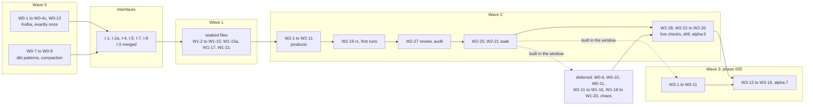

# Phases 004 and 005: the build breakdown

**Question:** what exactly is built in phase 004 (Kraken trades, instruments and the security master) and
phase 005 (the enriched product), in what order, in steps of 15 to 30 minutes, each with its files, its
dependencies and the one command that proves it, and where does the 48-hour soak fall?
**Status:** analysis before the work, not a decision; revised in place on 2026-11-28 after an independent
review, with the maintainer's ruling on each finding (below). Where it differs from an earlier document, these
win, later over earlier: the plan files
[`004-kraken-trades-instruments-security-master.md`](../plans/2026-11-26-unified-product-platform/004-kraken-trades-instruments-security-master.md)
and [`005-the-enriched-product.md`](../plans/2026-11-26-unified-product-platform/005-the-enriched-product.md);
[`DECISIONS-FINAL.md`](./2026-11-26-unified-platform-architecture/DECISIONS-FINAL.md) and the
[decisions addendum](./2026-11-26-decisions-addendum.md); the owner's decisions of 2026-11-28 below; ADR-056, 022,
030, 047, 054, 058, 061 and 062 with their Outcomes; the frozen interfaces
[`phase-001-interfaces.md`](../development/phase-001-interfaces.md) and the schemas under `contracts/schema/`; the
[phases 002 and 003 audit](../audits/2026-11-27-phases-002-003-run-spine-and-serving.md) and `CHANGELOG.md`
3.0.0-alpha.4 to 3.0.0-alpha.5.1. Its shape is the
[phases 002 and 003 breakdown](./2026-11-27-phases-002-003-build-breakdown.md); its step ids (`I-n`, `W0-n` to
`W3-n`) are this document's own. A split step keeps its id with a letter (`W0-4a`); a new step takes the next
free id in its wave.

## Terms used once and then assumed

- **Landing (Kafka):** the Iceberg table `lake.<fence>.landing`, every record of the planned offset range byte
  for byte, control frames included, its end offsets in the snapshot summary of the same commit (ADR-022; columns
  in `model.PLATFORM_TABLES`). The `stream = trade` filter is bronze staging's, not the landing's (departure below).
- **Connector snapshot:** a commit the connector made, marked by its `k2.job` summary property; compaction and
  expiry make snapshots that carry no offsets (`docker/lake/offsets.py`, header).
- **Type-2 (SCD2):** one row per version of a thing, with `valid_from` and `valid_to`; the open row's `valid_to` is
  `9999-12-31 23:59:59` and the first version opens at `1970-01-01` (ADR-030).
- **Optional input:** an input port with `required: false`; a product whose optional input is paused, never
  audited or later than its `maxLagMinutes` is `partial: <inputs>`, else `complete`.
- **Container slot:** the one container job this host runs at a time (a throwaway lake, a Spark run, a
  `make test-dbt`, `make test-airflow`, a promtool run, a deploy). **Unit-only:** a step whose proof starts no
  container.
- **Soaked file:** a file the soak runs: `docker/lake/*`, `docker/dbt-runner/k2_dbt.py`,
  `docker/airflow/dags/factory.py`, `oneshot.py`, and the k2gen emitters under `platform/k2gen/k2gen/emit/`.
- **`$PYTEST`:** `uv run --no-project --with pytest==9.2.0 --with pyyaml==6.0.4 --with fastavro==1.12.2 --with duckdb==1.4.4 pytest`.
- **`$DOCGATES`:** the doc gates that start no container: `python3 scripts/check_docs.py words <files>`, `counts`
  and `data`, and section (a) of `scripts/check-docs.sh` (the relative links) run alone. `make check-docs` starts
  promtool, so it is a slot.

## Review of 2026-11-28 and what changed

An independent review read this breakdown against the tree the same day; the maintainer accepted all thirteen
findings. Each was checked against the code before it was written in.

| # | Finding (evidence) | Change made here |
|---|---|---|
| 1 | `batch_audit` passes only if every planned offset landed (`offsets.py:368`), `offset_gaps` needs `max - min + 1 = n` (`:412`), the landing has no skipped column (`model.py:1236-1243`): a batch with a control frame fails | the landing holds every record of the range; the filter moves to bronze staging (staged plus skipped equals the landing range read); W0-2, W1-3, W1-9, W1-14 reworded; a departure from plan 004, stated below |
| 2 | Bronze staging is keyed by run id (`connector.py:322`): a retry after the landing commit, or a kill between landing and staging, leaves a hole | bronze staged by offset from a through-offset kept in the bronze commit's summary; I-1 freezes the key; W0-2 and W0-4a assert no holes as well as no duplicates |
| 3 | W0-9 covers dbt outputs only; the maintenance key writes nothing (`tests/test_init_lake.py:338`); compacting bronze `main` while `audit` waits breaks the fast-forward (`connector.py:402`) | new W1-21: a Kafka product's landing and bronze compacted with the Spark key in its own DAG, skipped while `audit` is ahead of `main`; a soak start condition |
| 4 | Review and audit at pull-request time would land critical and high fixes to soaked files after the 48 hours | new W2-27: the review and the phase audit on the W2-19 rc before W2-20; W2-26 keeps only what changed after it |
| 5 | `built_here` refuses only a write without this run's client tag (`k2_dbt.py:487`); a compaction carrying the tag passes it | W0-9: after the tests the wrapper accepts only an `operation=replace` snapshot whose parent is the tested one; ADR-061 Outcome line in W2-23; compaction cadence and its cost in W0-12 |
| 6 | The memory floors read the host's `/proc/meminfo` (`run-path-lib.sh:47`, `throwaway-lake.sh:206`); containers run in Docker Desktop's VM | new W0-13: the floors measure the VM |
| 7 | W0-4 needs a Kafka product in the release, W1-2 depends on I-1, I-1 on W0-4: a cycle; five scenarios over 30 minutes | W0-4 split into W0-4a, W0-4b, W0-4c on a synthetic fixture product (k2gen compiles Kafka pipelines already: `emit/pipeline.py:124,139`); I-1 merges after W0-4a |
| 8 | Zero rows for a paused optional input empties a `table` model (security-master's type-2) and rewrites a seven-day merge as `rate_missing` | the owner question restated: the rule is per input, on the input port, default refused for a `table` model consumer; I-4 freezes the field |
| 9 | `make test-airflow` and `make check-alerts` run containers (`Makefile:81-85`, `:145-149`); an rc deploy is a deploy | W1-5, W1-6, W1-12, W1-13, W1-17 are slot; W1-17's proof runs promtool on the compiled rules, since `check-alerts` reads `docker/prometheus/` only |
| 10 | The first run starts at EARLIEST (`offsets.py:132`) with a backlog; no rule for failed runs, a stuck bronze, a capture outage; the reset rule ignored soaked files | the soak starts at zero backlog with a delete-file baseline; the clock restarts on a diff to a soaked file or a bronze stuck 30 minutes; empty and failed runs reported apart |
| 11 | No step for: a paused product resuming at the log start; the derived watermark; the per-product lock against rebuild and restore; W1-6's trigger; the release-check skill | I-1 freezes the first two; I-7 the lock and the trigger (I-3 is merged); W2-25 owns the skill; rows added to the mapping |
| 12 | The archived parity wrapper sources `.env`, reads Lakekeeper on `localhost:18181` (no host port since ADR-059 part 7) and commits `tests/parity/pinned.json` with snapshot ids; `tools` has 256M | W1-18: the pin a row in a platform table, never a file in the repo; `tools` sized there |
| 13 | Restore has no named writer (no engine key writes every warehouse: `tests/test_init_lake.py:329-345`; `scripts/drop.sh:84` uses the root pair); the `holds` writer is unnamed | W0-10 names restore's writer; I-7 names the `holds` writer; every DAG held during a restore |
| I-3 | Merged without the `holds` table: k2gen refuses a second platform table (`emit/lake.py:257-258`) | new I-7 and I-8 own it, with the files it touches |
| W0-5 | Merged; the contract lacks a next link's place in the body (only the `Link` header is read), the page parameter's name and start (fixed as `page=<n>` from 1, `fetch.py:305`) and a per-kind `maxBytes` (`k2-v2.schema.json`, `publicApiConnector`); `connector-failure.md:153` quotes the old message | new W0-14, conditional and not needed for `AssetPairs`; the runbook line goes to W2-24 |
| also | `make check-docs` starts promtool, so a unit step cannot prove with it | unit doc proofs are `$DOCGATES` |

## Method

- **One pull request for both phases**, branch `phase/004-005-kraken-and-enriched`, tag `v3.0.0-alpha.6` at 004's
  exit and `v3.0.0-alpha.7` at 005's. Each step is a short-lived branch merged into the phase branch;
  `v3.0.0-alpha.6-rc.N` tags are what the maintainer deploys between merges.
- **Interfaces first.** Small `I` steps freeze the surfaces several steps share; a step that reads a surface
  depends on its `I` step. An `I` step that a wave 0 proof informs merges after that proof.
- **Riskiest unknowns first** (wave 0), each proven on a throwaway before anything builds on it.
- **Steps of 15 to 30 minutes on disjoint files.** A shared file is edited in the order of the shared-file table.
- **One container job at a time.** Every step is marked `unit` or `slot`. Slot steps form one queue (below); unit
  steps run beside it in parallel. Throwaway scripts refuse to start under their memory floor
  (`scripts/lib/run-path-lib.sh`: 10 GiB available; `throwaway-lake.sh`: 6 GiB), measured in Docker Desktop's VM
  from W0-13 on; until then they read the host.
- **`make spine-e2e` after every merge into the phase branch** (stage table below), `FULL=1` before each tag.
- **A deploy-path change is proven by an rc tag deployed to live before it merges** (rows marked `rc`).
- **Everything the soak runs merges before its clock starts**: every soaked file, and every step that edits one,
  is on the critical path or merged before W2-19's rc is cut.
- **Independent adversarial review** (access, identity, secrets, deploy) and the phase audit with `/audit` run on
  the W2-19 rc before the soak starts (W2-27); critical and high fixed first. What changes after it is reviewed
  again at W2-26. Documents once, at the end of each phase.
- **No real venue data or market-derived numbers are committed.** Every fixture is synthetic: Kafka frames come
  from `services/capture-rust/tests/fixtures/synthetic-kraken-20s.jsonl`, the `AssetPairs` response is written by
  hand in the publisher's format, and a parity pin is a row in a platform table, never a file.

## Departure from plan 004: what the landing holds

Plan 004 says the landing table "holds the kept records byte for byte" (its line 36). This breakdown departs from
it: the landing holds every record of the planned range, trade and control frames alike, and the `stream = trade`
filter runs in bronze staging, whose batch accounting is staged plus skipped equals the landing range read. The
reason: the offset checks reused from phase 001 hold only over an unbroken range. `offsets.batch_audit` passes a
partition only if `end - start` rows landed at `start..end - 1` (`docker/lake/offsets.py:368`), and
`offsets.offset_gaps` calls a partition intact only if `max - min + 1` equals its row count (`:412`); the landing
has no column for a skipped record (`model.py:1236-1243`), so with the filter at the landing every batch holding a
control frame would fail its audit, and skipped counts kept only in summaries would be lost to snapshot expiry.
The raw topic carries trade and control frames only (books have their own topic, and book capture is off), so the
extra bytes on disk are small; the soak's benchmark reports the landing's growth.

## What exists today that each phase reuses

Checked in the tree at `f437254`, with I-3 (`0578ad4`, merged at `71e013f`) and W0-5 (`558a21b`, merged at
`fabfab5`) since landed on the phase branch.

| Piece | Where | What 004 or 005 does with it |
|---|---|---|
| The Kafka and public-API connector kinds, frozen in phase 001 | `contracts/schema/k2-v2.schema.json` (`kafkaConnector`, `publicApiConnector`) | compiled and run; no field added unless a step below proves one missing (W0-14) |
| The Kafka landing's columns and name | `platform/k2gen/k2gen/model.py` (`KAFKA_LANDING`, `PLATFORM_TABLES`); `contracts/schema/pipeline.schema.json` (`landing.table`) | written by the Spark connector, every record of the range |
| A Kafka DAG's shape: no `fetch`, Spark `load`, `audit`, `publish` | `platform/k2gen/k2gen/emit/pipeline.py` (`tasks`) | run by the factory as it is; k2gen compiles a Kafka pipeline today (`emit/pipeline.py:124,139`) |
| Exactly-once offset bookkeeping, pure and tested | `docker/lake/offsets.py`, `tests/test_lake_offsets.py` | reused: `bounded_offsets`, `evicted`, `skip_evicted`, `latest_summary`; `batch_audit` and `offset_gaps` hold because the landing keeps the whole range (departure above) |
| Confluent framing and the broker and registry calls | `docker/lake/wire.py`, `docker/lake/catalog.py` | `wire.py` split from its trade constants (plan 004) |
| Kafka source, Avro codec and Kafka sink in Spark | `docker/spark/Dockerfile` (`spark-sql-kafka-0-10`, `spark-avro`, `kafka-clients` by sha256) | read Redpanda; on a throwaway, also produce synthetic frames |
| The file connector: land, load onto `audit`, audit, publish | `docker/lake/connector.py`, `tests/test_lake_connector.py` | the public-API kind lands through it; the Kafka kind adds its own load beside it, staged by offset, not by run id |
| Daily per-product maintenance with landing expiry at 14 days | `docker/lake/maintain.py` (`LANDING_DAYS = 14`), the maintenance key (reads and deletes, writes nothing) | gains a Kafka branch (never expired); compaction is W1-21's, with the Spark key |
| The fetch container: https-file, and public-api since W0-5 | `docker/fetch/fetch.py` (`PAGINATION`, the `Link` header, `page=<n>`), `tests/test_fetch.py` | `kraken-instruments` fetches through it with pagination `none` |
| The dbt wrapper and its publish guard | `docker/dbt-runner/k2_dbt.py` (`resolve`, `built_here`, `publish`, `verdict`) | gains input lag, input state and a `degraded` result; `warn` tests already pass (`verdict`) |
| `k2_input` | `dbt/macros/k2_input.sql` | an optional input with no snapshot is today a compile error; `I-4` fixes the rule, per input |
| Relationships with `asOf`, policies `delay`, `mask`, `rowScope` | `k2-v2.schema.json` (`relationships`, `relationshipProperty`); `emit/dbt.py` (`_relationship`); `emit/trino_rules.py` | 005's checks read them |
| Roles, the delayed and masked canary | `contracts/access/roles.yaml` (`delayed_reader`); `principals.yaml` (`p.canary-delayed`) | the delay and mask path on Trino 484 is already proven |
| The run record, with each input's `state` and `lagMinutes`, the `offset_gap` event, the `lagMinutes` rule and the product state forms (I-3) | `contracts/schema/run-record.schema.json`; `platform/runs/k2runs.py`; `phase-001-interfaces.md` (I-3's dated section) | the wrapper writes `lagMinutes: None` today (`k2_dbt.py`, `run`) |
| The run path on a throwaway lake | `scripts/verify/run-path.sh` (9 claims), `scripts/lib/run-path-lib.sh`, `scripts/lib/throwaway-lake.sh` | the `run` stage gains a Kafka product and a Redpanda |
| Backup of the compiled backup set; restore classes `restore` and `rebuild` | `scripts/backup-lake.sh`, `scripts/backup_lake.py`; `k2-v2.schema.json` (`backup`) | `make restore` and the drill are new |
| The nightly backup timer, not installed | `make backup-install`, `scripts/systemd/k2-backup.timer` | not installed (owner, 2026-11-28) |
| Topics and their retention | `docker/redpanda/init.sh`: `market.crypto.v3.raw.<ex>`, 12 partitions, 48 h or 2 GiB per partition | `kraken-trades` reads the raw Kraken topic |
| Book capture off on every venue | `config/instruments.yaml` (`book_capture`, ADR-050) | the raw topic holds trade and control frames; bronze staging's filter counts the rest |
| The archived candle model | `legacy/v3-lake-ingest/dbt/models/market_analytics/marts/candles/ohlcv_1m.sql` | the bucket recompute order |
| The `AssetPairs` connector as the architecture drew it | `ARCHITECTURE-V2.md` (`kind: public-api`, `allowHosts: [api.kraken.com]`) | `kraken-instruments`' connector |
| Run times of one file product | `docs/benchmarks/2026-11-27-ecb-fx-run-times.md` | the only measured basis for the chain estimate |

Not there yet: the `holds` table (I-3's dated section says so), `make product-verify`, `make rebuild`,
`make restore`, `make restore-drill`, `make hold`, `make parity-silver`, `scripts/verify/delete-files.sh`, every
chaos script plan 004 names, a `SELECTOR` for `make test-dbt` (`scripts/dbt-test.sh` reads none), DuckDB in the
`tools` image (`docker/tools/Dockerfile`), and any computation of `partial` (no file outside the schemas names it).

## Owner decisions

**Taken (2026-11-28):**

| Decision | Consequence here |
|---|---|
| The Kafka landing is never expired (plan option (a)); no ADR | `maintain.py`'s 14-day expiry stays for file landings (O6) and never touches `lake.<fence>.landing`; snapshot expiry still runs on it, never past the newest connector snapshot. The landing now keeps control frames too (departure above); the soak's benchmark reports its growth on disk |
| `LAKEKEEPER_ENCRYPTION_KEY` is deferred | the first restore drill reads it from `.env` on this host, so it does not prove a host loss; that stays open for the 3.0 gate |
| The nightly backup timer is not installed yet | the drill runs after a manual `make backup`; the scheduled path stays unproven |
| The review's thirteen findings, all accepted (2026-11-28) | applied to the tables below, each listed in the review section above |

**Still open:**

| Question | Options and each one's consequence | Needed by |
|---|---|---|
| FX content at 3.0 | (a) `ecb-fx-rates`, `fx-crosses`, `candles-eur` only: phase 005 is `W3-1` to `W3-16` without `W3-13`. (b) Also the old P4 content (returns, volatility, bars in reporting currencies, the stablecoin basis and its decomposition, `make parity-fx`): `W3-13` grows to about eight steps and one more container slot each; the architecture judged it at about 3 more days. The addendum of 2026-11-26 records the owner choosing (a), "capability only"; plan 005 still lists it as open, so this asks whether (a) stands | `W3-5` |
| `k2_as_of`'s signature, frozen before 005 builds (`I-6`) | Proposed: `k2_as_of(fact_time, target_alias, mode)`, a join predicate over the target's `valid_from` and `valid_to` (`mode='valid'`) or `recorded_at` (`mode='known'`), half-open `[valid_from, valid_to)`. Taking the target relation instead of an alias would let the macro also pin it through `k2_input`, one call per join, at the cost of one more argument kind to test | `W3-1` |
| The `relationships` and `asOf` rules | Proposed: a relationship names an existing column of the same physical type in a non-retired product, in the host-less form the schema's pattern already holds; a target table with `valid_from` requires `asOf`. A stricter rule (the target must be a declared input port of the referring product) makes every relationship test runnable through `k2_input` and refuses a reference the build never reads (`docs.foreign-key-not-read` exists today) | `W3-2` |
| An optional input with no audited snapshot | Ruled (finding 8): the rule is per input, declared on the input port, and for a consumer built as a `table` model the default is refused: the build fails and the output keeps its `audited` tag, since zero rows would rebuild it empty (a paused `kraken-instruments` would empty `security-master`'s type-2 tables). Open, for an incremental consumer: zero rows of the contracted columns (a paused ECB gives `rate_missing` at once, and `candles-eur`'s seven-day merge rewrites seven days of rated rows as `rate_missing`), or the last audited snapshot (stale rates until the carry limit, a `partial` badge with full-looking rows). Consequence for I-4: it freezes the port field and both renderings, and W0-7 tests each | `W0-7` |

## Interfaces first

| Id | Freezes | Files | Profile | Proof | Depends on |
|---|---|---|---|---|---|
| I-1 | A Kafka product's pipeline: bronze key `(kafka_partition, kafka_offset)` and its lineage columns; the summary keys `k2.kafka-offsets` on landing commits, `k2.src-snapshot-id` and a per-partition through-offset on bronze commits (the last landing offset bronze has staged through; trailing control frames mean `max(kafka_offset)` is not it); bronze accounting, staged plus skipped equals the landing range read; the envelope contract's home (a `raw_message` contract under `market-capture`); the accept-data-loss `conf` shape; a paused product whose resume point fell below the log start is the below-log-start case (fails loudly, the accept-data-loss run records `offset_gap`), never a silent resume at the log start; the watermark a derived product reads from a Kafka input (the landing's offsets or its landing time, one named) | `contracts/schema/pipeline.schema.json`, `platform/k2gen/k2gen/model.py` (`SNAPSHOT_SUMMARY_KEYS`), `docs/development/phase-001-interfaces.md` (a dated section) | unit | `make test-k2gen` exits 0 | W0-4a |
| I-2a | The public-API spool for one page, as W0-5 lands it: `raw.1.json`, `fetch.json` listing the page with its sha256, the request log, `volatileFields` stripped only for the change test, never from the landed bytes | `docs/development/phase-001-interfaces.md`, `contracts/schema/k2-v2.schema.json` (descriptions only) | unit | `make test-k2gen` exits 0 | W0-5 |
| I-2b | The spool for several pages: one `raw.<n>.json` per changed page, staged as one batch | as I-2a | unit | `make test-k2gen` exits 0 | W0-6 |
| I-3 | **Merged** (`0578ad4`, at `71e013f`). Run-record additions: event `offset_gap` (accept-data-loss), the `lagMinutes` rule (now minus the input's audited commit time), the state forms `complete` / `partial: <inputs>` / `degraded`. The `holds` table was left out: k2gen refuses a second platform table (`emit/lake.py:257-258`); I-7 and I-8 own it | `contracts/schema/run-record.schema.json`, `platform/runs/run_record.sql`, `docs/development/phase-001-interfaces.md` | unit | `make test-platform && make test-k2gen` exit 0 | none |
| I-4 | `k2_input` for an optional input with no audited snapshot, per input (owner question above): the input port's field, the default refused for a `table` model consumer, the two renderings for an incremental one | `contracts/schema/k2-v2.schema.json` (the input port's field), `dbt/macros/k2_input.sql` (its header contract only), `docs/development/phase-001-interfaces.md` (A7, dated line) | unit | `make test-k2gen` exits 0; W0-7's cases hold the rule | W0-7 |
| I-5 | Per-product alerts and dashboards: what Prometheus reads (Airflow statsd per DAG for failure and duration, today's only per-DAG series) and what the page reads (run records, through the catalog site as `svc.catalog`); emitted into the release, read through Prometheus's pointer | `docs/development/phase-001-interfaces.md`, `platform/k2gen/INTERFACES.md` | unit | `$DOCGATES` pass | none |
| I-6 | `k2_as_of`'s signature and the relationship, `asOf` and inheritance rules (owner questions above) | `docs/development/phase-001-interfaces.md`, `contracts/schema/k2-v2.schema.json` (descriptions) | unit | `make test-k2gen` exits 0 | owner's answer |
| I-7 | The `holds` table (columns `product_id`, `reason`, `held_by`, `held_at`, `released_at`, in the governance build catalog) as k2gen's second platform table, and what I-3 left unsaid: its writer (proposed: `svc.runs`, which writes the run records through `governance_build` already); the per-product lock, a `holds` row that `make rebuild` and `make restore` write before they start and a DAG's `resolve` honours; every DAG held during a restore; W1-6's trigger (how a degraded build starts the instruments run) | `platform/k2gen/k2gen/model.py` (`RUN_RECORD_SQL`, `PLATFORM_TABLES`, `RESERVED_PRODUCT_NAMES`), `emit/lake.py` (the platform-table guard, the DDL emit, the retention and backup-set emits), `emit/trino_rules.py`, `tests/test_frozen_interfaces.py`, the lake goldens (`platform/k2gen/tests/golden/lake/`), `docs/development/phase-001-interfaces.md` | unit | `make test-k2gen && $PYTEST tests/test_frozen_interfaces.py -q` exit 0 | I-3 |
| I-8 | The `holds` table through deploy, the drift check and the access suite: deploy creates it and reads it; the drift check knows it; its read and write rows | `scripts/deploy.py`, `scripts/verify/catalog_drift.py`, `scripts/access_verify.py`, `tests/access/expectations.yaml`, `contracts/access/` | unit, rc | `$PYTEST tests/test_deploy.py tests/access -q`; its rows run in W2-10's `access-verify`, its deploy in W2-19's rc | I-7 |

I-7 edits k2gen emitters, so it merges before W2-19's rc is cut: after the soak starts, the change would restart it.

## Wave 0: the unknowns

| Id | Unknown | Why risky | Throwaway proof | Command | Profile | Fallback if it fails |
|---|---|---|---|---|---|---|
| W0-1 | Offsets planned from the landing's newest connector snapshot, bounded per partition, eviction refused with the partitions named (pure). **In flight**, with findings 1 and 2 applied | the resume point is one JSON value in a summary; ADR-022's Outcome: a bound under the arrival rate makes eviction certain | `docker/lake/kafka.py` (new) `plan()` over `offsets.py`, `tests/test_lake_kafka.py` (new) | `$PYTEST tests/test_lake_kafka.py tests/test_lake_offsets.py -q` | unit | none needed: pure code |
| W0-2 | One Spark commit writes every record of the planned range and its end offsets; bronze is staged from the landing by offset, per partition every landing row after the bronze through-offset up to the landing's end, filtered `stream = trade`, staged plus skipped equal to the range read; a blocked bronze still lands (ADR-047), and a retry or a kill between landing and staging leaves no hole. **In flight** with W0-1 | two writes in two commits would be ADR-022's two facts in two systems; staging keyed by run id (`connector.py:322`) never stages a retry's new range | `docker/lake/kafka.py` `land()`, `stage()`; `docker/lake/connector.py` dispatch on kind | as W0-1 | unit | none: W0-4a proves it live |
| W0-3 | A throwaway lake with a Redpanda on compose's pinned image, the RawMessage subject registered from `schemas/avro/raw-message.avsc`, synthetic frames produced by Spark's Kafka sink with `to_avro` and the Confluent header. **In flight** | the `run` stage has no broker today; `k2-capture replay` has no Kafka sink, by design | `scripts/lib/throwaway-lake.sh` (`redpanda_up`), `scripts/lib/kafka_seed.py` (new) | `bash scripts/lib/throwaway-lake.sh up kafka-seed <release> && bash scripts/lib/throwaway-lake.sh down kafka-seed`, the seed's count line equal to the fixture's frame lines | slot | `rpk topic produce --schema-id` in the Redpanda container, if its `rpk` encodes Avro |
| W0-4a | On the throwaway, a synthetic fixture product `kafka-fixture` (`platform/k2gen/tests/fixtures/`, never a 004 product): one load lands every seeded frame and stages the trades; a load killed before and after its landing commit adds no row twice and leaves no hole in bronze; a retry under the same run id stages the new range; Spark's own key writes warehouse `k2` | the plan's first exit line; the cycle W0-4, W1-2, I-1 is broken by a fixture k2gen already compiles | `scripts/verify/kafka-path.sh` (new), the fixture product | `bash scripts/verify/kafka-path.sh <release> a` prints `0 FAIL`, exit 0 | slot | resume from `max(kafka_offset) + 1` per partition read from the landing itself, the summary kept as a cross-check |
| W0-4b | Below the log start fails loudly, naming the partitions; the accept-data-loss run records `offset_gap`; a paused product resumed after its point left the log is the same case, never a silent jump | the rule I-1 freezes, proven before it is relied on | `scripts/verify/kafka-path.sh` (group b) | `bash scripts/verify/kafka-path.sh <release> b` prints `0 FAIL` | slot | none: a loud failure is the safe default |
| W0-4c | After a compaction and an expiry on the landing and bronze, the next run still resumes from the newest connector snapshot | compaction and expiry make offset-less snapshots, and ADR-022 says expiring the last connector one restarts from the earliest offset | `scripts/verify/kafka-path.sh` (group c) | `bash scripts/verify/kafka-path.sh <release> c` prints `0 FAIL` | slot | as W0-4a's |
| W0-5 | **Merged** (`558a21b`, at `fabfab5`). The public-API fetch: `next-link` and `page` pagination up to `maxPages`, `minIntervalS` between requests, every hop through the existing address guard, `volatileFields` ignored for the change test, every fetch logged | a second page is a second redirect-free request the guard must also check | `docker/fetch/fetch.py`, `tests/test_fetch.py` | `make test-connectors` exits 0, every socket faked | unit | pagination `none` only |
| W0-6 | A run with several pages lands one object per changed page and stages them as one batch | `connector.py` loads exactly one `raw.<ext>` per run today | `docker/lake/connector.py` (load of N files), `tests/test_lake_connector.py` | `$PYTEST tests/test_lake_connector.py -q` | unit | one object per run, the pages concatenated by fetch in a JSON array |
| W0-7 | An optional input that is paused or never audited: the wrapper passes no snapshot and, per the input port's rule (I-4), `k2_input` renders zero rows of its columns or the last audited snapshot, and a `table` model consumer is refused by default; the run record says `paused` and its lag | today it is a compile error (`k2_input.sql`, header), and zero rows would empty a `table` model | `dbt/macros/k2_input.sql`, `dbt/tests/k2_input/`, `docker/dbt-runner/k2_dbt.py` (`resolve`), `docker/dbt-runner/test_k2_dbt.py` | `make test-dbt && $PYTEST docker/dbt-runner -q` (the render cases are `scripts/dbt-test.sh` step 4) | slot | refuse every optional input with no snapshot, so the product fails rather than goes `partial` |
| W0-8 | Three dbt patterns through the wrapper on a throwaway lake: (a) type-2 from a listing as a `table` model with window functions, rebuilt equal by `--full-refresh`; (b) a held table plus a silver that takes held rows back once they resolve; (c) a `warn` test that publishes and reports `degraded` | the publish guard knows only statements carrying this run's client tag (alpha.4, Fixed); dbt snapshots would hold history nowhere else, so `make rebuild` and the `rebuild` backup class could not recreate it, and their first version opens at the first run, not `1970-01-01` | `scripts/verify/dbt-patterns.sh` (new), a fixture product set under `platform/k2gen/tests/fixtures/` | `bash scripts/verify/dbt-patterns.sh` prints `0 FAIL`, exit 0 | slot | (b) as a `delete+insert` incremental; (a) as an incremental merge keyed with the partition column (spike (a)) |
| W0-9 | Compaction of a dbt output moves `main` past its `audited` tag, and the next build's reconcile would restore it; the proof: compaction inside the wrapper after the tests and before the tag commit (`ALTER TABLE ... EXECUTE optimize` as the builder), on a stated cadence, then `audited`; after the tests the wrapper accepts only a snapshot with `operation=replace` whose parent is the tested snapshot, since `built_here` passes any write carrying the client tag (`k2_dbt.py:487`); delete files counted before and after; the ADR-061 Outcome line is W2-23's | the plan's soak exit is a delete-file bound; maintenance writing a data-preserving snapshot is a write the marker's invariant never met | `scripts/verify/dbt-patterns.sh` (claim 4), `docker/dbt-runner/k2_dbt.py` | as W0-8 | slot | maintenance compacts and moves the tag by the same compare-and-set commit, recording `audited` with its reason |
| W0-10 | `make restore` on a throwaway: every DAG held first (I-7); a `restore` table's copy put back in MinIO and registered in Lakekeeper; a `rebuild` table's entry dropped without purge, recreated and rebuilt; the Lakekeeper database from its dump with the key from `.env`; tags equal to run records after. Its MinIO writer named before it writes (proposed: a `restore` key of its own, never the root pair, since no engine key writes every warehouse) | never drilled (plan README, open items); Iceberg metadata holds absolute paths | `scripts/restore.py` (new), `scripts/verify/restore.sh` (new) | `bash scripts/verify/restore.sh <release>` prints `0 FAIL` and its time | slot | restore by rebuild for every table but the landings and run records |
| W0-11 | DuckDB in `tools` reads the Kafka landing at a pinned snapshot through Lakekeeper with the read-only `tools` key, its Iceberg extension baked into the image | `tools` has no DuckDB; an extension fetched at run time is a network call the image must not make | `docker/tools/Dockerfile`, `scripts/verify/duckdb-landing.sh` (new) | `bash scripts/verify/duckdb-landing.sh <release>` exit 0 | slot | the plan's lighter form of `parity-silver`: accounting plus unit tests plus the determinism check (owner's choice) |
| W0-12 | Whether the five-minute chain fits: a prediction from W0-4's Spark task times and W0-8's build times, with W0-9's and W1-21's compaction at their cadence, written before the soak, then measured by it | the ECB run that landed a new file took 121.7 s end to end and an unchanged one at most 34.8 s (the benchmark above); `kraken-trades`, `canonical-trades` and `candles` in series could approach the 200 s escape line | the numbers in the step's pull request, labelled a prediction | none: an estimate, scored by the soak | unit | the plan's escapes in order: one Spark driver for `load`, `audit` and `publish` of a Kafka product; Spark Connect; derived products every 15 minutes |
| W0-13 | The memory floors measure Docker Desktop's VM, where the containers run, not the host's `/proc/meminfo` (`run-path-lib.sh:47`, `throwaway-lake.sh:206`) | a floor read on the host can pass while the VM is short, the failure the one-slot rule exists for | `scripts/lib/run-path-lib.sh`, `scripts/lib/throwaway-lake.sh`, `tests/test_memory_floor.py` (new: a stub `docker` on `PATH`) | `$PYTEST tests/test_memory_floor.py -q`, each script refusing under its floor | unit | the floors raised by the host's surplus over the VM's size |
| W0-14 | Conditional: the public-API contract's three missing fields, a next link's place in the body, the page parameter's name and start (fixed as `page=<n>` from 1, `fetch.py:305`), and a per-kind `maxBytes` (only `httpsFileConnector` has one). Needed before `kraken-instruments` only if `AssetPairs` needs one; it does not: it is a single unpaginated response, so pagination `none` suffices for this phase | a field added later moves a frozen contract | `contracts/schema/k2-v2.schema.json`, `docker/fetch/fetch.py`, `tests/test_fetch.py` | `make test-connectors && make test-k2gen` exit 0 | unit | none needed in this phase |

**Assessed and dropped as unknowns:**

- **A landing per product for topic data (format, object naming, conditional PUT):** the format is frozen (an
  Iceberg table, `pipeline.schema.json` `landing.table`, `model.KAFKA_LANDING`), and naming and the conditional PUT
  belong to the fetch kinds, proven in phase 002 (`connector.py`, `run-path.sh` claims 2 and 5). The atomicity that
  remains is W0-2 and W0-4a.
- **Spark reading Redpanda with the engine's own key:** Redpanda takes no credential, Spark is on `k2-net` with it,
  and the Spark key's reach in warehouse `k2` is proven (`scripts/verify/storage-keys.sh`). Folded into W0-4a.
- **The delayed role's row filter and a null connection id:** proven on Trino 484 by the canary's
  `p.canary-delayed` and its rows; what is new is two expectation rows (`W2-10`).
- **Pool contention as a throwaway test:** a throwaway Airflow can only run stand-in tasks, and the build's rule is
  no stand-ins; W0-12 predicts it from measured parts and the soak measures it.

## Wave 1: phase 004's platform

| Id | Builds | Files owned | Profile | Proof | Depends on |
|---|---|---|---|---|---|
| W1-1 | `wire.py`'s framing split from its trade constants | `docker/lake/wire.py`, `tests/test_wire_format.py` | unit | `$PYTEST tests/test_wire_format.py -q` | none |
| W1-2 | k2gen compiles a Kafka product (bronze per `I-1`, the landing in the backup set as `restore`, no landing expiry) and a public-API product (`I-2a`) | `platform/k2gen/k2gen/emit/pipeline.py`, `emit/lake.py`, `platform/k2gen/tests/` | unit | `make test-k2gen` exits 0 | I-1, I-2a, I-7 |
| W1-3 | The Kafka audit: `offsets.batch_audit` on the landing batch (every planned offset landed); bronze staged plus skipped equals the landing range read; frames parse, keys unique; one `audit_checks` row each | `docker/lake/kafka.py`, `tests/test_lake_kafka.py` | unit | `$PYTEST tests/test_lake_kafka.py -q` | W0-2 |
| W1-4 | Publish by one REST commit requiring both `main` and `audit` (open item F8); a bad argument exits 1, not 2 (audit MED 28); the test header's dead script name (MED 11) | `docker/lake/connector.py`, `tests/test_lake_connector.py` | unit | `$PYTEST tests/test_lake_connector.py -q` | W0-2 |
| W1-5 | The factory passes an accept-data-loss `conf` to `load` and records `offset_gap` | `docker/airflow/dags/factory.py`, `docker/airflow/tests/test_factory.py` | slot | `make test-airflow` exits 0 | I-1, I-3 |
| W1-6 | A degraded build starts the instruments run (the trigger I-7 freezes) | `docker/airflow/dags/factory.py`, tests | slot | `make test-airflow` exits 0 | W1-5, W0-8, I-7 |
| W1-7 | The wrapper writes each input's `lagMinutes` and state (the watermark I-1 names for a Kafka input), and `degraded` in its result | `docker/dbt-runner/k2_dbt.py`, `docker/dbt-runner/test_k2_dbt.py` | unit | `$PYTEST docker/dbt-runner -q` | W0-7, W0-9, I-1, I-3 |
| W1-8 | `k2runs.state(product)`: `complete`, `partial: <inputs>` or `degraded`; the catalog page shows it | `platform/runs/k2runs.py`, `platform/catalog-site/k2site.py`, their tests | unit | `make test-platform` exits 0 | I-3 |
| W1-9 | `maintain` for a Kafka product: snapshots by retention, never the newest connector snapshot, the landing never expired; whole-table offset continuity over the landing (`offsets.offset_gaps`), which holds since it keeps every record | `docker/lake/maintain.py`, `tests/test_lake_maintain.py` | unit | `$PYTEST tests/test_lake_maintain.py -q` | W0-4c |
| W1-10 | Orphan cleanup with a 24-hour floor; freshness alerts skip a product while it maintains | `docker/lake/maintain.py`, tests | unit | as W1-9 | W1-9 |
| W1-11 | `make hold PRODUCT= REASON=` and `make unhold`: pause the DAG, write the `holds` row as I-7's writer | `scripts/hold.py` (new), `tests/test_hold.py` (new), `mk/run.mk` | unit | `$PYTEST tests/test_hold.py -q` | I-8 |
| W1-12 | Deploy never unpauses a held DAG (and audit LOW 40, a DAG paused mid-drain) | `scripts/deploy.py`, `tests/test_deploy.py` | slot, rc | `$PYTEST tests/test_deploy.py -q`; live, `make hold` then an rc deploy leaves it paused | W1-11 |
| W1-13 | `release-verify` runs the live suite for the published products when others are pending (MED 18) | `scripts/deploy.py`, `scripts/access_verify.py`, tests | slot, rc | `$PYTEST tests/test_deploy.py tests/access/test_access_verify.py -q`; an rc deploy | W1-12 |
| W1-14 | `make product-verify PRODUCT=`: every offset accounted (each landing span whole, spans abut; bronze staged plus skipped equals each span), layers level, a second run adds nothing | `scripts/product_verify.py` (new), `tests/test_product_verify.py` (new), `mk/run.mk` | unit | `$PYTEST tests/test_product_verify.py -q` | W1-3 |
| W1-15a | `k2-dbt build --full-refresh`: the wrapper's flag, merged before the soak since `k2_dbt.py` is soaked | `docker/dbt-runner/k2_dbt.py` (flag), `docker/dbt-runner/test_k2_dbt.py` | unit | `$PYTEST docker/dbt-runner -q` | W1-7 |
| W1-15b | `make rebuild PRODUCT=`: the product held through I-7's lock, bronze restaged from the landing, then the flag | `scripts/rebuild.py` (new), `tests/test_rebuild.py` (new), `mk/run.mk` | unit | `$PYTEST tests/test_rebuild.py -q` | W1-15a, I-7 |
| W1-16 | `make restore` generated from the backup set, and `make restore-drill` printing its time; the drift check's `--runs` (MED 19) | `scripts/restore.py`, `scripts/verify/catalog_drift.py`, `mk/run.mk`, tests | unit | `$PYTEST tests/test_restore.py -q` | W0-10 |
| W1-17 | Per-product alert rules and dashboards emitted into the release (`I-5`) | `platform/k2gen/k2gen/emit/alerts.py` (new), `platform/k2gen/tests/` | slot, rc | `make test-k2gen`; promtool `check rules` and `test rules` over a scratch release's compiled rules (`make check-alerts` reads `docker/prometheus/` only, `Makefile:145-149`); an rc deploy | I-5 |
| W1-18 | `make parity-silver PRODUCT=` (DuckDB recomputes `silver_trade` from the landing) and `make parity-ohlcv` on the new tables, in `tools` with the read key; the archived wrapper's `.env` sourcing and `localhost:18181` replaced; the pin a row in a platform table, never a file in the repo; `tools` sized for DuckDB (256M today), with ADR-010's Outcome and the compose summary | `scripts/parity_silver.py` (new), `scripts/parity_ohlcv.py` (from the archive), `mk/run.mk`, `docker-compose.yml` (`tools` limits), `docs/adr/ADR-010-resource-budget.md` (Outcome), tests | unit | `$PYTEST tests/test_parity_silver.py -q`; `python3 scripts/check-budget.py` passes | W0-11 |
| W1-19 | The replay export over the Kraken landing, in `tools` | `scripts/replay_export.py` (from the archive), tests | unit | `$PYTEST tests/test_replay_export.py -q` | W0-11 |
| W1-20 | Notebooks through Trino as a named principal over TLS; `make test-notebooks` stops being a SKIP | `notebooks/` (new), `Makefile` (`test-notebooks`) | slot | `make test-notebooks` exits 0 on a throwaway lake | W2-11 |
| W1-21 | Compaction of a Kafka product's landing and bronze with the Spark key, inside the product's own DAG, skipped while bronze's `audit` is ahead of `main` (a compaction there breaks the fast-forward, `connector.py:402`); the maintenance key stays without a write | `docker/lake/maintain.py`, `tests/test_lake_maintain.py`, `docker/airflow/dags/factory.py` (the Spark key for that pass) | unit | `$PYTEST tests/test_lake_maintain.py -q`; live, a soak start condition | W1-10, W0-4c |

## Wave 2: phase 004's products, live, the soak, the exit

Product documents follow `contracts/fx-reference/ecb-fx-rates/` (product file, one `.odcs.yaml` per table,
`grants.yaml`, `models/`, `unit_tests.yml`). Each model step's proof is `make test-dbt SELECTOR=<product>` (a slot,
W3-4) plus, from W2-19, its first live run.

| Id | Builds | Files owned | Profile | Proof | Depends on |
|---|---|---|---|---|---|
| W2-1 | `kraken-trades` documents: the Kafka connector on `market.crypto.v3.raw.kraken`, the landing of every record, bronze staging's filter `stream in [trade]`, `bronze_trade` keyed by partition and offset, the `raw_message` envelope contract | `contracts/market-capture/kraken-trades/` (new) | unit | `bash scripts/verify/ci-validate.sh <out dir>` exits 0 | W1-2 |
| W2-2 | `silver_trade`: one typed row per trade by `UNNEST ... WITH ORDINALITY`, every delivery kept and flagged; unit tests on synthetic rows | `contracts/market-capture/kraken-trades/models/` | slot | `make test-dbt SELECTOR=kraken_trades` exits 0 | W2-1, W3-4 |
| W2-3 | `silver_trade_unresolved`, owner-only; silver takes held rows back once they resolve; the `warn` audit "unresolved rows = 0" (W0-8's pattern) | `contracts/market-capture/kraken-trades/models/`, `grants.yaml` | slot | `make test-dbt SELECTOR=kraken_trades` | W2-2, W2-7 |
| W2-4 | `kraken-instruments` documents: the public-API connector to `AssetPairs`, hourly, pagination `none`; the parser with a hand-written synthetic response and its audits | `contracts/market-capture/kraken-instruments/` (new), `domains/market-capture/` (new) | unit | `$PYTEST domains/market-capture -q`; `ci-validate.sh` | W1-2, W0-5 |
| W2-5 | `silver_listing`, one row per pair and version; unit tests | `contracts/market-capture/kraken-instruments/models/` | slot | `make test-dbt SELECTOR=kraken_instruments` | W2-4 |
| W2-6 | `security-master` documents and seeds: `code_exceptions.csv` (owner reviews it), `stablecoins.csv`, the currency master for fiat; its input port on `kraken-instruments` declares the I-4 rule (refused, a `table` model consumer) | `contracts/reference-data/security-master/` (new) | unit | `ci-validate.sh` exits 0 | W2-5, I-4 |
| W2-7 | `asset`, and `instrument` and `venue_symbol` as type-2 (W0-8 (a)); unit tests: a trade before its symbol's first fetch resolves through the `1970-01-01` version, a spelling claimed twice is held for that venue only | `contracts/reference-data/security-master/models/` | slot | `make test-dbt SELECTOR=security_master` | W2-6, W0-8 |
| W2-8 | `canonical-trades`, an incremental union over its venue input ports, Kraken the only one, `required: false` with its I-4 rule | `contracts/market-analytics/canonical-trades/` (new) | slot | `make test-dbt SELECTOR=canonical_trades` | W2-3, I-4 |
| W2-9 | `candles` at 1m, 5m, 1h and 1d, each touched bucket recomputed in the archived model's order; `delay` on `window_end` for `delayed_reader`; unit tests | `contracts/market-analytics/candles/` (new) | slot | `make test-dbt SELECTOR=candles` | W2-8 |
| W2-10 | Grants and rows: `svc.partner-dashboard` as `delayed_reader` on `silver_trade` (nothing newer than 20 minutes, `conn_id` and `conn_msg_seq` null, bronze and the held table denied); a consumer's read row on `candles.ohlcv_1d`; I-8's `holds` rows run here | `contracts/access/principals.yaml`, the products' `grants.yaml`, `tests/access/expectations.yaml` | slot | `make access-verify RELEASE=<scratch release>` exits 0 | W2-9, I-8 |
| W2-11 | spine-e2e `run` widened: on the throwaway with W0-3's Redpanda, the synthetic `AssetPairs` spool, then frames produced; instruments, security master, trades, canonical trades and candles, each through its tasks; the delayed rows | `scripts/verify/run-path.sh`, `scripts/lib/run-path-lib.sh`, `scripts/verify/spine-e2e.sh` | slot | `ONLY="run" make spine-e2e` prints `PASS run` | W2-10, W0-3, W0-13 |
| W2-12 | `kafka-connector-kill.sh`: a load killed mid-run resumes exactly once | `scripts/chaos/kafka-connector-kill.sh` (new) | slot | it exits 0 on a throwaway | W2-11 |
| W2-13 | `kafka-below-log-start.sh`: the log start moved past the resume point (the pinned Redpanda's delete-records command, checked in the step); the run fails loudly; the accept-data-loss run records `offset_gap` | `scripts/chaos/kafka-below-log-start.sh` (new) | slot | exits 0 | W2-11, W1-5 |
| W2-14 | `unknown-symbol.sh`: held, `degraded`, instruments run started, other symbols publish | `scripts/chaos/unknown-symbol.sh` (new) | slot | exits 0 | W2-11, W1-6 |
| W2-15 | `bronze-failed-then-repaired.sh`: landing keeps advancing while bronze waits; the repaired batch reaches silver | `scripts/chaos/bronze-failed-then-repaired.sh` (new) | slot | exits 0 | W2-11 |
| W2-16 | `venue-test-fails.sh`: `canonical-trades` and `candles` unchanged | `scripts/chaos/venue-test-fails.sh` (new) | slot | exits 0 | W2-11 |
| W2-17 | `pause-input.sh <product>`: the derived product runs and shows `partial` | `scripts/chaos/pause-input.sh` (new) | slot | `bash scripts/chaos/pause-input.sh kraken-trades` exits 0 | W2-11, W1-8 |
| W2-18 | `scripts/verify/delete-files.sh`: every silver table's delete-file count, under its bound at the end; its first live run is the soak's baseline | `scripts/verify/delete-files.sh` (new) | unit | `bash -n`; its live runs are the soak's start and end | W0-9 |
| W2-19 | Live, deploy and first runs only: an rc deploy with every 004 product; the first runs drain the backlog from EARLIEST; `make release-verify` | none (the rc tag) | slot, rc | `make release-verify` exits 0; each product's first runs succeed | W2-11, W0-12, W1-15a, W1-17, W1-21, I-8 |
| W2-27 | The independent adversarial review (access, identity, secrets, deploy) and the phase audit on the W2-19 rc; critical and high fixed first, each fix merged and on a new rc before the soak | `docs/audits/` (new file) | unit (each fix takes its own profile) | the audit's table holds; `$DOCGATES` pass | W2-19 |
| W2-20 | **The soak starts**: 48 hours of five-minute runs, under the start conditions and restart rules below | none | wall-clock | `make release-verify` and `delete-files.sh` at its start, the time noted | W2-27, W2-18 |
| W2-21 | The soak ends: `delete-files.sh` against the baseline, the chain's p50 and p90 with n per step, empty and failed runs apart, the landing's growth on disk, published by `/benchmark-report` | `docs/benchmarks/` (new file) | slot | `make check-docs` exits 0 with a command per row | W2-20 |
| W2-28 | Live checks moved out of W2-19: `make product-verify`, `make parity-silver`, `make parity-ohlcv`, `make access-verify LIVE=1` (in the soak window, each logged as an overlap, or after it); `make hold` then `make unhold`, and W1-12's rc deploy, after it | none (the rc tag) | slot | each command exits 0 | W2-21, W1-11 to W1-14, W1-18 |
| W2-22 | The restore drill on the live, disposable volumes, after a manual `make backup`, every DAG held: `make restore-drill` passes and prints its time | `docs/runbooks/lake-backup-and-restore.md` (the drill's record) | slot | `make backup && make restore-drill` exits 0 | W2-28, W1-16 |
| W2-23 | ADR-063 (the Kafka connector with a landing per product: gives up ADR-021's shared archive, keeps ADR-022 and ADR-047); Outcomes on ADR-022, ADR-030 and ADR-061 (W0-9's compaction after the tests); the ADR-010 Outcome line if any limit moved | `docs/adr/` | unit | `$DOCGATES` pass | W2-21 |
| W2-24 | Runbooks, each command run first: onboard a Kafka product, onboard a public-API product, pause, resume, deprecate and retire, hold, accept data loss, backup, restore and rebuild from empty; `connector-failure.md`'s fetch messages (line 153 quotes the https-file-only one) | `docs/runbooks/` (six new, two widened) | unit | `$DOCGATES` pass | W2-22 |
| W2-25 | dbt labs 4 (`UNNEST WITH ORDINALITY`, window flags) and 5 (type-2 from listings); chapter 23; current-state documents (`CLAUDE.md`, `README.md`, `docs/development/spine-e2e.md`); the release-check skill on the new names | `docs/development/dbt-labs/`, `docs/architecture/23-*.md` (new), `.claude/skills/release-check/`, those files | unit | `$DOCGATES` pass | W2-22 |
| W2-26 | A review of what changed after W2-27 (hold, deploy, restore, parity), its critical and high fixed, `Resolved in` lines on W2-27's audit; a scratch `make release` against real images, `FULL=1 make spine-e2e`, tag `v3.0.0-alpha.6` | W2-27's audit (appended lines) | slot | `make release TAG=<scratch tag>` exits 0 | all of 004 |

## Wave 3: phase 005

| Id | Builds | Files owned | Profile | Proof | Depends on |
|---|---|---|---|---|---|
| W3-1 | `k2_as_of` per `I-6`; unit tests on each boundary: exactly on `valid_from` picks the new version, `1970-01-01`, `9999-12-31 23:59:59`, `valid` against `known` | `dbt/macros/k2_as_of.sql` (new), `dbt/tests/k2_as_of/` (new), `scripts/dbt-test.sh` (its cases) | slot | `make test-dbt` exits 0 | I-6, W3-4 |
| W3-2 | Checks: a relationship names an existing, same-typed column of a non-retired product; a target with history requires `asOf`; a failing fixture each | `platform/k2gen/k2gen/checks/docs.py`, `platform/k2gen/tests/fixtures/` | unit | `make test-k2gen`: each fixture fails its code | I-6 |
| W3-3 | Checks: no output policy weaker than an input's (a `delay` never earlier, a masked column masked or dropped, a transform as strict); a failing fixture each | `platform/k2gen/k2gen/checks/access.py`, fixtures | unit | `make test-k2gen` | I-6 |
| W3-4 | `make test-dbt SELECTOR=<selector>` builds one product with its inputs on the throwaway; moved first in the queue, since every model step's proof uses it | `scripts/dbt-test.sh` | slot | `make test-dbt SELECTOR=calendars` exits 0 | none |
| W3-5 | `candles-eur` documents: namespace `candles_eur`, `ohlcv_1d_eur`, four optional inputs from three domains with their I-4 rule, key `(venue, instrument_id, window_start)`, `delayed_reader` 20 minutes on `window_end` | `contracts/market-analytics/candles-eur/` (new) | unit | `ci-validate.sh` exits 0 | W2-26, W3-2, W3-3 |
| W3-6 | The model: instrument as at `window_end` (valid), the quote asset's currency, the newest rate published by `window_end` (known), `rate_missing` for a stablecoin or crypto quote, seven days back; unit tests | `contracts/market-analytics/candles-eur/models/` | slot | `make test-dbt SELECTOR=candles_eur` exits 0 | W3-5, W3-1, W3-4 |
| W3-7 | `fx-crosses`: the `fx_rates_daily` mart, any pair from two euro legs; unit tests | `contracts/fx-reference/fx-crosses/` (new) | slot | `make test-dbt SELECTOR=fx_crosses` | W3-4 |
| W3-8 | Catalog pages gain "joinable to" from the declared keys; `catalog-site.sh` and `api-schema.sh --release` run in CI's contracts job (audit MED 16, the two that need no Docker) | `platform/k2gen/k2gen/emit/catalog.py`, `platform/catalog-site/k2site.py`, `.github/workflows/ci.yml` | unit | `make test-platform && bash scripts/verify/catalog-site.sh` | W3-5 |
| W3-9 | Rows: `candles-eur` as `delayed_reader` (nothing newer than 20 minutes on `window_end`); a `full_reader` read row (the plan's `docker exec` line, which names no login) | `tests/access/expectations.yaml`, grants | slot | `make access-verify RELEASE=<scratch release>` | W3-6 |
| W3-10 | spine-e2e `run` gains `candles-eur` and `fx-crosses` on the throwaway | `scripts/verify/run-path.sh` | slot | `ONLY="run" make spine-e2e` prints `PASS run` | W3-9, W3-7 |
| W3-11 | `pause-input.sh ecb-fx-rates`: `rate_missing` rows and a `partial` badge | `scripts/chaos/pause-input.sh` (its ECB case) | slot | `bash scripts/chaos/pause-input.sh ecb-fx-rates` exits 0 | W3-10 |
| W3-12 | Live: an rc deploy; first runs; the catalog document's inputs from three domains | none | slot, rc | the plan's `curl` prints `['fx-reference', 'market-analytics', 'reference-data']` | W3-11 |
| W3-13 | FX content option (b) only: returns, volatility, bars in reporting currencies, stablecoin basis and decomposition, `make parity-fx` | `contracts/fx-reference/`, `scripts/` | slot | `make parity-fx` exits 0 | owner's answer |
| W3-14 | dbt lab 6 (point-in-time joins) | `docs/development/dbt-labs/` | unit | `$DOCGATES` pass | W3-12 |
| W3-15 | Chapter 25 (joins across domains); current-state documents | `docs/architecture/25-*.md` (new), those files | unit | `$DOCGATES` pass | W3-12 |
| W3-16 | Phase audit, review fixes, scratch release against real images, `FULL=1 make spine-e2e`, tag `v3.0.0-alpha.7` | `docs/audits/` (new file) | slot | `make deploy RELEASE=v3.0.0-alpha.7 && make release-verify` exits 0 | all of 005 |

**Counts.** Interfaces 9 (all unit, I-8 also rc; I-3 merged). Wave 0: 16 (W0-5 merged, W0-14 conditional), of which 9 slot
(W0-3, W0-4a to W0-4c, W0-7 to W0-11). Wave 1: 22, of which 6 slot (W1-5, W1-6, W1-12, W1-13, W1-17, W1-20), 3 of
them rc. Wave 2: 28 rows, of which 19 slot (W2-19 also rc), the 48-hour wall-clock row and the review W2-27. Wave 3:
16, of which 10 slot (W3-12 also rc). In all 91 rows, 44 of them container slots; 2 merged.

## Critical path and order of work

The accepted path to "the 004 chain runs live and the soak starts", each id with its profile. The rule behind it:
every soaked file merges before the clock starts. The unit steps this revision added (I-2a, I-5, I-7, I-8, W0-13,
W2-18) sit beside the path and merge before the step they are listed ahead of.

1. W3-4, slot (moved first)
2. W0-1, unit (in flight)
3. W0-2, unit (in flight)
4. W0-3, slot (in flight)
5. W0-13, unit
6. W0-4a, slot
7. I-1, unit (merges after W0-4a)
8. W0-4b, slot
9. W0-4c, slot
10. I-3, unit (merged, `71e013f`)
11. I-2a, unit
12. I-7, unit
13. W1-2, unit
14. W1-3, unit
15. W1-4, unit
16. W0-7, slot
17. I-4, unit
18. W0-8, slot
19. W0-9, slot
20. W1-7, unit
21. W1-15a, unit (the flag)
22. W1-5, slot
23. W1-6, slot
24. W1-8, unit
25. W1-9, unit
26. W1-10, unit
27. W1-21, unit (the Kafka compaction)
28. I-5, unit
29. W1-17, slot, rc
30. W2-1, unit
31. W2-4, unit (pagination `none` is enough)
32. W2-2, slot
33. W2-5, slot
34. W2-6, unit
35. W2-7, slot
36. W2-3, slot
37. W2-8, slot
38. W2-9, slot
39. I-8, unit, rc (proven by W2-10's rows and W2-19's rc)
40. W2-10, slot
41. W2-11, slot
42. W2-18, unit
43. W0-12, unit
44. W2-19, slot, rc (deploy and first runs only)
45. W2-27, unit (review and audit; fixes take the slot as they need it)
46. W2-20, wall-clock: the soak starts

**The slot queue up to the soak start**, in order: W3-4, W0-3, W0-4a, W0-4b, W0-4c, W0-7, W0-8, W0-9, W1-5, W1-6,
W1-17, W2-2, W2-5, W2-7, W2-3, W2-8, W2-9, W2-10, W2-11, W2-19, then W2-27's fixes, if any, each as its own slot
job. Twenty slot jobs before the review. W0-3 is in flight and takes the slot when it is ready, ahead of W3-4 if
first.

## Deferred into the soak window or after it

- **Into the soak window** (unit steps freely; slot steps one at a time, each throwaway's start and end logged as an
  overlap): W0-6 and I-2b, the multi-page fetch; W0-10, W0-11; W1-1, W1-11, W1-14, W1-15b, W1-16, W1-18, W1-19,
  W1-20; the chaos scripts W2-12 to W2-17, each on a throwaway of its own; W0-14 only if a product needs it; phase
  005's steps under the soak's rule below; the drafts of W2-23 to W2-25.
- **Out of W2-19 into W2-28:** `make product-verify`, `make parity-silver`, `make parity-ohlcv` and
  `make access-verify LIVE=1`, in the window or after it.
- **After the soak, before W2-22:** `make hold` and `make unhold` (W2-28), W1-12 and W1-13 with their rc deploys.
  None of these edits a soaked file, so none restarts the clock.

## Shared files: who edits, in what order

| File | Steps, in order | Rule |
|---|---|---|
| `docs/development/phase-001-interfaces.md` | I-1, I-2a, I-3 (merged), I-4, I-5, I-7, I-6, I-2b | dated sections appended; the frozen text above them unchanged |
| `docker/lake/kafka.py`; `docker/lake/connector.py` | W0-1, W0-2, W1-3; W0-2, W1-4, W0-6 | each a chain in id order as listed; W0-6 now follows W1-4 |
| `docker/lake/maintain.py` | W1-9, W1-10, W1-21 | in order |
| `docker/dbt-runner/k2_dbt.py` | W0-7, W0-9, W1-7, W1-15a | in order, all before the soak |
| `docker/airflow/dags/factory.py` | W1-5, W1-6, W1-21 | in order, all before the soak |
| `scripts/deploy.py` | I-8, W1-12, W1-13 | in order; each proven by an rc deploy |
| `platform/k2gen/k2gen/emit/pipeline.py`, `emit/lake.py`, `emit/trino_rules.py`, `model.py` | I-1, I-7, W1-2 | `model.py` frozen: the maintainer approves; all before W2-19's rc |
| `scripts/lib/throwaway-lake.sh`, `run-path-lib.sh`, `run-path.sh` | W0-3, W0-13, W2-11, W3-10 | W0-3 also takes audit MED 17 (the release's `init-lake.sh`) and LOW 43 |
| `tests/access/expectations.yaml` | I-8, W2-10, W3-9 | rows appended; the owner reviews every row |
| `contracts/schema/k2-v2.schema.json` | I-2a, I-4, I-6, W0-14, I-2b | descriptions, then I-4's port field; W0-14 only if needed |
| `mk/run.mk` | W1-11, W1-14, W1-15b, W1-16, W1-18 | one target block each |
| `scripts/chaos/pause-input.sh` | W2-17, W3-11 | the ECB case appended |
| `CLAUDE.md` | W2-25, W3-15 | the documents step only |

## Order

*Reading guide.* Boxes are groups of steps; an arrow means the later group cannot merge before the earlier. The
dashed arrows: work built while the soak runs, unit steps freely and slot steps under the soak's rule; nothing of
005 is deployed until 004's tag. W3-4 sits at the head of the slot queue though it is a wave 3 id.

## spine-e2e at each merge point

| Stage | Gains | When |
|---|---|---|
| `release` | the five 004 products and the two 005 products compile | W2-1 to W2-9; W3-5, W3-7 |
| `access-verify`, `test-access` | the delayed and masked rows on `silver_trade`, the consumer row on candles, the `holds` rows; `candles-eur`'s rows | W2-10; W3-9 |
| `run` | a Redpanda on compose's image beside the throwaway lake (W0-3), synthetic frames produced by Spark's Kafka sink from the synthetic Kraken fixture, the synthetic `AssetPairs` spool written as fetch leaves it; then instruments, security master, trades, canonical trades and candles through their tasks; the notebooks; later `candles-eur` and `fx-crosses` | W2-11, W1-20; W3-10 |
| `rehearsal` | nothing: its compose has no scheduler (audit MED 17), so a hold across a deploy is W1-12's rc deploy on live | none |

The fetch itself stays proven by `make test-connectors`, as in phase 002: a local fixture server sits on a private
address the fetch must refuse. The chaos scripts W2-12 to W2-17 reuse `run-path-lib.sh` and run each on a lake of
its own, never inside `spine-e2e`.

## The soak

**Before it starts:** W2-19's rc runs all five 004 products on the live stack, and W2-27's review and audit have
run on that rc with every critical and high finding fixed and redeployed. Every soaked file is merged.

**Start conditions**, each checked and noted at the start:

- the captures producing to `market.crypto.v3.raw.kraken`; `kraken-trades`, `canonical-trades` and `candles` every
  five minutes, `kraken-instruments` hourly and `security-master` after it;
- zero backlog: the first runs from EARLIEST have drained, each partition's landing end offset within one run's
  arrivals of the topic's high watermark, so no soaked run is a catch-up run;
- a delete-file baseline per silver table from `delete-files.sh` (W2-18);
- compaction running: dbt outputs inside the wrapper (W0-9), a Kafka product's landing and bronze in its DAG
  (W1-21);
- the per-product alerts (W1-17), the memory floors reading the VM (W0-13), the `holds` table deployed (I-8), and
  W0-12's prediction written down.

**Restart rules.** The 48-hour clock restarts on any of:

- a merge into the phase branch, or a deploy, that changes a soaked file;
- a deploy that drains a soaked DAG (`dagShapeChange`) or restarts Trino (`trinoRestart`): it pauses runs for up to
  300 s and loses their five-minute slots (`catchup=False`). A rules-only or 005-only release whose
  `make release-diff` shows neither for a soaked product may deploy, and the benchmark names it. Default: no
  deploy during the soak;
- a soaked product's bronze stuck for over 30 minutes (six runs): `audit` ahead of `main`, or the landing advancing
  while bronze does not.

A failed run that is not one of these is counted and named in the benchmark with its cause. A capture outage gives
empty runs: they are reported apart from runs that moved records, so the p50 and p90 are never lowered by them.

**What is built while it runs:** the deferred list above, phase 005's unit steps (I-6, W3-2, W3-3, W3-5, W3-8,
W3-14 and W3-15's drafts) and 004's documents from what has already run (W2-23 to W2-25 drafts). Slot steps (W3-1,
W3-6, W3-7, W3-9 to W3-11, and the deferred slot steps) run one at a time; each throwaway's start and end is
logged, and the benchmark reports p50 and p90 twice, over every run and over the runs no throwaway overlapped, so a
pass is never bought by interference and a miss can be told from it.

**After it:** W2-21 publishes, then W2-28's checks, then the restore drill (W2-22), which drops and restores the
live lake and so cannot overlap the soak.

## Budget

`python3 scripts/check-budget.py` today: `bootstrap default 23 services 17.30 CPU 29.375 GiB`, PASS against
25 / 48 (with `build` 18.30 / 30.875, `fetch` 17.80 / 29.875, `tools` 17.55 / 29.625, `hot-gold` 21.30 / 37.375).
The captures and Redpanda are already in the default set and in that sum (`docker-compose.yml`, resource summary):
`redpanda` 2.0 CPU / 2G, `redpanda-console` 0.5 / 256M, `redpanda-init` 0.25 / 128M, `capture-kraken` 0.25 / 256M,
`capture-binance` 0.25 / 256M, `capture-coinbase` 0.25 / 512M. Bringing them back into play moves no limit; it moves
real use (Spark every five minutes in its 3.0 CPU / 8G, Redpanda's disk, the landing's growth), which the soak
measures. Neither phase adds a long-running service. `tools` (0.25 CPU / 256M today) is sized for DuckDB in W1-18.
A step that changes a limit records it in ADR-010's Outcome and the compose summary.

## Hardening items these phases touch

| Item (source) | Here | Why |
|---|---|---|
| Publish without compare-and-set (F8, alpha.4 Known and open) | W1-4 | the Kafka path publishes through the same function |
| Connector exit 2 on a bad argument (audit MED 28); the dead script in the test header (MED 11) | W1-4 | same file |
| Throwaways run the working tree's `init-lake.sh`; a release with no `ddl/spark/` exits silently (MED 17, LOW 43) | W0-3 | same file, and the restore drill leans on `lake-init` |
| One pending product hides the live suite at `release-verify` (MED 18) | W1-13 | every 004 product is pending at its first deploy |
| The drift CLI never compares tags with run records (MED 19) | W1-16 | the restore drill's check |
| A paused DAG unpaused by the next deploy after a mid-drain death (LOW 40) | W1-12 | the hold must survive deploys |
| Offline verify scripts in CI (MED 16, half) | W3-8 | the catalog pages change there |
| Backup manifests are imitations (MED 20) | W2-22 | the drill restores real ones |
| `lake-init` prints Lakekeeper's error body (deploy Q3); inline script on `/dbt-docs/` (Q4); the key cache by inode (Q5) | deferred | no step here edits those files |
| A parser reaches the internet beyond its allow-list (F5); self-attested test results (F4); Spark holds the maintenance key (R9) | deferred, restated | the instruments parser runs in fetch like ECB's; W0-9 keeps dbt-output compaction in the wrapper and W1-21 compacts a Kafka product with the Spark key, so the maintenance key gains no write |
| `prefect-db` on `127.0.0.1:15432` (MED 13) | deferred | follow-on plan 004 |

## Exit criteria and verification lines, each mapped

**Plan 004 exit:** a killed connector resumes exactly once: W0-4a, W2-12. `make product-verify` accounts for every
offset: W1-14, W2-28. Unknown symbol held without stopping the venue: W0-8, W2-3, W2-14. A failed venue test leaves
the derived products unchanged: W2-16. A paused input makes the derived product `partial`: W0-7, W1-8, W2-17. The
delayed role: W2-10 (release time); live, see below. 48 hours, the delete-file bound and the chain's times:
W2-18, W2-20, W2-21. The restore drill with its time: W2-22. The tag: W2-26.

**Plan 004 Verification block:** `kafka-connector-kill.sh` W2-12; `kafka-below-log-start.sh` W0-4b, W2-13;
`make product-verify` W1-14, W2-28; `make parity-silver` W1-18, W2-28; `make parity-ohlcv` W1-18, W2-28;
`unknown-symbol.sh` W2-14; `bronze-failed-then-repaired.sh` W2-15; `venue-test-fails.sh` W2-16;
`pause-input.sh kraken-trades` W2-17; `make access-verify` W2-10, W2-28; `make hold` and `unhold` I-7, I-8, W1-11,
W2-28; `delete-files.sh` W2-18, W2-21; `make restore-drill` W1-16, W2-22; `make test` every step and
`make check-docs` at W2-21, W2-26 (unit steps use `$DOCGATES`). The unit test of a trade earlier than its symbol's
first fetch: W2-7. The benchmark's command per number: W2-21. Notebooks: W1-20.

**Coverage the review added:**

| Claim | Steps |
|---|---|
| The landing holds every record of the range; bronze staged plus skipped equals it | W0-2, W1-3, W1-14 |
| Bronze staged by offset: a retry or a kill between landing and staging leaves no hole | I-1, W0-2, W0-4a |
| A paused product resuming at the log start is the below-log-start case | I-1, W0-4b |
| The watermark a derived product reads from a Kafka input (offset or landing time) | I-1, W1-7 |
| The per-product lock between a running DAG and `make rebuild` or `make restore`; every DAG held during a restore | I-7, W1-15b, W1-16, W0-10, W2-22 |
| W1-6's trigger: a degraded build starts the instruments run | I-7, W1-6, W2-14 |
| Compaction of a Kafka product's landing and bronze, skipped while `audit` waits | W1-21, W0-4c, the soak's start |
| Compaction of a dbt output accepted only as `operation=replace` on the tested parent | W0-9, W2-23 |
| An optional input's rule, per input; refused by default for a `table` model consumer | I-4, W0-7, W2-6 |
| The memory floors measure the VM | W0-13 |
| Restore's MinIO writer and the `holds` writer named | W0-10, I-7 |
| The parity pin never a file in the repo | W1-18 |
| The release-check skill on the new names | W2-25 |

**Plan 005 exit and Verification block:** `candles_eur` builds on fixtures with its unit tests and
`make test-dbt SELECTOR=candles_eur`: W3-4, W3-6. The weaker-policy and retired-reference fixtures fail
`k2gen check`: W3-2, W3-3. A fact exactly on `valid_from`: W3-1. `pause-input.sh ecb-fx-rates`: W3-11. The
`delayed_reader` row: W3-9. The `curl` of the catalog document: W3-12. `make parity-fx`: W3-13, option (b) only.
The tag: W3-16.

**Lines that cannot run as written, and their stated replacements:**

- Plan 004 and plan 005's `docker exec k2-trino trino --execute "SELECT count(*) FROM ..."` "as a consumer": the
  command names no user, password or HTTPS server, as in phase 002. Replaced by read rows of
  `tests/access/expectations.yaml` for a consumer over TLS (W2-10, W3-9).
- Plan 004's `make access-verify` for `delayed_reader` on the live stack: live runs skip every row of a product
  other than the canary (`scripts/access_verify.py`; audit HIGH 10). The claim is proven at release time on a
  throwaway lake whose rows are planted fresh and old; on live data it needs `svc.partner-dashboard`'s password
  file under `${K2_SECRETS}` and the live suite widened to products, which W1-13 starts and no step finishes.
  Flagged for the owner.
- Plan 005's `make test-dbt SELECTOR=candles_eur`: no `SELECTOR` exists; W3-4 adds it.

## Risks

| Risk | Sign | Response |
|---|---|---|
| The chain's p90 passes 200 s | W0-12's prediction, then the soak | the plan's escapes in order, each a step of its own; the soak restarts after one |
| Compaction and expiry drop the resume point | W0-4c fails | resume from the landing's own offsets, the summary as a cross-check |
| Compaction undone by reconcile | W0-9 | compaction inside the wrapper, or a tag-moving maintenance commit |
| Compaction of bronze while a batch waits on `audit` | the publish fast-forward refused | W1-21 skips while `audit` is ahead of `main` |
| A bronze hole after a retry or a kill between landing and staging | W0-4a's hole claim fails | staging by offset (W0-2); `product-verify` finds any left |
| The 48-hour raw retention runs out during a long stop | `make product-verify` finds a gap; the run fails below the log start | the operator's accept-data-loss run, recorded as `offset_gap` |
| Landing growth with no expiry, control frames included | the soak's disk line | the owner's decision stands; the benchmark reports it, and option (b) needs an ADR |
| A fix to a soaked file found after the soak starts | W2-27 ran before it, so only a new finding | the clock restarts; the fix is not deferred past the tag |
| The live restore drill destroys state the soak or 005 needs | ordering | the drill runs after W2-21 and W2-28, after a manual `make backup`, on volumes disposable before 3.0 |
| A throwaway job beside the live stack takes the VM down | the one-slot rule broken | one slot, named holder; floors read in the VM (W0-13); the soak's two p90 lines |
| The delayed claim never proven on live data | above | the owner decides on the partner principal's password file |

## Estimate

Phases 002 and 003 (73 steps by the same method) took one long working day. This breakdown now has 91 rows, 44 of
them container slots, two already merged, and its proofs run Spark and Redpanda together. What sets the time to the
soak's start is the slot queue: twenty slot jobs in series, then the review and audit and their fixes; the unit
steps run beside it. No slot job of this kind has been timed yet, so the build before the soak is still judged at
about one more long working day, now with the review and audit inside it rather than after the soak; that is a
judgement, not a measurement, and the plan's own judgement (Kraken 10 working days, the enriched product 3)
predates the method that set 002 and 003's pace. To it add, as wall clock and not effort: the 48-hour soak, a
restart for each reset it suffers, W2-28's checks and the restore drill after it, and each rc deploy. The earliest
tag for `v3.0.0-alpha.6` is therefore the build, plus 48 hours, plus the live checks, the drill and the closing
review; `v3.0.0-alpha.7` follows within its own live steps, since most of 005 is built during the soak.
