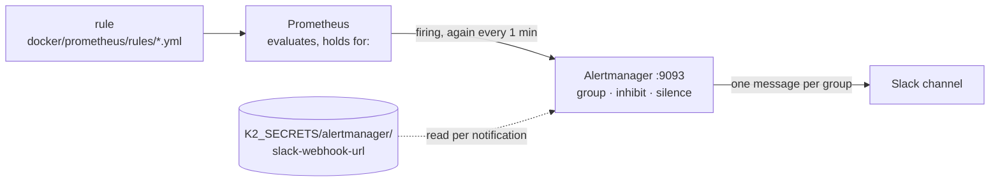

# Runbook: Follow an alert to Slack, and keep the path working

Where a firing alert goes, from its rule to the Slack channel, and the five things done to that
path: install or rotate the webhook, test delivery, silence an alert, find why nothing arrives,
and bring Alertmanager back. What a particular alert means is its own runbook's (the `runbook:`
annotation every rule carries); the design is in
[ADR-010](../adr/ADR-010-resource-budget.md)'s 2026-11-26 Alertmanager addendum and
[`docker/alertmanager/alertmanager.yml`](../../docker/alertmanager/alertmanager.yml).

**Run every command from the repo root with `set -a && . ./.env && set +a` loaded.**

> **Where these commands ran.** On 2026-11-26, against throwaway copies of the `alertmanager`
> service started from its own compose definition (`docker compose -p <scratch> run
> --service-ports`, so the image, command, mounts, limits and the 127.0.0.1:9093 port are
> compose's, under another container name), and through `make alert-test-standin`: every
> `docker exec k2-alertmanager ...` below ran as `docker exec <throwaway> ...` unless it says live.
> The live `k2-alertmanager` has run since 2026-11-26 18:19:20 UTC, and the Slack webhook has been
> installed on the live stack since 2026-11-27 (`make alerts-install-webhook`, step 3 of
> [first-cutover-to-releases.md](./first-cutover-to-releases.md)). Live, on 2026-11-27, `make alert-test`
> printed `PASS alert delivery to Slack: K2TestAlert ... sent (notifications 0 -> 1, failed 0 -> 0)`.
> The live stack is release-shaped since that day: the webhook file is one of the secret files
> a deploy requires before it recreates Alertmanager. The silence, outage and failure-alert steps
> were not induced live.

| # | Task | MTTR target | Measured |
|---|------|-------------|----------|
| 1 | Install or rotate the webhook | <2 min | taken at the next notification, no restart (2026-11-26, throwaway) |
| 2 | Test delivery | <2 min | `make alert-test` a few seconds, live: `PASS alert delivery to Slack` with the webhook installed (2026-11-27); `make alert-test-standin` 81 to 86 s (2026-11-26) |
| 3 | Silence an alert | <2 min | seconds (2026-11-26, throwaway) |
| 4 | Nothing arrives in Slack | <10 min | the failure alert fired 16 s after a failed notification (2026-11-26, throwaway); not induced live |
| 5 | Alertmanager down | <2 min | healthy 6 to 7 s after a recreate (2026-11-26, throwaway); not induced live |

---

## The path



1. **Prometheus** evaluates each rule group at its interval (30 s or 1 min for the capture,
   Airflow and disk groups; the global 15 s for the Alertmanager group). Past its `for:`
   the alert is firing, and Prometheus sends it to `alertmanager:9093` (the `alerting:` block of
   [`prometheus.yml`](../../docker/prometheus/prometheus.yml)), and again every minute while it
   fires (`rules.alert.resend-delay`, `1m` on the *live* Prometheus:
   `curl -s localhost:9090/api/v1/status/flags | jq -r '.data["rules.alert.resend-delay"]'`).
2. **Alertmanager** groups alerts by `alertname` and `component`, waits 30 s for the rest of a
   new group, then sends it. It sends a group again at most every 5 minutes while it changes,
   every 4 hours while it does not, and once when it resolves. `DockerDiskUsageCritical` mutes
   `DockerDiskUsageHigh` for the same `job` and `instance`; a silence mutes whatever it matches.
   `K2TestAlert` is the one exception: each is its own group, sent at once.
3. **The Slack receiver** reads the webhook URL from `/run/k2-secrets/slack-webhook-url`, which
   is `${K2_SECRETS:-$HOME/k2-secrets}/alertmanager/slack-webhook-url` on the host, mounted
   read-only. It reads the file at every notification. The URL is never in the repository, the
   log or `/api/v2/status`, which names the file only (`make alert-test-standin` step 9).

A message, as the stand-in for Slack received it (Slack renders `<url|text>` as a link; the
title links to http://localhost:9093, which opens on this host only):

```
FIRING: AlertmanagerNotificationsFailing (critical)
*AlertmanagerNotificationsFailing* (critical): Slack notifications are failing (other): alerts are not arriving
Runbook: <https://github.com/rjdscott/k2-market-data-platform/blob/main/docs/runbooks/where-an-alert-goes.md|docs/runbooks/where-an-alert-goes.md>
Started 2026-11-26 18:02:37 UTC
```

Only the rule's name, severity, `summary` and `runbook` annotations and its start time are sent;
a `summary` that quotes a value is the only value that leaves the host.

---

## 1. Install or rotate the webhook

**Symptom.** `make alert-test` prints `SKIP alert delivery to Slack: webhook not installed`, or
the webhook was revoked or regenerated in Slack, or the channel changes.

**Detection.** `AlertmanagerNotificationsFailing` (`alertmanager-alerts.yml`), as soon as any
alert is sent while the file is missing (`reason="other"`) or the URL is refused
(`reason="clientError"` for a 404). It is seen in Prometheus and Grafana; it reaches Slack only
once the path works again.

**Expected behaviour.** With no file, Alertmanager starts, takes alerts and shows them, and every
notification fails: one ERROR line per attempt, and the failed counter rises.

```
level=ERROR source=dispatch.go:642 msg="Notify for alerts failed" ... receiver=slack err="slack/slack[0]: notify retry canceled due to unrecoverable error after 1 attempts: open /run/k2-secrets/slack-webhook-url: no such file or directory"
```

A notification that failed goes again at its group's next send, one group interval later (5
minutes; 30 s for `K2TestAlert`), so an alert that fired before the install still arrives (seen
for a `K2TestAlert` on the throwaway, 2026-11-26). Nothing needs a
reload or a restart: the next notification reads the new file.

**Recovery**

1. Get the channel's incoming-webhook URL from Slack. It starts `https://hooks.slack.com/services/`.
2. Install it. It is read from standard input, hidden on a terminal; never put it on a command
   line, where shell history and `ps` keep it. From a file: `make alerts-install-webhook < file`.

   ```console
   $ make alerts-install-webhook
   Slack incoming-webhook URL (input hidden):
   installed /home/<you>/k2-secrets/alertmanager/slack-webhook-url (mode 600); Alertmanager reads it at the next notification, no restart. Test it: make alert-test
   ```

   It creates `${K2_SECRETS}` (700) if missing, sets `alertmanager/` to 700, and writes the file
   mode 600, **in place**: on Docker Desktop a file renamed over the old one was not seen by the
   container after 243 s, while an in-place write was seen at once (2026-11-26). Change the file
   only with this target, not with an editor that saves by renaming. If Alertmanager started
   before the directory existed, Docker made both directories empty, 755 and owned by you (Docker
   Desktop, measured); the target then sets `alertmanager/` to 700 and leaves `${K2_SECRETS}` as
   it is.
3. Test: `make alert-test` (section 2). Expect two `PASS` lines and, in Slack,
   `FIRING: K2TestAlert (info)`, then `RESOLVED: K2TestAlert (info)` about a minute later.
4. Rotating is the same two steps with the new URL; revoke the old one in Slack after the test
   passes.
5. To uninstall: `rm "${K2_SECRETS:-$HOME/k2-secrets}/alertmanager/slack-webhook-url"`. The next
   `make alert-test` prints the `SKIP` line again.

Docker Desktop shows a bind-mounted file to the container as the container's own user (`nobody`
for Alertmanager), so a mode 600 file you own is readable there. A native Docker engine does not
map owners; that case is not verified here.

**Measured.** 2026-11-26, `make alert-test-standin` steps 3 and 6: installed, then the next
notification went to the new URL; rotated, the same; Alertmanager's `StartedAt` unchanged
across both.

---

## 2. Test delivery

```bash
make alert-test
```

It checks, in order, and exits 1 on any `FAIL`, 0 on `PASS` or `SKIP`:

1. `k2-alertmanager` is running.
2. Prometheus lists it among its Alertmanagers (`/api/v1/alertmanagers`, retried for 30 s
   after a Prometheus start). An empty list after an edit of `prometheus.yml` is the file mount
   (CLAUDE.md): `docker compose up -d --force-recreate --no-deps prometheus`.
3. The webhook file exists. If not: `SKIP`, nothing sent.
4. It sends one `K2TestAlert` (severity `info`, component `alert-test`, a unique `test_id`,
   ending after a minute) and waits for Alertmanager's attempt: `PASS` when
   `alertmanager_notifications_total{integration="slack"}` rose and the failed counters did not.

What each state prints, as run on 2026-11-26:

```
# live stack, on 2026-11-26 before Alertmanager was started (it runs live now)
FAIL alertmanager: k2-alertmanager is not running (docker compose up -d --no-deps alertmanager)

# running, no webhook
PASS prometheus to alertmanager: k2-prometheus sends to 1 Alertmanager
SKIP alert delivery to Slack: webhook not installed (make alerts-install-webhook; docs/runbooks/where-an-alert-goes.md)

# installed
PASS prometheus to alertmanager: k2-prometheus sends to 1 Alertmanager
PASS alert delivery to Slack: K2TestAlert 20261126T181031Z-2727172-7986 sent (notifications 0 -> 1, failed 0 -> 0)

# a wrong or revoked URL (here a 404)
PASS prometheus to alertmanager: k2-prometheus sends to 1 Alertmanager
FAIL alert delivery to Slack: K2TestAlert 20261126T181047Z-2728065-2321 failed (failed 0 -> 1): docker logs --since 2m k2-alertmanager 2>&1 | grep 'Notify for alerts failed'
```

(The container names in the last three were the throwaways'. The `installed` case ran live on 2026-11-27: `PASS alert delivery to Slack: K2TestAlert ... sent (notifications 0 -> 1, failed 0 -> 0)`.) Slack cannot be asked whether the
message arrived; `PASS` means Slack answered `ok`. Look at the channel.

`make alert-test-standin` runs the whole path with nothing live touched and no Slack: the
`alertmanager` service from its compose definition (project `k2-alerttest`), a Prometheus with
the repository's `prometheus.yml` and Alertmanager rules, and a stand-in for Slack that records
what it receives. Nine steps, each a `PASS` or `FAIL` line: no webhook (`SKIP`, and a forced send
fails visibly), install from stdin, delivery and the payload, a repository rule's own alert
arriving through Prometheus, inhibition, rotation without a restart, a resolved message,
uninstall, and no URL in any payload, log line or status page. 81 to 86 s on 2026-11-26, 23 PASS lines, exit 0.

---

## 3. Silence an alert

**Symptom.** Planned work will fire an alert you already know about (a venue's capture stopped
for maintenance, say).

**Detection.** Not an alert: you decide.

**Expected behaviour.** The alert still fires in Prometheus; Alertmanager sends nothing for it
while the silence holds, and lists it as `suppressed`. Silences live in the `alertmanager-data`
volume: a graceful stop writes them to disk, so a silence outlived `docker stop`, removal and a
new container (2026-11-26). A kill (`docker rm -f`, an out-of-memory kill, the VM dying) loses
what changed since the last write, every 15 minutes: on the throwaway, after `docker rm -f`, an
expired silence was back and a new one was gone (2026-11-26).

**Recovery**

```console
$ docker exec k2-alertmanager amtool --alertmanager.url=http://localhost:9093 silence add alertname=CaptureDown job=capture-kraken --duration=2h --author=owner --comment="kraken maintenance"
9d1d4572-2c17-4ba7-bdca-889a2be1e2c9
$ docker exec k2-alertmanager amtool --alertmanager.url=http://localhost:9093 silence query
ID                                    Matchers                                      Ends At                  Created By  Comment
9d1d4572-2c17-4ba7-bdca-889a2be1e2c9  alertname="CaptureDown" job="capture-kraken"  2026-11-26 20:10:35 UTC  owner       kraken maintenance
$ docker exec k2-alertmanager amtool --alertmanager.url=http://localhost:9093 silence expire 9d1d4572-2c17-4ba7-bdca-889a2be1e2c9
```

A comment is required. Match on the labels the alert carries (`amtool -o extended alert query`
shows them, below); capture alerts on `up` name the venue by `job`, the rest by `exchange`.
`silence query --expired` lists the ended ones.

**Measured.** Seconds; add, query and expire each answered at once on the throwaway (2026-11-26).

---

## 4. Nothing arrives in Slack

**Symptom.** An alert is firing at http://localhost:9090/alerts or in Grafana, and no message
came.

**Detection.** `AlertmanagerNotificationsFailing` and `AlertmanagerDown`, both in Prometheus and
Grafana only while the path is broken.

**Expected behaviour.** A new group waits 30 s before it is sent, a silence or an inhibition
mutes by design, and a group already sent is sent again only when it changes (5 minutes) or
after 4 hours.

**Recovery.** In order, stopping at the first that explains it:

```bash
make alert-test
curl -s localhost:9090/api/v1/alertmanagers | jq -c '.data'
docker exec k2-alertmanager amtool --alertmanager.url=http://localhost:9093 alert query --silenced --inhibited
docker logs --since 15m k2-alertmanager 2>&1 | grep 'Notify for alerts failed'
curl -s 127.0.0.1:9093/metrics | grep -E '^alertmanager_notifications(_failed)?_total\{integration="slack"' | grep -v ' 0$'
```

| What it shows | Cause | Fix |
|---|---|---|
| `SKIP ... webhook not installed`; log `open /run/k2-secrets/slack-webhook-url: no such file or directory`; `failed_total{...,reason="other"}` | no webhook file | section 1 |
| log `unexpected status code 404`; `failed_total{...,reason="clientError"}` | the URL is wrong or revoked | section 1, with a new URL |
| `{"activeAlertmanagers":[],...}` (what the *live* Prometheus printed on 2026-11-26, before its recreate) | Prometheus runs an older `prometheus.yml` | `docker compose up -d --force-recreate --no-deps prometheus` |
| the alert listed as `suppressed` | a silence or the disk inhibition | section 3, or expected |
| `FAIL alertmanager: k2-alertmanager is not running` | Alertmanager is down | section 5 |

**Measured.** 2026-11-26, `make alert-test-standin`: a notification failed at 18:02:21 UTC
for want of the file, and `AlertmanagerNotificationsFailing` was active from 18:02:37, one
scrape and one evaluation later; installed, it reached the stand-in in its group's 30 s wait.
Not induced on the live stack.

---

## 5. Alertmanager down

**Symptom.** `AlertmanagerDown` in Prometheus or Grafana, and nothing in Slack.

**Detection.** `AlertmanagerDown` (`up{job="alertmanager"} == 0` for 2m). It cannot reach Slack
itself, and nothing outside the host watches for it.

**Expected behaviour.** Nothing is routed while it is down. Prometheus goes on evaluating and
sends every firing alert again each minute, so what is still firing arrives once Alertmanager
answers, after the 30 s group wait. Check what fired in the meantime from Prometheus (*live*,
2026-11-26: it printed the alert names, one per series):

```bash
curl -sG localhost:9090/api/v1/query --data-urlencode 'query=max_over_time(ALERTS{alertstate="firing"}[1h])' \
  | jq -r '.data.result[].metric.alertname'
```

**Recovery**

```bash
docker compose ps alertmanager
docker logs --tail 50 k2-alertmanager
docker compose up -d --no-deps alertmanager          # not run by the step that wrote this: it starts the live service
docker inspect -f '{{.State.Health.Status}}' k2-alertmanager    # healthy
make alert-test
```

After editing `docker/alertmanager/alertmanager.yml` a reload is enough (the directory is
mounted, so the edit is seen):

```console
$ curl -s -X POST 127.0.0.1:9093/-/reload
$ docker logs --tail 2 k2-alertmanager
... msg="Loading configuration file" component=configuration file=/etc/alertmanager/alertmanager.yml
... msg="Completed loading of configuration file" component=configuration file=/etc/alertmanager/alertmanager.yml
```

**Measured.** On the throwaway, stopped, removed and created again from its compose definition:
healthy 6 s after (2026-11-26; 7 s after a `docker rm -f` the same day). `AlertmanagerDown`'s 2 minutes are a promtool case, not a
live induction.

---

## Reading amtool output

Every `amtool` call needs `--alertmanager.url=http://localhost:9093`, run inside the container.
As printed on the throwaway on 2026-11-26, with a test alert, a silenced `CaptureDown` and the
two disk alerts firing:

```console
$ docker exec k2-alertmanager amtool --alertmanager.url=http://localhost:9093 alert query
Alertname                Starts At                Summary                                                                                            State
K2TestAlert              2026-11-26 18:10:31 UTC  Delivery test 20261126T181031Z-2727172-7986 from make alert-test: not an incident, nothing to do  active
DockerDiskUsageCritical  2026-11-26 18:10:35 UTC  rb test                                                                                           active
$ docker exec k2-alertmanager amtool --alertmanager.url=http://localhost:9093 alert query --silenced --inhibited
Alertname            Starts At                Summary                           State
CaptureDown          2026-11-26 18:10:35 UTC  capture-kraken is down (rb test)  suppressed
DockerDiskUsageHigh  2026-11-26 18:10:35 UTC  rb test                           suppressed
```

- A bare `alert query` lists what will be sent: `active`. `--silenced --inhibited` lists what is
  muted, `suppressed`; it does not say which, so look for a silence matching it
  (`silence query`) or its critical twin among the active.
- `-o extended alert query` adds every label and annotation and `Ends At`: the time Alertmanager
  treats the alert as resolved unless it is sent again (an alert `amtool alert add` made with no
  `--end` got five minutes).
- `config routes` prints the routing tree, and `config routes test <label=value>...` the receiver
  an alert with those labels reaches:

```console
$ docker exec k2-alertmanager amtool --alertmanager.url=http://localhost:9093 config routes
Routing tree:
.
└── default-route  receiver: slack
    └── {alertname="K2TestAlert"}  receiver: slack
$ docker exec k2-alertmanager amtool --alertmanager.url=http://localhost:9093 config routes test alertname=CaptureDown component=capture severity=critical
slack
```

To add an alert by hand, quote an annotation value that has spaces inside the flag
(`--annotation='summary="two words"'`); unquoted, amtool warns that its new parser fell back to
the old one.

---

## Failure modes / incidents

- **2026-11-26**, building it: through Docker Desktop's file sharing a webhook file renamed over
  the old one stayed unseen by the container for the whole 243 s measured, while an in-place
  write was seen at once. `make alerts-install-webhook` writes in place.
- **2026-11-26**: `amtool alert add` with `--end` and no `--start` starts the alert at its end
  time, so the message's "Started" was a minute late. `make alert-test` passes both.

---

**Last verified:** 2026-11-26 against `step/s09-alertmanager` on throwaway copies of the service
and `make alert-test-standin`; on the live stack, 2026-11-27, only `make alert-test` (the delivery
PASS above, webhook installed); the silence, failure-alert and outage recoveries are not induced live.
