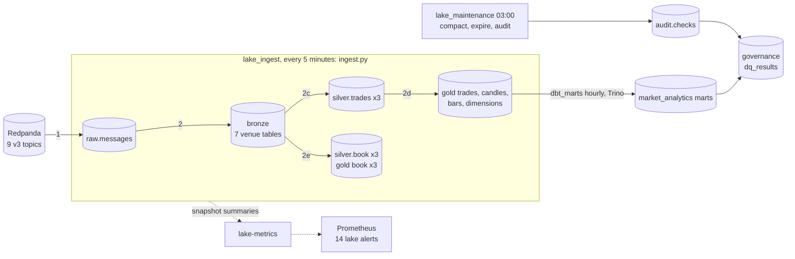

# The v3 lake ingest pipeline (archived)

This directory holds the single pipeline that wrote the v3 lake from Phase D (`e2a2651`,
2026-08-27) until it was retired on 2026-11-26: the ingest and its stages, nightly maintenance,
the rebuild, the metrics exporter, the four Airflow DAGs that scheduled them, the thirteen
old-format product contracts, the dbt marts built on its tables, the research notebooks, the
parity, verify, replay and chaos scripts, their tests, and the documents that described it
running. Its tables were copied and then dropped on 2026-11-26 ([State at archive](#state-at-archive)).
Nothing here is started, scheduled or run by `make test`; CI builds one archived Dockerfile and
runs its self-check, and nothing else ([Known residue](#known-residue)). See [`../README.md`](../README.md) for the
archive rules.

The files moved exactly as they were, in one commit of 125 pure renames (`6429a58`). A later
commit (`538ea1e`) repointed the relative link targets inside 18 of the archived Markdown
documents so they resolve from their new depth, and changed nothing else on those lines (each
changed line matches a removed one once its `](target)` is blanked); it also added one archived
dbt macro. Paths written as prose or code (`docker/lake/`, `docker/airflow/dags/`, `notebooks/`,
`scripts/`, `tests/`) were not rewritten, so they name where things were in the live tree.

```text
legacy/v3-lake-ingest/
  lake/            ingest.py and its stages, maintenance.py, rebuild.py, metrics.py, ddl/lake.sql (was docker/lake/)
  lake-metrics/    the exporter's Dockerfile (was docker/lake-metrics/)
  airflow/dags/    lake.py (lake_ingest, lake_maintenance, lake_rebuild) and dbt_marts.py (was docker/airflow/dags/)
  airflow/tests/   the two DAG suites (was docker/airflow/tests/)
  contracts/       the 13 old-format products and their 26 ODCS table contracts (was contracts/)
  dbt/             the domain marts and their staging models, and the project's README (was dbt/)
  notebooks/       five notebooks and k2lake.py, a uv project of its own (was notebooks/)
  scripts/         lake-verify, the OHLCV, bar and trade parity, the replay export, four lake faults (was scripts/)
  tests/           the pytest suites of the above, and the parity pin (was tests/)
  docs/            chapters 08 and 09, three operations documents, the lakehouse labs, seven runbooks (was docs/)
```

## What it was

One Airflow DAG, `lake_ingest`, ran one Spark program every five minutes (cron `1-59/5`):
`docker exec k2-spark-iceberg python3 /home/iceberg/lake/ingest.py`. That one run read every
venue's Redpanda topics and wrote every layer for every venue, each stage reading its parent from
the snapshot it last committed, so a re-run with nothing new committed nothing
([`lake/README.md`](lake/README.md), [`docs/architecture/08-lake-ingest.md`](docs/architecture/08-lake-ingest.md)):

| Stage | Module | Writes |
|---|---|---|
| 1 | `ingest.py` | `raw.messages`: every record of the nine v3 topics byte for byte, with the Kafka end offsets in the same Iceberg commit ([ADR-022](../../docs/adr/ADR-022-exactly-once-via-snapshot-offsets.md)); then the batch audit of that commit ([ADR-047](../../docs/adr/ADR-047-ingest-batch-audit-after-publish.md)) |
| 2 | `bronze.py` | seven `bronze.<venue>_<message>` tables in each venue's own field names |
| 2c | `silver.py` | `silver.trades_{binance,kraken,coinbase}`: one typed row per trade, canonical symbol, replay, gap and precision flags |
| 2d | `gold.py`, `scd2.py` | `gold.trades`, `gold.ohlcv_{1m,5m,1h,1d}`, `gold.bars`, and the type-2 dimensions `gold.dim_instrument` and `gold.dim_venue` ([ADR-030](../../docs/adr/ADR-030-scd2-security-master.md)) |
| 2e | `books.py` (kept in `docker/lake/`) | `silver.book_{binance,kraken,coinbase}`, `gold.book_top20`, `gold.bbo_1s`, `gold.book_state` |

Three more DAGs, all in [`airflow/dags/`](airflow/dags/):

- **`lake_maintenance`**, 03:00 UTC: `maintenance.py` compacted, expired snapshots, removed
  orphan files, then ran the nightly audits into `audit.checks` (`contract_schema`,
  `offset_continuity`, `duplicate_identifiers`, `bronze_unparseable`, `bronze_schema_drift`,
  `silver_parity`, `silver_flags`, `gold_parity`, `ohlcv_parity`, `bars_parity`,
  `kraken_checksum`). A failure exited non-zero and fired `LakeAuditFailed`. The ingest filed its
  own findings in the same table (`offset_gap`, `batch_offsets`, `bronze_parity`), and operators
  filed `job = 'operator'` rows for events no check can see.
- **`lake_rebuild`**, manual only: `rebuild.py` dropped one layer and recomputed it from its
  parent over the whole archive.
- **`dbt_marts`**, hourly at minute 10: astronomer-cosmos ran the dbt project on Trino, each
  domain as its own writer ([ADR-035](../../docs/adr/ADR-035-trino-and-dbt-for-marts.md),
  [ADR-044](../../docs/adr/ADR-044-producer-lake-and-domain-mart-warehouses.md),
  [ADR-046](../../docs/adr/ADR-046-governance-domain-and-quality-results.md)):
  `market_analytics.candles.ohlcv_1m`, the view `delayed_candles.ohlcv_delayed_20m`,
  `venue_quality.venue_quality_scorecard`, and the governance view
  `quality_results.dq_results` over every domain's `dq.dbt_test_results` and the lake's audit
  rows.

One file lock (`lock.py`) made every writer serial: an ingest that found it held exited 75, which
the DAG mapped to skipped. Watching it: the `lake-metrics` exporter (`metrics.py` on its own image)
read snapshot summaries over the catalog's REST API for Prometheus, which held 14 rules in
`docker/prometheus/rules/lake-alerts.yml` and four more on these DAGs in `airflow-alerts.yml`, and
Grafana's K2 Lake dashboard. The gates over it: `make lake-verify` (exactly-once and layer
parity on the live tables), `make parity-ohlcv` and `make parity-bars` (candles and bars
recomputed by a second engine at the snapshot pinned in `tests/parity/pinned.json`),
`make test-notebooks`, the four lake faults of `make chaos`, and `make backup`'s copy of four fixed
tables.



## Why it was archived

[ADR-056](../../docs/adr/ADR-056-unified-data-product-platform.md) (Accepted 2026-11-26) rebuilds
K2 as one data product platform in which each dataset brings its own data in. Its Context names
what this pipeline's shape cost: after [ADR-050](../../docs/adr/ADR-050-order-book-capture-paused-during-platform-build.md)
switched one venue's order book off, the next `lake_ingest` run failed at its book step, so a step
for a product nobody was feeding failed the run every venue depends on (fixed by #238); and the
one job was near its slot, with a p90 of 253 s against the 300 s between runs, past
[ADR-034](../../docs/adr/ADR-034-airflow-3-replaces-prefect.md)'s 240 s trigger, which had fired on
2026-11-25.

The plan review's critical finding F1 is why it went in the first phase rather than later
([`FULL-PLAN-REVIEW.md`](../../docs/research/2026-11-26-unified-platform-architecture/FULL-PLAN-REVIEW.md)):
the next phase moves the compiler to the new document format, takes generated files out of git,
runs compose from a release and makes the domain catalogs read-only, all things this pipeline
depended on. Keeping it alive through that "means a dual-format compiler or two deploy models.
Retire it in N0." The plan's phase 000 does
([`000-clear-the-ground.md`](../../docs/plans/2026-11-26-unified-product-platform/000-clear-the-ground.md),
Wave 3).

**The cost, plainly** (phase 000, "What this phase costs"):

- **No live crypto data reaches the lake** from the drop until phase 004 lands `kraken-trades`;
  Coinbase and Binance return in phase 001 of the plan to release.
- The captures keep writing to Redpanda, which keeps a raw topic's records for 48 h or 2 GiB per
  partition, whichever binds first (`docker/redpanda/init.sh`, `RAW_RETENTION_MS` and
  `RAW_RETENTION_BYTES`). `kraken-trades` starts at the log start when it first runs; anything
  captured earlier than that is never in the lake.
- Every dashboard, notebook, lab and screenshot that read the old tables is stale or retired;
  `make lake-verify` and the 2026-11-25 parity pins stop being live gates.
- ClickHouse's reload from lake gold went with gold, so the paused hot tier can resume only from
  topics within their 7 days ([ADR-057](../../docs/adr/ADR-057-clickhouse-hot-tier-paused-during-platform-build.md)).

Until the `v3.0.0` tag the platform is a lab whose data may be dropped after a backup
(`CLAUDE.md`, "Where this is going"; ADR-056), which is what made the cost acceptable.

## What replaced each piece

Phase files are in [the plan to the demo tag](../../docs/plans/2026-11-26-unified-product-platform/)
and, marked "to release", in
[the plan to release](../../docs/plans/2026-11-26-unified-product-platform-to-release/). The table
in the first plan's README, "Existing products and open items: where each goes", is the authority;
this is that table by piece of code.

| Here | Successor | Phase |
|---|---|---|
| Stage 1 and `raw.messages`, one archive of every frame | none shared: the Kafka connector lands each product's topic in its own landing, still resuming exactly once from the snapshot | [`004`](../../docs/plans/2026-11-26-unified-product-platform/004-kraken-trades-instruments-security-master.md) |
| Stages 2 and 2c, the venue bronze and silver tables | per-venue `-trades` and `-instruments` products: Kraken, then Coinbase and Binance | `004`; to release [`001`](../../docs/plans/2026-11-26-unified-product-platform-to-release/001-widen-crypto.md) |
| Stage 2d: `gold.trades`, candles, the dimensions | `canonical-trades`, `candles` at every timeframe and `security-master`, as dbt products | `004` |
| `gold.bars` | `event-bars`, a registered code transform | to release `001` |
| Stage 2e and the book tables | none: the book data is let go, `venue-books` is declared paused and `book-snapshots` retired (ADR-050 Outcome) | `000`; to release `001` |
| `audit.checks` and the nightly audits | run records (`governance.run-records`), audits scoped to each batch, whole-table checks in maintenance | [`002`](../../docs/plans/2026-11-26-unified-product-platform/002-run-spine-through-ecb-fx.md), `004` |
| `maintenance.py` | maintenance per product: compaction, orphan cleanup, checks, expiry | `004` |
| `rebuild.py` and `lake_rebuild` | `make rebuild` | `004` |
| `lake_ingest`, `lake_maintenance` | one DAG per product, generated from a release, with a daily maintenance task | `002` |
| `dbt_marts` and its marts | the dbt runner and wrapper; `quality-results` first, `delayed-candles` retired for the `delay` policy on `candles`, `venue-quality` rebuilt on run records | `002`; `004`; to release `001` |
| `lake-metrics`, the 14 lake alerts, the four DAG alerts, the K2 Lake dashboard | generated per-product dashboards and alerts; objective and duration alerts later | `004`; to release [`002`](../../docs/plans/2026-11-26-unified-product-platform-to-release/002-controls-alerts-release-engineering.md) |
| `make lake-verify` | `make product-verify` | `004` |
| `make parity-ohlcv`, `make parity-bars`, the pin | `make parity-silver`, `parity-ohlcv` re-pinned on Kraken; both parities re-pinned over three venues | `004`; to release `001` |
| `replay_export.py`, `replay-lake.sh` | the replay export over the Kraken landing, in the tools container | `002`, `004` |
| `notebooks/` (DuckDB with the storage root key) | notebooks through Trino as a named principal, on the new names | `002`, `004` |
| `make backup`'s four fixed tables | the backup set compiled from contracts | `002` |
| The four lake faults | a killed Kafka connector, a start below the log start; a MinIO or Lakekeeper stop is not named in either plan | `004` |
| The 13 old-format contracts, `lake.sql`, `apply_ddl.py` | ODPS products and ODCS contracts, DDL emitted by the new compiler | [`001`](../../docs/plans/2026-11-26-unified-product-platform/001-release-and-rules-spine.md) |

## State at archive

Done on the live stack on 2026-11-26 as Wave 3 of plan phase 000. The evidence is on the host,
outside the repository: `~/k2-backup/drop/retire-live-2026-11-26.log` for the sequence, and
`~/k2-backup/drop/2026-11-26/` for a `drop-<target>.log` and a manifest `<target>.<time>Z.json`
per target.

1. **Proved first.** `make gates` passed on the rebased Spark image against the live old pipeline
   (`~/k2-backup/drop/gates-new-image-2026-11-26.log`), as Wave 3 step 1 requires.
2. **Run lists saved**, then the DAGs paused for good. `airflow dags list-runs <dag> -o json` for
   each into `dag-runs-<dag>.json`, then `lake_ingest`, `lake_maintenance`, `lake_rebuild` and
   `dbt_marts` paused. The saved `lake_ingest` list caught its 14:56 run still `running`, so the
   script then waited until no Spark driver or Python process ran in `k2-spark-iceberg` and every
   queued or running run of the four DAGs had all its tasks finished: true at 14:59:49 UTC (the
   log's `idle at` line). That run's only task, `ingest`, had ended at 14:59:25 (`task_instance`
   in the Airflow database dump of 14:59:55); Airflow stamped the run itself ended at 15:00:05.
   The backup ran from 14:59:55 and the first drop began at 15:01,
   after the dry runs. The last run of each:

   | DAG | Last run | State | UTC |
   |---|---|---|---|
   | `lake_ingest` | `scheduled__2026-11-26T14:56:00+00:00` | `success` | 14:56:29 to 15:00:05 (the saved list caught it still running; the end is Airflow's, read after the drop) |
   | `lake_maintenance` | `scheduled__2026-11-26T03:00:00+00:00` | `success` | 03:00:00 to 03:44:30 |
   | `lake_rebuild` | `manual__2026-11-25T04:28:34.320970+00:00` | `failed` | the only run Airflow holds, 1 s long; its cause is not recorded |
   | `dbt_marts` | `scheduled__2026-11-26T14:10:00+00:00` | `success` | 14:10:00 to 14:10:52 |

3. **`make backup`**, 14:59:55 to 15:00:00 UTC (`~/k2-backup/STATUS.json`): its four fixed tables
   (`raw.messages`, `audit.checks`, `gold.dim_instrument`, `gold.dim_venue`) brought up to date in
   `~/k2-backup/lake/`, and the catalog and Airflow databases dumped to `~/k2-backup/catalog/`.
4. **Dry runs** of all sixteen targets, then **`make drop`** on each in this order: each copy
   compared by object count and bytes with MinIO before anything was dropped ("match" in every
   `drop-<target>.log`), then each table purged through Lakekeeper and its namespace dropped.

   | Target | What | Objects | Bytes | Manifest (UTC) |
   |---|---|---:|---:|---|
   | `market_analytics.candles` | 1 table | 485 | 151,640,703 | 15:01:07 |
   | `market_analytics.delayed_candles` | 1 view | 35 | 30,707 | 15:01:20 |
   | `market_analytics.venue_quality` | 1 table | 179 | 854,651 | 15:01:29 |
   | `market_analytics.staging` | 3 views | 100 | 62,568 | 15:01:40 |
   | `market_analytics.dq` | 1 table | 576 | 4,338,983 | 15:02:10 |
   | `governance.quality_results` | 1 view | 20 | 23,908 | 15:02:21 |
   | `governance.staging` | 2 views | 40 | 26,532 | 15:02:30 |
   | `governance.dq` | 1 table | 119 | 557,240 | 15:02:51 |
   | `k2.scratch_p4` | 2 tables | 107 | 339,349 | 15:03:05 |
   | `k2.scratch_p4_pr1` | empty namespace | 0 | 0 | 15:03:22 |
   | `bucket:scratch-p4-landing` | bucket, **not dropped** (below) | 13, and 19 object versions | 2,432, and 2,814 | 15:03:26 |
   | `k2.gold` | 11 tables | 34,994 | 8,520,990,965 | 15:04:50 |
   | `k2.silver` | 6 tables | 11,659 | 13,757,246,800 | 15:07:28 |
   | `k2.bronze` | 7 tables | 12,757 | 14,714,348,632 | 15:08:49 |
   | `k2.raw` | 1 table | 8,746 | 27,601,248,956 | 15:10:56 |
   | `k2.audit` | 1 table | 84 | 466,114 | 15:11:08 |
   | **Total** | | **69,914** | **64,752,178,540** (60.31 GiB) | |

   Sums of the manifests' `objects` and `bytes`; `du -sh ~/k2-backup/drop/2026-11-26` prints 61G,
   which includes the bucket's versions and the logs.
5. **After.** `SHOW SCHEMAS` in Trino lists only `information_schema` and `system` in the catalogs
   `lake`, `market_analytics` and `governance` (the log's last lines; read again later that day, the
   same, and the same in `fx_reference`, `market_capture` and `reference_data`).

**Not dropped: the bucket `scratch-p4-landing`.** Its objects are under MinIO object lock, which
refuses to delete a locked object version before its retention date: `make drop` copied and
compared it, then `mc rb --force` failed with "is WORM protected and cannot be overwritten"
(`drop-bucket:scratch-p4-landing.log`). All 19 versions are locked, one of them in `COMPLIANCE`
mode, which no user can lift early, and the last lock expires at 2026-11-27T06:00:18Z
(`mc retention info --json --recursive --versions k2/scratch-p4-landing`, read 2026-11-26). The
bucket still exists at this writing and is to be dropped after that time; until then it is both in
MinIO and in the copy.

Also not dropped: the Airflow records of the four DAGs were deleted later the same day
(`airflow dags delete`), once the DAG files were archived; their run history survives in the saved
run lists and in the Airflow database dump of 14:59:55 UTC, both copied into
`~/k2-backup/drop/2026-11-26/` so the nightly backup's pruning of old dumps cannot remove them; the Redpanda topics, which the captures
still write; the empty warehouses.

## Running or verifying it today

Nothing here runs on the stack. Compose no longer defines `lake-ddl` or `lake-metrics`,
`docker/airflow/dags/` holds no DAG, and every table this code reads is dropped. Bringing it back
is not a supported path; phase 004 rebuilds what it did as products. What can be checked, each
command run from the repository root on 2026-11-26 on the retirement branch, with what it printed:

```bash
# The move commit, and that it changed no file.
M=$(git log --format=%H -1 -M --diff-filter=R -- legacy/v3-lake-ingest/lake/ingest.py docker/lake/ingest.py)
git show --stat -M100% --format= "$M" | tail -n 1
#   125 files changed, 0 insertions(+), 0 deletions(-)
# The live tree as it last ran, for any file; here the compose service that applied lake.sql.
git show "$M^:docker-compose.yml" | sed -n '/^  lake-ddl:/,/^  [a-z].*:$/p'

# The pytest suites, with the archive's modules on the path.
PYTHONPATH=legacy/v3-lake-ingest/lake:docker/lake:platform/k2gen uv run --no-project \
  --with pytest==9.2.0 --with pyyaml==6.0.4 --with fastavro==1.12.2 --with duckdb==1.4.4 \
  pytest legacy/v3-lake-ingest/tests -q -p no:cacheprovider --rootdir legacy/v3-lake-ingest \
  --continue-on-collection-errors
#   19 failed, 253 passed, 22 errors

# The notebook helper, in its own uv project (its .venv is git-ignored).
(cd legacy/v3-lake-ingest/notebooks && uv sync -q --locked && uv run --locked pytest -q -p no:cacheprovider)
#   15 passed

# The two DAG suites, in the Airflow image.
docker run --rm --network none -e AIRFLOW__LOGGING__LOGGING_LEVEL=WARNING \
  -e AIRFLOW__COSMOS__ENABLE_CACHE_DBT_LS=False -v "$PWD":/repo:ro -v "$PWD/dbt":/opt/k2/dbt:ro \
  k2-airflow:3.3.2 python -m unittest discover -s /repo/legacy/v3-lake-ingest/airflow/tests
#   Ran 18 tests ... FAILED (failures=1, errors=19)

bash legacy/v3-lake-ingest/scripts/lake-verify.sh --help
#   legacy/v3-lake-ingest/scripts/lake-verify.sh: line 39: ./chaos/lib.sh: No such file or directory
```

- **The pytest suites fail on moved paths and one moved constant**, not on their logic as far as
  the errors show: the tests resolve `docker/lake/ddl/lake.sql`, `docker/lake/gold.py`,
  `config/bars.yaml`, `schemas/avro/`, `tests/fixtures/bronze/` and the `Makefile` from their own
  parent directory, which is now this one, and `maintenance.py` and `rebuild.py` import
  `MAINTENANCE_DRIVER_MEMORY`, which the kept `docker/lake/spark_conf.py` no longer defines.
- **The notebook helper's tests pass** (`k2lake.py` against synthetic DuckDB tables). The
  notebooks themselves read the dropped tables.
- **The DAG suites find no DAG**: each resolves the repository as three directories above itself,
  here `legacy/`, and loads `legacy/docker/airflow/dags`, which does not exist.
- **The exporter's image builds**, in CI only: the required check "Docker build (lake-metrics)"
  builds `lake-metrics/Dockerfile` and runs `metrics.py --self-check` from this directory in it
  (`.github/workflows/ci.yml`).
- **`scripts/lake-verify.sh` and the four `scripts/chaos/lake-*.sh` cannot start.** Each sources
  the chaos `lib.sh` relative to its own directory, and this archive has none. The two helpers
  they call, `pause_lake_ingest` and `resume_lake_ingest`, were removed from the live
  `scripts/chaos/lib.sh` by the same retirement and exist only in git history
  (`git show "$M^:scripts/chaos/lib.sh"`). Do not run the chaos scripts in any case: each injects
  a fault into the live stack.
- **The parity and replay scripts and the dbt models** read the dropped tables, and the live dbt
  project no longer contains these models.

### Reading or restoring the old data

Each table's copy under `~/k2-backup/drop/2026-11-26/<target>/<table>/` is its Iceberg directory,
`metadata/` and `data/`, and the manifest names its location in MinIO and its metadata file. Every
path inside Iceberg metadata is absolute, so a table comes back by putting its files at their old
keys and registering the metadata file: [`docs/runbooks/drop-and-rebuild.md`](../../docs/runbooks/drop-and-rebuild.md),
section 3, "Restore a dropped table from its copy", whose last step reads the table back through
Trino. Read the Parquet under `data/` directly only through the metadata: files that compaction
replaced are still in that directory, so reading every file there is not the table.

**The copy is not a backup against disk loss.** It, `make backup`'s copy in `~/k2-backup/lake/` and
the MinIO volume are all on the host's one disk. An off-host copy is the hardening phase's
([to release `004`](../../docs/plans/2026-11-26-unified-product-platform-to-release/004-hardening.md)).

## Known residue

- **The bucket `scratch-p4-landing`**, until its object lock expires (above).
- **CI still builds the exporter**: "Docker build (lake-metrics)" is a required status check on
  `main` (branch protection, the owner's setting), so the leg builds the archived Dockerfile to stay
  green. The owner may remove the leg and the required check together.
- **Not tracked for advisories**: `.github/dependabot.yml` has no entry for `notebooks/` or the
  exporter's `FROM python:3.15.1-slim-trixie` here, and both Trivy scans skip `legacy/`.
- **Not gated**: `scripts/check-docs.sh` link and word gates do not scan this README or the archived
  documents (only the em-dash gate reads added lines here); its links were checked by hand.
- **Kept in the live tree for reuse** in `docker/lake/`: the plan names `offsets.py`, the framing
  half of `wire.py`, `bars.py` and `books.py`, and `catalog.py`, `book.py` and `instruments.py`
  stay because those import them ([`docker/lake/README.md`](../../docker/lake/README.md), "What
  stays, and why"). The tables `books.py` names are dropped.
- **Immutable records still name the old tables, DAGs and paths as they were**: the ADRs, the
  audits, the benchmarks, the research notes, the plans and `docs/MIGRATION-JOURNEY.md`.
- **The 2026-11-25 parity pin** in `tests/parity/pinned.json` names snapshots of dropped tables;
  only a restore makes it readable.
